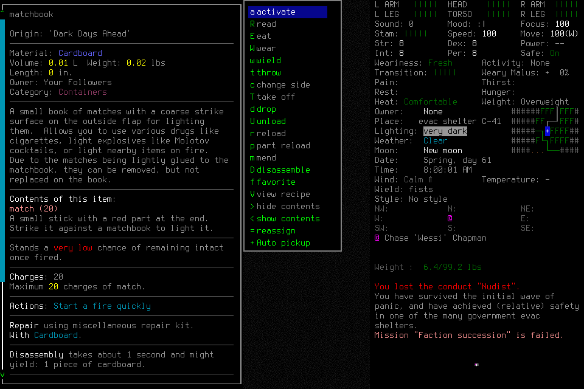
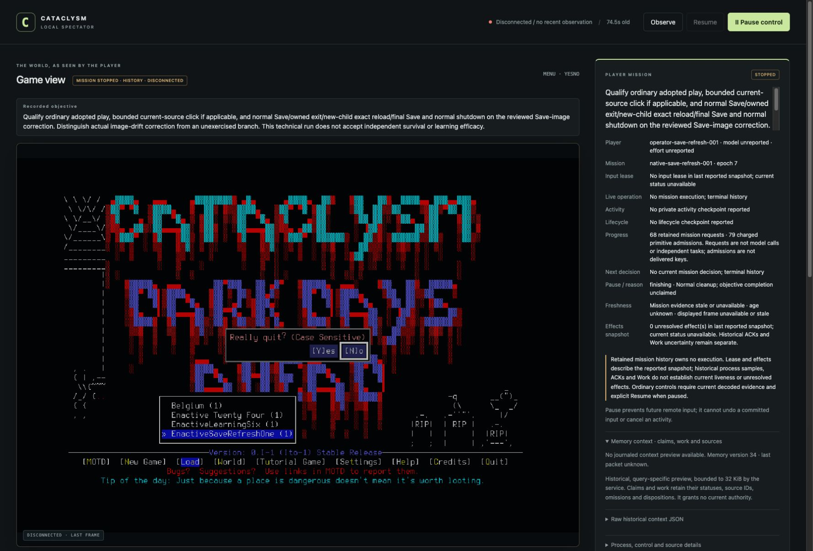

# Native001: ordinary click and exact normal lifecycle

**Scoped technical outcome accepted by independent evidence review.** Robin in
EnactiveSaveRefreshOne was normally created/adopted, used ordinary input, saved,
exited normally, reloaded the exact checkpoint in a new owned child, moved one tile
and completed final normal Save/exit/FinishStopped. The lead sent no game inputs
or tactical rescue after activating the operator.

This does **not** qualify the Save-image correction branch: neither Save start
encountered image drift. Persistent visual churn can still prevent strict final
dispatch. No non-unit mapping, general mouse parity, seven-day survival or causal
learning benefit is established.

## Frozen configuration

Source `ce5677a8a63f5323d814164d17d477dcd7837d91`; native
`ce810d3a2ee05517c5ead7b56caba7de42b4d4f0c729cea7551a327aaf0ec45e`.
Prepared English default Evacuee/Survivor, windowed/background wrapper and project
userdir. No source/native/configuration changed during the run. A clean mechanical
lead registrar submitted the whole admission once because the lead host cached an
obsolete tool schema. The operator catalogue was verified as mission/10, policy/2
and native6; unsupported shapes were not coerced.

Five prospective files froze objective, actor, scenario, limits and forecast before
Start. Admission selected 512 inputs/mappings, 384 requests, 2,048 frames/512 MiB,
7,200 wall seconds and 3,600 game seconds; 128 inputs/900 wall seconds/256 frames/
64 MiB were protected for ending. No extension or refund occurred. No learning
library or adviser was admitted; model/effort were recorded as unreported at freeze.

[Exact candidate CI](https://github.com/CVX-Hull/enactive/actions/runs/39778360305)
passed 1,586 tests in 898.190 seconds and full portable checks. That is source
evidence, separate from this native run and protected-main acceptance.

## Actual input and lifecycle

`nsr001-click-matchbook` delivered one left click at native output pixel (100,343),
with window/output 960×640 and viewport [0,0,960,640]. Actual informing, preflight
and after-click images were inspected independently. The click opened the matchbook
information/action menu; normal dismissal returned to inventory with the matchbook
selected, then to play. A returned ACK alone would not prove this effect. This is
one unit-geometry target, not full mouse or non-unit qualification.

| Boundary | Actual evidence |
| --- | --- |
| Initial adoption | Robin / EnactiveSaveRefreshOne, turn 5212800; `nsr001-adopt` |
| Ordinary interaction custody | Direct wait advances to 5212801 before Save |
| First Save | `nsr001-save-transition`, normal endpoint turn 5212801 |
| First owned exit | `nsr001-exit-yes`: OwnedNormalExit, return code 0 |
| Distinct child and exact reload | `nsr001-reload-adopt`: same world/Robin, first normal turn 5212801, new launch/session and coordinate epoch |
| Actual continuation | `nsr001-reload-step`: RIGHT moves [0,0,0]→[1,0,0], turn 5212802 |
| Final ending | `nsr001-save-final-transition`, second OwnedNormalExit return code 0; `nsr001-finish` records FinishStopped without a completed-objective claim |

One world-name edit was blocked with zero primitives because the editor was not
open. The operator then opened it through a new menu decision and edited normally,
without lead intervention. The original rejection stays blocked.

All six native unknown ACKs remain unknown. Separate lifecycle/effect/owned-exit
proofs resolve their effects without replay. All 67 operator operation handles
ultimately settled; the registrar's separate Start makes 68 retained requests.

## Closed accounting and verification

| Measure | Verified result |
| --- | --- |
| Requests | 68: 27 completed, 36 partial, 1 blocked, 4 unknown |
| Charged inputs/mappings | 79: 73 returned, 6 unknown |
| Images | 210 original PNGs, 8,427,188 bytes; every SHA-256 verified |
| Game time | 2 seconds, with exact midpoint reload and no time reset |
| Start→normal-Finish event | 837.536 seconds, shared host wall-clock span; not model compute or input latency |
| Closed ledger | Stopped / epoch 7 / zero unresolved effects |
| Cleanup | Both native exits normal; actors terminal before controller close; controller exited 0, game and port 8766 listener absent |

Independent review verified all five closed artifacts and five frozen pins,
SQLite integrity, critical images and host presentation, original result collection,
normal lifecycle and counts. Presentation does not establish attention. Raw host
traces remain private; they contain account/encrypted fields. The closed ledger's
later wall watermark includes passive inspection and controller closure; it is not
substituted for the earlier normal-Finish event.

## Terminal presentation finding

The terminal view correctly says STOPPED / HISTORY / DISCONNECTED, no current
mission decision and zero unresolved effects. However, `controller.error` retains
the timeout imperative “Observe to reconcile, then resume” while `last_result.error`
is empty after an error-free Pause receipt. The last-command-only label missed
this production shape. [#143](https://github.com/CVX-Hull/enactive/issues/143) owns
the bounded wording follow-through. Its subsequent renderer/test change is source
evidence, not retroactively present in this frozen run.

The [work map](../work.md) links the full delivery and campaign requirements.
[#195](https://github.com/CVX-Hull/enactive/issues/195) retains image-drift scope;
[#176](https://github.com/CVX-Hull/enactive/issues/176)/[#181](https://github.com/CVX-Hull/enactive/issues/181)
retain wider input/geometry qualification. Failed fresh005 stays failed and closed.
