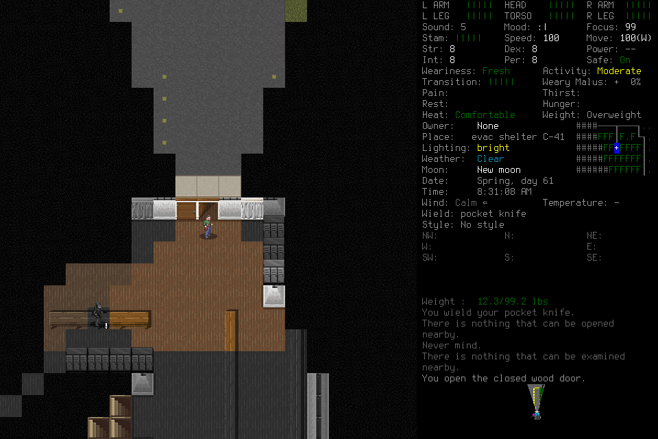

# Learning009: independent learning works within a narrow scope; cadence fails

Two successive independent Sol/low players and one bounded Sol/medium adviser
ran frozen source `e174bff3f73ca659e5bc6da904d83b7a43812210`, native
`690fe96e27e5d31046e1600918caad1ccd9f5964ff291ea9b01a33d4f25a86b1`,
MCP5.1/player-view4 and mission/11/procedure/3. This loaded the existing
EnactiveLearningSix/Casey save under a new admission with no historical library.
The lead admitted, observed and started the registered clean successor after the
original host exited. It supplied no tactics, keys, procedure code or memory
curation. No source patch, restored save or budget extension occurred during play.

Independent evidence review finds bounded positive organic learning, including
actual useful play during claimed reflection. The successor's conservative final
statement did not establish that overlap; the retained intervals and PNGs do.
The combined outcome remains unaccepted because useful apparent cadence fails.
This is not the fresh seven-day campaign or causal evidence of learning benefit.

## What actually happened

| Requirement | Observed evidence and limit |
| --- | --- |
| Ordinary discovery | Player opened a door/curtains, surveyed items and talked to Rickey. Patient-list task accepted; no quest completion or supply gain. No lead/user rescue. |
| Executable authorship | Player authored revision1 (`180ade6…143`); `op-5ca726ba2ac84c0dad45ebeafa18678b` delivered five cardinal steps with six fresh evaluations and checked displacement. |
| Distinct useful reuse | Revision2 moved west two tiles and yielded before furniture, then south three tiles toward Rickey for dialogue. Requests `op-11bdfb1d2a584fb097f93e8b20fbe303` and `op-f8a481e7ae6e4745b519128cba088d12`. Narrow shelter-floor scope, not general navigation. |
| Changed-condition revision | Door opening changed visibility without displacement and revealed an NPC. Revision2 added explicit nonhostile consent. Actual advice identified missing NPC tile positions; revision3 restricted NPC-visible use to one inspected step. No experienced collision or universal safety rule is claimed. |
| Fresh-context application | Clean successor retrieved context and actual sources, corrected its incomplete read declaration, claimed/readmitted, then executed revision3 east once with `op-9bf487697ce547289a009ee86baead10`. Retrieval alone is not the evidence of use. |
| Useful play during pending advice | Job2 claimed at mission+179.336s, submitted+193.247s; door action produced visible opening/light/NPC at+185.593s. Job3 was claimed+243.990s through+261.497s; survey/TAB produced the empty-item observation at+257.529s. Both are actual effects during claimed work, not passive overlap. |
| Normal lifecycle | Save checkpoint `op-9118b5b93c014f7d84b5b3cb7c8f5f7c`, old-child exit0, new launch `82446a076ad64201ac9b0de991098130`, fresh Casey adoption `op-ae9e1b115e024cf09101a65c1a1aaddf`, ordinary continuation, final Save/exit0 and Finish `op-94d45776a1ab4a019be9e81d316a468d`. |
| Accounting | Original reserves intact; six historical transport-unknown primitives remain recorded, with zero mission-unresolved effects. Operator Pause/takeover was not exercised. |

The first world identity Claim used the actual `UILIST` image, exercising the
generic owned-provenance repair motivated by [closed008](../changes/062-player-decision-context.md#closed008-valid-world-evidence-rejected-by-menu-taxonomy).
Ordinary malformed limits, incomplete handoff/source declarations and a
cross-session citation were refused and corrected by the players. These are
retained costs and independent recovery, not error-free operation.

## Responsiveness and context

The mission advanced16game seconds in907.698mission-wall seconds. The two active
deciding hosts lasted485.016s and365.150s; their sum excludes the intervening
handoff/start gap and is not the whole mission time. A dialogue source aged96.37s
and its phase expired before recovery. Only five program invocations occurred,
including yields and one successor step; they do not qualify the frozen20-skill
representative useful cohort, whole-player p95<=2s or absence of routine stalls.
Short local routine execution cannot hide acquisition, repair or context costs.

Timestamped records from these exact two owned CLI sessions identify compaction
events after gaps of89.986s and63.326s. Both profiles explicitly forced
`model_auto_compact_token_limit=128000`. The last reported inputs before those
events were125,504 and127,593tokens; the host reported a475,000-token context
window. These event intervals associate the stalls with compaction; they do not
isolate network, model compute or a universal compaction duration. Only event
types/timestamps and usage metadata were extracted; private reasoning was not
copied into project evidence.

The [official configuration reference](https://developers.openai.com/codex/config-reference)
defines the setting as an automatic-compaction threshold and uses model defaults
when unset. Remove the arbitrary override in the next prospective profile,
retaining the original run unchanged. Do not invent a larger model window, disable
compaction globally or claim responsiveness from configuration alone. Keep
campaign memory separate from a host's fallible context summary. Further context
reduction must preserve decisions, actual images, outstanding effects and exact
detail access; byte reduction alone is not a useful-play result.

## Cost, closure and follow-through

| Active host | Completed MCP calls | UTF-8 response-text bytes | Typed images | Wall span |
| --- | ---: | ---: | ---: | ---: |
| Original player | 54 | 329,281 | 38 | 485.016s |
| Clean successor | 60 | 304,455 | 33 | 365.150s |
| Adviser | 30 | 143,029 | 6 | 572.841s |

Separate player preflight adds1call/1,682text bytes/no image; adviser preflight
has no calls. Tool-level error flags do not count semantic refusals. Raw host
usage counters are retained without summing them as unique context or billing.
The adviser completed8jobs, charging960seconds of claim windows, not960compute
seconds. Some later notes were correctly identified as mechanical bookkeeping.

Final ledger:79requests,57charged primitives (51returned/6unknown),167frames and
17,354,496frame bytes. Source/native/host/display and semantic usefulness remain
separate evidence. All three actor hosts and the gracefully stopped controller
exited0. Both native children exited0 normally; no exceptional native signal was
needed. Normal saves changed15of191files;176are unchanged, none added/removed.
The owned children/controller/listener are absent after verification.

Frozen inputs, original streams, copied closed ledger/archive, observer timing,
filtered host-event metadata, save differences and the byte manifest remain in
private `.runtime/campaigns/discovery-learning-009/closed-evidence/`. Page-local
observer timing is not proof of paint or end-to-end useful latency.
Exact deciding source passed [CI40040204608](https://github.com/CVX-Hull/enactive/actions/runs/40040204608).
Protected-main publication is separate.

Existing#164 owns the default-host/context investigation and another complete
prospective qualification; #177/#178 own wider procedural learning and advisory
utility, including the NPC-view limitation. #176/#191 retain wider ordinary
interaction and portability, and #145 retains the genuinely fresh seven-day
outcome. Do not manufacture another counterexample to erase this run's positive
evidence, or relabel its failed combined readiness as success.
