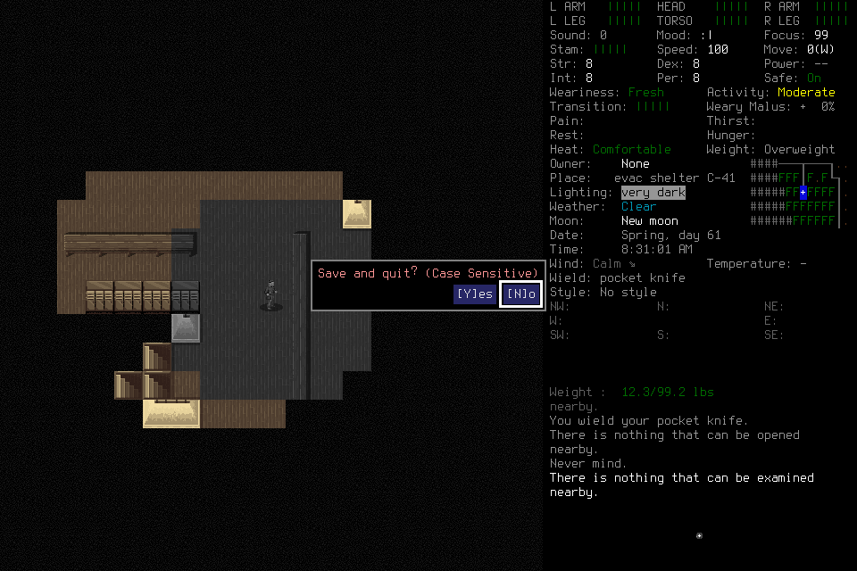

# Learning007: adoption reached, ordinary tool use failed

One independent Luna/low player ran frozen source
`59ba149f9055d9a868cf254b7dd89827b57765e0` with native
`690fe96e27e5d31046e1600918caad1ccd9f5964ff291ea9b01a33d4f25a86b1`.
A separately bounded adviser reviewed software-recorded trajectory. The lead
admitted and observed, without tactics, input, memory curation or source patches.
The mission loaded the existing EnactiveLearningSix/Casey save under new identity
and accounting, with no historical procedure library. It was not a fresh campaign.

## Outcome

The player ordinarily launched/loaded, retained the unknown Load input without
replay, reconciled its actual effect, inspected Casey's character screen and
corrected conflicting identity Claims. The ledger records completed normal-session
adoption. The player's later statement that adoption could not be confirmed is
not the ledger outcome: read-only snapshot/receipt grants_authority=false flags
were misinterpreted. Its following direct intent supplied only a goal description,
which did not satisfy the actual input/intent/expected contract. No ordinary
gameplay input followed adoption.

The deciding continuation lasted337.289s and stopped. The lead recorded failure
and requested closure only under unchanged original limits, with no renewed
learning/navigation authority or tactics. That38-second continuation reached the
visible Save confirmation but again submitted malformed direct intents. It
declared permanent quiescence without confirming Save, owned exit or Finish.
This closure request is operator intervention and does not establish independent
normal ending.

After all player/adviser tool handles were terminal, the lead verified the exact
owned native PID/launch and sent SIGTERM, then gracefully stopped its controller.
The exited child, controller and8766listener were absent on final verification.
All191save files retain their original hashes: none added, removed or changed.
No normal Save/exit/Finish, same-character reload or stopped-objective completion
is credited. Original ledger/archive, failed drafts, unknown ACK and prior save
are retained; no save restoration/edit, global install/configuration change,
budget extension or failed-authority renewal occurred.

## Learning, cost and limits

The ledger contains37requests:18completed,4partial,14blocked and1unknown.
Seven primitives are charged:6returned and1unknown. These are setup/identity/Save
interactions, not useful survival progress. There is no player-authored Procedure,
program execution, distinct-situation reuse, counterexample revision, fresh-context
handoff/application or useful-play overlap with reflection. No game-time progress
or routine usefulness cohort is established.

The adviser completed8jobs and submitted8grounded note proposals with no Procedure
candidates. Original claims charged120seconds each, exhausting the960-second
allowance; charged windows are not measured compute duration. Its active host
lasted308.400s and became permanently quiescent before cleanup. Advice was read
once by the player, but no beneficial learning/causal effect is established.

The deciding and closure continuations contain73completed MCP calls,13failed
tool replies,430,503UTF-8 text bytes and29typed image parts. This excludes passive
preflight and the adviser: player preflight adds1call/881text bytes/no image;
adviser activity adds21calls/53,031text bytes/2images. Source-visible validation
refusals also occur inside delivered successful transport envelopes; these counts
must not be interpreted as all semantic failures. Images are not text bytes.
Retained CLI usage counters are raw host reports; resumed-session counters are
not summed as unique context size or billing. No separately billed provider was
configured. Whole-player useful latency remains unqualified; short tool execution
or passive V8 timings do not repair this failure.

An earlier producer preflight failed before a model thread because a configuration
map was serialized as a string. Recursive TOML leaf flags fixed the next preflight;
both attempts remain recorded, with zero native input. Two focused independent
read-only sweeps examined current-document drift and actual default response size.
The latter found roughly5–9KiB default replies despite progressive detail access;
its partial counts were superseded by the closed totals above.

Private frozen profiles, original CLI streams/receipts and closed byte snapshots
are retained under `.runtime/campaigns/discovery-learning-007/`; the full mission
ledger/archive remains under `.runtime/missions/discovery-learning-007/`.
`closed-evidence/evidence-manifest.json` identifies stopped snapshot bytes. Browser
timing export retains earlier page sessions and requires current-run filtering;
it is not proof of paint or end-to-end useful progress. A large expanded export
also timed out an accessibility read; it is a spectator ergonomics finding, not
a native game failure. [Delivery062](../changes/062-player-decision-context.md)
owns follow-through; existing#164/#177/#178/#191 retain action ownership.
