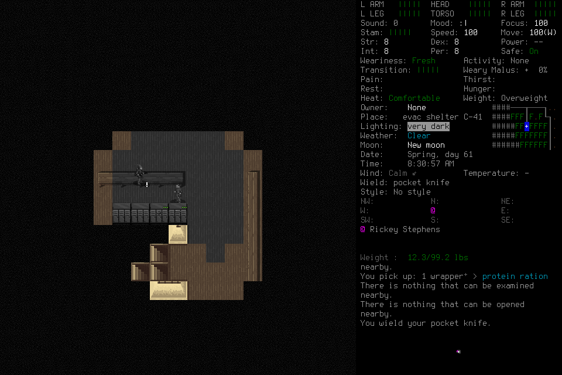

# Luna diagnostic017: independent correction, insufficient progress

One fresh Luna/low deciding CLI host ran frozen source
`35c3bfa9e6b0aab3b0f4c85fba2802bf59ed03cc` with signed native
`690fe96e27e5d31046e1600918caad1ccd9f5964ff291ea9b01a33d4f25a86b1`.
The lead admitted and observed the run without tactics, input or memory curation.
There was no adviser, runtime patch, budget renewal, save restoration or global
configuration change. This finite loaded-world diagnostic was not the integrated
learning mission or a fresh seven-day campaign.

## Actual outcome and organic-adoption limits

The player ordinarily loaded Casey in EnactiveLearningSix, explicitly grounded
identity Claims, inspected inventory and surroundings, and wielded a pocket
knife through ordinary interface interaction. The actual retained frame shows
both the wielded item and the new wield message. Earlier pickup messages in that
frame are historical; this run does not establish another ration pickup.

Seven navigation requests include six completed one-tile moves and one refusal:
“Target or connecting terrain is unknown or blocked.” Target-only model intents
were successfully bound to the selected published coordinate scope by software.
This is actual narrow binding evidence, not sustained route execution. The
player's later inspection selects its own Floor tile; neither that image nor the
refusal proves its claimed impassable map edge. Needs values were blank; the
player did not invent hunger/thirst values. No sustained supply, travel or threat
management is established.

The player recovered from malformed drafts, exact-source selection errors and
an inapplicable Save stage request without lead rescue. The latter preserved its
original phase and limits and returned no-input guidance. That is organic
interface correction evidence; it does not prove generalized procedure learning.
The wield-menu opening capture to visibly equipped capture spans81.843s,
including malformed drafts and scope/selection errors. This is a routine
capture-to-effect interval, not host-ready-to-DOM measurement; it cannot be
discarded or relabeled novel. Independent read-only review verifies the pixels,
correction chain, conservative navigation refusal and normal lifecycle.

All36 persisted skill requests have `procedure:null`. Memory contains127 Claims
(including123 automatic native facts and four player interpretations) and one
Work, with no Procedure, ProcedureUse or revision. Memory-version128 is not128
learning events. Imported fallible procedure references and ordinary correction
cannot substitute for player-authored adoption, distinct-situation reuse,
counterexample revision/retirement or fresh-context application. No successor or
useful play during pending reflection was exercised.

Normal Save produced a reconciled SavedCheckpoint, the exact owned child exited
normally with returncode0, and separate Finish recorded `disposition:stopped`.
Three input ACKs remain unknown, separately from zero unresolved effects. Work
was recorded completed, but Finish has no completed-work event and claims no
objective completion; those facts must not be conflated.

## Responsiveness and cost

The activated wrapper lasted557.436s for seven adopted game seconds. The ledger
contains58 requests: Start, ten lifecycle, six Observe, five Remember and36skills.
Thirty-eight primitives were charged:34returned, three unknown and one rejected.
The archive retains119PNGs totaling10,664,252bytes and375,276metadata bytes.
Activated CLI events contain84MCP calls,11failed calls,480,028UTF-8 text bytes,
48typed image parts and zero non-null structured duplicates. Failed calls
include local drafts that never became ledger requests.

The retained timestamped CLI rollout has123activated host custom calls,
including focused reference reads, failed drafts, result collection and final
reporting. Execution median is0.130s, p950.807s and maximum15.038s; consecutive
completion-to-next-call gaps have median2.594s, p958.838s and maximum35.610s.
These include scheduling, compaction and reasoning and do not isolate inference
or define a useful routine cohort. Two automatic compactions occurred; their
cost is retained, not removed from timing. Aggregate reported input8,185,584,
cached input7,896,832, output41,604 and reasoning output21,925 are not unique
context size or billing. No separately configured paid provider was used;
account billing remains unknown.

The browser export retains2,173status and216frame records without reported
ring overflow. Filtering the activated interval by status-ready epoch yields215
DOM replacements. Assuming shared-host wall clocks, capture-to-DOM median178ms,
p95309ms and maximum1,002ms have no negative samples; decode p95is9.2ms.
DOM replacement is not physical paint or a useful decision, and this does not
establish ready-to-useful-visible latency. The20-useful-decision cohort is not
qualified. Whole-player progress remains unacceptable despite relatively quick
tool/display stages; this configuration is not admitted as responsive.

## Closure and next work

The deciding actor is permanently FINAL. After its exit0, the owned controller
exited0 on SIGINT; exact native PID34320 and port8766 checks found no process or
listener. All191save files remain present;16hashes changed only in the admitted
world through normal Save, with no additions or removals. Original frozen
inputs, rollout, ledger, PNGs, raw browser timing, failure/output/timing audits,
save manifests and cleanup receipts remain project-local.

[#164](https://github.com/CVX-Hull/enactive/issues/164) must address complete
useful cadence and high-level execution, rather than count one-tile calls as
batching. [#176](https://github.com/CVX-Hull/enactive/issues/176) retains organic
ordinary fallback and focused error/tool ergonomics.
[#177](https://github.com/CVX-Hull/enactive/issues/177) and
[#178](https://github.com/CVX-Hull/enactive/issues/178) retain the actual
learning/reuse/revision/fresh-context/reflective-overlap outcome. The next
integrated mission must exercise those capabilities together; another successful
identity/menu diagnostic cannot substitute. Do not repeat the same configuration
without an evidence-backed change or a distinct unresolved question. Full fresh
[#145](https://github.com/CVX-Hull/enactive/issues/145) and protected publication
remain incomplete. Organic autonomy and useful apparent responsiveness remain
coupled requirements.
