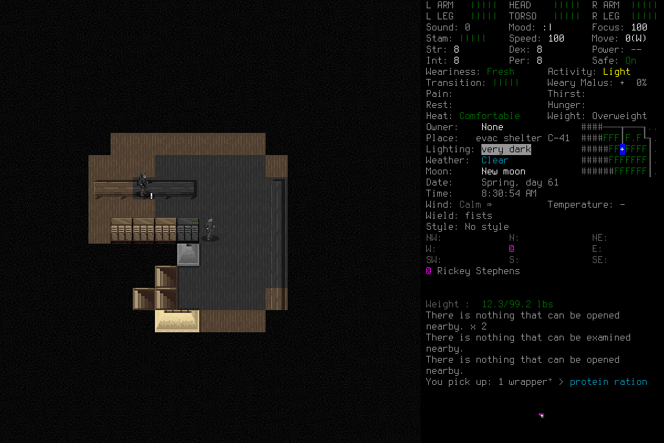

# Luna diagnostic013: useful pickup, normal ending, unacceptable pace

One fresh CLI0.162.1 Luna/low player ran frozen source
`687f29942c985991e931c07ce82a6743caf5ef8a` with signed native
`690fe96e27e5d31046e1600918caad1ccd9f5964ff291ea9b01a33d4f25a86b1`.
The lead admitted the mission and observed; it supplied no tactics, inputs or
memory curation. There was no adviser. All30 frozen files and the existing
baseline archive were retained; no save restoration or old-world authority was
imported. The source's [exact CI](https://github.com/CVX-Hull/enactive/actions/runs/40003724136)
passes. This does not qualify subsequent source or gameplay speed.

The CLI profile used existing `enabled_tools`/`required` settings to select15
deciding-player tools from the same21-tool contract. Passive preflight took16.779s
and made one snapshot read. Three selected descriptions and single-copy output
were observed; the complete loaded inventory was not independently counted.
Required continuation tools, including detail, were subsequently used naturally.
Do not attribute a speed improvement to the role filter without a controlled test.

## Outcome and limits

The player ordinarily launched and loaded Casey in EnactiveLearningSix. Load's
input ACK remained unknown; original-operation collection, explicit observation,
same-root reconciliation and provisional readmission preceded identity adoption.
Unlike012, the character Claim cites the actual character screen, and the world
Claim cites the earlier Load list showing that world. The lead independently
inspected both cited images. Stored Claims remain fallible interpretations.

The player inspected inventory and its surroundings, stepped north toward a
locker and picked up one wrapped protein ration. The retained post-pickup image
shows the new pickup message and12.3lb carried weight, versus11.9lb beforehand.
Its supported supply Claim cites that image. An earlier pickup root expired;
explicit Observe recorded macro closure before a new decision. This did not
renew the expired root or erase failed selection/confirmation attempts.

Repeated needs inspection opened `PLAYER_INFO` without structured needs data.
The player did not invent hunger/thirst values. There was no broader travel,
threat choice, sustained needs management, procedure learning/revision, fresh
successor or useful work during pending reflection. One step and a ration are
bounded useful interaction evidence, not the requested integrated mission or
fresh seven-day campaign.

Normal Save had an unknown confirmation ACK. Same-operation reconciliation
produced a SavedCheckpoint. Owned main-menu exit was independently registered
with returncode0, retaining its unknown input ACK. Finish completed with
`disposition:stopped` and no completed Work event; ending Work remained planned.
Three malformed Finish drafts preceded the separate new-root Finish. The ledger
records no unresolved effects; this does not rewrite the three unknown ACKs.

## Cost and measurement

The activated wrapper lasted596.008s for two adopted game seconds. The ledger
contains46 requests: Start, nine lifecycle, five Observe, five Remember and26
skills. Twenty-eight primitives were charged:25 returned and three unknown.
Eighty-nine PNGs total7,369,563bytes; metadata totals232,976bytes. Harness API spend
is zero; account billing is unknown.

Activated CLI output contains70 MCP calls, including six failed tool calls,
378,662 UTF-8 bytes in text parts,43 typed image parts and zero non-null structured
duplicates. This scope excludes passive preflight, shell outputs and model prose.
The CLI reports10,203,701 aggregate input tokens,9,965,696 cached input and39,408
output across the turn. These are not unique context size, per-call attribution,
billing or evidence of causal savings.

A read-only timing sweep matches18 inspect/close/look/navigation/pickup/Observe
calls by request ID, including failed attempts. Median execution is0.446s and
maximum0.692s; recorded completion-to-next-custom-call gaps range1.7–12.5s.
Anchors come from the retained host
rollout, not the untimestamped CLI event list. These gaps include reasoning,
scheduling and other work; they do not isolate inference. There is no20-useful-
routine-decision cohort or correlated raw browser display dataset. Apparent
responsiveness remains unqualified and the useful-play rate unacceptable.

## Closure and follow-through

The player became permanently FINAL and its process exited0. The final mission
was stopped with no active operation or lease. The remaining controller exited0
on SIGINT; exact owned-process and port8766 checks verified absence. All191 save
files remain present;13 hashes changed only in the admitted world through normal
Save, with no additions, removals or deletion. Frozen inputs, full private rollout,
ledger, actual PNGs, tool accounting, save comparison and cleanup are retained.

[#164](https://github.com/CVX-Hull/enactive/issues/164) owns measured cadence and
software-owned request naming/collection, using the existing SDK without silent
snapshot retarget or budget renewal. Scope, grounding and consequential limits
remain player decisions. Repeated unsupported inspection and item-selection
overhead belong with [#176](https://github.com/CVX-Hull/enactive/issues/176).
[#175](https://github.com/CVX-Hull/enactive/issues/175) now has useful initial Load
and a complete normal ending in this narrow case. [#177](https://github.com/CVX-Hull/enactive/issues/177),
[#178](https://github.com/CVX-Hull/enactive/issues/178) and the full fresh
[#145](https://github.com/CVX-Hull/enactive/issues/145) outcome remain incomplete.
