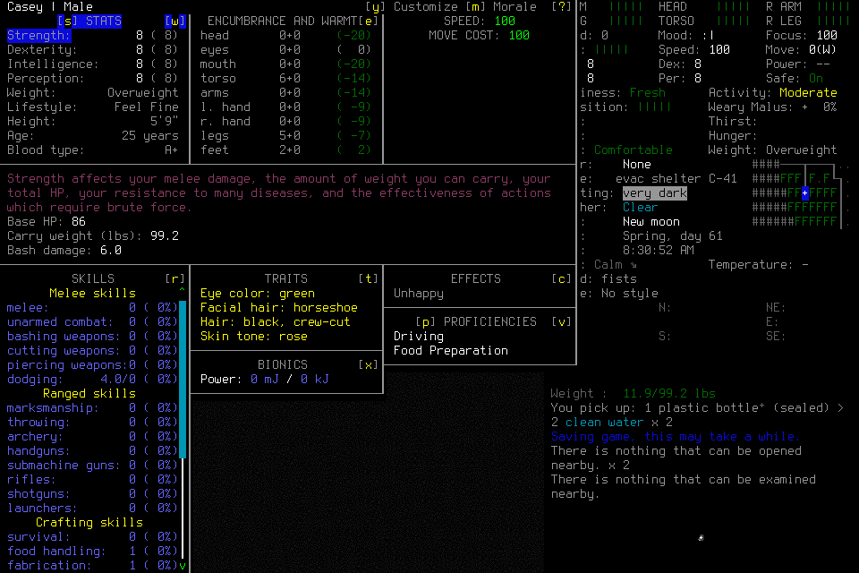

# Luna diagnostic012: lifecycle deadline and unsupported identity memory

Frozen source `51c4968fa14f2506c6900f622ddb3d75f74aa5da` and signed native
`690fe96e27e5d31046e1600918caad1ccd9f5964ff291ea9b01a33d4f25a86b1`
ran with one fresh CLI 0.162.1 Luna/low player and no adviser. All 30 frozen files,
prior numerical/quality/latency/ending caps and coupled forecast were retained.
The existing baseline archive was hash-verified and reused without restoration.
No old world facts, authority or fresh-survival credit were imported.

The 15.606-second passive preflight read the brief/guide and selected current
schemas, reported current lifecycle/Claim descriptions and made exactly one
null-mission snapshot. Its actual result contains one text value and no duplicate
structured value. It initially overlooked the namespaced tool names, then found
them independently. Separate explicit activation followed lead-only Start.
No desktop restart is assumed or needed to prove this fresh producer's framing.

## Actual outcome

The player launched the owned windowed child, used ordinary/menu controls and
selected the admitted EnactiveLearningSix/Casey save. Selection had an unknown
ACK. The player collected the original operation, Observed, explicitly read the
returned diagnostic source and reconciled Load without replay or lead tactics.
It completed provisional readmission and opened Casey's character screen.

Two shell schema queries failed from quoting/path selection; ten read-only shell
commands occurred in the activated turn. Two MCP calls failed before admission:
ordinary direct input included an invalid menu perception, and null source was
selected from a snapshot with no source. In the latter case both snapshot source
and mission current source were null, while Observe's result listed a separate
diagnostic source. The explicit source read resolved it. This is not a missing
observation member or permission to infer a replacement from another cache entry.

One world identity Claim was stored through the new semantic authoring API. Its
value was EnactiveLearningSix, but its sole primary source was the character
screen below. The screen establishes Casey and character details; it does not
show the world name. The earlier Load list is distinct evidence and was not cited.
Successful storage therefore does **not** establish valid semantic grounding,
identity adoption, useful memory or learning. The failed mission is not an
eligible procedure library. The lead did not repair or curate the Claim.

The player chose 32 primitives, 120 wall seconds and 3,600 game seconds for the
original Load root. Its deadline includes transition, identity Claims, dismissal
and adoption, not just menu opening. It expired before the character Claim and
adoption. The player stopped control and became permanently FINAL. No adopted
game time, useful supply/navigation cohort, normal Save/exit/Finish or seven-day
outcome is accepted. Historical Save messages visible in the HUD are not this
mission's Save evidence.

## Accounting and closure

There are 14 ledger requests: Start, four lifecycle, two Observe, one Remember,
five skills and Stop. Five primitives were charged: four returned and one unknown
with its transition effect separately resolved. Nineteen PNGs total 1,236,457 bytes;
metadata totals 47,424 bytes. No new game time was adopted. Harness API spend is
zero; account billing is unknown.

The activated CLI wrapper lasted 170.872 seconds. The prepared Start-call-to-CLI
activation interval was 0.562 seconds including admission, versus 38.759 seconds
between admission and CLI start in011. These differently anchored components
show reduced lead orchestration overhead; neither isolates inference nor proves
whole-player responsiveness.

Activated CLI output has 20 actual MCP calls, including two no-submission errors,
102,154 UTF-8 bytes in MCP text parts, nine typed image parts and zero non-null
structured duplicates. This scope excludes passive preflight, shell outputs and
model prose. The CLI reports 3,417,214 input tokens, including 3,272,960 cached,
and 15,144 output tokens across the turn. These are aggregate reported usage,
not unique context size, per-call attribution or billing. No causal token/latency
saving is inferred from a comparison with differently scoped earlier traces.

The spectator showed actual current native frames and paused ownership. Its page
lifetime began before Start. No browser raw export was retrieved; the known slow
download-event path was deliberately not repeated. No routine cohort or complete
correlated display dataset exists, so apparent responsiveness is unqualified.

After actor exit0, the mission was paused with no active operation or lease. The
owned controller closed normally on SIGINT; exact game/player/process and port
checks then verified absence. All 191 save files remain byte-identical before and
after closure. This exceptional OS closure is not normal game ending. Private
frozen inputs, rollout, ledger, PNGs, usage audit and cleanup records retain the
failure, stored Claim and unchanged ACK.

## Follow-through

[#164](https://github.com/CVX-Hull/enactive/issues/164) owns actual context cost,
progressive schemas, ordinary-input shape accuracy, actionable missing-source
guidance, lifecycle budget ergonomics and a prospective role-scoped catalogue
using the CLI's existing tool filter. The global/project allow table need not
expand. Source-free Launch and exact selected-source behavior remain unchanged;
no silent archive fallback or automatic support judgment is justified.

[#177](https://github.com/CVX-Hull/enactive/issues/177) owns truthful source-linked
knowledge/procedures; storage is not truth and exposure is not use. The next
player must choose evidence that establishes each Claim. Whole-lifecycle limits
must fit the frozen forecast; expired authority never renews. [#175](https://github.com/CVX-Hull/enactive/issues/175)
retains useful initial Load with normal ending; [#176](https://github.com/CVX-Hull/enactive/issues/176)
retains organic continuation and [#178](https://github.com/CVX-Hull/enactive/issues/178)
useful asynchronous advice. Full integrated learning and genuinely fresh
[#145](https://github.com/CVX-Hull/enactive/issues/145) remain required.

Exact frozen-source [CI](https://github.com/CVX-Hull/enactive/actions/runs/39999281737)
subsequently passes 1,768 Python tests in 1,084.828 seconds, diagrams and viewer
regressions. This source lane does not accept the gameplay failure above or
qualify subsequent source changes.
