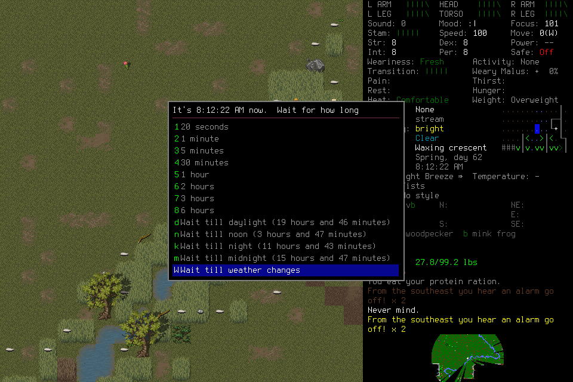
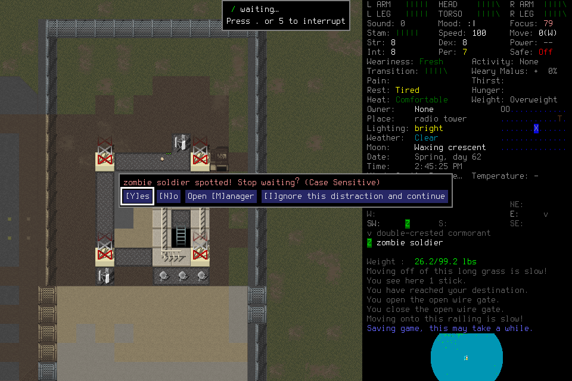

# Fresh024: useful revisions, then a failed observation boundary

Fresh024 ended incomplete after **110,661 accounted game seconds** (30h44m21s)
and **1,376 charged inputs**. The player revised and reused executable procedures
and continued useful play during some reflection work. It did not reach seven
days, activate its successor, reload a midpoint checkpoint or finish normally.
The later cleanup and source repair do not turn this into a passing campaign.

## Frozen basis and failure

The deciding source was `05e49350718e6ee2efbfc26c02b31b1000a65a02`, signed native
`96e58aa08e7f8dd74c42f1bd30bc48a11ebd0eca16deac4cd810e1e843b6fe70`.
Scenario: fresh EnactiveSurvival24/River. The original player used Sol6.1/low and
the bounded adviser Sol6.1/medium through the existing structured tools. Original
limits were4,096 inputs/mappings/requests,8,192 frames/2GiB,21,600 wall seconds and
691,200 game seconds, with protected cleanup reserve. Costs were not renewed.

Direct operation `op-5d1bf4f851ab4349b14a987953d5b2a2` received the native rejection
“original capture expired or clock moved backwards.” The next Observe,
`op-5b66949ad1f44ab7b028c05da126526b`, failed the combined original-prompt
integrity/binding guard. An authenticated rotation832→833 alone is insufficient
to explain this: the existing pending-observation rule permits that relation.
The retained evidence lacks every private phase/binding field needed to prove the
failing subpredicate. A later synthetic reproduction found a missing pending marker
after known native rejection; [the source repair](2026-10-24-audit-remediation.md)
is not proof that this was Fresh024's cause. Neither error authorizes replay.

## Learning and reflection: observed scope

The ledger contains2,171 Claims and9 Procedure revisions, with no Work or Decision
rows. The ledger admitted18 remember requests; the host attempted21, including3
rejected before submission. Automatic native Claims account for most rows. Nineteen program requests bound local revisions across five families and
104 charged primitives; invocation does not imply successful acquisition or effect.

| Evidence | Interpretation and limit |
| --- | --- |
| Pickup procedure derived from Fresh023 and selected at distinct lockers | Retained learning informs a local revision; no direct invocation of a donor revision or isolated causal gain is established. |
| Rest revisions respond to hydration limits and a changed numeric menu | The player changes procedure data after failure; a remembered key is not a durable semantic label. |
| A rest revision is retired after a hazmat threat; conservative recovery is later selected twice | Retirement preserves contrary evidence. Reuse does not certify safety or general usefulness. |
| All16 reflection jobs have claims and completed submissions, producing19 notes and no candidate procedures | Claimed advice can overlap useful movement; this is not continuous coverage. The budget exhausts early and later requests are omitted. |
| One explicit advice fetch and adoption of the frozen-water/usable-hydration correction | Limited adoption is supported; later failures remain, and survival benefit is unproved. |

This retained source (`dcfdf27e…aafe7`) supports the numeric-menu mismatch in
`op-297926e94f0448749c8f99a10270563a`: the selected row is “Wait till weather changes.”
The procedure must respond to current observations rather than assume old indexes.

The frozen cadence profile required20 genuinely useful routine decisions,
p95≤2s, maximum stall≤5s, local response≤500ms and separately classified novelty.
There is no independently labelled, joined cohort satisfying that test. Browser
DOM timing proxies have incomplete correlation and overflow; they are not physical
paint or useful-decision latency. No cadence or model superiority is accepted.
## Recorded costs and omissions

The retained host counters and receipts provide the following accounting. Cached
input is included within input, not additional tokens or a billing amount.

| Role | Host span seconds | Input tokens | Cached input tokens | Output tokens |
| --- | ---: | ---: | ---: | ---: |
| Original player | 15,758.677 | 193,737,142 | 190,977,536 | 121,785 |
| Activated adviser | 1,293.569 | 8,577,302 | 8,412,160 | 12,812 |
| Player preflight | 11.026 | 34,652 | 24,064 | 174 |
| Adviser preflight | 9.259 | 34,274 | 24,192 | 224 |
| Known counter total | Do not sum overlapping wall | 202,383,370 | 199,437,952 | 134,995 |

The separate reasoning-output counter totals60,557; it is not added to reported
output. There are1,001 completed MCP items including15 failed-status items:
937/14 from the player,62/0 adviser,1/0 player preflight and1/1 adviser preflight.
The adviser preflight's failed tool says “Invalid reflection job response”; host
exit0 is not a tool-success assertion. The player also records14 command items,
four reconnect errors and one error item. The deterministic driver exits1; its
overhead is not separately measured. No successor was activated or model usage
invented for its empty trace.

MCP result text blocks total6,814,139 UTF-8 bytes with879 image blocks. This excludes
arguments, structured-content duplication, command outputs, prompts and other
forwarding surfaces; it is not complete context bytes or a token estimate.
Sixteen jobs charge1,920 seconds conservatively; summed observed claim-to-submit
time is224.229 seconds, while adviser host span is1,293.569 seconds. These measures
and host durations overlap and are not isolated inference or additive campaign
wall time. Monetary cost, isolated inference, hidden approval delay and complete
engineering/cleanup overhead remain unknown. The [portable receipt](2026-10-24-fresh024-closeout.json)
keeps per-role counters, scope and omissions.

## Exceptional ending and preservation

The original host exited0; the driver reported incomplete and exited1. There was
no activated successor. The attempted owned exit lacked a verified saved
checkpoint. Supported zero-input Stop and owned process shutdown were collected;
the native return code remains **unknown**, and normal exit is **not verified**.
Host exit0, a save message on screen and process absence do not prove normal Save,
exit or Finish. The final retained native image shows an activity interruption question; Stop and
shutdown receipts separately establish control and process disposition.

The frame shows a zombie-soldier interruption at Spring day62,14:45. Menu state
has no authoritative scene clock; the report therefore keeps **last accounted**
game seconds distinct from an inferred precise ending time. No new game or native
probe was launched for this assessment.

Offline verification checks all3,617 indexed frame references, SQLite quick_check,
settled/effect accounting and all191 pre-existing save hashes. The ledger retains
1,374 returned primitives, one rejected and one unknown; unresolved effects are
empty after the recorded reconciliation. The original unknown ACK remains unknown.
A later settled effect does not rewrite its delivery disposition.

The project-local ordinary tar archive
`.runtime/campaign-closeout/independent-seven-day-024/failed-run-and-world.tar`
contains3,882 files/702,992,527 payload bytes: original mission, campaign and failed
world evidence. Archive size709,959,680 bytes, SHA256
`0d8a398ada95aef2cbdb1695d526a87ee673bb8d6aa4ae11c45aaeb3deabbebd`.
Every member hash and the unchanged source copies were checked before removing
only the active EnactiveSurvival24 world. The adjacent private manifest owns member
hashes and restoration instructions. All191 preserved save files remain unchanged;
Belgium, Enactive Twenty Four and EnactiveLearningSix remain active. Original mission
and campaign evidence remains intact. Exact owned PIDs, native Tiles and8766 were
absent before verification and after retirement. No save content was edited.

A first closeout invocation could not spawn ps inside the sandbox and stopped
before archiving/removal. Scoped process access then completed the same archive/
verification procedure. No global installation, setting or unrelated process changed.

## Closed donor scope and follow-through

The reviewed shared-eight-pin reader strictly mounts the actual four ancestors
plus024: **23 Procedure records**,7.587s mount time and221,937,664 bytes fresh-process
peak RSS. Exact ledger/index pins and measurement scope are in the
[portable closeout receipt](2026-10-24-fresh024-closeout.json). This fits the frozen
30s/512MiB setup envelope. It does not prove worst-case archive scaling, routine
cadence, successor handoff fit or actual gameplay application. Closed-paused donor
eligibility does not require or imply normal ending.

[#145](https://github.com/CVX-Hull/enactive/issues/145) owns the campaign outcome;
[#176](https://github.com/CVX-Hull/enactive/issues/176) the interaction boundary,
[#177](https://github.com/CVX-Hull/enactive/issues/177) learning/closure,
[#178](https://github.com/CVX-Hull/enactive/issues/178) advisory allocation and
[#164](https://github.com/CVX-Hull/enactive/issues/164) whole-configuration cadence.
Games remain user-paused. This dated record owns observations, not live sequencing
or permission for another run.
