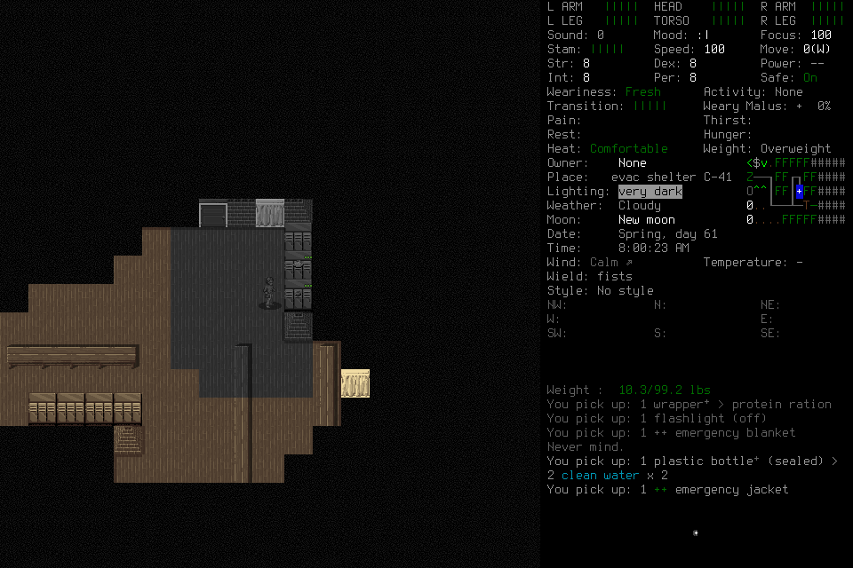

# Useful play works narrowly; integrated readiness remains unqualified

Sol/low independently created a character, acquired supplies, authored/reused a
procedure, handed useful memory to a fresh successor and completed normal
save/reload/ending. **Combined qualification remains unmet:** no genuine procedure
revision, no useful play during an actually claimed reflection job, and no qualified
whole-player cadence cohort. Another seven-day campaign is a no-go.

This report separates the completion of [#211](https://github.com/CVX-Hull/enactive/issues/211)
and [#210](https://github.com/CVX-Hull/enactive/issues/210) from the actual
independent-play outcome under [#136](https://github.com/CVX-Hull/enactive/issues/136).
The current runtime remains source `7f5b70c58000bc965cd236df618a448f9f10cc45`,
native `96e58aa08e7f8dd74c42f1bd30bc48a11ebd0eca16deac4cd810e1e843b6fe70`,
MCP5.4.0/player-view4, mission11/native6/Procedure3. No runtime, native, store,
schema or permission change was selected. Report publication does not qualify
the independent seven-day campaign.

## Grounding and configuration selection

The [closed bootstrap trials](2026-10-24-useful-bootstrap-trials.md) expose two
different failures. In001 a successful Launch was followed by an unsupported
inference that a read-only host filesystem prohibited admitted service gameplay.
In002 the exact forwarded picker PNG and accompanying JSON were present, but
the player twice described the intended fresh name as visible, then abandoned
discovery without an actual creation-capability refusal. Availability of pixels
does not establish attention, legibility or internal interpretation. Intention
contamination and context/attention failures remain plausible explanations;
the traces do not isolate an internal cause or prove a memory/native defect.

Four prospective offline attempts used the exact historical MCP text and original
PNG from001 trace line14 and002 line57. Common compact context distinguished
filesystem restrictions from service authority, intended identity from visible
fact, missing names from impossibility, and read-only evidence from executable
authority. It supplied no prior wrong answers, correct menu recipe, tactical
program, World-tab instruction or adopted memory. Candidates received the same
case payloads. The CLI image/read-only options follow its maintained
[command documentation](https://learn.chatgpt.com/docs/developer-commands#codex-exec).

| Candidate/case | Whole host wall | Observed result |
| --- | ---: | --- |
| Luna/low, successful-Launch continuation | 0.021s | CLI config-loading failure before model startup; missing model evidence |
| Luna/low, intended target versus picker | 5.167s | Correct visible labels, target distinction and bounded further-discovery judgment |
| Sol/low, successful-Launch continuation | 10.677s | Correct labels and authority distinction; registered continuation rather than false denial |
| Sol/low, intended target versus picker | 11.135s | Correct labels and uncertainty; no invented target or unsupported impossibility |

The initial disabled MCP table lacked a transport, so CLI parsing failed. The
remaining three invocations used the existing complete configuration table with
`enabled=false`; project/global configurations were unchanged. That failure
counted toward the four-host ceiling: no replacement fifth host was launched.
Each invocation reserved114work seconds and6cleanup seconds inside120total.
None timed out or required signals. The three completed traces contain one final
message and no recorded tool calls/commands/outside reads. No-tools was an
instruction; the read-only OS sandbox alone does not prevent reads or commands.
Enactive was disabled, and no game/controller was used by these diagnostics.

**Select Sol/low for one bounded live assessment**, independently reviewed on
complete passing coverage of both used cases. Luna passed its completed case;
its setup failure is not a model failure. Startup/contention and inference are
not isolated. These prompted development cases establish no comparative
superiority, causal prompt benefit, held-out generalization or useful-play speed.

The prior002 default snapshots already exposed the optional reflection
`proposal_count` cue in19 returned results; the player never read advice. A missing
notification implementation was not established. The next role context retains
the current compact guide/progressive schema cards and points to existing advice
at relevant impasses or useful boundaries. It adds no mandatory polling,
per-action critic, automatic adoption or lead gameplay intervention.

## Limits and preparation

Existing schema exports and validators own the limits; this work adds no parallel
wire schema, profile-cap parser, clamping or budget fields.

| Scope | Supported original root ceiling | Classification |
| --- | --- | --- |
| Ordinary skill | 32 primitives /900 wall seconds /43200 game seconds | Includes ordinary direct and program execution |
| All lifecycle | 256 primitives /1800 wall seconds /43200 game seconds | Launch, create, Save, Load, exit and Finish |

A smaller submitted allocation is a real immutable root limit. A600second prose
target is not an extra controller cap:600/900 ordinary and600/900/1800 lifecycle
allocations validate, while33ordinary primitives and wall limits above the actual
schema ceilings are rejected. Prior002's900second create request remains
nonconforming to its original600second instruction; actual short execution does
not erase that mismatch. Normal owned exit is explicitly lifecycle-classified.
Children retain their root deadline and cumulative costs; handoff/reload does
not renew mission limits.

The new finite integrated freeze admits2048 inputs/mappings,3072 requests,
8192 frames/2 GiB,7200 mission wall seconds and86400 game seconds. Its protected
reserve is256 inputs/900 wall seconds/768 frames/256 MiB, unavailable to normal ending.
Original and at most one fresh successor share6000driver work seconds. Activation
must occur within180 mission seconds. Final normal ending begins by4200 mission
seconds or earlier at512 inputs/1536 frames/512 MiB spendable headroom above reserve,
actual failure or insufficient whole-operation fit. At4200 the driver has at
least1800 seconds and the mission2100pre-reserve seconds remaining. These triggers
are operating rules, not newly claimed controller hard caps or completion guarantees.
Earlier actual local-root, driver and normal-ending fit governs. Exceptional
host/supervisor shutdown costs are separately retained, never extra input authority.

The forecast uses [Learning009](2026-10-23-discovery-learning-ninth-attempt.md):
907.698 mission seconds,79 requests/57 primitives/167 frames,103memory events and
1,191,936 SQLite bytes. It began from a save, failed cadence, and provides no fresh
creation success duration. A provisional200–500request/200–700frame short-run
range scales to roughly3–8 MiB at that one sample's aggregate bytes/request;
12 MiB allows uncertainty, without promising capacity. Up to3automatic Claims per
distinct normal source can multiply rows. Existing ceilings remain26624 Claims at
8192 frames,256 Work/2048 Decision/256 Procedure and64MiBSQLite. Full admitted input
and frame allowances do not guarantee storage fit. Handoff stays selective at
128 sources/four procedure packets; reflection selects8 records/eight sources,
32KiBcontext/16KiBresult. Original rows/bytes persist through succession/reload.
Saturation or missing necessary support is a retained failure, not permission
to discard history or invent read declarations.

The separate Sol/medium adviser has four reflection tools and no input authority.
Six90second jobs reserve540aggregate charged claim-window seconds; this is not
isolated model computation. Advice remains fallible and optional. The lead owns
admission, observation, verification and process custody; players choose all
tactics, author programs and curate/apply their memory without lead rescue.

## Integrated attempt evidence

Setup003 admitted EnactiveLearning03/Drew but ended before player/native activity.
The launcher returned, all three children were subsequently absent, and no player
trace was produced. The closed ledger has one Start, zero primitives, zero memory
and zero reflection jobs. Command-lifetime teardown is suspected; exact exit
signals are unknown. Its persisted admitted state is retained unchanged, not
rewritten as a successful terminal phase. There is no live writer/native process
or normal game ending to claim.

The separately frozen004 uses EnactiveLearning04/Ellis with the same reviewed
source/native/models/caps/context and an explicit003failure amendment. A bounded
foreground supervisor retains exact child handles through driver waiting and
shutdown, using existing host-custody helpers. This is an owned operator script,
not a new maintained runtime framework. It does not replay003, renew its budgets
or introduce another game-input actor.

## Closed004 outcome and independent assessment

| Frozen requirement | Observed result and practical limit |
| --- | --- |
| Organic setup and useful work | Actual fresh EnactiveLearning04/Ellis adoption after ordinary setup exploration and explicit reconciliation. A wrapped protein ration, blanket and dead-battery flashlight were acquired; later pickups added an emergency jacket and two bottles containing four clean-water units. The initial carried bottle is baseline, not new gain. No food consumption, wearing or successful illumination is established. |
| Player-authored executable procedure | One revision, three invocations, seven returned movement inputs. First travels east three tiles and yields before a bench; second travels two tiles in a different shelter aisle toward lockers subsequently looted. The successor uses it after reload for two more useful tiles. Short shelter-floor travel is supported; general navigation is not. |
| Consequential procedure change | Unqualified. Bench yielding follows the existing guard, not a counterexample. The later correction fixes Claim support for the dead flashlight; it does not revise/retire the procedure. No variation was manufactured to fill this branch. |
| Fresh-successor memory application | Registered quiescent handoff, actual source/context reads, Claim/readmission, retained door-exploration Work acted on, then post-reload execution of the retained procedure and another confirmed protein-ration pickup. This exceeds retrieval/storage alone, without proving causal benefit. |
| Claimed-advice useful-play overlap | Unqualified. Both jobs submitted by Unix1792898001.086; normal adoption was later at1792898112.055. Charged90-second reservations do not extend actual claimed work after submission. Passive adviser waiting is not useful-play overlap. |
| Advice disposition | Both players actually read advice; the successor explicitly rejects the setup/edit candidate as inapplicable and retains the disposition in Work. Two Claim-storage attempts failed. No executable candidate adoption or causal benefit is established. |
| Normal continuity and ending | First SavedCheckpoint, owned child exit0, distinct child Launch, exact world/Ellis Load and adoption linked to that checkpoint, useful continued exploration/map/locker work, final SavedCheckpoint, owned exit0 and Finish. Disposition is stopped; lighting/further travel remain unfinished. |
| Apparent cadence | Unqualified. No independently defined20-useful-goal cohort with checked readiness-to-visible-effect timestamps establishes p95<=2s, routine stalls<=5s or the separate novelty/local/display criteria. Missing samples cannot pass; no filler decisions were added. |

The first Save is `op-17f9a8efe3de43c4b1b9ba44bf34c542`; new-child Load adoption
is `op-81a1f5e480cb4ee0a81c355e6041e0e5`. Final Save is
`op-82e4658220514f51b427bcc58bd8fb38`, owned exit result
`op-2aa89c35264f4b67ab3b644ed2ecf6e6` and Finish
`op-fa15adc558c34de69aa54a3550720874`. Both native launch identities have recorded
normal returncode0. The six original unknown ACKs remain unknown; separate
reconciliation/process evidence establishes outcomes without relabeling delivery.
Local schema/allowance refusals, advisory support-closure corrections and failed
Claim-storage attempts remain part of the cost and outcome record. Independent
review found no confirmed authority bypass or implementation defect in this scope.

## Accounting, cleanup and next decision

| Measure | Retained004 result; domains remain separate |
| --- | --- |
| Mission / game time | 859.902 mission seconds /35 game seconds; not survival throughput |
| Deciding host wall | Original454.352s; successor412.286s, both exit0 without signals/timeouts. These spans include host startup/closure and are not inference time. |
| Outer custody | 867.112s including controller startup/closure. Driver/adviser exit0; controller gracefully stopped by exact owned SIGINT and exited0. No native signal/lead gameplay rescue. |
| Ledger | 109 mission requests, including Start;110 charged primitives =103 returned +6 unknown +1 rejected. Zero unresolved mission effects. |
| Archive / memory | 304 frames/20,923,826image bytes;160 Claims/one Procedure/two Work;1,454,080 SQLite bytes. Storage remained below the provisional short-run forecast and existing caps. |
| Reflection | Two completed jobs,180 charged claim-window seconds out of540;89unreviewed requests retained after original-horizon deferral. The adviser passively waited in software until closure; it did not compute on idle work. |
| Runtime request settlement | All109rows have one timing event, zero missing/duplicates. Mixed receipt-to-finalization median335.343ms, p95 15120.438ms, max16056.767ms. Lifecycle/unknown waits are included; this is neither an ordinary useful-goal cohort nor model/display timing. |
| Local programs | Whole-runtime receipts1134.098/882.451/1515.963ms for3/2/2 returned inputs. Tiny scope, with semantic effects checked separately; no per-input or whole-player p95 is inferred. |
| Model/tool counters | 143 completed MCP calls;807,182 UTF-8response-text bytes and102 typed images. Reported completed usage18,975,684 input tokens, including18,524,544 cached;30,127 output/2,240 reasoning-output tokens. Repeated/cached context is not unique retained context or money. No separately billed provider was configured; harness API spend0 does not make Codex account use free. |
| Saves / environment | All191preexisting save files unchanged;51new files belong to the new normal saved world/character. The useful Ellis checkpoint is retained. Owned model/game/controller processes and8766listener are absent after verification. No global install/profile/permission change. |

[Diagnostic decisions/current-limit checks](assets/player-readiness/diagnostics.json)
and [sanitized004accounting](assets/player-readiness/accounting004.json) retain
public summaries. Original byte-frozen role inputs, actual forwarded images/tool
streams, closed ledger/archive, source/request timing, save hashes/differences,
process receipts and the closure manifest remain project-local under
`.runtime/iterations/player-readiness-210-211/` and
`.runtime/campaigns/useful-learning-003/` / `useful-learning-004/`.
The public summaries do not make every private byte independently reproducible.
No private reasoning, credentials, host account paths or raw saves were published.

This completes the grounded selection and existing-contract preparation slices;
it does not qualify Sol/low for production apparent real-time play or complete
[#164](https://github.com/CVX-Hull/enactive/issues/164),
[#177](https://github.com/CVX-Hull/enactive/issues/177),
[#178](https://github.com/CVX-Hull/enactive/issues/178) or
[#145](https://github.com/CVX-Hull/enactive/issues/145).
Reuse the positive organic/succession/lifecycle evidence. Keep the missing genuine
procedure change, actual claimed useful-play/advice interval and measured useful
cadence in those existing outcome issues. In particular, the large admitted
horizon deferred later reflection credits during this short useful run; a future
profile/design decision should examine that tradeoff before another assessment,
without waiting artificially or manipulating inputs to earn a job. No new tier,
critic, memory store or menu-specific runtime repair is justified by these traces.

The next full campaign remains a no-go until the existing readiness criteria and
coupled seven-day forecast have evidence. Earlier failures and Learning009's
scoped positive results remain unchanged. Public report publication receives the
editorial profile; unchanged runtime/native evidence reuses PR209's full and main
checks, with no redundant native rebuild or full portable suite.

The interpretation/latency and executable-policy distinctions follow the prior
[responsive-gameplay research](../research-responsive-gameplay.md),
[tiered-gameplay research](../research-tiered-gameplay.md) and
[execution-first boundary](../changes/064-execution-first-learning.md). This run adds
scoped observations, not a new literature/generalization claim.

Local editorial validation passed in16.25seconds. Its first attempt could not
launch the existing pinned diagram browser inside the filesystem sandbox; the
same profile passed with that renderer allowed, without dependency/configuration
changes. Hosted PR/main publication checks are retained on the publication PR.
