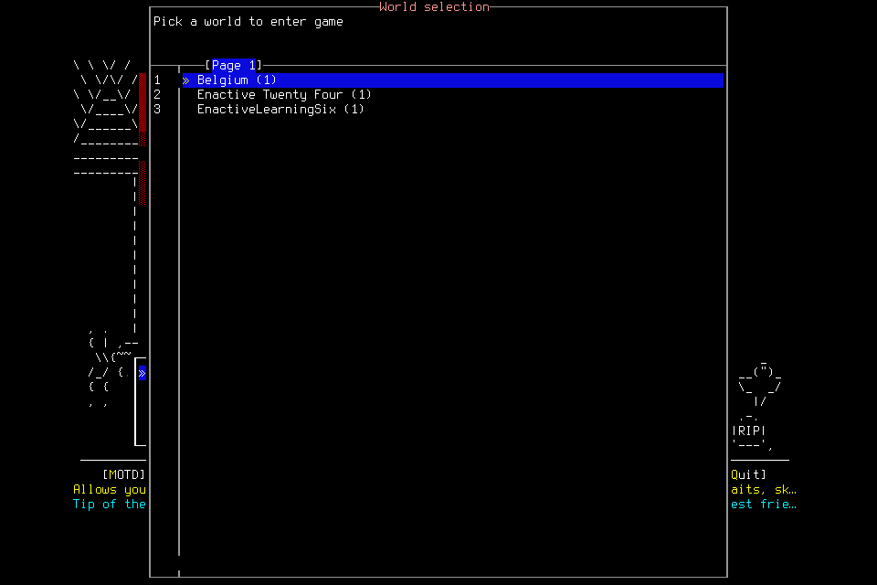
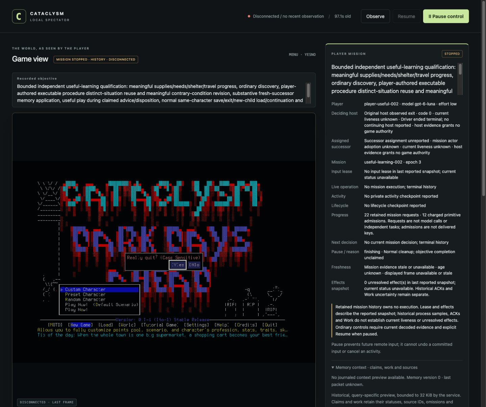

# Useful play did not start: bootstrap trials 001–002

**Neither trial qualifies the frozen Luna/low configuration for independent useful
learning, apparent responsiveness or another full campaign.** No fresh character
was created. Trial 002 independently ended its owned menu session normally; trial 001
needed exceptional process cleanup after the player stopped. The source repair and
its protected publication are separate from these failed functional outcomes.

[Mechanical accounting](2026-10-24-useful-bootstrap-accounting.json) owns the
retained counts and scoped intervals. [PR209](https://github.com/CVX-Hull/enactive/pull/209)
owns exact source/review/CI; [#136](https://github.com/CVX-Hull/enactive/issues/136)
owns integrated delivery, [#164](https://github.com/CVX-Hull/enactive/issues/164)
player ergonomics/cadence and [#145](https://github.com/CVX-Hull/enactive/issues/145)
the still-unaccepted fresh seven-day outcome.

## What was frozen

Both development trials used source `038d5ddb643e99a189f15b765be203a257c0ad80`,
native SHA256 `96e58aa08e7f8dd74c42f1bd30bc48a11ebd0eca16deac4cd810e1e843b6fe70`,
MCP5.4.0, mission/11, player-view/4 and the prepared windowed project wrapper/userdir.
Each admitted one fresh Luna/low original, at most one fresh Luna/low successor,
and one bounded Sol/medium adviser. Host context/compaction defaults remained;
no paid API/provider, global setup change, imported procedures or old-world facts.
The lead supplied no tactics, inputs or memory repair during deciding play.

Each admission retained 1024 inputs/mappings, 1536 requests, 4096 frames/1GiB,
4200 mission-wall seconds and 86400 game seconds. Protected reserves were 128 inputs,
600 wall seconds, 384 frames and 128MiB, unavailable to normal ending. The original
and successor shared 3300 driver seconds; ending began by 2700 mission-wall seconds
or earlier if remaining capacity/authority could not fit. Ordinary roots were
bounded at 32 primitives/120 wall seconds; create/load at 256/600. Adviser limits
were 6 jobs, 1 pending, 8 trajectory records/8 sources per job, 90 seconds/job
and 540 aggregate claimed-job seconds;
actual claim-to-submit windows below are not isolated model compute.

The prospective outcome required useful supplies/needs/shelter/travel work,
ordinary discovery, organically authored executable reuse and genuine contrary-
condition revision, substantive fresh-context application, useful play during
claimed advice/disposition, same-character normal Save/exit/new-child Load and
final ending. Cadence required 20 genuine useful routine decisions, p95≤2s,
unexplained routine stall≤5s and supported local useful effects≤500ms. Loading,
long activities and novelty remained finite separate cohorts with all costs.
Neither slower samples nor missing instrumentation were grounds to fabricate a pass.

Focused source checks and independent review preceded development. Full protected
CI overlapped the frozen trials under the development-first workflow; formal
qualification/merge was withheld. Run 40150375147 exercised 2091 tests in 900.053s
and failed one queued-lifecycle fixture that omitted required ingress fields.
The fixture was migrated to current submission validation and exact certificate
checking; 22 focused tests passed in 9.913s. No production validation was weakened.
The later PR/main receipts own final publication qualification, not these trials.

## Actual outcomes

| Trial | Player behavior and actual closure | Unqualified outcome |
| --- | --- | --- |
| 001 · EnactiveLearning01/Avery | Successful owned Launch, then the player stopped solely because it inferred that its filesystem read-only label prohibited gameplay. No actual gameplay denial established that claim. Lead Stop plus exact owned child/adviser/controller signals closed the failure exceptionally. | No character, normal game ending, useful work, memory or learning. Original host 12.361s; adviser usage remains partly unknown. |
| 002 · EnactiveLearning02/Blair | A new frozen brief clarified filesystem restrictions versus authorized service effects. The player continued through ordinary setup, then withdrew when the fresh target name was absent from an existing-world picker. It independently aborted setup, obtained owned normal exit0 and completed Finish. | No fresh creation or useful learning. Original host 109.154s. The clarification coincided with continuation; this pair establishes no causal prompt benefit or model ranking. |

Trial 002 twice claimed the requested world was visible, although the retained
image shows only Belgium, Enactive Twenty Four and EnactiveLearningSix. It later
corrected itself and avoided adopting a substitute. The record contains no ordinary
discovery of the visible World entry from the main menu, and no concrete refusal
proving that world creation was unsupported. A missing fresh name is an expected
setup problem to investigate, not proof of an absent tool.

The same player requested a 900-second create root against the frozen 600-second
ceiling. Execution stayed short, but the requested bound was nonconforming.
Its 180-second exit request also exposes ambiguity between the brief's ordinary
root cap and other lifecycle classes. [#210](https://github.com/CVX-Hull/enactive/issues/210)
owns explicit machine-usable ceilings and reduced budget bookkeeping through the
existing contracts, without another approval gate or budgeting framework.

The final quit-confirmation ACK remains **unknown**. Separate owned process/exit
proof establishes normal child exit0; that does not rewrite the ACK. A first
Finish attempt correctly refused locally because its snapshot lacked a source.
The player read the exact retained image, chose a separate supported Finish and
completed it. This is menu-only cleanup and existing pre-staging correction;
neither same-character save/reload nor the new receiver-certified refusal branch
was exercised by this deciding host.

## What the clocks and costs establish

| Retained evidence | Scope and result |
| --- | --- |
| New semantic settlement samples | All 25 mission request rows, including Start/Stop, across both trials have one sample; no missing/duplicate/censored sample. Trial 002's 22 requests have 114.182ms median runtime-receipt-to-finalization,327.220ms nearest-rank p95 and15,196.961ms maximum. The maximum includes the unknown quit wait; it is not task-success or inference latency. |
| Browser presentation proxy | 31 matched trial 002 native-capture→DOM-replacement intervals: 153ms median,337ms nearest-rank p95,417ms maximum; no negative sample or export overflow. Shared-host wall-clock correspondence is an assumption, DOM replacement is not physical paint, and these are setup frames, not useful routine effects. |
| Model result text | Across both roles/preflights, trial 002's 41 text result blocks have 4652B median,6303B p95 and7169B maximum. These are UTF-8 bytes, excluding typed image blocks; not tokens or total model context. |
| Reported model usage | Completed turn records across preflights, originals and002 adviser total 2,941,967 input tokens, including 2,702,464 cached input, and 8830 output/69 reasoning output. This is processed repeated input, not unique retained context or a monetary charge.001 adviser's interrupted turn has no completed usage receipt, so totals are lower bounds. |
| Game/memory |001: 3 mission operations, zero primitive admissions.002: 22 operations, 12 charged primitives: 11 returned and 1 unknown; 41 retained frames/1,130,508 PNG bytes. Neither has an adopted normal session or memory record. Game duration is unmeasured, not a seven-day or survival rate. |
| Advice |001 produced one grounded note;002 two grounded correction notes, with observed claim-to-submit windows 9.682s and7.444s/5.779s respectively.002 retains 17 unreviewed trajectory requests. No procedure candidate, player advice fetch/disposition or demonstrated useful-play overlap occurred. |

No 20-decision useful cohort exists. Treating 22 mission requests, 12 keys or 31
displayed frames as useful decisions would manufacture a latency result. These
trials cannot isolate model inference, demonstrate memory benefit or determine
whether another model/tier would meet the same whole-loop targets.

The existing journal/SQLite/SDK and observer export supplied these joins; no new
timing store, service or per-key model labels were introduced. Fresh024's original
database was separately opened read-only/immutable: all 866 requests correctly
remain missing the newer settlement endpoints, with unchanged database hash.

## Decision and follow-through

Do not start a full campaign with this configuration. There is no defensible
seven-day wall/input forecast from these zero-adoption bootstrap trials; do not
extrapolate menu throughput or reuse Fresh024's partial rate as an upper bound.
The earlier supervised campaign, Learning009 and Fresh024 remain their original
separate evidence. Memory, programs and asynchronous learning have not been
tested here, so these failures do not justify replacing that architecture.

Under #164/#136, first assess truthful screen reading and continuation against
these closed traces, separating target identities/configuration from observed
facts and actual tool denial from a host-label inference. Use the existing roles
and tools; select a capable configuration from evidence before another frozen
useful-play assessment. Do not encode a World-tab recipe, add a menu catalogue,
install a per-action critic or declare the entire flash tier inferior. #210 owns
the concrete root-ceiling gap. #177/#178 retain their unchanged learning/advice
acceptance; #143 consumes the actual timing and stopped-host presentation limits.

The current compact player guide now distinguishes intended identities from
observed facts and filesystem restrictions from actual service capability.
P-TRUTH/P-KNOWLEDGE and existing outcome review already require these distinctions;
no new principle, semantic truth checker or automatic maintenance-date renewal
is justified. Prose root caps are not claimed as controller enforcement: the gap
is explicitly tracked, and future caller/admission changes need coordinated review.

## Retention and cleanup

Both original frozen briefs, manifests, raw host traces, source images, SQLite,
journals, failed observations and role receipts remain project-local under
`.runtime/campaigns/useful-learning-001` and`002`, corresponding mission directories
and their recorded session journals. Read-only analysis verified SQLite integrity
and unchanged database hashes. Both pre/post manifests preserve all 191 original
save entries; neither run created a world or character to retire. No save editing,
failed-scope revival, third deciding host or manual gameplay rescue occurred.

001's signals are exceptional cleanup, never normal ending.002's player,
adviser and driver exited; its native child has registered normal exit0/Finish.
Owned controllers were then stopped. Unrelated apps/processes and the global
environment were untouched.

The first DOM read of the fixed 402,531-character observer export was truncated
by the browser tool; that partial file is retained. Bounded 90,000-character reads
of the same fixed DOM export produced a complete parseable retained copy without
printing it to model context. Opening the 32-sample timing disclosure did return a
large UI snapshot; neither that acquisition cost nor the truncation is a game
stall or a change to the measured interval. No download wait or new export service
was required.

The subsequent [grounded selection and integrated004 assessment](2026-10-24-player-readiness.md) uses new finite freezes. Its useful-play progress and remaining qualification gaps do not relabel either closed bootstrap failure.
