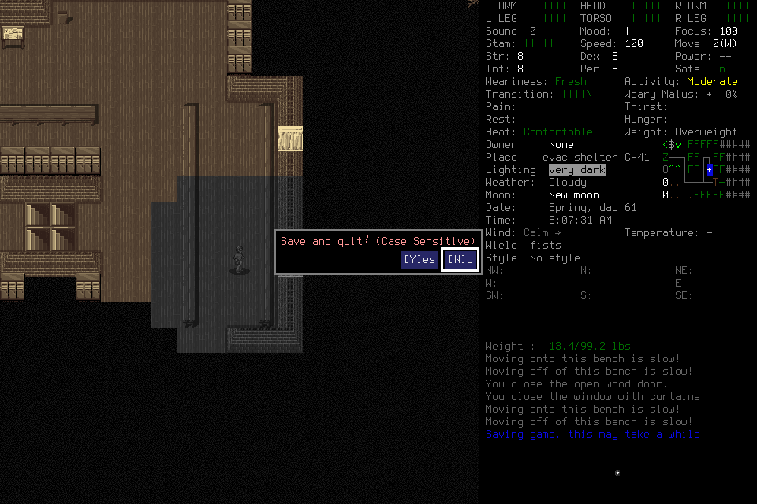

# Generic gameplay host delivered; native configuration remains unqualified

The user-required generic gameplay harness is deployed through
[PR239](https://github.com/CVX-Hull/enactive/pull/239). Every current campaign
player uses the pinned Pi core runner with explicit frozen model, context, tools
and finite limits. Codex gameplay launch/resume/default/fallback and obsolete
selector flags were removed; engineering Codex remains the lead. Model quality
cannot veto this architecture requirement. DSH remains deferred absent a concrete
gap in maintained Pi. Current operation lives in the
[player component](../components/player-interface.md) and
[runbook](../runbook.md#bounded-player-host-activation).

The fresh independent `generic-host-001` actor completed normal identity adoption
but exhausted its twenty-call cap without a useful ordinary goal or normal
Save/owned exit/Finish. This is a failed qualification, not a successful gameplay
configuration or a general ranking of Pi/DeepSeek. The
[derived JSON](2026-10-25-generic-host-qualification.json) records counts, costs,
clocks and hashes of private originals. The
[earlier failed pilot](2026-10-25-pi-configuration-pilot.md) remains unchanged.

## Source and prospective admission

Main `44fa4ba725dd7b2f6e90db09eced4c4cc6f61424` has the same tree
`0bf4437ccf8dbf29d22faef9b2538674d0500e91` as independently reviewed head
`41ccef7b3e56dbf96dbc893cf6dc4b54e60bdbb6`. Actual protected full
[PR validation](https://github.com/CVX-Hull/enactive/actions/runs/40239114066) and
[main validation](https://github.com/CVX-Hull/enactive/actions/runs/40240480587)
each passed2,137 cases/4,057 subtests, attempt1, before native admission.
The final focused driver/lifecycle/host/status checks passed76 cases/245 subtests,
including31 actual pinned Node host/MCP/CLI cases; fast structural checks passed.
Independent source and current-caller reviews resolved consequential findings.
The earlier f805 full CI failures remain failures with unresolved causes under
[#26](https://github.com/CVX-Hull/enactive/issues/26). The reviewed test-only
15s collection policy retains3s diagnostics and a controlled delayed-publication
negative control; it changes no production deadline and proves no latency repair.

The new frozen mission, actor and evaluation profile preceded Start. Pi
agent-core/AI/MCP1.4.0 requested the already approved exact
`deepseek-ai/DeepSeek-V4.1-Flash-1017:zRTkTPfs`, low effort,8,192 output tokens,
45s timeout and zero retries/fallback/compaction. Exact public
[version metadata](https://api.deepinfra.com/models/deepseek-ai/DeepSeek-V4.1-Flash-1017?version=zRTkTPfs)
and [chat schema](https://api.deepinfra.com/models/deepseek-ai/DeepSeek-V4.1-Flash-1017/schema/openai-chat-completions?version=zRTkTPfs)
were rechecked before Keychain access/admission. The older report explains source
conflicts, actual four-call compatibility and immutable-serving uncertainty.
The key entered only the dedicated provider environment, never argv, files,
output, traces or MCP/native children. No global installation/configuration changed.

The same legitimate EnactiveLearning04/Ellis save and unchanged native binary
`96e58aa08e7f8dd74c42f1bd30bc48a11ebd0eca16deac4cd810e1e843b6fe70`
were used. No lead tactics, donor memory, hidden state, save edits or old actor
revival occurred. Limits were512 inputs/mappings/requests,1,024 frames/256MiB,
1,800 wall/43,200 game seconds, with128 inputs/300 wall seconds/128 frames/32MiB
protected reserve and1,740s driver bound. `--max-hosts1` plus20 provider calls
prevented successor activation. The target was one purposeful useful visible
ordinary outcome plus normal ending, without forced learning/handoff/filler.
Ending had to begin by request14 or600 wall seconds, whichever earlier.

## Actual failure and closure

A Load input retained its original unknown acknowledgment. The player observed,
read the exact diagnostic source and reconciled the same root without replay.
After a premature inspection was blocked, it explicitly readmitted, inspected,
recorded character and world Claims, dismissed PLAYER_INFO and completed normal
adoption at request16. The new healthy premature-adoption/Claim-selection refusal
repair was not exercised: no such faulty adoption was submitted. Its native
correction qualification and the separate historical-PNG classification gap remain
owned under [#176](https://github.com/CVX-Hull/enactive/issues/176).

The actor started Save at request17, later than the prospective request14
threshold. The actual screen selected No. It sent ENTER while describing an
intended Yes; the returned normal view established no saved checkpoint. This is
a player interpretation/input error, not evidence of completed saving.

A subsequent Save used an invalid lifecycle scope and was not submitted. Exit
was then correctly blocked because normal gameplay lacked its own verified saved
checkpoint. At22:53:40UTC the host settled `request-limit`, requests20, after
211.315 process seconds; driver exit1, no successor and no Finish. No useful
ordinary goal/procedure application was established; the adopted timeline advanced
zero game seconds. The last unforwarded intent is not inferred.

The custodian used supported Stop and exceptional owned native SIGTERM/controller
SIGINT. Its original `native_cleanup_unresolved=true` remains: the native identity
became defunct before controller reap and no normal exit status was established.
Later exact checks found all five recorded PIDs absent and port8766 closed. That
supplemental closure does not convert the run into a normal ending. Opaque hashes
of all242 save files were unchanged; no save was interpreted, edited or retired.

## Costs, limits and next work

The fresh trace has20 request/response pairs and21 MCP tool pairs. Its closed
ledger has18 requests:10 completed,5 partial,1 unknown,2 blocked; this includes
lead Start and exceptional Stop, while two unsubmitted actor calls have no ledger
row. Eight primitives retain7 returned/1 unknown. Five Claim events comprise two
player identity Claims and three runtime adoption Claims; no procedure exists.
There are26 retained frames/2,249,222 bytes and a438,272-byte SQLite database.

Fresh usage was63,466 uncached input +863,104 cached input +9,635 output tokens,
including4,939 reasoning already within output:936,205 total. Configured base-rate
estimate is **US$0.023652824**. Across four compatibility calls and both twenty-call
failed native runs, **all44 approved calls are consumed**, estimated
**US$0.049413224** at$0.20/$0.60/$0.006 per million uncached/output/cached tokens.
Actual billing and complete lead/reviewer monetary/token/active-effort costs are
unknown. The conservative consumed reservation remains$9.4437376 under the$10
ceiling; lower observed estimates do not renew the call allowance. No further
paid inference is selected or authorized by this report.

Fresh request-start-to-first-chunk median was1,506.1ms; complete median7,553.4ms,
maximum39,039.5ms. These are provider/host boundaries, not isolated inference,
physical display or decision-to-useful-effect clocks. No matched control,
20-useful-goal cohort, useful-task cost or causal harness/model comparison exists.
[#164](https://github.com/CVX-Hull/enactive/issues/164) retains p95<=2s useful
decision-to-visible-effect, unexplained routine stalls<=5s and supported local
useful effects<=500ms. [#145](https://github.com/CVX-Hull/enactive/issues/145)
remains no-go with its existing #164 gate.

[#240](https://github.com/CVX-Hull/enactive/issues/240) delivers the mandatory
cutover and assessment; [#236](https://github.com/CVX-Hull/enactive/issues/236)
closes the bounded negative comparison. Model configuration and normal-ending
readiness remain open under #164, with scoped recovery work under #176.
[#222](https://github.com/CVX-Hull/enactive/issues/222) remains independently
Ready/Next: first qualify the represented-UI real-component positive/negative
probe, then useful learned non-travel procedure/application with normal ending,
within its four-active-hour appetite. A future paid/live admission needs a concrete
fresh allocation; none is implied by that sequencing. The old host worktree was
archived after its attachment became eligible. The remaining clean app-primary
worker checkout stays owned/retained after archive refusal, with copied/hash-verified
private evidence; the app guard was not bypassed.
