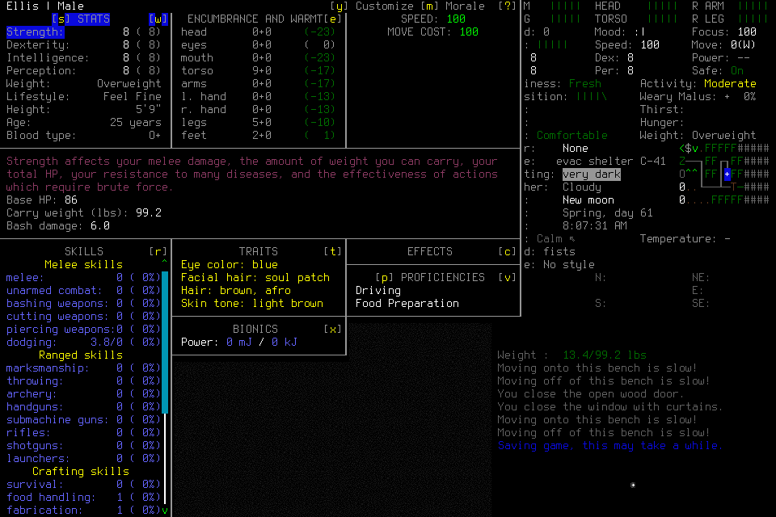

# Pi/DeepInfra pilot: reject this configuration, defer model selection

The bounded `pi-configuration-001` player exhausted its20-request allowance
before establishing useful ordinary play or a normal ending. Reject this exact
configuration for adoption and defer comparative model selection. The failure
includes player sequencing errors and a runtime recovery defect; it cannot establish
whether DeepSeek or Pi is generally better or worse than the existing player.
The [derived JSON](2026-10-25-pi-configuration-pilot.json) retains original counts,
clocks, configured-rate estimates and hashes of private evidence.

Four prior non-game compatibility requests established basic image/tool
continuation, actual null-content history acceptance and exact reasoning replay
through the pinned Pi SDK. That scoped compatibility result stands. No useful
learned procedure/application, fresh successor,20-goal cadence cohort, normal
Save/owned exit/Finish or campaign readiness was established by this pilot.

## Frozen configuration and research

[#236](https://github.com/CVX-Hull/enactive/issues/236) owns the approved US$10 total
ceiling, at most44 DeepInfra requests and prospective quality/stopping criteria.
The actual pilot used source `6c73a2b86f3fd00cfc2a538643d910077d8712be`, Pi
agent-core/AI/MCP1.4.0, MCP6.1/player-view5/procedure3 and native6 binary
`96e58aa08e7f8dd74c42f1bd30bc48a11ebd0eca16deac4cd810e1e843b6fe70`.
The maintained optional host used the existing player MCP/writer boundary; no
second executor, DSH fork, extra adviser or model tier was introduced.

Official sources were checked before compatibility and again immediately before
native admission on2026-10-25. The exact advertised model version was requested
as `deepseek-ai/DeepSeek-V4.1-Flash-1017:zRTkTPfs` through DeepInfra's
OpenAI-compatible endpoint, with explicit string `low` effort,8,192 output-token
cap,45-second request timeout, streaming usage and zero retries/fallback. There
was no automatic compaction or restored host session.

| Primary source | Consequence for this configuration |
| --- | --- |
| [Exact version metadata](https://api.deepinfra.com/models/deepseek-ai/DeepSeek-V4.1-Flash-1017?version=zRTkTPfs) and [version routing](https://docs.deepinfra.com/chat/overview) | Advertised fp8,1,048,576 context and131,072 output capacity; use the explicit version route and our smaller finite output cap. Actual returned backend name omitted the suffix, so immutable serving revision remains unattested. |
| [Exact version chat schema](https://api.deepinfra.com/models/deepseek-ai/DeepSeek-V4.1-Flash-1017/schema/openai-chat-completions?version=zRTkTPfs) and [reasoning contract](https://docs.deepinfra.com/chat/reasoning) | String reasoning effort supersedes older numeric-blog assumptions. The exact schema exposes image content, tools and `reasoning_content`. |
| [Pi integration example](https://docs.deepinfra.com/integrations/pi) | Its older-model `deepseek` thinking format adds another field in the pinned SDK. Use the existing reviewed OpenAI reasoning format matching the exact endpoint contract; no speculative adapter. |
| [Model API page](https://deepinfra.com/deepseek-ai/DeepSeek-V4.1-Flash-1017/api) and exact metadata | Promotional prices were lower. Budget at undiscounted $0.20 input/$0.60 output per million, with no assumed cache saving; estimates below use configured cache-read $0.006/M. Billing is unknown. |

The published assistant schema rejected Pi's `content:null` during offline
validation. A diagnostic omission copy passed, but production serialization was
unchanged. Actual HTTP200 compatibility resolved this candidate's parser gap;
the failed schema receipt remains. The four actual calls correctly described a
synthetic red square/blue circle/digits47 image, continued after one read-only MCP
tool, accepted null assistant content and replayed exactly2,975 actual reasoning
characters. This is basic compatibility, not gameplay perception or skill.

The exact Keychain item was read only into the dedicated provider process's
environment. No credential entered argv, files, traces or the MCP child. Earlier
failed locator attempts remain retained. Dependencies, caches and outputs remained
project-local; no global configuration or installation changed.

## Actual outcome and failure

The independent player loaded the legitimate existing EnactiveLearning04/Ellis
save previously ended normally in007. It received frozen context and16 selected
player tools. The lead supplied no tactical keys, memory curation, save edits or
hidden-state solution. Original mission limits were512 inputs/mappings/requests,
1,024 frames/256MiB,1,800 wall/43,200 game seconds, with protected128 inputs,
300 wall seconds and128 frames/32MiB. One optional fresh successor had a separate
20-request ceiling under the same mission/driver bounds; none activated.

The pilot started at21:13:28UTC. An original Load input had an unknown ACK after
the15-second controller deadline; later observations and explicit same-root
reconciliation established its effect without replay. A premature identity
inspection was correctly refused until separate readmission. The player then
opened PLAYER_INFO and retained only the character Claim. It attempted adoption
without first dismissing the screen or providing the world Claim.

Rejecting that request was correct. The runtime's generic failure cleanup then
discarded the otherwise valid lifecycle phase and lease. Two subsequent dismissal
attempts were not submitted; later Observe failed the strict missing-adoption
history invariant. That invariant must remain strict. Model error triggered the
failure, while the irreversible escalation belongs to the runtime. It is not
reasonable to attribute the complete result solely to either model or harness.

The host settled at its hard20-request cap after about256.57 process seconds.
The driver returned1. No normal ending occurred. The lead used supported Stop,
then exceptional SIGTERM for the exact owned native process and SIGINT for the
controller. The supervisor's original `native_cleanup_unresolved=true` flag remains
unaltered: native identity changed after TERM, and its exit status is unknown.
Later OS checks proved all five recorded owned PIDs absent and port8766 closed.
This is exceptional closure, not normal Save/exit/Finish. Opaque before/after
hashes of all242 save files were identical; no file was parsed, edited or retired.
The first launcher import-path failure preceded any controller/admission/provider
call and was corrected with process-local PYTHONPATH; its receipt also remains.

## Counts, costs and clocks

| Measure | Compatibility | Native original | Combined |
| --- | ---: | ---: | ---: |
| Actual provider requests | 4 | 20 | 24 |
| Uncached input tokens | 1,180 | 55,700 | 56,880 |
| Cached input tokens | 640 | 850,560 | 851,200 |
| Output tokens, including reasoning | 1,203 | 14,259 | 15,462 |
| Reasoning tokens already within output | 1,038 | 10,216 | 11,254 |
| Configured base-rate estimate, USD | 0.00096164 | 0.02479876 | 0.02576040 |

These are normalized provider usage and configured-rate estimates, not invoices.
All20 native responses reported usage. Sum uncached input×$0.20, cached input×$0.006
and output×$0.60, then divide by one million; do not add reasoning again.
Provider-billed totals, account balance and lead/reviewer token/currency totals
remain unknown. Cost per completed useful gameplay task is unqualified because
none was established. Unknown billing is not a reported zero.

The conservative reservation was$0.2146304 per call at full context/output,
including failed/unknown calls:24 calls consume$5.1511296 of reservation, while
all44 would reserve$9.4437376 under the$10 ceiling. No further requests are selected;
unused allowance does not revive the failed actor or authorize a new pilot.

The native trace contains20 request/first-chunk/completion sets and18 actual MCP
tool-start/result pairs. The mission ledger has14 admitted requests (8 completed,
2 partial,1 unknown,3 blocked),5 primitives (4 returned,1 unknown), one Claim and
zero procedures. SDK validation and read-only source calls explain why these
counts differ. SQLite is393,216 bytes;18 PNG frames total1,313,961 bytes.
No adopted normal timeline exists, so game seconds are unknown.

Actual forwarded native payloads total12,107,069 compact JSON bytes, including
1,571,190 UTF-8 text bytes and6,817,056 decoded image bytes across repeated history.
These are repeated request content, not unique evidence, provider tokens or
attention. Headers/keys were excluded. Intermediate assistant content is available
only when forwarded later; the last unforwarded intent must not be reconstructed.
Private body logging cost remains included in the actual host clocks.

| Native request-start interval,20 requests | Median | Maximum |
| --- | ---: | ---: |
| To response headers | 920.7ms | 1,420.7ms |
| To first response chunk | 1,555.9ms | 2,265.4ms |
| To complete provider response | 6,499.2ms | 41,681.8ms |

First chunk is a transport endpoint, not inference start. These timings include
request/serialization/network/provider work as observable at the host; they do not
measure decision-to-useful-visible-effect or physical display paint. No passing
p95, unexplained routine-stall criterion or local useful-effect cohort follows.
The unchanged #164 requirements remain20 genuine useful routine decisions,
p95≤2s decision-to-visible-effect, unexplained stalls≤5s and supported local useful
effects≤500ms.

The historical [Codex007 comparator](2026-10-25-useful-play-seventh-assessment.md)
used gpt-6.1-sol/low with an adviser, older source/context and an earlier legitimate
save state. It made supplies/shelter/travel progress, revised/applied travel
procedures, activated a fresh successor and ended normally:85 requests,84 primitives,
232 frames and51 observed game seconds in about23.8 minutes. It too lacked a
qualified routine cohort and model-ready timing. This unmatched whole-configuration
contrast cannot isolate harness/model effects, compare billed cost or rank models.

## Source repair, review and publication

[PR238](https://github.com/CVX-Hull/enactive/pull/238) added detached actual provider
request bodies to the existing private trace before admission. Focused checks
passed39 Python cases/118 subtests, including the31-case Node wrapper, and independent
review rechecked the concrete freeze. Full PR run
[40231964251](https://github.com/CVX-Hull/enactive/actions/runs/40231964251) attempt1
failed three synthetic setup/collection paths before their intended targets.
The exact cases passed locally (3 cases/11 subtests), and unchanged full attempt2
passed2,121 cases/4,006 subtests. Full merged-main
[40233760409](https://github.com/CVX-Hull/enactive/actions/runs/40233760409) passed the
same counts before admission. Causes of the first failures remain unresolved/not
reproduced; maintenance[#26](https://github.com/CVX-Hull/enactive/issues/26) owns
recurrence diagnostics. No production timeout was changed and no failed CI was waived.

Independent closed-run review identified the adoption-recovery defect. The narrow
repair returns actionable blocked feedback and the actual PhaseReceipt for
premature adoption or incomplete/unknown/wrong-subject caller Claim selection,
only after custody, lease, exact evidence, deadline, budgets and storage checks.
It preserves the original phase/checkpoint/lease/limits without input, refresh,
automatic dismissal, Resume, invented Claims or adoption. The new refusal paths
retain fatal handling of their checked health faults; no native/schema/persistence
contract or strict history invariant is weakened.
The source PR linked from #236 owns the final focused/review/protected publication
receipts. Those source checks cannot retrospectively qualify this failed native
run or establish actual native correction usability; that branch remains unqualified.

Source review found and repaired a private-to-public stage mismatch before
publication: a premature request at `world_confirmation` initially emitted an
invalid public PhaseReceipt. The correction retains the private phase and maps
it to the existing public `awaiting_control`, without a schema change. The new
regression initially omitted the confirmation's required visible question; that
request was correctly refused. Supplying the exact question made explicit
continuation pass; the failing fixture receipt remains retained.

Review also reproduced a pre-existing gap in the later candidate-proof
`ContractError` catch: corrupt historical world PNG evidence can return blocked
while retaining the phase/lease. The strict candidate check prevents adoption;
the catch does not consistently retire unhealthy history. The current-checkpoint
helper does not repair that historical classification, and blindly rethrowing
every EvidenceError would also destroy intended semantic correction. #176 owns
a separately scoped classification/retirement repair and its negative/correction
checks. This closeout does not claim exhaustive adoption-history fault handling.

Lead integration checks passed69 lifecycle/creation cases and41 subtests before
the public-stage correction. The final adoption/premature-identity cohort passed
6 cases and22 subtests with real loopback fixtures. Fast structural checks passed.
Independent source review rechecked the stage correction and explicit continuation;
independent evidence review recomputed counts, costs, clocks and retained hashes.
The source PR owns the exact final protected CI receipts, rather than treating
these focused source checks as full regression or native qualification.

## Disposition and next iteration

Close #236 as a completed bounded negative selection decision after source/evidence
publication. Retain the optional Pi host for controlled experiments, with actual
endpoint compatibility limited to this tested version/configuration. Do not adopt
this failed gameplay configuration, retry it automatically or claim a speed win.
DSH remains deferred until a concrete maintained-Pi gap justifies another host.

[#222](https://github.com/CVX-Hull/enactive/issues/222) remains the independent Ready
candidate: first probe current represented-UI program behavior, then separately
freeze useful learned execution beyond travel and a normal ending. Its original
scope and four-active-hour appetite remain; no DeepInfra dependency or blanket
validation gate is added. #164 retains complete useful cadence and future
configuration selection; #176 retains unsupported pre-identity normal cleanup
and observed lifecycle fallback/qualification. #145 remains no-go with its actual
#164 readiness gate. Any future native correction check or provider comparison
needs its own prospective purpose and finite admission, preserving these costs.

Private originals, frozen manifest and one-off reducer remain under project
`.runtime/host-model236/`, `.runtime/campaigns/pi-configuration-001/` and
`.runtime/missions/pi-configuration-001/`. The JSON publishes derived receipts and
selected hashes, not the complete private trajectory. The earlier host worktree
is retained because app archival refused its primary-checkout attachment; its
ignored preparation evidence was copied and hash-verified into the primary project.
