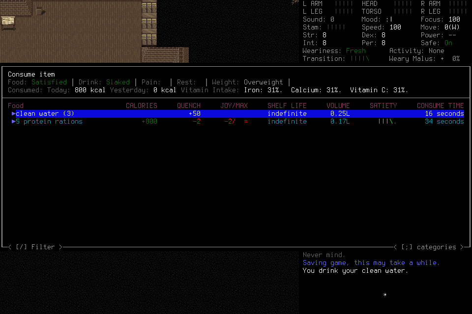
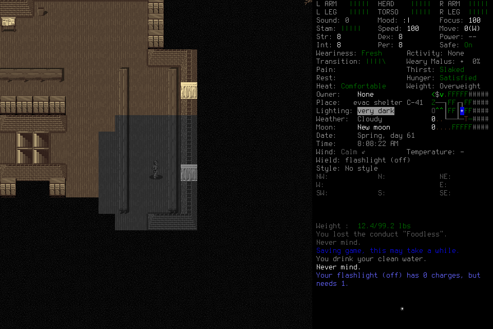
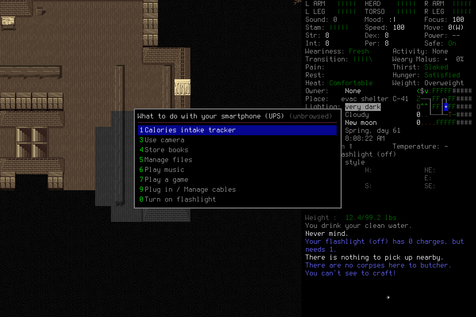
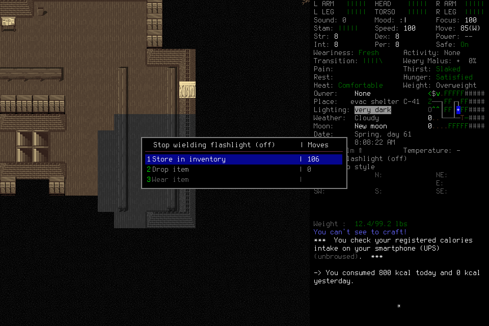
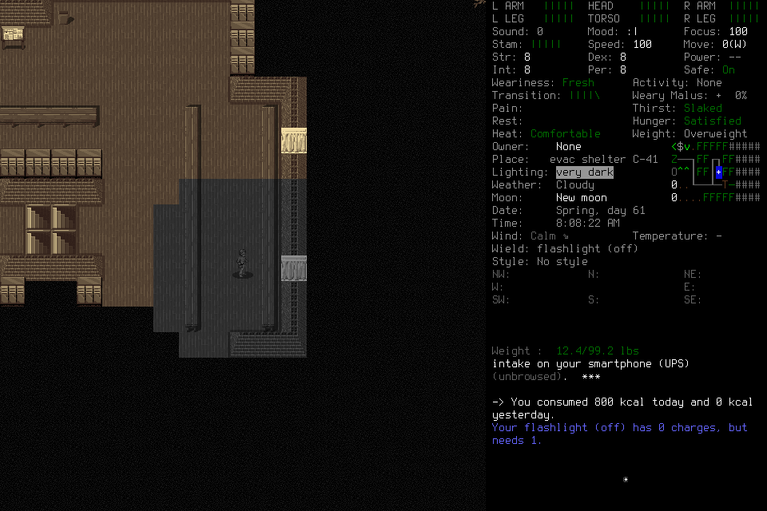
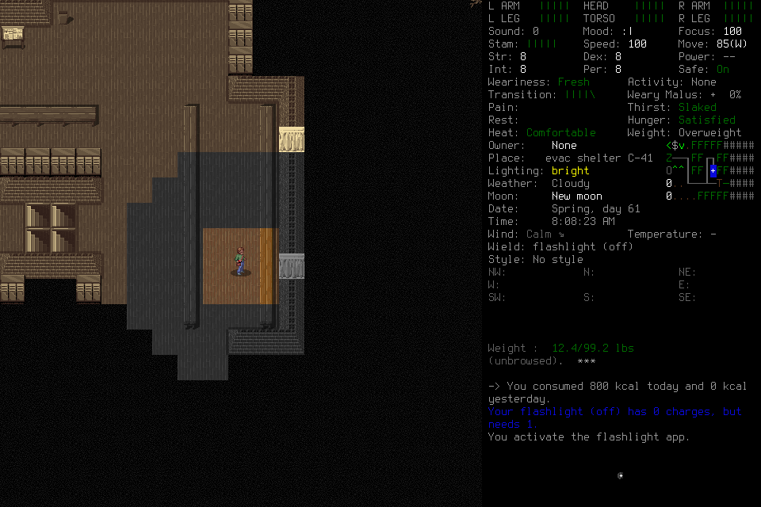
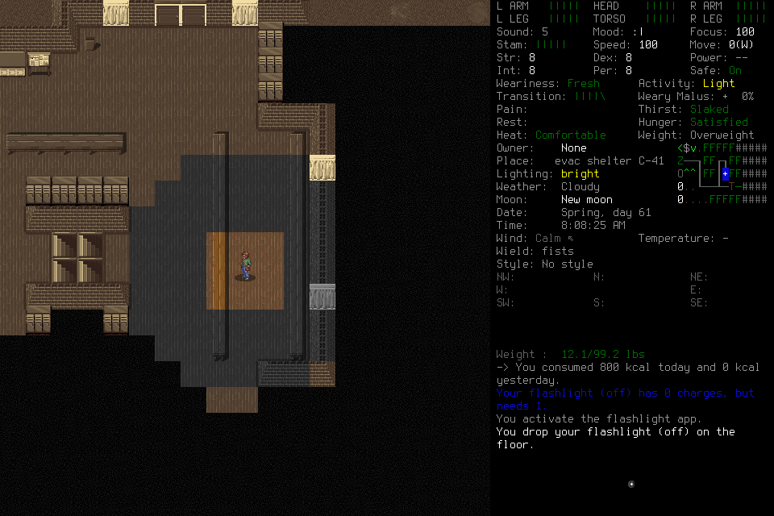
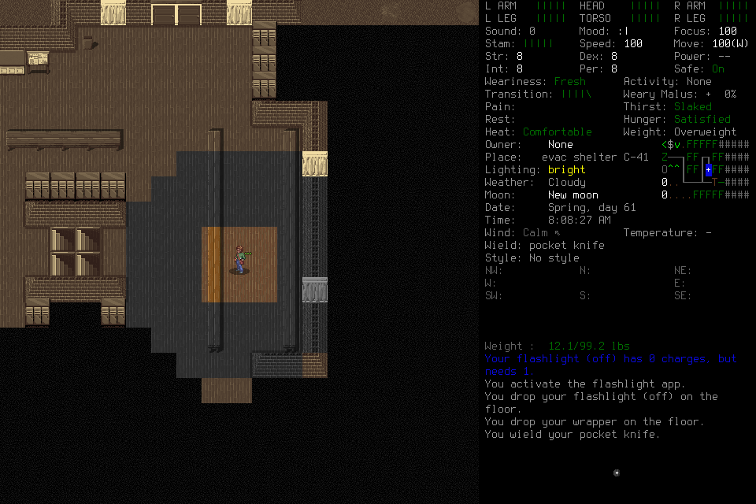
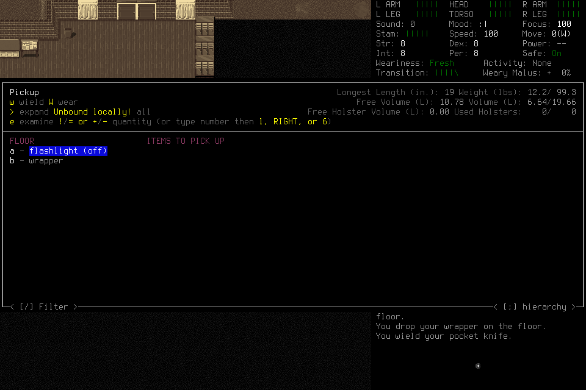

# Program breadth: useful effects, failures and normal ending

The tested probe program follows a represented non-travel UI workflow across
reordered rows, yields on missing/disabled/ambiguous required representation,
and retains ordinary fallback under the original root and limits. These are
properties of that tested policy, not automatic semantic checks on learned code.
The [new probe](../../tests/test_program_ui_execution.py) found no production
executor gap. It uses real JavaScript, MissionRuntime and its writer with the
existing synthetic transport and trusted-admission fixture. It is **source-contract
evidence only**. The separate native cases below supply actual learning and a
narrow useful effect. Case009 combines player-derived conditional row selection,
same-root ordinary completion of useful lighting, and registered normal ending.
This is a program-assisted workflow, without whole-player apparent-latency
qualification or fully automated final-menu handling. Case010 adds a narrow
knife-equipping effect with an unintended wrapper drop and inaccurate player
self-report, separating usable authoring syntax from reliable semantic behavior.

[#222](https://github.com/CVX-Hull/enactive/issues/222) owns the useful
learned-program outcome and its publication/closeout. Every live assessment uses its own frozen finite
allocation; the source probe itself starts no game or provider call. The
mandatory generic Pi host remains current independently of model selection.
The separately scoped #251/#253 follow-through is recorded in010; each actor
retains its own original conditions and failures.
The later [target-selection guidance screen](#target-selection-guidance-screen--26-october-2026)
records a rejected candidate and assessment-context limitations; it starts no
eleventh native case or responsiveness claim.
The later [canonical contract presentation](#canonical-program-contract-presentation--26-october-2026)
verifies the existing program shape in the actual offline MCP/Pi loadout; model
understanding and useful play remain separate qualifications.
The fresh [complete-context baseline and native011](#complete-context-baseline-and-native011--26-october-2026)
passes its synthetic gate and records ordinary flashlight pickup/normal ending,
with unexecuted program drafts, failed revision and marking-representation limits.

## Tested path and causal controls

The probe uses one explicitly selected eligible Procedure/3 revision and a
program-owned root (`phase_id=null`). It reuses
[ProgramInputSkill](../../harness/gameplay/program_input.py), Program-view/1 and
the existing [bounded JavaScript evaluator](../../harness/gameplay/policy_program.py).
No new executor, registry, schema, dependency or production behavior was added.
The inherited fixture assumes already-proven identity for temporary core tests;
it neither exercises nor bypasses production admission in a real game.

The synthetic transfer workflow has two positive variants. With stable rows,
the program makes two downward selections; after rows reorder, it recomputes
from the current selected row and moves upward instead. Both independently
assert the fixture's transfer effect and the selected target, not merely program
`done`. Each retains four primitive deliveries in one request, five evaluations,
exact before/after sources, pinned procedure lineage and unchanged original
request bytes. Fixture coordinates remain unchanged: this is non-travel coverage.

Four negative variants remove the required UI/target, disable it or make its label
ambiguous after the opening input. The program yields without activation; a
deliberate ordinary cancellation retains the same root, procedure lineage and
cumulative two-input allowance. A separate three-input cap stops before target
activation and explicitly checks that a child cannot replenish the exhausted
original local allowance. Existing program tests retain Pause/fault/unknown-delivery
stopping and collection without replay; healthy semantic yield is a different path.

The maintainer-written fixture program is not supplied to a future player or
credited as organic learning. Program-view still lacks PNG pixels/hidden state;
null UI remains unavailable. A generated program's semantic applicability and
actual useful effect still need independent judgment and real qualification.

## Verification and remaining outcome

Inspected base: `b8e3ebec087f517f3c6b07044db741aaae10cf49`.
Worker source commit: `c8e1750679ec9ee8be7804950663c229e671cc95`, integrated as
`04f885b`. Focused primary checks passed17 tests/6 subtests in8.98s; independent
focused review also passed17/6. Two existing py_mini_racer dependency deprecation
warnings remain. Review found a weak blocked-only assertion; the lead added the
specific original-allowance reason check and reran that case successfully.
Protected exact-candidate PR/main profiles and their actual outcomes belong in
the implementation PR under the existing delivery policy; these local results
are not a full-regression or native-build claim.

The frozen required integrated result is a player-derived/adopted conditional procedure
actually advancing a useful non-travel workflow, followed by normal registered
Save/owned exit/Finish. Apparent whole-player latency means useful visible progress,
exposed stalls and yield/recovery, retaining authorship/revision/wait/failure costs.
A local program may hide slow model calls; API duration/count and JS evaluation
are diagnostic measures. This source probe supplies no useful-effect timing cohort,
physical display clock or causal benefit claim. The full20-useful-decision cohort
and unchanged responsiveness/readiness gates remain
[#164](https://github.com/CVX-Hull/enactive/issues/164); the smaller breadth result
does not inherit that quota or qualify the seven-day campaign.

## Two actual finite cases

Both cases used merged source `1a98ad91`, the same native binary
`96e58aa08e7f8dd74c42f1bd30bc48a11ebd0eca16deac4cd810e1e843b6fe70`,
the legitimate EnactiveLearning04/Ellis save, and the mandatory Pi host with
`deepseek-ai/DeepSeek-V4.1-Flash-1017:zRTkTPfs`, low effort and8,192 output tokens.
The provider's returned name omitted the version suffix; immutable backend
serving remains unattested. Full PR40244466503 passed2,140 cases/4,063 subtests;
main40245122931 passed its main-smoke116/358 profile before admission. Neither
is a native outcome. One fresh deciding actor per case owned tactics, evidence
interpretation and learning; no adviser, donor procedure, lead keys, hidden state
or save edit was supplied.

Each mission had512 input/mapping/request,1,024 frame/256MiB,2,400 wall-second
and43,200 game-second bounds, with128 input,600 wall-second and128 frame/32MiB
ending reserves. Ending was to begin by1,500s and complete before2,100s; the
driver was bounded at2,340s. Prior actors and uncertain inputs were not revived.
The user's necessary-budget-expansion approval funded concrete finite allocations;
it did not authorize automatic retries.

| Case | Actual result | Ending and closure |
| --- | --- | --- |
| `program-breadth-001` |37 requests, about480s, no Procedure/program or useful needs effect; configured45s request guard terminated request37 after HTTP200/body onset. No final usage or tool dispatch survived. | No Save/exit/Finish. Guardian Stop and exceptional cleanup; original native-cleanup-unresolved flag retained. Later all five exact PIDs were absent and port8766 closed. All242 opaque save identities unchanged. |
| `program-breadth-002` |55 requests,838.053s, one game second,39 spent inputs/102 frames; two stored Procedures, three submissions and two actual invocations. Narrow learned wield effect, failed parameterized follow-through. | Actual SavedCheckpoint and OwnedNormalExit0, but no Finish. All five exact PIDs absent and8766 closed; no exceptional native signal was needed. Eleven of242 opaque save identities changed during normal saving, with no interpretation/edit. |

Case001 proves its timer mechanism, not isolated provider capacity, inference
latency or a source fault. One completed call took44.678s. The lead admitted002
with a120s request guard under unchanged apparent-response and normal-ending
criteria; both the failure and its full resource reservation were retained.

## Actual learning, useful effect and limits

In002 the player selected lighting for the visibly dark shelter. V1 was authored
from that actor's inventory/wield observations at request32 (memory sequence19),
then explicitly selected under a new program-owned root at request33. It reads
current represented rows, matches the target label, joins selected row IDs and
recomputes direction on each step. Ten evaluations produced nine returned inputs
(`w`, seven downward selections, confirmation), visibly changing fists to the
intended flashlight. This is narrow item-preparation advancement beyond cursor
motion. The next actual activation test exposed zero charges: **no illumination
or completed lighting solution occurred**.

After an initially refused parent revision and explicit Context retrieval, V2
was stored at sequence32 and selected at request38 with a smartphone parameter.
Twelve evaluations/eleven returned inputs culminated in a **Stop wielding
flashlight** Store/Drop/Wear prompt. Program `done` did not mean task success.
The player recognized the mismatch and cancelled it at request39; the flashlight
remained wielded. Credit conditional parameterization/application, not a second
successful wield. Neither version branches on battery state or handles that new
prompt. Native missing-row yields, upward navigation and broader variation were
not exercised; the source negatives above remain a separate lane.

V1 tool execution took1.937s. Nine same-process local receipt intervals totalled
1.731597s, ranging166.226–231.618ms; final selection to the wielded-result capture
took211.794ms. V2 took2.448s, with eleven intervals177.859–234.862ms, but ended in
the wrong prompt. Browser history joins V1 final frame219/revision47 to a92ms
capture-to-DOM proxy and10.2ms decode; V2's prompt proxy was223ms/11ms decode.
These assume the shared wall clock and do not measure physical paint.

The local loops show useful conditional execution without a model round trip per
arrow. Exposed waits remain: inventory result to the next close attempt119.131s;
V2 prompt to cancellation58.291s. Discovery/authorship/correction are distinct
cohorts, not automatically unexplained routine stalls, and all costs remain in
the episode. This small sample supplies no valid whole-player p95, broad500ms
usefulness qualification or causal learning benefit.

## Missing Finish and bounded diagnosis

Request46 reconciled the original unknown save confirmation into a completed
SavedCheckpoint. Request52 returned OwnedNormalExit0 linked to that checkpoint
and exact launch, preserving an unknown input ACK. Ending started at716.576s.
Request53's Finish was **not submitted** because its selected snapshot lacked a
source. It also supplied nonempty identity claims, whereas canonical Finish
requires none. Request54 read the retained final source; request55 failed with
HTTP400 before another action. The mission remained paused. Exit, Stop, cleanup
or a later case cannot retroactively supply Finish.

The failed request contained31 image parts after a30-image previous request.
Its original error body was not retained. An exact-payload diagnostic was rejected
before execution by automatic approval review because it would separately export
real mission history/images; no such replay, credential read or charge occurred.
Two subsequent isolated requests used only the inspected synthetic red-square,
blue-circle/digits47 fixture, the exact model/route, low effort and512 output tokens:
31 parts returned `Too many images in request: 31 > 30`;30 returned HTTP200 and
stream onset. This strongly explains002's error, without recovering its missing
body or qualifying the8,192-output gameplay configuration.

Private evidence remains under `.runtime/campaigns/program-breadth-00{1,2}` and
`.runtime/missions/program-breadth-00{1,2}`: frozen assignments/configuration,
original JSONL/ledger, real frames, browser mid/final timing exports, process
custody/closure, opaque save manifests and closed accounting. Synthetic probe and
rejection receipts are under `.runtime/iteration222`. Raw provider requests,
images and reasoning stay private; no key/header was retained.

Known configured-rate usage estimates are$0.046510544 for36 completed001 calls
and$0.079014448 for54 completed002 calls; these are not invoices. Failed final
calls and synthetic stream usage/cost are unknown. Conservatively reserving every
call at$0.2146304 gives94 actual requests/$20.1752576 of the existing$25 ceiling,
including both synthetic calls. No unknown cost or failed request is free.

At the60–90 minute fit checkpoint, the selected bounded repair is an
explicit bounded image-history policy on Pi's maintained context hook, preserving
all text/tool pairing and original images, declaring historical omissions and
protecting the latest result group. No new executor or model bake-off follows.
Source qualification and a separately frozen actual application with normal
Save/owned exit/Finish remain necessary; #222 stays open.

## Image-history source repair

The coordinated `pi-player-host/2` route now requires a positive integer
`max_context_images`; version1 is rejected rather than upgraded implicitly.
Pi's maintained `transformContext` hook projects copied messages, keeping newest
historical images, every text/reasoning/tool pair and the whole latest tool-call
result group. Older image parts become explicit tool-call/index/SHA256 markers
which grant no authority or source-read proof. Original messages and complete
MCP result traces retain their pixels. Oversized current groups stop before
incrementing the next provider-request counter. No automatic reread, retry,
text compaction, new executor or dependency was added. The guide also clarifies
the existing post-exit source selection and empty-identity-claims Finish contract.

Worker source `0932e6c` was integrated as `cbc7e92`. Actual pinned serializer/MCP
and CLI tests passed35/35 independently in the worker and integrated checkout;
the campaign fixture passed44 tests/151 subtests. Initial worker sandbox checks
had eight loopback-bind EPERM failures; the isolated loopback rerun passed.
The lead's final wording explicitly disclaims source-read proof. Fast governance,
reference and diff checks passed. Protected source publication is recorded in
[PR243](https://github.com/CVX-Hull/enactive/pull/243), whose reviewed tree became
`d0b3fa064df59a66e4d27aa7411f100f771150de`. Actual PR and main profiles were both
full, before subsequent admission. These fixtures do not qualify gameplay or
apparent whole-player responsiveness.

## Later cases: setup planning and real hydration

Both later cases used that unchanged published source/native/model configuration,
version2 with30 image parts, low effort,8,192 output tokens and120s provider guard.
They used fresh actors and legitimate game-owned saves, with no prior actor's
memory, tactical recipe, adviser, hidden state or revived input authority.
Actual full source evidence was retained and rechecked before credentials/Start.

| Case | Actual outcome | Limits and closure |
| --- | --- | --- |
| `program-breadth-003` |27 requests,318.107s host span; no adoption, Procedure, useful effect or normal Save/exit/Finish. | Actor chose an8-input/120s Load root. It expired during identity work; the world Claim and dismissal were also unfinished. Host return0 was conversation completion; driver correctly returned incomplete. Guardian exceptional SIGTERM/transient defunct flags retained; later all five exact PIDs absent and8766 closed. All242 opaque save identities unchanged. |
| `program-breadth-004` |52 requests,873.705s host span; normal adoption and one actual learned hydration application, but no normal Save/owned exit/Finish. | One prospectively allocated24-input/600s Load envelope, unchanged global/ending guards. Later wrong-phase poll faulted control while the program root was still live. Same exceptional cleanup and eventual exact-process/port closure. Twelve of242 opaque save identities changed; no save interpretation/edit or hydration-persistence claim. |

The supplied guide already required the entire Load lifecycle to share one finite
allowance, including identity, Claims, dismissal and adoption. The schema allowed
more than120s;003's limit was selected by the actor. The successful002 Load used
24 inputs/300s and adopted about204.3s after opening. After independent review,
the lead adjudicated one004 case with a prospective resource forecast:
600s setup +600s useful application +300s normal ending +300s slack =1,800s
before the protected600s reserve. This supplied no game keys, identity evidence
or renewed root. The actual allocation worked in004, including corrected world
grounding, without establishing causal performance improvement. Aggregate active
agent effort was not reliably metered; elapsed/CI/native clocks are not that total.

In004, memory sequence22 stores a source-grounded Procedure revision. Request30
deliberately selects it under its own new root and immutable use lineage. Its
conditional state machine inspects represented consume-list rows and counts,
intends water then ration consumption, and can navigate or yield on unexpected
representation. Only **two actual evaluations/returned inputs** occurred: `E`
opened the consume list; `ENTER` started consumption of the initially selected
water. There was no native navigation branch, revision, program `done` or `yield`.
A later program request was blocked before evaluation/input and is not a second
executed application.

The real before list shows clean water4. The completed-effect frame shows3,
“You drink your clean water” and Drink **Slaked**. This is useful non-travel
advancement, rather than cursor movement or program success assertion. The prior
ordinary ration consumption was exploration; the program did not finish its
ration/close stages.

Program tool execution took0.663s. Same-process delivery intervals were281.316ms
opening the list and172.741ms starting consumption. That second endpoint is a
**6% consuming** frame, not completed hydration. The completed effect reached the
retained poll result11.648s later, including intervening model/tool decisions;
this is not isolated native consumption time. Exact frame172/revision43 joins
browser capture-to-DOM at281ms and decode15.3ms under the shared-wall assumption.
Other frames share revision43; their identities cannot substitute for this capture.
No whole-player p95,500ms useful-effect cohort or causal learning benefit follows.

## Wrong-phase poll and bounded source follow-through

The first activity-scope poll at request31 was unsubmitted. Request32 correctly
used the published prompt scope and returned a menu with `stage:awaiting_control`.
Request33 explicitly retrieved that state. Request34 nevertheless polled again
against the menu source. The runtime rejected it **before native observation/input**
because it was no longer `activity_poll`; generic failure handling then paused
and revoked the lease. This occurred around454.42 host seconds, before the
original240s program root's deadline near639.16 host seconds. Later expiry
compounded failed recovery; it did not cause the original fault.

This is confirmed caller misuse followed by existing fail-closed behavior, not a
demonstrated native delivery failure. Normal Save and exit attempts were blocked;
no registered checkpoint or Finish was produced. The actor's final≈42-call,
≈835s-remaining estimates were wrong: actual counts were52 requests/15 charged
inputs/49 retained frames, with about1,525.6 mission-wall seconds remaining.
Tracked game time34s ends at the last normal anchor, not a full post-water total.
The actor's “unsaved” conclusion is also unproved: no registered checkpoint is
established, while12 opaque file identities changed. Their contents were not read.

The selected snapshot already exposed the wrong boundary. The bounded follow-through
adds a pure pre-staging composer refusal for child `poll` when that selected source
is not `activity_poll`. It preserves live receiver checks, fault stopping, original
limits and unknown-request collection; it does not infer freshness, close the
phase, choose an input or restore control. A future qualification needs its own
prospective source/resource freeze; no further live case follows automatically
from these closed cases. Neither failure can be repaired retrospectively.

The narrow composer change was authored as `1bacd72e`, integrated as `9e9c5e8`.
Focused producer, player-tools, invocation and HTTP integration checks passed
77 tests/188 subtests in the worker and integrated checkout; two existing
dependency warnings remain. Initial worker sandbox checks had six loopback-bind
EPERM failures; the isolated rerun passed. Positive fixtures were corrected to
use actual activity-poll boundaries. Tests retain metadata/schema validation
precedence, valid inherited root fields and original limits, and verify known
refusal without staging, submission or refresh. Runtime guards were not changed.
Fast governance/reference/diff checks passed. These are source fixtures, not a
new native normal-ending qualification; protected publication belongs to the PR.

## Prompt caching and whole-player performance

[DeepInfra's current automatic caching contract](https://docs.deepinfra.com/chat/prompt-caching)
matches repeated prompt prefixes. Inspection of the actual requests confirms
stable system/tool definitions and no explicit cache key or retention options.
The pinned Pi short-retention option does not send a key on this base URL.
[Explicit paid retention](https://docs.deepinfra.com/chat/prompt-cache-retention)
has separate model support; its current table does not list this DeepSeek model.
Schema presence alone is not evidence of that support.

Known reported input was97.2% cached in002 and97.3% in004;002's per-response range
was18.8–99.7%, median97.1%. These observations coexist with exposed waits and
failed ending; they establish no apparent-speed or causal cache benefit.
Constructed JSON bodies totalled104,870,345 bytes in002 and90,703,955 bytes in004,
with maxima3,820,017 and2,883,599 bytes. These are uncompressed body sizes, not
measured wire/upload time or isolated serialization cost.

Neither003 nor004 exercised historical image omission: retained maxima were9
and22 images. The image-window/cache-prefix tradeoff remains unqualified natively.
Changing an older image to a marker can shorten prefix reuse; it must be assessed
from actual usage/request bodies when naturally encountered, rather than assuming
fewer images means faster progress. No extra paid cache experiment was introduced.
Context growth, reasoning/output, host projection/serialization/trace I/O, tool/
native capture/storage, display proxy, useful local coverage and recovery remain
separate performance lanes. Missing endpoints stay unknown. #164 owns the broader
whole-player acceptance; cache hits and model-call timing are diagnostic.

Across these fresh allocations, actual requests total173 (37+55+27+52 plus two
synthetic diagnostics), conservatively reserved at$37.1310592 within the$40 ceiling.
Known configured-rate estimates across169 reported responses total$0.24035928;
failed final/synthetic usage and all invoices remain unknown. These are DeepInfra
estimates, not aggregate lead/agent engineering cost. No failure or cache saving
refunds the allowance. The old separate44-call allocation stays closed.

The integrated #222 result remains **incomplete**: useful learned non-travel
advancement is evidenced, while the required normal Save/owned exit/Finish in
the same assessment is absent. Source fixes, process closure and real hydration
cannot substitute for that acceptance or qualify campaign readiness.

## Post-publication005: Load reached a menu, without normal adoption

[PR244](https://github.com/CVX-Hull/enactive/pull/244) published the composer
refusal on merged source `7dd4ee8bcf3a8a418d82865e68d29e981e5c8a4e`, with the
same tree as reviewed `4d51e028`. Exact protected full PR validation passed
2,145 tests/4,075 subtests; actual main validation selected and passed
main-smoke118/365. The PR owns the independent review and exact run receipts,
including retained earlier fixture failures. Neither profile is native evidence.

After the user's explicit approval of necessary budget expansions, the lead
froze one separately reviewed005 assessment on that source. The source/native,
model and player restrictions remained fixed; this was not restoration of an
old actor. The cumulative ceiling became$60: at most90 new requests after173
fully reserved prior requests, or263 total at$56.4477952. The old separate44-call
allowance remained closed. The complete initial Load root had24 primitives/600s;
normal ending had to begin by1,200s or before the last16-request reserve and
complete before1,800s, preserving600s within the2,400s mission. Exact publication
and final filled-package review preceded credentials, Start and inference.

The actual host ended after298.518s and26 provider requests. Source-free owned
Launch succeeded. The player opened the registered Load root and confirmed the
highlighted world, then the highlighted Ellis row in the actual character list.
The second `ENTER`, native request `08250d82-747a-43ca-9a87-fe08a680b6c7`, became
unknown across the session transition. The player collected its original
operation and never replayed it. Actual charges were **three primitives: one
returned Resume, one returned ENTER and one unknown ENTER**. The actor's final
description of three returned plus one unknown was incorrect.

Later native observations reported a changed session, `in_game=true`, paused
with origin `host`, and an INVENTORY/menu receiver with clean water3 and five
rations. They had no normal-play scene. Lifecycle Observe requires normal play
with a scene for this Load transition and rejected that menu before ingesting
a candidate after-source. Subsequent explicit-source reconciliation could not
satisfy the retained-after-source requirement. Null-source attempts were also
caller errors; correcting those selections did not produce the absent normal
endpoint. The native observation's empty request `id` is not an observation
identity, and does not by itself establish the actor's claimed custody defect.

Native source distinguishes menu receivers from normal play and clears pending
input on world/session change rather than acknowledge an action from the old
world. It does not establish that loading must immediately expose normal play.
This is consistent with the unknown acknowledgment; the exact causal native
event ordering and reason the inventory appeared remain unproved. No supported
continuation from this particular post-load menu was demonstrated. A menu, a
changed session or `in_game=true` cannot substitute for normal evidence, grounded
identity Claims, explicit dismissal/adoption or input authority. Existing
unexpected-transition/owned-unadopted work in
[#176](https://github.com/CVX-Hull/enactive/issues/176) owns that scoped follow-up.

No Claims, Work, Procedure, program execution, normal adoption, useful effect,
registered Save, owned normal exit or Finish occurred. The005 case therefore did
not exercise the new poll refusal and cannot qualify it natively. Player Stop
and custodian SIGTERM were exceptional closure. The original cleanup receipt
retains its transient defunct/unresolved flag; a later independent OS check
found all five recorded PIDs absent and port8766 closed. All242 opaque save-file
identities were unchanged. No save contents were interpreted or edited.

All26 responses reported usage:62,648 uncached input,1,219,968 cached input,
16,110 output including10,475 reasoning tokens. Configured-rate estimate was
$0.029515408; the full-case reservation was$5.5803904. Cached input share95.1%
did not make this blocked whole-player path responsive or useful. No image
omission occurred (maximum seven images); constructed JSON bodies totalled
9,798,164 bytes, maximum564,627. These are diagnostic quantities, not isolated
upload/serialization/cache benefit or useful-effect timings. Browser mid/final
exports are retained privately, without a useful-decision/paint claim.

Through005, fresh actual requests total199 and conservative full reservations
$42.7114496 under the new$60 ceiling. Known configured estimates across195
reported responses total$0.269874688; four earlier failed/synthetic usage records
and all invoices remain unknown. Cache savings and failures never renew caps.
No further actor follows from this closed freeze. The integrated #222 result
and #164 whole-player cohort remain open; #145 remains unaccepted.

## Post-repair006: reconciled menu, premature identity inspection

[PR246](https://github.com/CVX-Hull/enactive/pull/246) published the initial-Load
menu path at `dbec27f6b29ae0af9feadf5f5388294b52b50200`. Exact full PR validation
passed2,171 tests/4,088 subtests; actual merged-main main-smoke passed118/365.
Those source checks did not themselves establish native recovery.

One independently reviewed006 allocation retained the same native/model and
allowed80 new requests after199 prior requests, reserving at most$59.8818816
within$60. The user explicitly authorized the necessary visible game data to
DeepInfra. An earlier launch was rejected before process creation pending that
consent; a later overlong configuration label failed before admission/inference.
Both pre-admission failures remain retained separately; neither consumed a model
request or started a game. The corrected admission then started one fresh actor.

The actual Load ENTER remained unknown. Diagnostic Observe retained its changed
in-game INVENTORY/menu source, and request11 completed same-root Load transition
effect reconciliation. The original ACK and charge remained unknown; the mission
was still paused, without a lease, at `awaiting_control`. Request12 immediately
submitted `inspect` with `purpose=character_identity`. It omitted the required
**separate same-root Load readmission and returned menu dismissal to normal play**.
The runtime rejected it before input and retired the phase through its active-only
guard. The actor's final report incorrectly called inspection the next documented
step; the preserved trace and current guide establish this caller error. The
destructive applicability failure is also a concrete public-interface ergonomics
gap, not an authority bypass or evidence that readmission succeeded and failed.
Before reconciliation, another premature skill received misleading generic
prompt/new-root guidance; the original lifecycle root was still required.

No Procedure, conditional program, ordinary adoption, useful effect, Save
checkpoint, owned normal exit or Finish occurred. The host returned0 after
310.093s; the driver reported incomplete. Player Stop and exceptional native
SIGTERM closed the runtime. The original transient-defunct/unresolved cleanup flag
is retained; later all five exact owned PIDs were absent and port8766 was closed.
All242 opaque save identities were unchanged. No save contents were interpreted.
The disconnected browser retained the last menu frame; its timing export supplies
no useful-decision cohort or physical-paint evidence.

Actual006 used27 requests, all with reported usage:64,034 uncached input,
1,338,624 cache-read and17,183 output tokens, including10,831 reasoning tokens.
Configured-rate estimated cost was$0.031148344; the full reservation was$5.7950208.
Cached input share was95.4348%, with no image omissions and at most8 images.
Constructed request bodies totalled12,809,280 bytes, maximum745,289; these are not
wire timing or apparent responsiveness. Fresh cumulative actual requests are226,
fully reserved at$48.5064704; known configured estimates total$0.301023032.
Earlier unknown usage, invoices and aggregate engineering effort remain unknown;
no failure/cache saving refunds the allocation. The old separate44 calls remain
closed. Independent review checked the sequence, accounting and ending limits.

The next bounded correction uses the existing pure request producer to refuse
a skill selected from that paused, reconciled Load-menu snapshot before staging,
with explicit separate-readmission guidance in the transition result. It neither
automatically readmits nor changes runtime custody/failure checks. A new finite
assessment must preserve006 as failed; #222's useful-program plus normal-ending
outcome and the separate #164/#145 gates remain open.

## 007: normal ending, no useful program effect

[PR247](https://github.com/CVX-Hull/enactive/pull/247) published the request-guidance
correction at `0fcb4cbaf7ac39f9508fa45097b1157bd47d8bb4`, with the identical
reviewed tree. Exact full PR40267263121 passed2,176 tests/4,096 subtests; actual
main40268024360 passed its selected main-smoke profile119/373, both attempt1.
The final independently reviewed007 freeze kept the same native/model/low effort
and one actor, with80 new requests after226 prior:306 maximum reserved
$65.6769024 within the prospectively expanded$70 ceiling. The user's necessary
budget-expansion and necessary visible-game-data/DeepInfra authorization applied.

The actual initial Load reached the same in-game menu. This time the player
reconciled its transition, separately readmitted, dismissed to actual normal
play, inspected identity, grounded Claims, returned and adopted. Wrong dismissal
arguments and a mis-grounded world Claim were corrected without phase loss. This
is one actual qualification of that bounded recovery sequence, not all#176.

The selected goal was to light the very dark shelter with the carried flashlight.
Three independently authored/selected program roots ran on actual observations:

| Root and executable | Actual behavior and limit |
| --- | --- |
| `op-ec816f39…`, family `eadd0070…` revision1 | Returned `i` once; the next evaluation attempt proposed unsupported `HOME` and failed input-schema validation before native dispatch. This was a policy/input-contract error, not a CDDA engine error. |
| `op-e8607bc3…`, same family revision2 `c404fd73…` |12 evaluations/12 returned inputs: `i`, one initial `UP`, then ten `UP`s reporting unknown selection. The program treated the supplied row-ID string as a numeric index and exhausted its original allowance. |
| `op-57b83628…`, new family `ae5d9efa…` revision1 | Four evaluations, three returned inputs `ESC,i,a`, then explicit yield because the flashlight remained off. This did not identify the zero-charge condition. |

Parent retrieval was initially unsubmitted; the24,000-byte context packet later
omitted that procedure for its byte bound. The new family does not prove the
parent was globally unavailable. Healthy fallback/correction costs remain in
the run. The existing player guide did not spell out the selected-row type or
physical-key enumeration. Its follow-through now clarifies these existing
contracts; the data/behavior is unchanged.

Later **ordinary** `ENTER` then `ENTER` exposed the actual message that the
flashlight had0 charges and needed1. It remained off and lighting remained very
dark. The programs made decision mistakes; the later ordinary attempt uncovered
an unmet game-item precondition. No program-driven useful effect, missing engine
capability or new executor requirement is established. Historical food/drink
messages supply no attributed useful effect in this case. The original actor
final is retained with these causal/count/contract corrections.

The unchanged native PNG is retained source `37c86e6b…`, revision72, session
`1792988289742-12513-1`, capture1792989066359ms. Its exact matching browser frame
reached DOM replacement248ms later, with9.5ms decode on the shared-host wall-clock
assumption. This is a failure-frame display proxy, neither paint nor useful-effect
latency. Final browser export dropped no records.

Normal Save began832.846 mission seconds after admission. SavedCheckpoint,
owned exit with returncode0 and separate NormalFinish with disposition `stopped`
were recorded; Finish completed954.985s after admission, within both ending
deadlines and the inference reserve. Three original ACKs remain unknown with
separate effect reconciliation: Load/Save use LifecycleTransition; Quit uses
OwnedNormalExit/process evidence. Quit did not use another Load/Save-style
Observe transition. Mission charges were35 primitives:32 returned and3 unknown.
No replay or successor occurred. No native cleanup signal was required. Later
all five exact PIDs and port8766 were absent.11of242 opaque save identities
changed, with no additions/removals or content interpretation.

Actual usage was64 requests, all reported:746,993 uncached input,6,951,040
cache-read and52,061 output tokens, including25,760 reasoning tokens. The
configured estimate was$0.22234144, not billing; full reservation$13.7363456.
Fresh cumulative actual requests are290, reserving$62.2428160; known configured
estimates total$0.523364472. Earlier unknown usage and invoices remain unknown;
failures/cache savings never renew caps. Cached input share was90.2963%.

This is the first case here to exercise historical-image omission: requests60–64
omitted1,2,2,3,3 older image parts respectively, with at most33 pre-projection
images and30 actually forwarded per request. Those11 omissions include repeated
context, not11 distinct originals. API responses completed normally and originals
remain retained. Cache-read tokens fell210,560→28,672 between requests59–60,
recovered at62 and fell again at63. This establishes no isolated or causal
cache/speed benefit. Constructed bodies totalled128,983,734 bytes, maximum
3,846,910; these are not wire/upload timings.

Host elapsed was991.169s; provider-request durations totalled930.348s, median
8.566s and maximum92.180s. Tool durations totalled59.350s. The95 retained PNGs
occupied6,869,237 bytes; recorded game seconds were0. These diagnostic clocks,
fast cursor inputs and successful ending supply no useful-decision latency
cohort. Apparent-response percentiles, causal learning/cache benefit and campaign
readiness remain unqualified. Independent review checked actual program lineage,
accounting, native evidence, unknown reconciliation and normal ending.

The integrated#222 outcome remains incomplete. The next offline correction is
program-authoring contract clarity; a later native assessment requires its own
explicitly selected finite source/configuration/resource freeze. No automatic
retry, actor revival or weakening of useful-effect/normal-ending criteria follows.

## 008: valid local execution, missed submenu decisions

[PR248](https://github.com/CVX-Hull/enactive/pull/248) published the authoring
clarification and007 closeout at `2689c5034ac271d5631179591112e714d1199d9a`,
with the identical reviewed `2c8f3a5` tree. Exact editorial PR40270661904 and
actual-main40270870033 passed attempt1 in35.74s and25.42s. Runtime/native behavior
was unchanged from full-qualified0fcb4cb. The custodian reused the maintained CI
editorial selector for that complete five-file delta and rechecked all four
qualifying/publication profiles before credential access. No full-runtime rerun
or native rebuild was claimed for the documentation change.

After closed007 review, the lead separately selected one008 assessment with
clearer existing field/key contracts and healthy replanning within original
remaining limits. The same model/low effort, native, mandatory Pi and no donor/
adviser/successor remained fixed. The allocation was80 new requests after290
prior, or370 maximum reserving$79.4132480 within an$80 ceiling, applying the
user's necessary-expansion approval. No automatic following trial was authorized
by that freeze. Useful learned non-travel advancement plus normal ending stayed
required; task preconditions did not grant new input authority or resources.

Load, identity and adoption succeeded. Ordinary exploration found a crafting
refusal with the visible message that the player could not see to craft; pickup,
butcher and disassembly attempts established no material conversion. This does
not establish that all material work or lighting options were impossible.

Two actual authored/selected program applications ran:

| Program | Local execution and actual outcome |
| --- | --- |
| `op-766c9cae…`, revision `726174153840…` | Seven evaluations/six returned inputs selected and activated the smartphone. Its submenu exposed `Turn on flashlight` at row7, but the confirm branch accepted default row0, `Calories intake tracker`. The result was an800-kcal popup, not lighting. The original final's900-kcal figure is incorrect. |
| `op-c55c2cd6…`, revision `f4697fbeb331…` |17 evaluations/16 returned inputs selected pocket knife and Wield correctly. The next prompt asked what to do with the old flashlight, with `Store in inventory` selected. The generated close branch sent `ESC`, cancelling that required prompt. Wield stayed flashlight off. |

These are unmodified native captures, sources `e6e56d56…` and `bd8bfb8f…`. The
second routine's immediate result `3e0d633d…`, later normal frame `8040ba7…` and
the saved-checkpoint normal endpoint `a9f955cc…` consistently show flashlight off.
A delayed HUD or engine refusal is unnecessary to explain the failed wield.
Provider request43 received the exact current source42 PNG, SHA256
`9869d183ef69da49fa5b46e7b7ed7f72508ac0ede76369629a4ffb2dae835d54`, image29of29,
with one protected image and no omission. Missing latest-image delivery is excluded.
The original actor final is retained with these narrower causal/count corrections.

Neither program established its intended useful effect. The executor ran the
proposed inputs; generated control flow missed visible additional decisions.
Program `done`,24 local evaluations and22 returned inputs across two model
requests demonstrate local execution, not useful progress or a latency pass.
No new executor, native capability or authority repair is established here.
Further scope/configuration judgment belongs in#222 before another native case.

Normal ending succeeded. The first Save was cancelled when `ENTER` resolved as
No; a later lowercase `y` left confirmation unchanged. Uppercase `Y` produced
SavedCheckpoint. Owned normal exit0 and a separate NormalFinish with disposition
`stopped` followed, approximately864.247 mission seconds after admission. The
three original Load/Save/Quit ACKs remain unknown with separate effect evidence;
Quit uses OwnedNormalExit.48 charged inputs comprise45 returned and3 unknown;
126 frames were charged and898 remained. No replay, successor or native cleanup
signal occurred. Later all five exact PIDs and port8766 were absent.10of242
opaque save identities changed, with no additions/removals or save interpretation.

Actual usage was58 requests, all reported:1,253,987 uncached input,5,094,016
cache-read and50,489 output tokens, including28,607 reasoning tokens. Configured
estimate$0.311654896 is not billing; full-case reservation$12.4485632. Fresh
cumulative actual requests are348, reserving$74.6913792; known configured
estimates total$0.835019368. Earlier unknown usage/invoices and aggregate
engineering cost remain unknown. Failure/cache savings never renew caps.

Cached input share was80.24596%.14 request projections omitted69 older image
appearances, including repeated context; at most38 pre-projection images became
at most30 forwarded, with no blocked projection. Constructed bodies totalled
142,110,185 bytes, maximum4,539,380. These are not wire/upload or isolated cache
benefit measurements. Request-start→response-complete median8.369s and maximum
53.211s are API diagnostics; driver elapsed was910.164s. The exact calorie-popup
and unchanged-wield frames reached DOM replacement252ms and177ms after native
capture, with9.4ms and9.7ms decode, assuming a shared host wall clock. These are
failure-frame proxies, not paint or useful-effect endpoints. Final browser export
dropped no records. No useful-response cohort, percentile or causal benefit is
established;#164 and#145 remain separate.

Independent review verified actual control flow, native frames, exact image
forwarding, accounting, uncertainty and ending. The integrated#222 result is
still incomplete. The next increment must address the deciding configuration
or demonstrated planning/verification gap through an explicit bounded decision;
normal ending and an honestly reported failure do not complete the feature.

## 009: program-assisted useful lighting and normal ending

The lead separately selected one configuration assessment after008's reviewed
missed submenu decisions. [PR249](https://github.com/CVX-Hull/enactive/pull/249)
published that failure evidence at `c8b89fc5c9f77121c98bd3578be84a48584cf4bc`,
tree-identical to reviewed `7b41f7d`. Exact editorial PR40273944012 and actual
main40274221414 passed attempt1 in36.63s and24.08s. Runtime remained unchanged
from full-qualified `0fcb4cb`: full PR40267263121 passed2,176 tests/4,096 subtests;
actual main40268024360 passed main-smoke119/373. The immediate admission check
reused the maintained complete editorial-delta classifier and verified all four
profiles, exact native/provider/schema and independent final-package review.
No new runtime, native build, schema or authority path was introduced.

The same pinned Flash version/Pi1.4.0/native ran with medium reasoning,
16,384 output tokens and a240-second provider guard, instead of low/8,192/120s.
An injected-fetch SDK smoke used no real provider request, game or credential;
the actual first provider body then confirmed medium/16,384. This establishes
serialized configuration, not backend effort attestation or a causal quality
comparison. Provider reasoning documentation informed a separately bounded
quality hypothesis; no alternate model, donor procedure, adviser, successor,
restoration, retries or lead tactics were supplied. The user had approved
necessary budget expansions and the same game-data-to-DeepInfra LLM use.

Load/reconciliation/readmission and identity adoption completed. A wrong world
Claim blocked adoption without input; a failed wrong-scope memory correction
was followed by a fresh grounded Claim and adoption. Ordinary activation found
the held flashlight had0 charges. The current Use-item menu exposed a disabled
flashlight and an enabled smartphone with53/56 battery. The player authored and
explicitly selected a conditional row-selection procedure from those sources.

| Actual application | What happened |
| --- | --- |
| Request34, `op-62d6e3e…`, Procedure `revision-1c504a33…` | A proposed DOWN input omitted required `modifiers: []`. Policy validation stopped before any native input. This is an authoring failure, not an executor defect. |
| Request38, `op-a3b58707…`, Procedure `revision-8561c905…` | Five local evaluations recomputed target/current row positions, sent DOWN three times and ENTER once, then stopped for inspection. The phone function menu opened at source `d89ad86d…`, revision33. Four inputs ran locally in one model-selected application. |
| Request40 then41 | A new program root was refused before submission because that prompt was still open. The player deliberately used ordinary displayed hotkey0 under the original prompt root. Its inherited ProcedureUse retained root `op-a3b58707…` and corrected executable lineage; lighting actually became bright. |

The corrected executable is a new procedure family, revision1 with parent null.
An attempted parent-linked write was refused as unavailable before submission;
it is a semantic correction across two stored families, not a committed revision2
or demonstrated formal revision transfer. The first memory write also failed
because cited sources/requests were unrelated. Both failures remain retained.
The actor final's description of one ENTER omits the three preceding DOWN inputs;
its request/phase shorthand does not replace the actual ledger.

The unmodified native before/after sources are `ef6dc5c1…` revision21 and
`1ba42d7b…` revision37, same owned session. The latter says “You activate the
flashlight app,” shows `Lighting: bright` and visibly illuminates the floor and
benches; turn5213302→5213303. The held flashlight remains off because the useful
light comes from the phone. This is actual useful shelter improvement, not only
cursor movement or program termination. The selected program substantially
advances that workflow through conditional item selection and activation, with
ordinary image-informed completion under its original root, cumulative five
inputs and original150-second/ten-input envelope. The frozen criterion requires
advancement of a useful workflow and permits ordinary fallback; it does not
require every final input to be generated locally. Independent review supports
that scoped positive result. Fully automatic lighting, live yield/correction
branches, transfer and causal learning benefit remain unqualified.

Normal registered Save began about595 mission seconds after admission. Two
semantic confirmation attempts were refused for the nonverbatim stage question;
ordinary confirmation and separate transition reconciliation established
SavedCheckpoint. OwnedNormalExit returned0, followed by separate NormalFinish
with disposition `stopped`, about745.201 mission seconds after admission. That
truthful disposition leaves broader objectives unclaimed; it does not negate
the independently verified useful effect. The Load/Save/Quit dispatch ACKs remain
unknown and charged, with separate lifecycle/exit effect evidence and no replay.
22 charged inputs comprise19 returned and3 unknown. No native cleanup signal or
successor occurred. Controller SIGINT closed the service only after normal game
ending. All five exact PIDs and port8766 were absent;12of242 opaque save file
identities changed with no additions/removals or save interpretation.

The host settled in773.384 seconds and the driver ran773.763 seconds. The local
program tool interval was889.872ms for its four inputs and submenu result; it
is not a useful-effect endpoint. The failed-flashlight capture to bright capture
was286.845s on the shared host wall clock, including exploration, authorship
and correction. In the browser's same-process monotonic clock, the first Use-item
list DOM→bright DOM interval was267.135s; phone submenu DOM→bright DOM was49.670s,
retaining Observe, the refused new root, player reasoning and ordinary completion.
These expose the workflow's wait; they are not a validated routine-decision cohort. The exact bright capture at1792993507768 reached DOM replacement at
1792993507909:141ms, with9.9ms decode. This is a display proxy assuming a stable
shared host clock, not screen paint or end-to-end useful decision latency. The
final browser export retains225 frame and2,505 status records with no overflow,
including failures/stale history after service closure. No p95, two-second cadence
pass or local useful-effect500ms claim follows.

All60 actual provider requests reported usage:168,846 uncached input,
6,522,368 cache-read and49,223 output tokens, including24,682 reasoning tokens.
Configured estimate$0.102437208 is not billing. Full new-case reservation is
$13.1727360. Prior348 requests retain their original$74.6913792 reservation;
fresh cumulative408 requests therefore reserve$87.8641152, within the concrete
$100 ceiling. Known configured estimates total$0.937456576; four earlier unknown
usage records, invoices and aggregate engineering cost remain unknown. The
original four-hour forecast is historical, not a claim about actual total effort.
No failure/cache/promotion refund renews a request or mission limit.

Cached input share was97.4766%. There were no image omissions or blocked
projections; at most30 images were forwarded. Constructed bodies totalled
126,844,909 bytes, maximum3,829,339, with934 repeated image appearances and
78,099,961 decoded image bytes. Request-start→response-complete median7.197s and
maximum81.904s are diagnostics. High cache share and this single changed-effort
case establish neither cache speedup nor a faster/better model. Stable-prefix
caching, context/image work, output/reasoning, upload/compression and display
cost remain relevant to#164's next complete-player assessment.

Case009 satisfies the small integrated breadth outcome: a deliberately selected
player-derived conditional program advances a useful non-travel workflow, and
normal Save/owned exit0/Finish follows in the same assessment. Earlier failures
remain failures. Appropriate publication, current guidance/tracker reconciliation
and owned closure complete#222; the full20-useful-decision cohort, whole-player
responsiveness and seven-day readiness remain#164/#145, without a new live trial
or causal benchmark from this closeout.

## 010 — Memory-envelope guidance, knife equipping and wrong-item drop

This October26 follow-through belongs to [#251](https://github.com/CVX-Hull/enactive/issues/251)'s completed discovery and [#253](https://github.com/CVX-Hull/enactive/issues/253)'s implementation/assessment. It is a new finite development case, not a resumed009 actor or a controlled speed comparison. The scoped positive is an actual player-derived conditional program equipping a pocket knife, followed by normal Save/owned exit0/Finish. An unintended wrapper drop, malformed program return, semantic-support refusal and inaccurate player self-report remain negative evidence. This does not qualify reliable complete equipment handling or useful apparent cadence.

### Selected improvement and source evidence

The discovery attributed009's complete useful episode rather than optimizing its cursor-only segment. Requests28–41 contained264.580603s of disjoint provider-request spans and2.414385s of subsequent tool spans within267.300749s of host-monotonic request28-start→request41-result; the remaining0.305761s covers unisolated local handoffs/validation/gaps. Those endpoints differ from009's267.135s browser interval. The two malformed memory drafts occupied77.552416s of provider-request spans, not isolated inference or a promised recoverable saving.

Actual request28 placed `entry_type` inside `intent.entry`; request29 duplicated it there and at `intent.entry_type`. Pinned Pi rejected both before MCP dispatch, showing unrelated Claim-branch errors. The corrected envelope passed schema validation; the later unrelated-support refusal remained a different semantic check. An isolated replay used the actual SDK, maintained MCP and original SDK staging against a synthetic sink: both malformed forms were refused and the valid form staged once with unchanged program/support. This proves contract behavior, not live grounding or better model decisions.

[PR254](https://github.com/CVX-Hull/enactive/pull/254) makes the selector/body sibling relationship explicit in the existing memory-tool descriptions and compact guide. The source diff changes one description literal, guide and component explanation; all21 tool schemas/names/read-only flags remain identical. It adds126 UTF-8 description bytes per memory tool, no tool, validator, automatic field movement, schema/persistence migration, executor or dependency. Independent review and63 focused player/Claim/procedure/MCP/Pi cases passed. Exact fullPR40359072802 passed2,176 tests/4,096 subtests; actual merged-main40361092927 passed main-smoke119/373, both attempt1. Main-smoke is not another full regression run.

Frozen source was `24ee0c2c605608e5c2a1987a5bbb04ce8354e1de`, tree-identical to reviewed `8a26fa3`. Native SHA remained `96e58aa08e7f8dd74c42f1bd30bc48a11ebd0eca16deac4cd810e1e843b6fe70`. One fresh Pi1.4.0 player used the same pinned DeepInfra Flash route, requested medium string,16,384 output,240s request guard and30-image policy as009. Actual request bodies confirm the serialized choices, not immutable backend effort. The new prospective mission brief also differs from009's run-specific brief; this is not an isolated prompt ablation. No donor, adviser, successor, lead tactic, hidden-state query or Save edit was supplied.

### What actually happened

The player observed the carried knife, the wielded inactive flashlight and the smartphone's active flashlight label. It selected an equipment-readiness workflow. All54 authored tool calls reached MCP; the retained next-request histories and tool events contain no early SDK schema/normalization refusal. That is observed conformance in this episode, not a causal improvement or model-wide success rate.

| Stage | Retained result and limit |
| --- | --- |
| Memory authoring | Request29 had a valid envelope but its evidence was unrelated to the cited request. Request30 corrected that pairing and stored `revision-bc513e18…`. |
| First program | Request32/root `op-e6d33361983647ea82c8ad2a2b22ad7e` returned `ESC`, `d`, `ENTER`: three counted evaluations/three returned inputs. It opened Multidrop, attempted confirmation without selecting an item, then stopped on an invalid `act` with null input. No input was dispatched for that invalid return. |
| Informal rewrite | Request33 stored `revision-7e69b9c5…` with the failed run as a counterexample. Both artifacts are separate families at `revision:1,parent:null`, not formal revision1→2. |
| Ordinary completion of the first stage | Ordinary `SPACE`, `RIGHT`, `ENTER` under the first root dismissed the popup, selected the flashlight and dropped it. Source `1249fb2d…` shows **Wield:fists**. This drop was not performed by the rewritten program. |
| Second program | Request40 explicitly selected `revision-7e69b9c5…`, `use-d88b1981…`, root `op-fb2470f50e04473db097ccaf8837058d`. Its17 evaluations/16 returned inputs actually equipped the knife, with a wrong-item drop described below. |

The second program sent `d`, `UP×3`, `RIGHT`, `ENTER`, `w`, `DOWN×8`, `ENTER`, then done. Its loose `/flashlight/` selector matched the smartphone's active Flashlight label; the actual selection moved to the wrapper and dropped it. It subsequently found and wielded the pocket knife. The actual trace notes `drop confirm sent`; **the target-absent branch was not taken**. The player's final report claimed that branch and called the second family “Revision2.” Both claims are corrected here; the original final text remains unchanged privately. Its claim of two unsubmitted refusals also undercounts the five actual MCP preparation refusals.

Both images are byte-identical native captures. Before source `1249fb2da24c063af3d6386454e79f9690ec4299e0da67224b97a9b8bd9fe7c8` is revision45/turn5213305; after `1212090b0925afffd0a49815a6730f429210217c76d3aea7862f0a13a55cd408` is revision82/turn5213307. PNG SHA256s are `9e04e19a34c640fe600e417e6dffb10faa8d92749922f1d49c303fccc02f9d9f` and `b7aad46cb3d15155a673b051a83f8b3f069c3082c585b4e169d5c355910e0e47` respectively. The active-lighting and calorie messages are retained game history, not new010 lighting/food outcomes.

Independent review supports only the narrow positive equipment-state effect: supported player authorship, explicit selected executable lineage, conditional row navigation and actual fists→knife change, plus normal ending. It does not credit correct program-controlled flashlight retirement, absent-target recovery, formal parent-linked refinement, combat utility, general workflow reliability or fully automatic completion. The wrong-item drop and invalid return require better semantic control, not a relaxed input validator. These limits remain with #177/#164; the evidence does not establish a new executor or missing native observation boundary.

### Normal ending, costs and apparent latency

Save began at17:00:35, before the frozen17:03:53 begin-ending boundary. Separate Save reconciliation recorded SavedCheckpoint through `op-787a8343dcf5433baec3d3a935f645e8`. OwnedNormalExit0 was recorded through `op-a996b92a4e95488390d76ceb189f144f`, followed by NormalFinish(`stopped`) through `op-1c1ca320257341028597194f47f165ff` at17:02:46, about1,132.697 mission seconds after admission. The1,800-second ending deadline at17:13:53 was not reached; no custodian ending stop occurred. All times here are UTC on2026-10-26.

The55-request host settled in1,175.273s. All five owned PIDs were absent and port8766 unbound. Player/MCP/native received no cleanup signals; controller SIGINT closed the service after normal game ending. Eleven of242 opaque Save identities changed, with no addition/removal or Save-content interpretation.41 charged primitives comprise38 returned and3 unknown Load/Save/Quit ACKs; separate effect proofs do not rewrite those ACKs or authorize replay. The ledger retains41 mission requests and109 source frames, with7,176,517 retained frame bytes; model requests and mission requests are different quantities.

Five MCP `not_submitted` refusals are retained: exact-source availability(request8), exact dismissal question(17), and open prompt(25/35/37). These have actual tool-start/result events; they are not SDK schema failures. The writer's unrelated-support refusal and the program's invalid return are separate again. Related ordinary-macro feedback/recovery was exercised, but #217's exact motivating new-lifecycle refusal remains unqualified.

| Measured interval | Actual coverage |
| --- | --- |
| First returned inventory display→knife display: **763.268s** | Exact matching native frame identities in one browser monotonic clock; includes exploration, authoring, support correction, failed program, rewrite, refused roots and ordinary control. First inventory source `137528ee…`, request20, was available at16:47:36.930; this is not an attention/model-ready timestamp. |
| Fists display after ordinary drop→knife display: **18.916s** | Same browser clock; includes the next model decision and final local program. It is not pure local execution. |
| Second program tool start→result: **3,625.180ms** | All16 returned inputs, including the wrong wrapper drop; program termination is not by itself useful-effect proof. No≤500ms useful-effect pass follows from this interval or fast individual ACKs. |
| Exact after-capture→DOM: **43ms** | Native epoch1793034020082→browser epoch1793034020125,5.3ms decode. Shared-host wall-clock proxy, not physical paint or whole-player latency. |

The browser export contains370 frame/4,223 status records without overflow, including failures/stale presentation after closure. Missing endpoints remain unknown. This is one useful equipment change, not17 useful goals or a20-decision routine cohort; no p95/two-second cadence, unexplained-stall or readiness pass is claimed. The first program's907.772ms tool interval ended in error and supplies no useful-effect timing pass.

All55 requests reported usage:476,223 uncached input,5,461,120 cache-read and51,805 output tokens, including29,899 reasoning tokens. Configured estimate **$0.15909432** is not billing. Full-case reservation is$12.0750080; cumulative463 actual requests retain$99.9391232 full reservation. The prospective80-new/408-prior ceiling reserved$105.4277632 under the newly applied$150 cumulative limit. Unused allocation, cache/promotions and failed work renew no actor or cap. Known configured estimates total$1.096550896; four prior usage records, invoices and aggregate engineering effort remain unknown. The earlier separate44-call allocation stays closed.

Cached-input share was91.9792%. Four request projections omitted six repeated historical image parts, maximum32 candidate/30 retained images; none blocked a current result group. These are repeated omission instances, not six distinct lost images. All text/tool pairing and private originals remain. Constructed bodies total111,219,323 bytes(maximum3,745,802),896 repeated image appearances/68,679,778 decoded image bytes. The first system context contains34,145 characters; serialized16-tool declarations occupy50,833 bytes. Different mission briefs, errors, useful tasks and image histories prevent attributing a benefit to these sizes or comparing009/010 as a causal speed experiment. API spans(median9.918s/max126.969s), cache share and request count remain diagnostics; upload, server inference, attention and physical paint are not isolated.

Private evidence is retained under `.runtime/campaigns/program-breadth-010/` and `.runtime/missions/program-breadth-010/`, with independent review, original trace/final text, frozen conditions, closed accounting, source/primitive/procedure joins, browser export, opaque Save manifests and OS closure. This completes the selected implementation and finite scoped assessment, with the adverse effects and corrected claims retained. #164's complete useful cadence and #145's independent campaign remain open; no automatic011 or new policy follows from this closeout.

## Target-selection guidance screen — 26 October 2026

[#256](https://github.com/CVX-Hull/enactive/issues/256) implemented and assessed one generic guidance candidate after010. **Reject/defer adoption; no native assessment was eligible.** The final candidate failed three required positive checks and established no eligible named target/phase improvement. The candidate guide was restored byte-for-byte to the preceding guide. This completes a bounded decision, not a successful gameplay or responsiveness improvement.

### Exact reproduction and candidate

Passive replay through the maintained `PolicyProgram` reproduced all21 original evaluation attempts from010: three valid returns followed by the original act/null error in `op-e6d333…`, and17 valid evaluations in `op-fb2470…`. It used the original immutable procedure source and each retained view/state; no native input or Save interpretation occurred. In the latter operation, the selected row went from row0 through wrapped rows23/22/21. The `/flashlight/` match identified the smartphone at row8; the code then toggled and confirmed the selected wrapper at row21 without testing equality. The supplied visible rows/selection were sufficient to expose this discrepancy. This is a policy decision failure, not evidence of a missing executor. An exploratory agent's contrary absent-target reading was rejected against the exact ledger and replay; original game evidence was unchanged.

Candidate commit `ba66d83036bc6744535cdd6a1c9f07f3fbab02af`, based on `ece5d7d`, adds one1,634-byte guide unit. It explains current target identity/enabled state, current selected-ID lookup, phase checks, yield on insufficient evidence and separate outcome verification, with two fictional protocol examples. No tool description/schema, runtime, authority, memory format, dependency, native build or model configuration changed. Fast checks passed in2.96s; the commit hook passed in2.26s. Seventeen existing evaluator tests passed in1.062s. Those checks are separate from the model assessment.

### Prospective screen and observed result

The frozen assessment used12 fresh one-request Pi1.4.0 hosts: three development and three final task pairs. Within each pair, the exact guide unit was the only transmitted context difference. Both arms used the pinned `deepseek-ai/DeepSeek-V4.1-Flash-1017:zRTkTPfs` DeepInfra route, medium string,16,384 output,240-second request guard and30-image policy. Serialized requests confirm those fields, not backend effort. Public model metadata/schema/pricing were checked before Keychain access. The host exposed one passive synthetic-boundary tool and no game/mission/input capability; the model made zero tool calls and received zero images. This is a text-authoring screen, not the native16-tool/vision configuration or a gameplay-speed comparison.

Each generated policy faced ten frozen checks: three target activation/navigation positives and seven insufficient-evidence/phase negatives. Final tasks changed labels, display formats, order and state/phase compositions, including a changed purpose with the original category/title. Each positive required actual synthetic ENTER on the intended row and a subsequent stop on an unfamiliar follow-up; universal abstention failed. Final eligibility required every candidate positive/negative to pass, no unsafe consequential selection, no lost baseline positive and at least one named target/phase improvement supported by a valid baseline decision. Invalid baseline artifacts or evaluator faults could not count as that improvement. A pre-admission review caught and repaired that aggregation defect before any paid request; direct oracle checks included universal-abstention rejection and valid positive navigation. All60 fixture UI shapes validated against the existing contract.

| Final task family | Baseline positives / negatives | Candidate positives / negatives |
| --- | --- | --- |
| Depot credential, multiline labels |0/3 ·5/7 |3/3 ·7/7 |
| Laboratory capsule, prefixed labels |0/3 ·7/7 |0/3 ·7/7 |
| Museum loan, suffix labels |0/3 ·4/7 |3/3 ·7/7 |
| Total |0/9 ·16/21 |6/9 ·21/21 |

These are30 paired fixture checks from three generated policies per final arm, not30 independent gameplay goals or a reliability estimate. All12 responses produced parseable source artifacts and all hosts exited0 without timeout. Final-lab candidate navigation/reordered checks proposed `{key:…}` without the required type/modifier fields; validation stopped before any input. Its already-highlighted check terminated explicitly without invoking the row. That did not satisfy the frozen ENTER requirement. No valid unsafe consequential proposal was observed. All21 candidate final negative reasons respected the original no-global-absence/no-unsupported-success rule. Every final candidate-pass/baseline-fail difference involved a baseline return-validation error, so the eligible named target/phase gain count is0. The native gate therefore failed; the conditional80-request native partition was not used and grants no later authority.

**Method limitation:** the lead supplied the compact guide and synthetic task, but omitted the complete ordinary-input JSON schema. The guide enumerates keys/modifiers and the result envelope without spelling out the full input object; the sole fixture tool supplied only boundary prose. Missing input fields dominated both arms, limiting attribution to target/phase judgment. The shared task also used “select … for inspection,” while the frozen positive oracle required invocation with ENTER; the lab policy explicitly interpreted this as highlighting without invocation. The original score is retained, with that intent ambiguity disclosed. No prompt repair, output-field insertion, retuning, replacement request or relaxed oracle followed. This screen does not establish that the guidance caused semantic regression, that its target-matching ideas are ineffective, or that a smaller model is unsuitable. The evidence is insufficient for this candidate's adoption under the declared gate.

Independent outcome review replayed all120 screen checks and the21 retained010 attempts, verified every transmitted pair and the accounting, and supported the negative native-eligibility decision. The owned follow-through is with #164: before any separately selected later comparison, supply the existing complete input/result schema equally to both arms, make highlight versus invocation intent explicit, and verify the actual producer/evaluator contract before spending on semantic claims. #177 retains010's real selector/phase and broader learning limitations; no new executor, validator, model tier or full-campaign gate follows.

### Costs, latency limits and closure

All12 requests reported usage:16,832 uncached input,60,800 cache-read and89,276 output tokens, including76,541 reasoning tokens. Cached-input share was78.3182%. The configured estimate is$0.057296800, not an invoice. The full screen reservation is$2.6345472; cumulative475 actual requests retain$102.5736704 full reservation and$1.153847696 known configured estimates. Four prior usage records and invoices remain unknown; the separate older44-call allocation stays closed. Original planning allowed12screening plus80conditional native, at most555 requests/$120.1373184 within$150. Unused conditional allowance, failures and cache savings renew no cap or actor.

The guide baseline/candidate sizes were25,836/27,470 UTF-8 bytes; actual system messages were26,285/27,919 bytes and the single tool declaration228 bytes. Constructed request bodies totalled362,568 bytes, maximum31,172. Output including reasoning totalled36,028 baseline versus53,248 candidate tokens. Request-start→completion median/max was60.577/95.956s baseline and95.130/147.370s candidate. Sequential host intervals totalled948.979s, including startup/closure. These are this text screen's diagnostic costs, not isolated inference, upload or a causal guide-latency effect. There was no actual useful visible game effect, display/paint measurement or20-decision responsiveness cohort. Fast passive evaluation, stop correctness and generation latency cannot qualify apparent gameplay cadence.

All12 host and12 MCP PIDs were independently absent after owned closure. No controller/game/native admission, Save operation or game-state modification was performed by the screen. All hosts returned normally and no supervisor timeout-cleanup branch ran; synthetic process closure is not a new normal-game-ending demonstration. Private originals, the candidate/baseline guides, fixed cases/oracles, review receipts, source/response traces, evaluations, costs and OS closure are retained under `.runtime/iteration256/`. The initial fixture-ID pattern error was caught and corrected before credential access; it is retained as a preparation error. The guidance candidate remains historical assessment evidence, while the preceding current guide/runtime remain unchanged. #164/#177/#145 acceptance remains open.

## Canonical program contract presentation — 26 October 2026

[#258](https://github.com/CVX-Hull/enactive/issues/258) delivers an explicit program-result contract through the existing `enactive_skill` description. Its JSON schema is a defensive copy of the evaluator's current canonical schema, derived from ordinary input with program click geometry removed. It appears once in the selected sixteen-tool loadout. Key/text/click alternatives, required discriminator/modifier fields and act versus yield/done input are explicit; direct clicks still require geometry on their separate path. No tool argument schema, tool name/order/read-only flag, version, authority, storage, model default or executor changed. The evaluator class, schema builder and V8 bridge are unchanged. Shape validity is not applicability, task success or input permission.

This addresses the specific context/assessment gap following256. The retained010 production request already included sixteen tools and the direct-input shapes; the old synthetic screen had one boundary-only tool. The production direct schema was not missing. The distinct program step shape is now explicit rather than inferred across those two paths. The compact guide points to the published card and distinguishes highlighting, invocation, termination and effect inspection; it does not duplicate the schema. Component/protocol explanations describe the same unchanged execution contract. The rejected256 guidance and all original failures/scores remain intact.

### Contract and producer evidence

The published card was parsed from actual skill help and checked against real `PolicyProgram` evaluations. Valid key, text, click, yield and done shapes pass; missing type/modifiers, act/null, non-null yield/done and program-supplied geometry fail both the published shape and evaluator. Mutating an exported nested schema copy cannot alter later readers or runtime validation. Ordinary direct-click validation continues to require its informing geometry. The official MCP client verifies all21 tool descriptions, schemas, ordering and read-only annotations without invoking the mission client.

The maintained Pi production-discovery test now uses the actual sixteen-tool deciding profile and current compact guide. A real project MCP subprocess and real Pi serializer forward every current description/argument schema unchanged. The exact canonical program card occurs once; the test checks direct geometry required versus program geometry omitted, original context prefix and owned child closure. Its injected response provides no model inference or remote-provider qualification. Separate retained captures repeat that same production path with three fresh MCP children, zero tool invocations and an injected SSE terminal response; all children are absent before settlement. These are source/serialization checks, not a replacement one-tool schema fixture.

The existing represented-UI writer fixture now states two different objectives: highlight the target **without invocation**, or invoke it and stop for independent effect inspection. Real JavaScript runs through the existing writer in both cases. The highlight oracle requires current target focus and no activation/transfer; the invocation oracle requires the fixture's actual transfer. Each rejects the other behavior. Both preserve `task_success_verified=false`; program done alone is insufficient. These are fictional synthetic effects, not native game evidence or player-authored learning.

Twenty-five focused presentation/evaluator/writer tests passed in4.534s; the complete existing Pi/MCP conformance integration lane passed in8.114s, including real local HTTP fixtures. Fast checks passed in2.47s. The initial new metadata test incorrectly iterated `ListToolsResult` instead of its tools list; the original failure is retained and the repaired test/full focused set passed. The first broad host run hit sandbox loopback EPERM; the same actual lane passed with local-loopback access. No failure was replaced with a passing mock. Source review and protected publication remain separate evidence from these checks.

### Size, local cost and scope

| Measured surface | Before | After |
| --- | ---: | ---: |
| Canonical result schema |1,294 bytes |1,294 bytes |
| `enactive_skill` description |1,014 bytes |2,632 bytes |
| Actual sixteen-tool declarations, Pi JSON encoding |50,833 bytes |52,709 bytes |
| Compact guide |25,836 bytes |26,282 bytes |

Thus the skill description adds1,618 UTF-8 bytes, serialized declarations add1,876 and the guide adds446. The new metadata is static, with unchanged tool ordering; no per-request timestamp/identity was added to the stable help. The current guide-only capture's system message is27,126 bytes and complete constructed body80,414 bytes. It is not the old mission-specific system prompt or an actual upload measurement.

Three cold Python import/spec-building samples had median80.187ms before and108.106ms after. Three current production-MCP/Pi initialization-through-request samples were355.692/583.098/447.910ms; whole fixture hosts took428.097/771.610/515.639ms including response and closure. These small local samples include process/import/scheduling work and do not isolate causal card overhead, model inference or a universal startup budget. Existing finite startup guards were retained. No faster useful-play, cache benefit, paint or apparent-cadence claim follows.

All21 source tool schemas/names/read-only flags/order match the preceding source; all sixteen actual Pi argument declarations also match the retained010 Pi declarations. An initial comparison of raw Python64-bit metadata bounds to JavaScript-serialized numbers was corrected to compare source-to-source and Pi-to-Pi. The existing serializer behavior was not changed or relabeled a new schema defect.

Private audit, baseline descriptions, actual captured payloads/events, cold samples, original failed/repaired check logs and source comparisons are retained under `.runtime/iteration258/`. This iteration made zero external provider requests, used no Keychain credential and admitted no controller/game/native run; cumulative paid-request accounting remains475. Fixture process closure is not a new normal-game-ending demonstration. #256 remains a rejected/insufficient-evidence decision; any later comparison needs its own prospective objective, complete common context and finite allocation. #164's useful cadence, #177's semantic learning and #145's independent campaign remain unqualified.

## Complete-context baseline and native011 — 26 October 2026

[#260](https://github.com/CVX-Hull/enactive/issues/260) completed a fresh qualification with the current guide/model after258. **The six-generation authoring screen passed; native011 demonstrated one useful ordinary pickup and normal ending. No native program ran or corrected procedure revision was stored.** Keep those results separate. This is neither adoption of256's retired candidate nor causal evidence that258 improved decisions, and it does not qualify complete-player responsiveness or campaign readiness.

### Frozen screen and actual context

Six fresh single-request Pi1.4.0 hosts used three fictional situation/format families, each with explicit highlight-without-invocation and invoke-once-then-inspect objectives. Each policy faced three positives (navigation, already focused, rotated/rekeyed) and eight negatives (not rendered, ambiguous, disabled, unknown focus, unavailable UI, changed title, changed purpose with unchanged title/category, completed local phase). The source freeze is `590bb089`; independently reviewed manifest `899cee1279bcd8cd6711779fd09b656e87f434a88172993879c4dc484654c67f` binds33 artifacts. Cases, prompts, oracles and limits were frozen before credential access. No replacement, field repair, new prompt arm or post-result oracle change occurred.

| Fresh generation | Positive checks | Negative checks | Wrong consequential inputs |
| --- | ---: | ---: | ---: |
| Calibration / highlight |3/3 |8/8 |0 |
| Calibration / invoke |3/3 |8/8 |0 |
| Dispatch / invoke |3/3 |8/8 |0 |
| Dispatch / highlight |3/3 |8/8 |0 |
| Sample / highlight |3/3 |8/8 |0 |
| Sample / invoke |3/3 |8/8 |0 |

Independent real-PolicyProgram replay reproduced66/66 checks and found no unsupported global-absence or success claims. Highlight policies never invoked; invoke policies selected the intended row once and stopped before follow-up input. These are checks of six authored policies, not66 independent goals, a reliability estimate or actual gameplay effects.

The screen used current PlayerTools metadata, the production MCP server and maintained Pi serializer. A fixture-only refusal records every attempted tool call before `player.call`, with no MissionClient endpoint. An injected call verified refusal; all actual generations made zero tool attempts. Every prepared request contains the same sixteen tool declarations and system guide/MCP instructions as258's production reference, including the canonical card once. Declarations occupy52,709 UTF-8 bytes; shared system context27,126 bytes. This screen supplies structured fictional UI, no PNGs or native/vision qualification.

The pinned DeepInfra route remains `deepseek-ai/DeepSeek-V4.1-Flash-1017:zRTkTPfs`, medium string,16,384 output,240s guard and30-image policy. Fresh [exact-version metadata](https://api.deepinfra.com/models/deepseek-ai/DeepSeek-V4.1-Flash-1017?version=zRTkTPfs) and [chat schema](https://api.deepinfra.com/models/deepseek-ai/DeepSeek-V4.1-Flash-1017/schema/openai-chat-completions?version=zRTkTPfs) declared public/nondeprecated status,1,048,576 context,131,072 maximum output, image/tools and medium support. These declarations and forwarded fields do not attest backend effort or efficacy. The [model page](https://deepinfra.com/deepseek-ai/DeepSeek-V4.1-Flash-1017/api) lists standard and51%-promotional prices; accounting retains standard configured$0.20/$0.60/$0.006 per million input/output/cached tokens. Configured estimates are not invoices.

Preparation passed25 focused tests/86subtests in4.87s and fast checks in2.65s. Independent review caught interruption cleanup and partial-artifact accounting gaps. Injected regressions additionally exposed a duplicate record-construction keyword and an absent-generation-directory write failure. These were repaired before paid calls: owned children are reaped on interruption/callback error/timeout, and six missing/partial/malformed generations retain all66 declared failed IDs. They are preparation errors, not model failures. Reference decisions and opposite-objective/malformed/abstention checks passed before the final clean admission review. All twelve actual screen host/MCP PIDs were absent after closure.

### Native011: useful ordinary effect, failed program application

After the original screen gate and independent semantic review passed, a separately reviewed prospective package admitted one fresh `program-breadth-011` / `player-program-breadth-011`. Exact source/native pins, current guide, sixteen tools and model configuration were retained; native SHA is `96e58aa08e7f8dd74c42f1bd30bc48a11ebd0eca16deac4cd810e1e843b6fe70`. The existing windowed/project-local preparation and six unchanged custody helpers were verified. Fresh source/CI/provider/pricing/process checks preceded credentials and Start. No donor, adviser, successor, lead tactic/input, save edit or forced variation was used; old001–010 actors stayed closed.

The player loaded the legitimate EnactiveLearning04/Ellis save, reconciled the unknown Load transition, completed grounded identity/adoption and chose to recover a flashlight from the current floor. Ordinary ENTER on a merely highlighted row produced “No items were selected.” The player subsequently marked the flashlight and confirmed pickup. Successful operation `op-aed11edf84eb4189ac9b138ca24efe0f` is a **new ordinary direct root**, not a prompt-scoped program or program-assisted execution. Source `d0543…` shows `You pick up: 1 flashlight (off)` and turn5213307→5213308. No unintended consequential item loss/activation was observed; the wrapper remained on the floor. Historical drop/activation messages already visible before the pickup are not new011 actions.

| Highlight only; no item queued | Flashlight marked and queued |
| --- | --- |
|  |  |

The player authored revision1 of `procedure-425f7365…`, but program drafts at requests31/new_root and33/prompt were both `not_submitted`: the selected snapshot still had an open prompt, and that scope did not support a program child. No program ledger request, evaluation, input, branch or executable reuse occurred. These refusals enforce the existing own-root contract; they are not evidence of invalid callback syntax or a missing universal executor. The procedure's highlight→ENTER premise was contradicted by ordinary operation `op-4c8c7c4ee45f4da887cd88a5a20082df`. Revision2 storage was refused for unavailable parent; the subsequent context call's player-selected4096-byte limit omitted the procedure. The stored revision1 remains active but known inadequate for this multiselect scene; no corrected revision was stored/applied.

The native marking distinction also exposes an observation limit: sources `5b7bed…` and `070671…` have **identical complete program-view projections**, including row text/IDs/focus, while pixels show minus→plus and an empty→populated ITEMS TO PICK UP pane. This is a concrete missing represented fact. It did not cause the two pre-admission scope refusals, and a program never ran. Retain ordinary image-informed interpretation; any structured marking support needs its own reviewed contract scope, not inferred pixels or relaxed ownership. The synthetic screen explicitly supplied simpler ENTER-invokes-row semantics and did not qualify this native multiselect affordance.

Independent outcome review accepts the frozen narrow native functional core: useful ordinary effect, no observed unintended consequential loss/activation, honest program-lineage limitation and normal ending; ordinary fallback was allowed and program use conditional. It rejects program-application/revision and broader readiness claims. The original player report is retained with corrections: actual59 provider requests, Finish about796.1s after mission admission, successful ENTER in a new root, and no supported explanation that HUD Activity `None`→`Light` was pre-existing character glow. That label change is observed, without a causal activation explanation. The published unmarked image also does not support using the report's12.1-lb starting value as its matched weight baseline.

### Ending, apparent progress and costs

Registered SavedCheckpoint `op-27c92…`, OwnedNormalExit0 `op-40ce…` and NormalFinish(stopped) `op-4709…` are independently retained. Save began about659.3s after admission, Finish about796.1s; the host settled about826.1s after launch. Both the1,200s begin-ending and1,800s normal-finish gates passed. The player left objective completion unclaimed in the registered Finish. Load, Save and Quit retain three charged unknown ACKs, separately reconciled without replay. Final unresolved effects are empty; that does not erase those unknown primitive records.

Final accounting has21 charged primitives:17 returned,3 unknown and1 rejected;41 ledger operations;71 archived frames/5,343,163 bytes; one game second advanced. The native host made59 requests with no timeout or successor, within its separate60-request allocation. Native/player/MCP/driver/controller PIDs and port8766 were verified absent. No native cleanup signal was needed; the controller was stopped only after normal game closure. A missing post-save hash artifact was completed after verified closure using the existing opaque hash helper:242 files before/after, zero added/removed,11 changed hashes, no parsing/edits. Registered lifecycle evidence, not those opaque hashes, proves Save/exit/Finish.

The passive background browser retained exact source/frame correspondence: first rendered floor list→rendered pickup result **168.758s**; marked row→rendered result **25.415s**. The useful result frame's native-capture→DOM proxy is **245ms**. The first two include exposed authoring/refusal/correction work; the third is a different display lane. Browser epoch joins assume a shared host wall clock; decode/DOM/animation opportunity is not physical paint. This is one ordinary useful workflow, no local program effect and no20-genuine-decision/p95 cohort. It does not qualify #164's apparent responsiveness.

| Accounting lane | New actual requests | Configured estimate | Full reservation |
| --- | ---: | ---: | ---: |
| Six-generation screen |6 |$0.031452064 |$1.3172736 |
| Native011 |59 |$0.204127976 |$12.9531904 |
| Cumulative after011 |540 |$1.389427736 known |$116.8441344 |

The cumulative known estimate excludes four earlier unknown usage records and all invoices; the older separate44-call allocation stays closed. All59 native responses supplied usage:725,284 uncached input,5,424,896 cache-read,44,203 output including28,269 reported reasoning tokens. Known-input cached share is88.2071%. Stable native system context is32,506 bytes and tool declarations52,709; total constructed bodies119,350,098 bytes, maximum3,673,957. These are constructed JSON, not wire/upload costs. Maximum forwarded images was30; the final projection omitted four older images with provenance retained and no blocked latest group. The [automatic caching contract](https://docs.deepinfra.com/chat/prompt-caching) does not turn cache share into a causal latency result. Native API median/max8.205/95.454s and screen79.713/148.616s remain diagnostic spans, not isolated inference or useful-effect clocks.

Private originals, frozen cases/oracles/helpers, failed/repaired preparation checks, actual payloads/images, ledgers, review receipts, browser timing and closure records remain under `.runtime/iteration260/` and `.runtime/campaigns/program-breadth-011/`. All three published PNGs are byte-identical to their retained native frames. The one unused native request and all old unused partitions are retired, not renewed. No new default, prompt arm, source/runtime/schema/authority change or012 follows. Existing #164/#177 own phase/applicability and exact-parent-detail follow-through; #191 owns the demonstrated marking-representation question without presuming a new framework. #217's distinct lifecycle cue and broader interruption/learning/portability gates remain unqualified; #145 stays no-go under #164.

## Completed-result parent retention — 26 October 2026

The source-only follow-through for [#262](https://github.com/CVX-Hull/enactive/issues/262)
removes a mechanical obstacle exposed by011. Request29's completed accepted write
already returned the canonical `revision-425f7365…` Procedure; request42 explicitly
selected it but the adapter's context-only parent cache refused it. The existing
finish path now validates the returned record against that original request and
retains it in the same bounded32-record descriptive cache. Direct completion and
explicit original-result collection share this behavior. The player still selects
the qualified parent; the writer still checks current-head, branch, source and
environment constraints. This adds no tool, store, schema, authority or automatic
retrieval/adoption.

An isolated replay read the original accepted response, immutable request and
unchanged failed correction draft. The base adapter reproduced the exact unavailable-
parent refusal. The changed adapter composed the unchanged semantic draft as
canonical revision2 with the exact parent/family; no further authoring-contract
refusal appeared. This was pure composition, with no receiver admission or program
execution. Original trace and SQLite hashes were identical before/after. The
historical failed revision, unexecuted program, draft's marking assumptions and
unsupported12.1-lb baseline remain unchanged; this does not retroactively store a
correction or establish its semantic quality. A separate valid synthetic successor
proves actual storage through the real SDK staging, CampaignMemory and MissionLedger
with no intervening context read. A stale branch remains refused.

Focused validation passed147 tests and425 subtests, including completed-result
validation, negative/uncertain receipts, qualified bounded copies and eviction,
restart/explicit collection, advice versus adoption, omitted-context retrieval and
the official MCP write→result→explicit successor loop. An initial sandboxed run
retained33 socket-binding failures; the same focused suite passed with loopback
permitted. A mistaken generic-host test filename collected no tests; the corrected
existing offline Pi host suite passed in9.53s. It uses injected local HTTP, no
provider. The21 tool names, argument schemas, read-only flags and order match the
base; only authoring guidance changes. Fast structural checks passed. Private
reproduction/check receipts are under `.runtime/iteration262/`; exact protected CI
and publication evidence belong to the linked PR.

No Keychain access, provider requests, native build, controller or game run was
performed. Faster apparent play, real counterexample application/reuse, marking
representation and the full responsiveness cohort remain unqualified under
#164/#177/#191. The previous540-request accounting and retired allocations are
unchanged.

## Corrected routine and fresh-player follow-through012 — 27 October 2026

**The required [#264](https://github.com/CVX-Hull/enactive/issues/264) capability
is incomplete.** The original stored a genuine same-family correction, and a
registered fresh successor retrieved it, eventually claimed/readmitted and ended
normally. Neither host invoked a program: the complete traces and all57 mission
requests contain zero program submissions, evaluations or inputs. Ordinary play,
storage and clean ending cannot substitute for the required executable application
contributing to useful gameplay. #262 remains Done; this does not retrospectively
change011 or qualify the whole player, learning benefit or responsiveness.

### Frozen scope and preparation

The one-admission development case used main `9a57c57cdd60943edd6029ce8676361041314d4e`,
the unchanged prepared native6 binary `96e58aa0…`, registered Load of
EnactiveLearning04/Ellis and the normally closed, hash-pinned native011 library.
Two fresh Pi hosts used the version-pinned DeepSeek Flash1017 route, medium effort,
16384 output cap,1048576 context window,30 historical images and240s request guard.
The original and successor each had60 requests; no paid authoring screen, adviser,
model fallback, source change or second admission occurred. This used known failure
evidence for development, not a held-out causal comparison.

Focused preflight passed174 tests/509 subtests plus fast checks. The actual current
producer→MCP→Pi capture verified the selected16 tool names/descriptions/order and
schemas through the existing JavaScript JSON codec, with the current guide/profile
and canonical program card. A direct Python comparison initially exposed existing
JavaScript Number rounding of64-bit schema maxima; the configured roundtrip matched,
without a schema/coercion change. Injected two-host custody tests covered parent/birth
identity, a reused PID and an unlaunched successor. Actual native/library/provider
and exact source PR/full plus main-smoke qualification were rechecked before keys.
Public model metadata/schema still declared this route's text/image/tools/medium
support; declaration does not prove backend reasoning, perception or useful speed.
[Version-pinned metadata](https://api.deepinfra.com/models/deepseek-ai/DeepSeek-V4.1-Flash-1017?version=zRTkTPfs).

Independent filled-package review caught two preparation errors before live work:
ending was initially allowed beyond the actual1800s ordinary-dispatch cutoff
(2400wall minus600protected reserve), and a literal historical source handle had
an extra prefix. Exact JSON episode references and synchronized clocks corrected
both. Original handoff targeted900s, ending began by1500s and Finish was required
before1800s; guardian Stop at1800s remained exceptional failure cleanup. The revised
package passed delta review and21 injected deadline/phase cases. Two launch commands
were automatically rejected before execution for run-specific credential/data
consent; the human then explicitly authorized264's named Keychain item, same
player-visible game data to DeepInfra, two hosts/120 requests and spending ceiling.
Only the subsequently accepted command read the key and launched the finite run.

### Original correction and the limits of the acquired item

The original retrieved native011's canonical parent and actual contrary image,
then ordinarily highlighted, marked and acquired one wrapper. Request26 stored
`revision-c5e2cff8…` in012 as revision2 of `procedure-425f7365…`, explicitly parented
to011's `revision-425f7365…`. Its support joins the three actual012 request/source
pairs below; its counterexample joins011's actual failed-confirm episode. This is
real same-family storage, not another revision1 family. The callback is unexecuted:
its marking state records an action request rather than proof of a visible mark,
and its applicability does not explicitly exclude an already-marked initial row.
Those limitations need current image-informed judgment and effect verification
before later use; accepted storage establishes no reliable routine.

| Retained source | What the actual frame establishes |
| --- | --- |
| `2cc11b54…` · [inventory before](assets/program-breadth-012/inventory-before.png) | Three wrappers containing protein ration and two containing frozen protein ration were already carried before pickup. |
| `75241c13…` · [highlighted](assets/program-breadth-012/pickup-highlighted.png) | The floor row says `wrapper`; ITEMS TO PICK UP is empty. |
| `6d427ed7…` · [marked](assets/program-breadth-012/pickup-marked.png) | A plus and populated queue pane show a distinct marking step. The structured rows/selection do not represent that distinction. |
| `7e29ee05…` · [result](assets/program-breadth-012/pickup-result.png) | The log says “You pick up: 1 wrapper”; acquisition occurred. Its contents, nutrition and useful survival effect are not established. |

The original report's “genuine food/ration item acquired” overstates this evidence;
existing carried rations do not establish the acquired wrapper's contents. Do not
infer that it was empty either. All four published PNGs are byte-identical to the
retained originals. Ordinary acquisition and one game second advanced are separate
from usefulness. No teacher program, lead tactic, save edit or manufactured pickup
state was supplied.

Two Work drafts failed argument validation before the writer. Inspection of the
exact retained assistant arguments against the intended Work branch finds prose
with spaces in `available[0].subject` and `predicted_output[0].subject`, where the
current schema requires bounded identifiers. The union diagnostic selected an
irrelevant Claim branch; this is misleading feedback, not a demonstrated valid-body
writer defect. A separate Claim draft carrying both quantity and state was also
refused and corrected. The actor retained remaining intent in a Claim; no Work
record was stored, so handoff's complete unfinished Work set was genuinely empty.
The actor reports remain unchanged, with these corrections recorded here.

### Fresh retrieval, failed application and normal ending

Registered handoff `op-4bb3de6f…` issued the real checkpoints. The fresh successor's
request2 retrieved the corrected revision and required source references; its
transcript includes actual historical/current images. There were **eight Claim
attempts: seven blocked, then completed** at `op-ff0b431d…`, followed by explicit
readmission `op-294050c4…`. Six refusals cited invalid current-source declarations;
one cited fresh-version/successor-bound context and used the original actor ID
instead of the assigned successor. All eight used the same packet ID. This does
not establish a stale-version bug. The successful declaration used four issued
current-source IDs and five qualified procedure-source pairs. Missing/extraneous
IDs and one changed actor caused needless exposed work; guards remained intact.
The reports' “fourth substantive,” five blocked and approximate request counts
are superseded by these actual totals. #164 owns the diagnostic/mechanical-join
opportunity without automatic reads, false read proof or weakened authority.

The successor searched through supported visible play, encountering no nearby
pickup and no visible items in its scan, then moved north. **No legitimate applicable
target was established within that bounded search.** This is narrower than its
report's “no honest target existed”: unseen shelter areas/basement and a longer
expedition remain unknown. No program invocation or useful program effect followed.
Correct abstention and ordinary exploration do not deliver264's core, and the case
does not prove a missing executor or model incapacity. Before another admission,
reshape the useful task/applicability and handoff fit explicitly; do not drop items,
roll back a save or repeat unrelated attempts to manufacture a passing application.

Normal ending is independently retained. An initial Save confirmation selected No;
a new Save root later reached the actual owned main menu. Same-root reconciliation
`op-db13401c…` registered SavedCheckpoint; `op-e48b1268…` registered OwnedNormalExit
with returncode0; `op-049c2a2c…` registered NormalFinish(stopped), objective completion
unclaimed. Finish occurred about1461s after admission, before1800s. Unknown Load,
Save-click and Exit-click acknowledgments remain charged historical unknowns,
separately reconciled without replay; final unresolved effects are empty.

### Accounting, measurement gaps and disposition

| Lane | Actual new requests | Configured estimate | Full consumed-request reservation |
| --- | ---: | ---: | ---: |
| Original |32 |$0.060382904 |$7.0254592 |
| Fresh successor |48 |$0.194398992 |$10.5381888 |
| New012 total |80 |$0.254781896 |$17.5636480 |
| Cumulative |620 |$1.644209632 known |$134.4077824 |

All80 responses supplied usage:760,015 uncached input,6,870,016 cache-read and102,598
output tokens, including73,774 reported reasoning tokens. Configured estimates are
not invoices and exclude four earlier unknown usage records. The full consumed
reservation uses each actual request's conservative cap;40 unused prospective
requests are retired and do not become another admission. The separate older44-call
allocation remains closed. Automatic [prefix caching](https://docs.deepinfra.com/chat/prompt-caching)
and cache share do not establish useful-effect latency.

The ledger retains57 operations,32 charged primitives (29returned/3unknown),99
frames/10,016,816 bytes,78 Claims/one Procedure/no Work and five game seconds. Native
host API median/max were10.931/86.635s for the original and12.406/54.942s for the
successor; these include serving/transport/generation, not isolated inference or
apparent useful progress. All actual requests retained stable tools and system
context, with at most30 forwarded images. The passive spectator opened after
startup and retained local timing in its UI, but browser automation was unavailable
at export and no complete timing JSON was recovered. DOM/paint endpoints are
unmeasured; no20-genuine-useful-decision cohort or local program-effect clock exists.
#164's responsiveness thresholds and #145's no-go remain unchanged.

Both hosts and driver exited0 without timeout or signals. The native child exited0
normally without a cleanup signal; only the controller received SIGINT, after
native/host closure. All five recorded player/MCP/native identities plus controller/driver and
port8766 were verified absent. Opaque Save hashes retained242 files before/after,
zero added/removed and11 changed, without parsing or edits. Private frozen packages,
initial preparation failures, actual payloads/ledgers/frames, corrected accounting,
reviews and closure are under `.runtime/iteration264/` and
`.runtime/campaigns/program-breadth-012/`. Independent outcome review confirms the
incomplete core and the narrower positive evidence. #264 stays incomplete pending
explicit rescope; #177 keeps broader correction/application/reuse and #191 keeps
its representation/portability questions. No source/default/authority change,
new allocation or second admission follows from this report.
