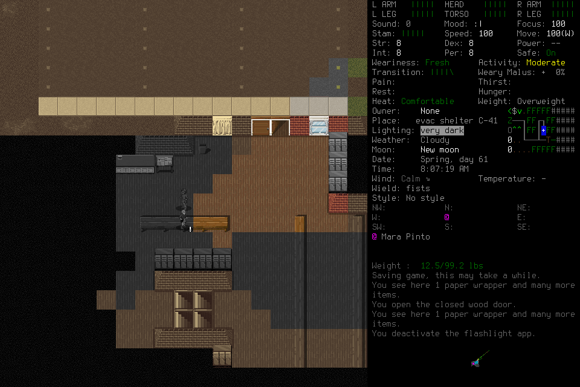
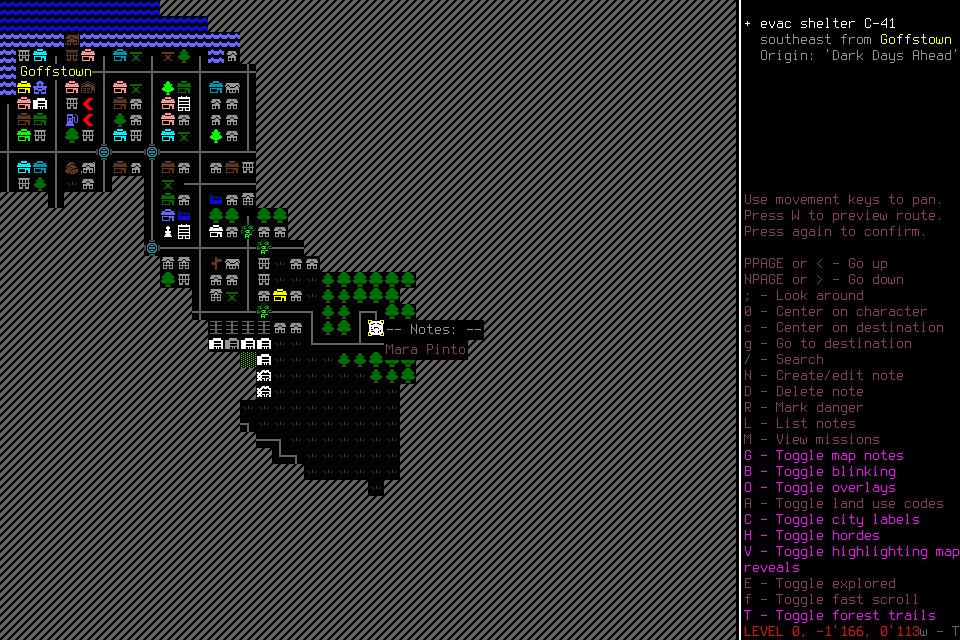

# Useful-play readiness: fast local programs, incomplete independent play

**The assessed configuration remains unqualified for the next seven-day run.**
006 demonstrated player-authored procedure revision, fresh-successor application
and useful ordinary play during actual advisory work. It ended with an open map
and permanent Stop. There is no defensible 20-goal routine cohort or complete
measurement of decision-ready latency. These results finish the bounded
[#215 assessment](https://github.com/CVX-Hull/enactive/issues/215); the capability
outcomes in [#164](https://github.com/CVX-Hull/enactive/issues/164),
[#136](https://github.com/CVX-Hull/enactive/issues/136) and
[#145](https://github.com/CVX-Hull/enactive/issues/145) remain open.

## What worked and what remains

| Outcome | Disposition and practical limit |
| --- | --- |
| Useful play | Collected reserves/soap, surveyed shelter and basement rooms, used the phone light, returned upstairs and learned Mara's pharmacy lead. Water and sleeping-plan questions remained unfinished. The mission advanced 105 observed game seconds. |
| Learned programs | One family had three revisions. Observed linoleum caused a safe yield and a grounded terrain-extension revision. A later advisory finding informed parameter guards; invalid parameters had not actually occurred. |
| Fresh memory application | The driver activated a genuinely fresh successor after quiescent handoff. It retrieved context and applied revision 3 in three travel roots: all 12 proposed steps have matching observed displacements. |
| Asynchronous advice | Useful investigation and basement exploration occurred during real claim-to-submit intervals. The player retrieved a static finding and implemented matching guards. Causal gameplay benefit and held-out generality remain unmeasured. |
| Local execution | 41 normal-play program effects had native capture spans at or below 494 ms. This supports the narrow local path, not whole-goal responsiveness. |
| Whole-player readiness | Rejected: a conservative assessment found 14 completed candidate goals, several involving novelty/repair. It cannot establish 20 qualified routine goals or a passing whole-player p95. |
| Normal ending | Failed. The successor stopped after spending its local map allowance. Save was refused before submission; no registered Save/exit/Finish was completed. |

The existing [player interface](../components/player-interface.md),
[mission execution](../components/mission-execution.md) and
[memory/learning architecture](../components/memory-learning.md) explain the roles.
Local programs and background advice operated within those roles. The next repair
is [#217](https://github.com/CVX-Hull/enactive/issues/217): surface existing
ordinary-macro recovery at the point of refusal.

## Conditions and finite attempts

006 used protected source `9dbd1de9e367e3a545ab6f47ca686a91aece2591`, MCP 6.0.0,
mission/11, native 6, player-view/4 and procedure/3. The prepared native hash remained
`96e58aa08e7f8dd74c42f1bd30bc48a11ebd0eca16deac4cd810e1e843b6fe70`.
One Sol/low original and one fresh Sol/low successor owned all play and learning;
a Sol/medium adviser had only the four advisory tools. The lead supplied no
006 tactics, game inputs or memory curation before permanent Stop. No source
changed during either run. The prepared windowed renderer and project userdir
preserved ordinary CDDA behavior and player-visible observations.

The explicit initial Load used normally saved Ellis in EnactiveLearning04,
including the prior game state from004 and the normally saved five-minute
technical002 wait. No prior mission memory or donor procedures were imported.
This saved setup, source repair and post-adoption adviser activation differ from
fresh004; their effects cannot be causally separated by this comparison.
004's unchanged-lifecycle same-character new-child reload proof was reused rather
than making another reload mandatory.006 still needed its own normal ending.

Original caps were 2,048 inputs/mappings, 3,072 requests, 8,192 frames/2 GiB,
7,200 wall seconds and 86,400 game seconds; the protected reserve was
256 inputs/900 seconds/768 frames/256 MiB. The two deciding hosts shared a finite
6,000-second driver. Handoff was due by 2,100 mission seconds if useful memory
existed; final ending was to begin by 4,200 or earlier for capacity/fit. These
were prospective allowances, never renewals or throughput promises.

| Attempt | Result and retained cost |
| --- | --- |
| 005 | Interrupted before adoption after lead Pause for failed source CI. Eight admitted requests; four inputs (three returned/one unknown); 14 frames/1,010,281 bytes; zero memory events and zero advisory claims. Game time unmeasured. All 242 saved files unchanged. Native was last reported running at controller shutdown and later absent; normal exit/returncode unproved. |
| 006 | 101 admitted requests: 23 completed, 72 partial, five blocked, one unknown.152 inputs: 151 returned/one unknown.384 frames/39,373,941 bytes; 105 game seconds; 273 memory events. Normal ending failed; exact owned cleanup followed the actors' permanent quiescence. |

005's freeze incorrectly called CI pending using a 07:19:28 observation. CI had
actually failed at 07:20:06 before admission at 07:21:51. That engineering error and
the original frozen record remain retained. The failure was independently traced
to a wall-age test clock sampled before a later frame capture, plus two cascades.
The fixture now ages the actual prepared frame; controller guards are unchanged.
006 preparation and admission queried exact current GitHub runs and actual job
steps automatically, retaining lookup times and heads outside the player loop.

[PR216](https://github.com/CVX-Hull/enactive/pull/216) owns source review/check
receipts: 124 focused interface/activity tests, four focused capture tests,
[final full CI](https://github.com/CVX-Hull/enactive/actions/runs/40172854909)
(2,098 tests/1,104.527 s, viewer and strict/render checks), and
[merged-main main-smoke](https://github.com/CVX-Hull/enactive/actions/runs/40174188042)
(115 tests/3.883 s plus viewer/strict/render checks). Main reused verified identical-tree
PR-full coverage. The [failed full run](https://github.com/CVX-Hull/enactive/actions/runs/40171133034)
remains evidence. There was no native rebuild. The earlier
[technical activity cases](2026-10-25-activity-continuation.md) still do not qualify
registered interruption/answer/continuation.

## Procedure, memory and advice evidence

The procedure family ends in `fa962344e706f7f2f244488b29c145c770352f677ebea89981ef4318dc2cca6c`.
Revision1 covered inspected empty `t_floor`. It yielded at actual visible
`t_linoleum_white` in request `op-27b126d94cd441399c010865d07d7965`.
Revision2 added that observed condition while retaining obstacle/displacement
checks; it cited the real counterexample. Revision3 added cardinal/integer and
0..8 parameter guards matching adviser job 2's static finding. The player
explicitly attributed that revision to the finding; no observed invalid-parameter
failure or causal performance improvement is claimed.

The successor's roots `op-aca0814ceb0f41a987e5156cac376539`,
`op-096c7c29b66649ddb886ea2089cec3a5` and
`op-2209c010f09b4e3481db18ae85194516` used revision 3 for 3,5 and4 steps.
Returned source positions verify every corresponding displacement. The procedure
remained a short shelter-floor aid, with image-informed decisions at other states.

Actual claim-to-submit intervals, rather than reserved deadlines, bound overlap:

| Adviser job | Actual interval | Evidence during the claim |
| --- | --- | --- |
| 1 | 22.580 s | Inventory/supply investigation and selection. Collection completed after submit, so it is not an in-window collection claim. |
| 2 | 71.015 s | Phone-light activation, basement-door approach/opening, room entry and the conservative linoleum yield. Revision3 was authored after submit. |
| 3 | 23.145 s to submit receipt | Post-Stop failure analysis; no useful-play overlap. |

Each job charged its original 90-second window, 270 seconds total. These are
claim-window charges, not measured inference or currency. The third job followed
permanent player Stop. No adviser controlled input or approved a step.
Memory's 273 events comprised 266 Claims, three procedure revisions and four Work
events; many Claims were automatic observation records. This is not 273 model
memory calls. The deciding hosts made 13 admitted Remember and two Correct
requests, including refusals; passive calls and their context costs are retained.

## Latency: separate measured lanes

The [evaluation contract](../evaluation.md#latency-budgets-for-interactive-play)
retained its targets: 20 genuine routine goals, ready-to-useful-effect p95≤2 s,
no unexplained routine stall>5 s, supported local effects≤500 ms and novel reasoning≤30 s.
Keys, travel legs, program termination and menu transitions do not automatically
become independent useful goals. Repairs retain their original start/costs.

| Lane | Result and scope |
| --- | --- |
| V8 program evaluation | n=53: 41 act/11 done/1 yield; median 0.937 ms, p95 2.798 ms, max 84.844 ms. |
| Normal-play program capture effects | n=41: median 331 ms, p95 464 ms, max 494 ms; zero>500 ms. Thirty consecutive within-root capture pairs: median 330.5 ms/p95 455 ms/max 464 ms. |
| Mixed request settlement | Existing reducer: 101 IDs/101 settlements, zero duplicates/missing/censored. Runtime median 532.603 ms/p95 2,110.824 ms/max 15,067.743 ms. Includes lifecycle, memory and other work; not useful-goal cadence. |
| Matched browser decode | 242 exact evidence/status/frame/capture joins: capture→decode median 128.650 ms/p95 264.200 ms/max 2,303.300 ms. Decode median 6.4 ms/p95 17.6 ms. Physical paint and per-sample fresh authority are unmeasured. |
| Actual model-ready/inference | No per-decision sufficient-evidence receipt timestamps. Item order, native ACKs and service gaps cannot isolate model inference. |

Representative selected-capture→effect-decode chains were pickup23.3091 s,
phone-light activation with repair45.3641 s, light-off with repair37.3296 s,
Mara approach/conversation73.8237 s. These begin at potentially earlier evidence
captures and are conservative proxies, not direct measurements of decision-ready
latency. They cannot produce a passing or failing whole-player p95. Fourteen
completed candidate goals, with novelty/repair among them, do not establish the
required 20 routine samples. Pharmacy search remains incomplete/censored.

The complete visible observer export has 4,403 status records/597 DOM replacements,
zero overflow, and exactly extends the earlier 1,162/136 export. 185 status failures
begin after both deciding hosts ended; 142 of 384 retained evidence references
lack an exact browser match. Successful decoding alone is not fresh authority.
Controller wall/monotonic offset varied about 20.069 ms; browser epoch/performance
about 21.600 ms; no decreasing native captures or negative matched intervals were
found. Reducer wall correspondence remains explicitly unassessed. These support
limited same-host proxy interpretation, not a calibrated paint clock.

Original/successor host spans were 945.454/239.853 s (1,185.306 s combined).
Supervisor span was 1,467.385 s including closeout. The deciding hosts reported
15,585,073 input tokens, of which 15,277,184 cached, and 31,158 output tokens;
3,271 reasoning-output tokens were reported separately. These are reported usage,
not currency or new provider spending. Adviser completed-turn usage is missing.
126 completed deciding MCP calls and 18 shell calls remain in the traces. Context
bytes and cache counts do not establish attention, inference cost or causality.

## Ending failure and the existing recovery path

Map root `op-a4bd5323df9b45419eeccae14f24b55e` allowed 12 mappings:
map 1 + search 1 + eight characters of `pharmacy` + Enter 1 + Escape 1.
The last Escape dismissed search results into OVERMAP. Save preparation returned
`not_submitted`: “A new lifecycle root requires no phase except explicit
create/load abort exit.” No Save input was sent. The player did not request
explicit Observe after exhaustion and instead permanently stopped.

The current [ordinary-observation contract](../protocol.md#integrated-mission-lifecycle)
allows Observe to record `macro_closure`, then a deliberately new bounded direct
root from the fresh owned menu. The existing unfamiliar-menu regression in
`tests/test_mission_macro_closure.py` covers exhausted Escape, Observe and new-root
Escape. This is source/fixture support for an available option; it was not tried
natively in 006. The failure does not establish a need for another recovery engine.
[#217](https://github.com/CVX-Hull/enactive/issues/217) owns actionable feedback
and software-owned mechanical context for this existing path.

After the hosts stopped, the lead verified native PID10460 under its exact
controller and sent SIGTERM while the controller retained its Popen handle.
The child became defunct awaiting reap; no further signal was sent. Shutdown
recorded returncode0 with `normal_exit_verified=false`. This supplies cleanup
custody, not a registered SavedCheckpoint/normal ending. All owned native,
driver, adviser and controller processes are absent, and port8766 is unbound.
The temporary spectator tab was closed after export.

Opaque manifests show13 existing files changed inside the selected world,
all 229 remaining files unchanged, and no additions/deletions. The game made its own
writes; no save editing/rollback occurred. Those changes and an in-game save
message cannot manufacture this mission's missing registered checkpoint.

## Retention and next work

[Compact result/provenance](assets/useful-learning-006/result.json) includes the
unaltered image hashes and displacement checks. The existing
[request-timing reducer output](assets/useful-learning-006/request-timing-summary.json)
retains all 101 samples and uncertainty labels. Larger ledgers, frames, host traces,
complete observer exports and opaque save manifests remain project-local under
`.runtime/campaigns/useful-learning-{005,006}/`, corresponding mission archives
and session `20261025-035203-26325cdc`; they are not wholly versioned by this report.
Screenshots retain [third-party provenance](../../NOTICE.md).

[#217](https://github.com/CVX-Hull/enactive/issues/217) is the next bounded source
item. #164 retains whole-configuration qualification and the measured historical-
source hash/context-read follow-ups. #177/#178 retain wider program/advice scope
and causal/held-out questions despite this scoped positive learning evidence.
#136/#145 retain independent learning/campaign completion, normal lifecycle and
fresh seven-day forecast gates. No third attempt or seven-day launch follows
from this report. Current architecture/contracts own behavior; this dated record
owns the evidence and failure disposition.
