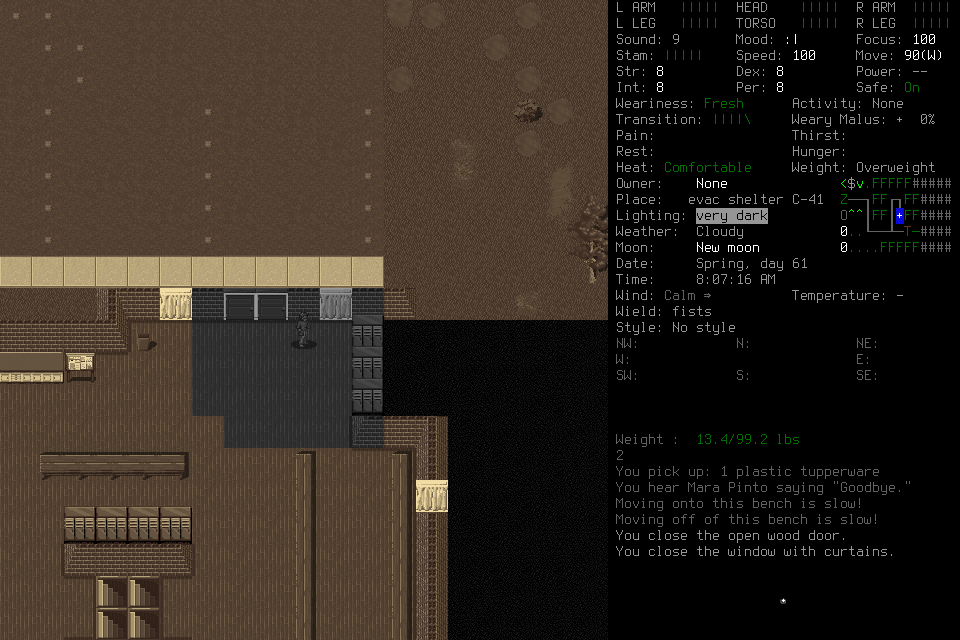
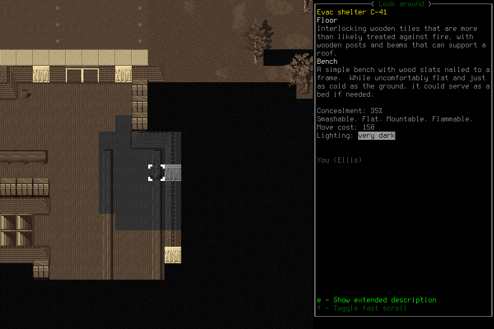

# Useful007: normal ending, narrow learned programs, unqualified cadence

**The player and a fresh successor made useful progress and ended normally. The
configuration remains unqualified for the next seven-day campaign.** The original
collected supplies and closed the shelter entrance and curtains; the successor
used retained travel knowledge and verified a fallback sleeping bench. They did
not claim completion of the next-night readiness objective. No defensible passing
20-goal routine cohort or sufficient-evidence receipt timing was established.

The [#217](https://github.com/CVX-Hull/enactive/issues/217) preparation-feedback
change was present, but its specific wrong-root Observe hint and ordinary macro
closure were not encountered. Its source implementation is delivered; that
usability branch remains unassessed. [#219](https://github.com/CVX-Hull/enactive/issues/219)
is completed as a scoped source projection change, without a speed claim.

## Observed outcome

| Area | Evidence and limit |
| --- | --- |
| Useful work | Two additional protein rations and a tupperware; exterior reconnaissance/return; closed entrance and north curtains; phone light off; bench explicitly described as a possible bed. Rest, water treatment and full readiness were not established. |
| Learned execution | Two actual Procedure/3 revisions. The first supported empty linoleum; a real yield and observed crossing informed ordinary-floor/open-door support. Eight invocations produced 18 returned inputs. All routines were travel aids, not general pathfinding or menu automation. |
| Fresh memory | A quiescent handoff activated a fresh successor. Its first Claim was refused; it corrected the selection/read declarations, claimed/readmitted, and applied revision2 to shelter travel. Retrieval or Claim alone is not application. |
| Background advice | Three actual claim-to-submit windows overlapped ordinary investigation, travel or successor approaches. Four notes and zero candidate procedures were submitted. The successor reviewed advice; no causal benefit is established. |
| Ending | Registered SavedCheckpoint, OwnedNormalExit and NormalFinish(disposition=stopped), with no unresolved effects. Three primitive ACKs remain unknown despite separately verified effects and ending. |
| Readiness | Unqualified. Missing model-ready clocks and an insufficient qualified routine cohort cannot produce a passing percentile. Short native/program execution is a separate lane. |

## Conditions and source assurance

One separately frozen development assessment used source
`00de5b6bcfc30efffbe294e56ceb0dfd7adb0a02`, MCP6.1.0, player-view/5, mission/11,
procedure/3 and native6. The prepared binary remained
`96e58aa08e7f8dd74c42f1bd30bc48a11ebd0eca16deac4cd810e1e843b6fe70`.
The existing fixed wrapper, explicit project userdir, FULLSCREEN=no and prepared
keyboard-driven options passed their existing validator. The first actual
original-host Snapshot reported player-view/5. Fresh production stdio preflight
matched all21 schemas; player/adviser profiles exposed16/4 tools respectively.
This does not prove that a model attended to every schema.

[PR220](https://github.com/CVX-Hull/enactive/pull/220) owns the source change,
independent review and exact check receipts.133 focused tests passed in27.160s;
fast checks passed. The [full PR run](https://github.com/CVX-Hull/enactive/actions/runs/40198059978)
passed2,102 tests in1,014.434s plus the required checks. The identical-tree
[merged-main run](https://github.com/CVX-Hull/enactive/actions/runs/40199664793)
passed the existing main-smoke profile:116 tests in3.748s plus required checks.
No native rebuild or redundant full main run was performed.

Preparation review fixed two draft defects before freeze: a caller-supplied PR
run could masquerade as the main receipt, and storage sizing omitted automatic
Claim expansion. Final preparation verified distinct PR/main events, branches,
workflow, executed profiles, actual mergedPR/main identity and identical trees;
checks were queried again immediately before admission. The forecast included
3 automatic Claims per distinct normal source, up to26,624 shared Claims at the
8,192-frame ceiling, independent64MiB DB and other caps, and retrieval work beyond
bounded output. No admission occurred under the defective draft.

The initial scenario explicitly loaded existing Ellis in EnactiveLearning04.
Earlier normal saves and006's13 game-owned file changes were retained;006 had no
registered normal final ending. No save contents were read or edited and no donor
mission memory was imported. Current conditions came from visible observations.
This was neither fresh survival nor a controlled comparison with006. The lead
supplied no tactics, keys, memory curation or runtime rescue.

Original caps were2,048 inputs/mappings,3,072 requests,8,192 frames/2GiB,
7,200 wall seconds and86,400 game seconds. Protected reserve was256 inputs,
900 seconds,768 frames and256MiB. Original and at most one fresh successor shared
6,000 driver seconds; handoff was due by2,100 when meaningful memory/Work and fit
existed, final ending by4,200 or earlier for actual capacity/fit. There was one
new007 admission, no extension, reroll, live patch or revival of005/006.
Admission was13:57:11UTC; activation took1.332s. The run stopped normally at
14:20:59UTC, well before its original limits. No seven-day launch followed.

## Learning, advice and the stopping decision

The [two exact historical procedure records](assets/useful-learning-007/procedures.json)
retain their programs, support and counterexample. Revision1 begins
`revision-c1a4f457…`; revision2 is `revision-d3119a7a…`. The recorded counterexample
cites `op-8b7a10535bef4da3812be90116777a1d` and the observed open-door crossing.
The revision is a changed applicability condition, not merely Claim correction.
Guards still yield for unsupported terrain, creatures and failed displacement.
The later brick-wall yield in `op-191fcd67311f45d988f4a39e87d14dc1` supports the
routine's limitation, not general pathfinding or false task success.

Actual claim-to-submit intervals were19.069s,23.673s and28.636s. The first covered
inventory closure and needs inspection; the second a purposeful aisle movement;
the third successor program/ordinary approach attempts. Final bench verification
is separate from merely attempting its approach. Each job charged its original
90-second window,270/540 total. Claim-window charges and host span are not measured
inference or currency. No adviser approved input or adopted memory automatically.

The successor then attempted Decision `op-56d2014636fc4197a350ee0401fdd678`.
The writer refused: “Decision requires an exact issued packet/version and selected
IDs.” Independent comparison found the packet ID, scope, memory version and
omission count matched an actually returned packet; **query differed**, and its
four selected source IDs were outside that packet's revealed source set. Empty
Claim/procedure lists alone do not establish the cause. The backend's predicate
is in `harness/gameplay/campaign_memory.py`; this is not a demonstrated storage or
capacity failure. Final SQLite size was1,372,160bytes, far below64MiB.

The refusal was not retained as an accepted Decision. The successor proceeded to
normal ending and explicitly left objective completion unclaimed, with substantial
resources remaining. There is no evidence that capacity forced termination.
Mechanical exact-packet authoring and truthful distinction between malformed
optional records and unsupported gameplay belong to the existing #164/#177 work;
ordinary play need not invent a Decision to narrate every action or advice use.

## Execution and timing lanes

The [evaluation contract](../evaluation.md#latency-budgets-for-interactive-play)
kept20 genuine useful routine decisions, ready-to-useful-effect p95≤2s,
no unexplained routine stall>5s, supported local effects≤500ms and novel reasoning
≤30s. Repairs keep their original start/cost; keys, program steps, termination and
arbitrary journey splits are not extra useful goals. The qualified cohort remains
insufficient. No passing **or failing model-ready percentile** follows from the
missing sufficient-evidence timestamps.

| Measured lane | Result and scope |
| --- | --- |
| Runtime receipt→finalization | n85; median377.983ms, p952,614.377ms, max15,578.544ms. All settled, no duplicate/missing/censored endpoints; mixed operations, not goal cadence. |
| Post-admission service | n85; median377.113ms, p952,612.895ms. Queue median0.0359ms/p950.0627ms; admission median1.285ms/p952.163ms. |
| Returned native preflight→ACK | n81; median166.311ms, p95216.005ms, max321.402ms. Includes setup/play/ending; three unknowns are excluded from returned-only percentiles and retained separately. |
| Program evaluation | Eight requests/26 evaluations/18 returned inputs; evaluation median0.858ms, p953.712ms, max68.398ms. |
| Within-program native captures | n18 same-session before/after intervals; median343ms, p95/max473ms. Narrow positive local evidence, not18 goals. |
| Browser capture→decode proxy | n527 mission-session replacements; median177.800ms, p95575.500ms, max1,056.500ms. Exact retained-evidence subset n148: median129.100ms, p95281.200ms, max956.600ms; do not substitute that subset for the broader sample. |

Selected original-capture→matched-decode goal-chain proxies were upstairs access
with repair180.299s, phone conservation including two refused menu attempts70.293s,
locker acquisition35.300s, exterior scout/return61.261s, entrance closure12.394s,
north-window approach/closure18.354s and successor bench verification66.305s.
These are conservatively earlier selected-capture starts, not isolated inference
or actual evidence-ready starts. The successful hotkey does not erase its failed
menu attempts. No per-event timestamps exist in the retained CLI JSONL.

Complete browser export002 exactly extends001:4,971 statuses
(4,742 rendered/229 failed),528 DOM replacements, zero overflow. One replacement
belongs to an older session;527 belong to this mission.148 exact retained-source
joins match session/revision/frame/capture timestamp.68 of81 returned ACK frames
match browser records;13 are unmatched.80 of84 settlement source references match,
but a settlement may reference an earlier retained frame. Successful decode alone
is not fresh authority or physical paint. The final export is disconnected.
Browser epoch/monotonic variation is about17ms; native anchor offset spread15.642ms.
No constant cross-process offset or calibrated paint clock is assumed.

## Costs, ending and retention

There were85 admitted requests:25 completed,53 partial,5 blocked and2 unknown.
84 primitives comprise81 returned and3 unknown;232 PNGs total25,180,553bytes.
The mission advanced51 observed game seconds.208 memory events comprise205 Claims,
two Procedures and one Work, with many automatic Claims—not208 model memory calls.
Deciding hosts made113 completed MCP calls and27 shell reads; the adviser made11
MCP calls. Original/successor host spans were1,114.413/312.500s; combined elapsed
span1,426.943s and supervisor span1,429.497s. These are not throughput or inference.

Reported deciding usage was14,048,822 input tokens,13,672,320 cached,25,908 output,
and3,160 reasoning-output reported separately. Adviser reported1,382,599 input,
1,294,592 cached,4,348 output and599 reasoning-output separately. These are reported
usage, not currency or a controlled comparison. No new paid provider was configured.

The ending is linked by actual canonical records:

- SavedCheckpoint: `op-33802cf8b9e24da88afe60c11e4f9abc`.
- OwnedNormalExit: `op-c2812a543e75416cb4d0a322812cfa1d`, tied to that checkpoint,
  launch `b8ad4dd32db14c8fafbf5a25d3b35b57` and native returncode0.
- NormalFinish: `op-f47169206dc3458f8e2c48a127a60f6c`, referencing that exit with
  disposition=stopped and no completed Work event. Objective success is unclaimed.

Unknown Load, Save-confirmation and exit-confirmation ACKs remain unknown; observed
transitions and the independent ending proofs reconcile effects without replay.
All owned game, driver, adviser, supervisor and controller processes are absent;
port8766 is unbound. The supervisor stopped its controller after normal exit;
no exceptional native signal or lead recovery was needed. Opaque manifests show
13 existing files changed inside the loaded world, all229 remaining files unchanged,
no additions/deletions. These were game-owned writes. No new world/character was
created, and the normal checkpoint is retained.

[Compact result/provenance](assets/useful-learning-007/result.json) and the existing
[request reducer output](assets/useful-learning-007/request-timing-summary.json)
retain selected machine evidence. Complete ledgers, frames, host traces, browser
exports and opaque manifests remain project-local under the007 campaign/mission
and session `20261025-095709-7239d480`; they are not wholly published by this report.
Images retain [third-party provenance](../../NOTICE.md). Current contracts remain
in the component/protocol documents; GitHub owns live actions and stages.

## Disposition and next work

The specific #217 wrong-root hint/macro-closure branch remains unexercised; do not
close it from normal ending alone. #164 retains whole-player readiness; #177 owns
program breadth and exact-packet memory ergonomics; #178 owns useful candidate
synthesis/disposition; #191 owns observation limits. In the inspected78 menu
observations,33 had structured UI and45 did not, although all had registered
actions. Programs have no PNG pixels. This is a real observation limit, but no
menu program was attempted: it does not prove a rejected program or justify a new
executor/framework. First assess a useful non-movement workflow using current
represented UI and existing code, then consider only demonstrated missing seams.

Preserve the current seven-day no-go in #136/#145. Source #219 completion, useful
revision/application and normal stopping do not establish full readiness, causal
learning, general portability or a fresh survival campaign. No second007 attempt,
old-run revival or automatic campaign follows from this report.
