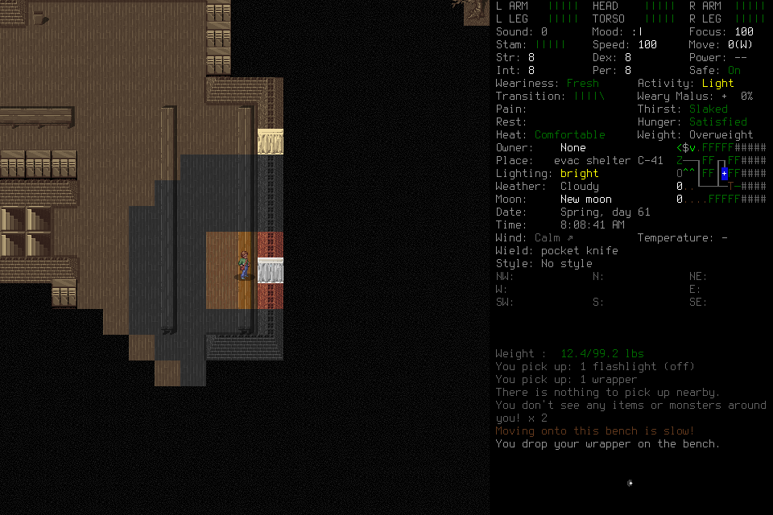
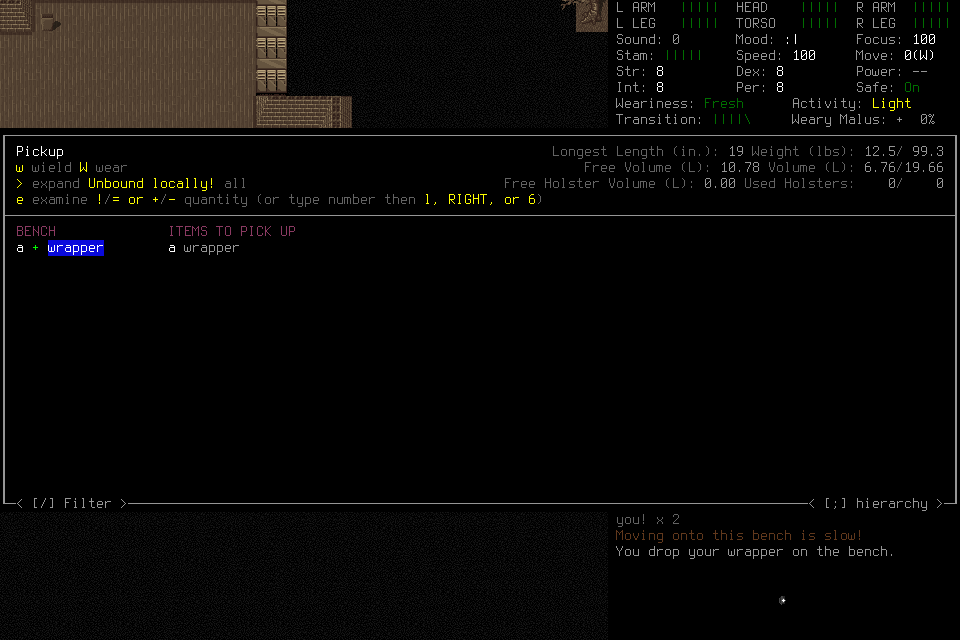

# Imported correction follow-through:015 and016

**[#264](https://github.com/CVX-Hull/enactive/issues/264) remains incomplete.**
Case015 exhausted its original Load phase before adoption. Case016 completed
adoption and read the imported lineage, then dropped a carried wrapper onto a
bench, opened pickup and marked that wrapper despite the frozen prohibition on
manufacturing an application target. Neither case stored a current correction,
ran a program, handed off to a fresh successor or ended through normal
Save/owned exit/Finish. Both were closed with guardian Stop and exceptional
owned-process cleanup. The second trajectory is a gameplay-policy failure;
no new native or source defect is established by it.

The [historical migration](2026-10-27-historical-advisory-import.md) remains a
completed enabling result: current tooling can retrieve the genuine011→012
family and original supporting pixels. Actual real-model retrieval here adds
no useful executable application. Neither current source plumbing nor a later
configuration can relabel these failures. The [earlier report](2026-10-25-program-breadth.md)
retains011/012's original correction and its limitations,013's creation/provider
failure and prior costs. The mandatory generic host remains independent of
selection of a particular provider/model configuration.

## Frozen conditions and resource continuity

Both were finite development continuations on clean main
`218cacb73d87ee393f94ec37f49d702ca55957fc`, after #270/PR271. That exact source
passed full protected PR and actual-main checks:2227tests/4276subtests each.
They used the unchanged signed native7 binary
`71e51f5301e873e6832eb50c7456f29b5e40e9c7f2e7a38d241e36873c778597`, engine
`7b2efa5cea38e4d4d97dd0e63b28b9148623da59`, store6/program-view2,
mission11/ledger13/memory6/Procedure3. Each admitted one normal Load of
EnactiveLearning04/Ellis, with the two genuine011/012 current advisory exports.
The synthetic migration fixture was never a donor. Old code remained advisory;
current authorship required an explicit qualified parent and current grounding.

Pi1.4.0 used the explicit DeepInfra
`deepseek-ai/DeepSeek-V4.1-Flash-1017:zRTkTPfs` route, medium reasoning,
16384output,1048576context,30images and a240second request guard. Each case
allowed at most two fresh players with60actual HTTP attempts each, including
any eligible429retry. Source/native/library/provider/CI and custody checks passed
before credentials/admission. Independent filled-package review and actual
no-provider MCP/Pi captures verified the current guide and16selected tools for
both roles. The first case's shared context was33025bytes; the second's was33746.
Synthetic capture requests made no inference or game input.

Shared mission bounds were2400wall/43200game seconds,512inputs/requests/mappings,
1024frames/256MiB, with600wall/128inputs/128frames/32MiB protected for cleanup.
Normal ending was required to begin by1500seconds, targeted Finish1740 and required it before
1800; guardian Stop/signals could not count as normal ending. Original final12
and successor final16provider attempts were procedural ending reserves. Actual
request counts are resource accounting, not a success or latency metric.

Both had prospective lead-selected scope under standing gameplay-data/spending/
GitHub authorization and the$170cumulative ceiling. Case014 remained inactive and
never allocated; old012/013partitions stayed retired. The original four-active-hour
whole-workflow appetite was inherited across015/016, not restarted after failure.
No actual active labor is inferred from wall or token counters. All times below
are UTC.

##015: phase expiry before adoption

Admission was20:09:23. The player selected an initial24input/420second Load root
at20:10:04, within its declared600second ceiling. A Load input's acknowledgement
was unknown; a later actual observation and explicit same-root transition
reconciliation separately established its effect. The original unknown remained
charged. Character identity inspection completed20:13:37, but imported context
and original-image retrieval occurred before identity adoption was complete.

Two grounded identity interpretation Claims were accepted20:16:27. At20:17:30,
dismissal and adoption were correctly refused because the original phase had
expired20:17:04. A child request could not renew it. The lead then used supported
zero-input guardian Stop and signalled only the exact launch-birth-verified owned
driver. Its existing custodian closed the remaining children. There was no adopted
normal play, useful original effect, current Procedure, program, handoff, successor
or normal ending. The case used15provider attempts;105unused attempts were retired.

##016: adoption, exploration and prohibited target manufacture

A deliberately reviewed new scope deferred optional historical retrieval until
after adoption and selected the declared24input/600wall/600game-second Load root
from the outset. It did not reopen015 or renew an old phase. Load began20:25:19,
adoption completed20:30:42 and the first historical context call followed20:30:52.
This demonstrates that sequence in one real run. The approximately322.5second
Load also fits420seconds; neither the necessity of600 nor an isolated causal
benefit of the prompt/order change is established.

The player inspected inventory and explored. Two navigation requests were blocked
with zero proposals because target/connecting terrain was unknown or blocked;
ordinary inputs continued. No legitimate useful pickup task was established and
left for a successor. Existing pickup messages in the loaded log were historical,
not new acquisitions. Ordinary movement and interface exploration do not substitute
for the required useful correction/application outcome.

The actual request→primitive→image joins show the disqualifying sequence:

| Operation | Actual evidence |
| --- | --- |
| `op-50f4db32886347e28874a949b5dfaad1`, `G` | Marks the bare wrapper in Multidrop; separate protein-ration container rows remain distinguishable. |
| `op-3fa377adb88545e5aeed9dbae0850a29`, `ENTER` | The game reports “You drop your wrapper on the bench.” |
| `op-ccfd644b1e754cc3ba174c623d122b81`, `g` | Opens that bench wrapper's initially unmarked pickup list. |
| `op-70cbf94d0e3148d593a713dae73a767e`, `RIGHT` | Marks the wrapper for pickup and populates ITEMS TO PICK UP. |

The frozen brief explicitly prohibited dropped/re-picked or otherwise manufactured
targets. The sequence cannot establish a legitimate useful application task.
No subsequent pickup confirmation or re-acquisition is demonstrated. The bare
wrapper is visually distinct from the protein-ration container rows; food/content
loss and wider harm remain unproven. Do not infer either from the word wrapper.

The host crossed its procedural original ending reserve during this sequence.
The lead issued supported guardian Stop at20:45:20, then interrupted the exact
owned driver. The custodian retained exceptional native SIGTERM and closure.
This was policy-failure closeout before the ending deadline, not another Load
expiry. No current Procedure/program, handoff, successor or normal ending occurred.
The final output is empty; request53aborted and no retained new draft code was found.
The86Claims comprise two explicit interpretations and84automatic native_fact
records, not86player-authored learning records. All67unused attempts were retired.

## Original pixels, uncertainty and cleanup

The following published PNGs are byte-identical to their original native captures.
Source IDs identify captures, not authority or current task applicability.

| Original source ID | PNG | SHA256 |
| --- | --- | --- |
| `c71c8a2ca4936d17628e14d804b73fbb0f2c67d7c4e6616af4e4e66a7f7bfed2` | [multidrop-marked](assets/imported-correction-016/multidrop-marked.png) | `68b289cbb765588928dda1c04d9246c5911d9e6c43fb6cf36be171bd6a02785a` |
| `d18d6fff07f8ab5c6ef60ba4c11755ef4d2e25c8a8318cc9fe48c0f29c7261de` | [dropped-on-bench](assets/imported-correction-016/dropped-on-bench.png) | `89c866b1bbb1b62688a8767cbf1105d6a99b12994bb0c22c948cd793299e4c2a` |
| `74c6a150cb3a05b7f94a14c676f99ba0b513fb122fe9f5c2a6ca19219d358322` | [pickup-unmarked](assets/imported-correction-016/pickup-unmarked.png) | `3013fbc8e96dc77099c216d4ab26e62750d315153a0039588751a760b1e836bf` |
| `d4a13870557e4ebfa0523be1f86041abb83e502580a48185ce6f726955c01c7c` | [pickup-marked](assets/imported-correction-016/pickup-marked.png) | `54cba2fd130de55e4209089a3e7595c30527f3a5624243adfb918c22a64cd98c` |

Each case retained one unknown native acknowledgement with a separately reconciled
effect; there were no unresolved effects in the final retained status. Original
unknowns were never converted to returned acknowledgements or replayed.015charged
four returned/one unknown primitive;016charged24returned/one unknown.
The original native cleanup receipt in each case flagged a defunct PID as unresolved.
That flag remains unchanged. A subsequent independent census found each case's
five recorded controller/driver/player/MCP/native PIDs and port8766absent.
Subsequent absence does not rewrite the earlier receipt or qualify normal ending.

All178original and180current donor-export files were rehashed unchanged after both
runs. Each case's248opaque save path/size/hash identities also remained unchanged;
no save contents were parsed or edited. This does not erase the actual observed
016drop/mark effect.015retains17frames/1,349,153PNG bytes and a393,216byte ledger;
016retains81frames/8,033,888PNG bytes and a688,128byte ledger. Private raw bodies,
credentials, save files and local process detail are not public artifacts.

## Accounting and apparent-latency limits

| Lane | Actual provider attempts | Known configured estimate | Consumed conservative reservation |
| --- | ---: | ---: | ---: |
|015|15|$0.022672024|$3.2931840|
|016|53|$0.160070688|$11.6359168|
|New total|68|$0.182742712|$14.9291008|
|Cumulative|710|$1.862468024known|$154.1668864|

015has14known usages/one aborted unknown;016has52known usages/one aborted unknown.
Invoices, four older usage records and013request22remain unknown too. Estimates
use configured standard rates, not invoices. Worst-case capacity did not credit
promotional prices or cache savings. No eligible429retry occurred in these cases.

015reported64,295uncached input,543,104cache-read and10,924output tokens;
016reported538,779uncached input,4,293,248cache-read and44,259output tokens.
Reported reasoning counts7194/32670are included within output, not charged twice.
Cached tokens were actually reported, but no isolated cache/latency benefit follows.

Observed request-start→response-complete spans had medians26.38s/15.41s and
maxima112.60s/116.62s for015/016, including the recorded aborted responses.
Those spans do not isolate inference, attention, queueing or upload.016advanced
eight recorded game seconds over about20minutes38seconds from admission through
custodian closure, without a verified useful task outcome.015had no established
game-time baseline. Startup, archive reading, identity work, exploration, refusal,
waits and failure remain charged in whole-run evidence. There is no useful-decision
cohort, apparent-cadence pass, causal learning/context/cache effect or campaign
readiness claim. API/cache/byte/call diagnostics cannot replace meaningful visible
effect and resumed useful work.

## Bounded source response

The frozen roles had procedural ending reserves, while actual charged HTTP-attempt
counts existed only in host bookkeeping/trace. A separate generic improvement now
uses the existing request-only Pi projection to append one clearly labelled
software resource-status message after history. It states attempts charged before
that request and remaining allowance including it. Retries reuse the original body;
the next assistant turn counts both attempts. It does not enter canonical history,
accumulate old notes, alter the stable system/tool prefix, change the hard cap or
grant gameplay evidence/read proof/authority. This addresses reserve visibility;
it does not explain away or prevent the observed policy failure.

Actual Pi/MCP fixture tests verify fresh single notes across turns, unchanged
original mission/system/tools and tool IDs, identical retry bodies and the next
turn's two-attempt count. All57host tests, eight CLI tests and fast checks pass. The CLI fixtures initially
failed only because sandbox loopback listen was denied; that original failure
is retained, and the approved host-route run passed all eight. An initial new test
assertion mishandled a null assistant content field; that test-helper failure is
retained separately from the corrected passing run. These are offline source
checks, with no additional inference or native/game input. Exact protected
publication checks remain a separate lane. Useful ending behavior on this new
context and any different model remains unqualified.

Independent outcome review verified the original source/ledger/image joins,
full-core failure, costs, memory distinction, donor/save hashes and cleanup limits.
The current DeepSeek configuration is rejected for this functional core; this is
not a general model-incapacity claim. A further source/model qualification or
native continuation requires its own prospective finite scope, current coupling,
reviewed screens where selected, filled package and full outcome. No unused
partition, source fix or metadata declaration automatically admits another case.
