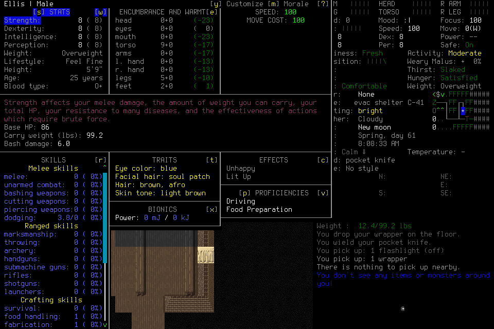
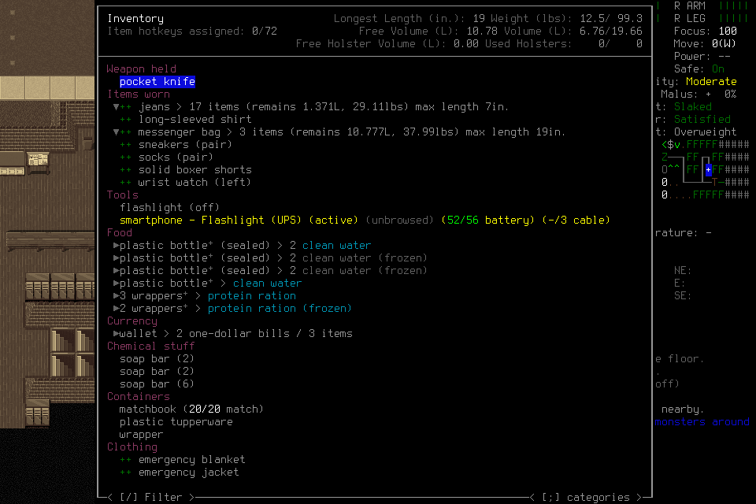
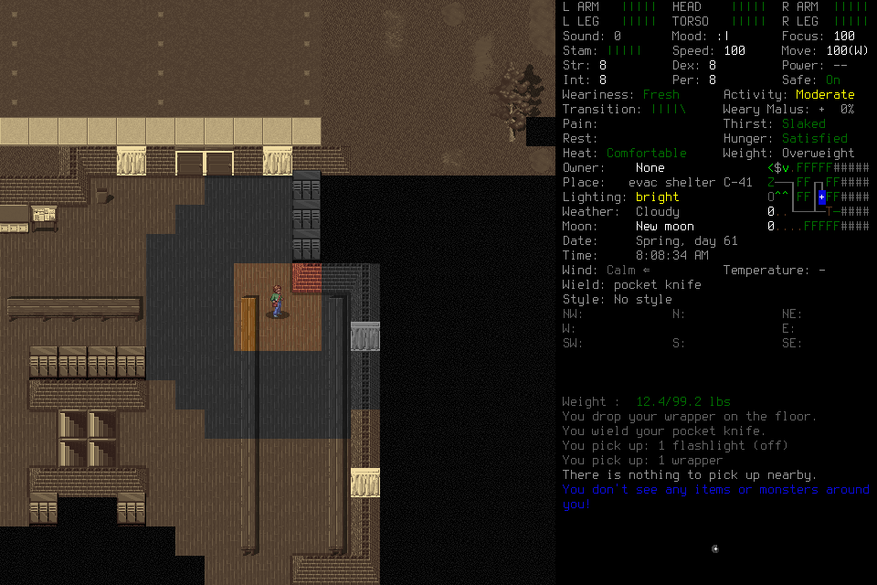
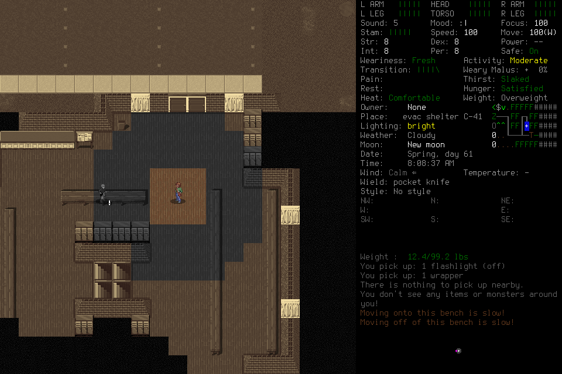

# Correction follow-through and player qualification

**[#264](https://github.com/CVX-Hull/enactive/issues/264) remains incomplete.**
Case015 exhausted its original Load phase before adoption. Case016 completed
adoption and read the imported lineage, then dropped a carried wrapper onto a
bench, opened pickup and marked that wrapper despite the frozen prohibition on
manufacturing an application target. Neither case stored a current correction,
ran a program, handed off to a fresh successor or ended through normal
Save/owned exit/Finish. Both were closed with guardian Stop and exceptional
owned-process cleanup. The second trajectory is a gameplay-policy failure;
no new native or source defect is established by it.

The [historical migration](2026-10-27-historical-advisory-import.md) remains a
completed enabling result: current tooling can retrieve the genuine011→012
family and original supporting pixels. Actual real-model retrieval here adds
no useful executable application. Neither current source plumbing nor a later
configuration can relabel these failures. The [earlier report](2026-10-25-program-breadth.md)
retains011/012's original correction and its limitations,013's creation/provider
failure and prior costs. The mandatory generic host remains independent of
selection of a particular provider/model configuration.

## Frozen conditions and resource continuity

Both were finite development continuations on clean main
`218cacb73d87ee393f94ec37f49d702ca55957fc`, after #270/PR271. That exact source
passed full protected PR and actual-main checks:2227tests/4276subtests each.
They used the unchanged signed native7 binary
`71e51f5301e873e6832eb50c7456f29b5e40e9c7f2e7a38d241e36873c778597`, engine
`7b2efa5cea38e4d4d97dd0e63b28b9148623da59`, store6/program-view2,
mission11/ledger13/memory6/Procedure3. Each admitted one normal Load of
EnactiveLearning04/Ellis, with the two genuine011/012 current advisory exports.
The synthetic migration fixture was never a donor. Old code remained advisory;
current authorship required an explicit qualified parent and current grounding.

Pi1.4.0 used the explicit DeepInfra
`deepseek-ai/DeepSeek-V4.1-Flash-1017:zRTkTPfs` route, medium reasoning,
16384output,1048576context,30images and a240second request guard. Each case
allowed at most two fresh players with60actual HTTP attempts each, including
any eligible429retry. Source/native/library/provider/CI and custody checks passed
before credentials/admission. Independent filled-package review and actual
no-provider MCP/Pi captures verified the current guide and16selected tools for
both roles. The first case's shared context was33025bytes; the second's was33746.
Synthetic capture requests made no inference or game input.

Shared mission bounds were2400wall/43200game seconds,512inputs/requests/mappings,
1024frames/256MiB, with600wall/128inputs/128frames/32MiB protected for cleanup.
Normal ending was required to begin by1500seconds, targeted Finish1740 and required it before
1800; guardian Stop/signals could not count as normal ending. Original final12
and successor final16provider attempts were procedural ending reserves. Actual
request counts are resource accounting, not a success or latency metric.

Both had prospective lead-selected scope under standing gameplay-data/spending/
GitHub authorization and the$170cumulative ceiling. Case014 remained inactive and
never allocated; old012/013partitions stayed retired. The original four-active-hour
whole-workflow appetite was inherited across015/016, not restarted after failure.
No actual active labor is inferred from wall or token counters. All times below
are UTC.

##015: phase expiry before adoption

Admission was20:09:23. The player selected an initial24input/420second Load root
at20:10:04, within its declared600second ceiling. A Load input's acknowledgement
was unknown; a later actual observation and explicit same-root transition
reconciliation separately established its effect. The original unknown remained
charged. Character identity inspection completed20:13:37, but imported context
and original-image retrieval occurred before identity adoption was complete.

Two grounded identity interpretation Claims were accepted20:16:27. At20:17:30,
dismissal and adoption were correctly refused because the original phase had
expired20:17:04. A child request could not renew it. The lead then used supported
zero-input guardian Stop and signalled only the exact launch-birth-verified owned
driver. Its existing custodian closed the remaining children. There was no adopted
normal play, useful original effect, current Procedure, program, handoff, successor
or normal ending. The case used15provider attempts;105unused attempts were retired.

##016: adoption, exploration and prohibited target manufacture

A deliberately reviewed new scope deferred optional historical retrieval until
after adoption and selected the declared24input/600wall/600game-second Load root
from the outset. It did not reopen015 or renew an old phase. Load began20:25:19,
adoption completed20:30:42 and the first historical context call followed20:30:52.
This demonstrates that sequence in one real run. The approximately322.5second
Load also fits420seconds; neither the necessity of600 nor an isolated causal
benefit of the prompt/order change is established.

The player inspected inventory and explored. Two navigation requests were blocked
with zero proposals because target/connecting terrain was unknown or blocked;
ordinary inputs continued. No legitimate useful pickup task was established and
left for a successor. Existing pickup messages in the loaded log were historical,
not new acquisitions. Ordinary movement and interface exploration do not substitute
for the required useful correction/application outcome.

The actual request→primitive→image joins show the disqualifying sequence:

| Operation | Actual evidence |
| --- | --- |
| `op-50f4db32886347e28874a949b5dfaad1`, `G` | Marks the bare wrapper in Multidrop; separate protein-ration container rows remain distinguishable. |
| `op-3fa377adb88545e5aeed9dbae0850a29`, `ENTER` | The game reports “You drop your wrapper on the bench.” |
| `op-ccfd644b1e754cc3ba174c623d122b81`, `g` | Opens that bench wrapper's initially unmarked pickup list. |
| `op-70cbf94d0e3148d593a713dae73a767e`, `RIGHT` | Marks the wrapper for pickup and populates ITEMS TO PICK UP. |

The frozen brief explicitly prohibited dropped/re-picked or otherwise manufactured
targets. The sequence cannot establish a legitimate useful application task.
No subsequent pickup confirmation or re-acquisition is demonstrated. The bare
wrapper is visually distinct from the protein-ration container rows; food/content
loss and wider harm remain unproven. Do not infer either from the word wrapper.

The host crossed its procedural original ending reserve during this sequence.
The lead issued supported guardian Stop at20:45:20, then interrupted the exact
owned driver. The custodian retained exceptional native SIGTERM and closure.
This was policy-failure closeout before the ending deadline, not another Load
expiry. No current Procedure/program, handoff, successor or normal ending occurred.
The final output is empty; request53aborted and no retained new draft code was found.
The86Claims comprise two explicit interpretations and84automatic native_fact
records, not86player-authored learning records. All67unused attempts were retired.

## Original pixels, uncertainty and cleanup

The following published PNGs are byte-identical to their original native captures.
Source IDs identify captures, not authority or current task applicability.

| Original source ID | PNG | SHA256 |
| --- | --- | --- |
| `c71c8a2ca4936d17628e14d804b73fbb0f2c67d7c4e6616af4e4e66a7f7bfed2` | [multidrop-marked](assets/imported-correction-016/multidrop-marked.png) | `68b289cbb765588928dda1c04d9246c5911d9e6c43fb6cf36be171bd6a02785a` |
| `d18d6fff07f8ab5c6ef60ba4c11755ef4d2e25c8a8318cc9fe48c0f29c7261de` | [dropped-on-bench](assets/imported-correction-016/dropped-on-bench.png) | `89c866b1bbb1b62688a8767cbf1105d6a99b12994bb0c22c948cd793299e4c2a` |
| `74c6a150cb3a05b7f94a14c676f99ba0b513fb122fe9f5c2a6ca19219d358322` | [pickup-unmarked](assets/imported-correction-016/pickup-unmarked.png) | `3013fbc8e96dc77099c216d4ab26e62750d315153a0039588751a760b1e836bf` |
| `d4a13870557e4ebfa0523be1f86041abb83e502580a48185ce6f726955c01c7c` | [pickup-marked](assets/imported-correction-016/pickup-marked.png) | `54cba2fd130de55e4209089a3e7595c30527f3a5624243adfb918c22a64cd98c` |

Each case retained one unknown native acknowledgement with a separately reconciled
effect; there were no unresolved effects in the final retained status. Original
unknowns were never converted to returned acknowledgements or replayed.015charged
four returned/one unknown primitive;016charged24returned/one unknown.
The original native cleanup receipt in each case flagged a defunct PID as unresolved.
That flag remains unchanged. A subsequent independent census found each case's
five recorded controller/driver/player/MCP/native PIDs and port8766absent.
Subsequent absence does not rewrite the earlier receipt or qualify normal ending.

All178original and180current donor-export files were rehashed unchanged after both
runs. Each case's248opaque save path/size/hash identities also remained unchanged;
no save contents were parsed or edited. This does not erase the actual observed
016drop/mark effect.015retains17frames/1,349,153PNG bytes and a393,216byte ledger;
016retains81frames/8,033,888PNG bytes and a688,128byte ledger. Private raw bodies,
credentials, save files and local process detail are not public artifacts.

## Accounting and apparent-latency limits

| Lane | Actual provider attempts | Known configured estimate | Consumed conservative reservation |
| --- | ---: | ---: | ---: |
|015|15|$0.022672024|$3.2931840|
|016|53|$0.160070688|$11.6359168|
|New total|68|$0.182742712|$14.9291008|
|Cumulative|710|$1.862468024known|$154.1668864|

015has14known usages/one aborted unknown;016has52known usages/one aborted unknown.
Invoices, four older usage records and013request22remain unknown too. Estimates
use configured standard rates, not invoices. Worst-case capacity did not credit
promotional prices or cache savings. No eligible429retry occurred in these cases.

015reported64,295uncached input,543,104cache-read and10,924output tokens;
016reported538,779uncached input,4,293,248cache-read and44,259output tokens.
Reported reasoning counts7194/32670are included within output, not charged twice.
Cached tokens were actually reported, but no isolated cache/latency benefit follows.

Observed request-start→response-complete spans had medians26.38s/15.41s and
maxima112.60s/116.62s for015/016, including the recorded aborted responses.
Those spans do not isolate inference, attention, queueing or upload.016advanced
eight recorded game seconds over about20minutes38seconds from admission through
custodian closure, without a verified useful task outcome.015had no established
game-time baseline. Startup, archive reading, identity work, exploration, refusal,
waits and failure remain charged in whole-run evidence. There is no useful-decision
cohort, apparent-cadence pass, causal learning/context/cache effect or campaign
readiness claim. API/cache/byte/call diagnostics cannot replace meaningful visible
effect and resumed useful work.

## Bounded source response

The frozen roles had procedural ending reserves, while actual charged HTTP-attempt
counts existed only in host bookkeeping/trace. A separate generic improvement now
uses the existing request-only Pi projection to append one clearly labelled
software resource-status message after history. It states attempts charged before
that request and remaining allowance including it. Retries reuse the original body;
the next assistant turn counts both attempts. It does not enter canonical history,
accumulate old notes, alter the stable system/tool prefix, change the hard cap or
grant gameplay evidence/read proof/authority. This addresses reserve visibility;
it does not explain away or prevent the observed policy failure.

Actual Pi/MCP fixture tests verify fresh single notes across turns, unchanged
original mission/system/tools and tool IDs, identical retry bodies and the next
turn's two-attempt count. All57host tests, eight CLI tests and fast checks pass. The CLI fixtures initially
failed only because sandbox loopback listen was denied; that original failure
is retained, and the approved host-route run passed all eight. An initial new test
assertion mishandled a null assistant content field; that test-helper failure is
retained separately from the corrected passing run. These are offline source
checks, with no additional inference or native/game input. Exact protected
publication checks remain a separate lane. Useful ending behavior on this new
context and any different model remains unqualified.

Independent outcome review verified the original source/ledger/image joins,
full-core failure, costs, memory distinction, donor/save hashes and cleanup limits.
The current DeepSeek configuration is rejected for this functional core; this is
not a general model-incapacity claim. A further source/model qualification or
native continuation requires its own prospective finite scope, current coupling,
reviewed screens where selected, filled package and full outcome. No unused
partition, source fix or metadata declaration automatically admits another case.

## Subsequent qualification and fresh014

All following lanes used clean main`99900aa0f9b2837d613368a26e8255af878edd1a`
after PR272's full PR40584158689 and actual-main40585784510 checks each passed
2227tests/4276subtests. None ran on the stream-diagnostic change described below.
The signed native7/store6/program-view2 binary remained unchanged.

| Qualification | Actual attempts | Result retained |
| --- | ---: | --- |
|017, Qwen3.8-27B low|2|Highlight passed13/13. Invoke passed nine negatives but yielded on all four positives because it read nonexistent`view.ui.category`; the supplied field was`view.category`.|
|018, same route plus SDK field card|1|Provider reported tool use, then the one-request cap stopped continuation. No final source or recorded tool identity/payload; no semantic grade.|
|019, Qwen3-VL-30B-A3B-Instruct off|1|Called a gameplay skill with invented snapshot`1234567890` instead of returning source. The synthetic service refused before MissionClient.|
|020, same route plus source-only mode|1|Called a menu skill with invented snapshot`snapshot-123`. The fixture refused; no source grade.|
|021, actual MCP Procedure-authoring capture|2|First response chose`enactive_remember` but placed Procedure fields outside`intent.entry`; SDK validation refused before MCP. Its unsubmitted source also used the wrong category field and an input array. The second tool-call arguments are unavailable. No canonical capture or semantic grade.|

Each lane stopped at its frozen failure and retained the artifact; no failed
output was replaced or regraded. All unused qualification and conditional-native
partitions were retired. No image probe or native game ran in017–021. Owned Node
hosts were reaped and recorded MCP children absent. These exact configurations
failed the selected development gates; this is no general model-incapacity or
causal prompting/context conclusion.

The field card contains current SDK field locations, without a policy or solution.
The021 capture fixture used actual SDK schema/cache/ID binding and canonical
Procedure validation, intercepting before any client stage/submit. Invalid handles,
foreign support, wrong tools/memory types and duplicates latched failure. Actual
injected Pi/MCP fixtures exercised capture followed by a clean terminal response;
a captured abstaining program still failed21 of24positive cases in independent
replay. Shape/capture alone was never functional acceptance. Synthetic records,
policies, handles and source-only instructions were excluded from gameplay.

The later user choice selected a fresh current lineage for014; migration270 was
already complete. Independent offline replay of all six unmodified260DeepSeek
policies passed all78current cases, including added marker cases, with zero unsafe
proposals. This reused limited authored-code evidence and prior native transport
within scope. It did not repair015/016, demonstrate a new generation, excuse
manufactured targets or establish native program effect. No old generated policy
was supplied to014's deciding player.

### Fresh014: adopted, then provider timeout

014 used the exact DeepSeek Flash1017`zRTkTPfs`/medium route, standard rates,
1048576context/16384output/30images/240second request guard, two-host/120-attempt
maximum, and an empty historical library. The fresh parent, genuine substantive
same-family correction, useful original progress, exact fresh-successor program
application and normal ending all remained required. New budget visibility, SDK
card and fresh-lineage context were hypotheses, not demonstrated policy repairs.
The prospective maximum reservation was$180.9891328under a finite$181ceiling,
recorded against the user's standing necessary-budget-expansion approval.

Admission began22:53:01UTC. The original Load root began22:53:49.850with24inputs/
600wall seconds. One unknown Load acknowledgement retained its original identity;
collection, Observe and explicit same-root LifecycleTransition supplied separate
effect proof without replay. An early identity inspection was correctly refused
before provisional readmission; the player then explicitly readmitted, inspected,
recorded identity interpretations, dismissed the screen and adopted at22:57:44.
That is about234.29seconds from the Load root and also fits420seconds; no causal
need or isolated benefit for600seconds follows. Inventory opened at22:58:39.

The eight Claims are two player interpretations and six automatic native facts,
not eight authored lessons. The character interpretation incorrectly describes
“Female”; its cited original frame reads **“Ellis | Male.”** The exact admitted
character name is supported. Identity adoption and opening inventory establish no
independently verified useful task effect.

| Original source | PNG SHA256 |
| --- | --- |
|`7333f84f8277780ecaad35de69527060e498223fac295167bc8c60c7acb187b8`|c4873f2779dfdc5641011e6489edf04651df92740460593b24cd64fa50315901|
|`453469adb341bbe53a7c59b36a54a79b8593bb9a2651138b1e2bc7a293f714ef`|6bb806f46ed64464a7088c37af77713d48d9e98a97063782d5ccb61737ab76ca|

Request18 received HTTP200, a first body chunk and backend model identification,
then hit the original240second request timer. No tool call or retained final text
followed. Its trace cannot establish that the model was authoring, what partial
content existed, whether traffic stalled, or the underlying cause. No Procedure,
Work, correction, program request, handoff or successor occurred. Guardian Stop
and owned native SIGTERM closed the case exceptionally; normal Save/owned exit/
Finish did not occur. The driver report's`phase:admitted`was stale after host exit;
the ledger's adoption proof and failed outcome remain authoritative.

The initial cleanup receipt retained a defunct native PID as unresolved. A later
check found all five recorded PIDs and port8766absent; it does not rewrite the
original flag. All358original/export hashes and248opaque save identities remained
unchanged.014retains23PNGs/1,953,572bytes and a434,176byte ledger. No save contents
were parsed or edited. Loaded game-log messages are historical, not new014effects.

### Updated accounting and limits

| Lane | Attempts | Known configured estimate | Consumed conservative reservation |
| --- | ---: | ---: | ---: |
|017–021|7|$0.053192100|$0.4767744|
|014|18|$0.033729024|$3.9518208|
|Cumulative|735|$1.949389148known|$158.5954816|

All seven qualification usages are known.014has17known usages and one unknown
(request18); invoices, four older usages,013request22,015request15 and016request53
remain unknown too.014's102unused attempts are retired. Its normalized119,934
uncached input/658,304cache-read/9,654output tokens include5,648reasoning tokens
within output; no double charge. Standard configured rates are estimates, not
invoices; promotions/cache savings provide no worst-case capacity credit.

014's request-start to response-complete median was15.424seconds and maximum
239.997seconds, including the aborted response. Admission through custodian closure
took about9minutes39seconds without a verified useful task effect. These spans
do not isolate inference/queueing/upload, qualify apparent latency, establish a
useful-decision cohort or prove causal cache/context/learning benefit. #264remains
incomplete and #145remains no-go behind #164. No closed actor resumes and no unused
partition automatically authorizes another case.

## Bounded stream diagnostics after014

The existing trace could not show mid-response body/parser/field progress on
request18. The change accompanying this report reuses the existing Fetch transform
and parsed-provider callback to snapshot constant-size counters/timestamps on
abort and response completion, including429. It retains body bytes/chunks, parsed
provider events, observed first-choice UTF8 string-fragment counts and last
body/event/field times. Scope labels distinguish current from retained last-attempt
metrics; state resets at each charged HTTP attempt and emitted copies do not
change later. No raw generated text, reasoning, arguments, headers or keys are added
to the diagnostic object. The [route contract](../../tools/player_host/README.md)
defines units and unsupported representations.

These diagnostics were unavailable in014 and cannot retrospectively explain it.
Zero observed field bytes establishes no backend-generation fact. The change adds
no timer renewal, retry, model/context change or input authority, and does not
solve the timeout or qualify useful cadence. Actual Pi/MCP fixtures cover Unicode
counts, reasoning aliases, partial output plus heartbeat under the original
deadline, no partial tool dispatch/retry,429isolation, null pre-request data and
last-attempt scope. A review found an initial unguarded choice-collection iterator
could change behavior on an SDK-skipped shape; array guards and a focused negative
fixture corrected it before publication. Appropriate protected source/actual-main
checks remain a separate evidence lane.

## Native017 refusal and native018 handoff failure

These are native cases, distinct from the earlier Qwen qualification configurations
with overlapping numbers. Both use accepted source
`0a7a4e04fb2bac0f158ad5fce346407ef83f3f25`, native7/store6/program-view2,
Pi1.4.0 and pinned DeepSeek Flash1017 `zRTkTPfs`/medium, an empty historical
ProcedureLibrary and the existing Ellis Load. Exact full PR40603109343 and
actual-main40604251720 each passed2227tests/4276subtests before these admissions.
No historical policy, synthetic fixture, save contents or engineering corpus was
supplied to the players. Original raw artifacts remain local under campaign and
mission `program-breadth-017` and `program-breadth-018`. UTC event timestamps below
identify raw records; these runs occurred on October27 in the operator's Eastern
local date.

Native017's first request returnedHTTP429 with118body bytes and no parsed model
events or usage receipt. The host did not classify it as eligible for retry. No
native game, tool/input, frame or memory record followed. Controller/player/MCP
closed; persisted mission state is paused/internal recovery with zero spent inputs.
A separate post-closure census found all four owned PIDs and8766 absent.119unused
attempts were retired. The refusal's exact cause remains unknown.

Two separately allocated generic text-only provider diagnostics then returned429
and200. The latter body was closed at headers; it proves request acceptance only,
not generation, gameplay capability or reliable continuation. The first recorded
capacity and invalid-looking error categories without retaining raw message text;
this does not establish a classifier defect. Both usages remain unknown. An
exact-payload diagnostic had been rejected before any request; the generic requests
contained no repository/game context, images or tools. There was no hidden retry
or restoration of the closed actor.

Native018 adopted identity at00:25:28UTC. One ordinary UP input moved Ellis from
`[0,0,0]` to`[0,-1,0]`. The player authored current parent revision
`revision-1c538c805eab497f1ee1ff08357c99a179a45b43183c443114eb780c4e2768ea`
and selected it on a lawful program root. Four evaluations and three ordinary LEFT
inputs moved Ellis to`[-3,-1,0]`. This is real executable displacement; the returned
program explicitly leaves task-success verification to the player. No independently
useful storage acquisition/benefit or the Work's claimed three available clear-floor
tiles is established.

These are byte-identical originals from source IDs
`7c81ccd2e5276cb37eccba3a4e2d24b1302663c2d200d6636f4295d9515f775b`
and`9fe74c28e4684c07369be75c6ccad16edf093a7128e27bc2ad04beb0bf92d853`;
PNG SHA256 values are`3e93641658df6173b3b6fe8d68e02061a577167e6ee7965bb9885e8f441523bd`
and`be9a32f57d6d1cda3f774bb1f84ab65e2fb7b8998159a075c18a0da76601d23b`.
Earlier log lines visible in the before frame are history, not new018actions.
New moving-onto/off-bench messages support a genuine furniture-related correction.
Same-family revision
`revision-5e38e31502f85b9723cca22f7b37dbd94860efae0da51b64e3a4b2983dcc9773`
adds neighbor/furniture and creature checks; no deliberate bad-parent intent is
established. It was never executed. Mara Pinto appears only after the final parent
input, so the player's claim that it kept stepping while the newly visible survivor
was present is unsupported.

Handoff`op-c74ac37e9a7c4a12b3bbbb5d57a5d7a1` succeeded at00:32:04UTC,
with unfinished Work and post-Pause source
`29a658da17c55949d4a6fc4a404b6a6535fdce43bd2394d2be88fa056cd322b1`.
The original host continued requests25–29, including two Save roots after its lease
ended. The first changed handoff to paused; the driver correctly refused succession.
The lead's initial compact-call interpretation incorrectly described a refusal;
the full settled result proves issuance. The host must end on the actual issuance,
rather than rely on another generated final report. No old issuance is restored.

There was no successor, corrected-program application or normal Save/owned exit0/
Finish. Guardian Stop/nativeSIGTERM were exceptional cleanup. Original defunct/
unresolved cleanup flags remain separate from later five-PID/8766 absence. One
Load input retains unknown ACK with separate transition/effect proof.29Claims
comprise two player interpretations and27native facts; there are two Procedures
and one Work. All358donor/export hashes and248opaque save identities remained
unchanged. Retained evidence has38PNGs/4,134,592bytes and a495,616-byte ledger.
Independent outcome review checked raw operations, frames, accounting and limits.

| Lane | Actual attempts | Known configured estimate | Consumed conservative reservation |
| --- | ---: | ---: | ---: |
| Native017 | 1 | Unknown | $0.2195456 |
| Generic diagnostics | 2 | Unknown | $0.4390912 |
| Native018 | 29 | $0.073564248 | $6.3668224 |
| Cumulative through018 | 767 | $2.022953396known | $165.6209408 |

All29native018usages are known:221,598uncached input,1,755,008cache-read and
31,191output tokens, including19,354reasoning tokens within output. The player's
final28-attempt claim is incorrect.91unused018attempts are retired. Earlier missing
usage and invoices remain unknown; conservative reservations are not actual expense.
Local program execution does not establish useful apparent cadence, a causal
learning/context/cache benefit or the full #164 cohort. #264 remains incomplete.

## Host settlement repair and workflow direction

The bounded repair uses pinned Pi's maintained turn-completion hook after an actual
coherent completed handoff receipt. Later same-batch calls are refused before
dispatch; no extra provider turn or generated final report is needed. Explicit
collection can settle only a handoff originated in this host, preserving successor
issuance reads and ordinary collection errors. The canonical driver still checks
current custody, actor, Pause, source and budget before successor assignment.
Cancellation/transport/cleanup failures override success. Offline checks and
protected publication qualify source behavior only; no new native result is implied.

The [development workflow](../project-management.md#gameplay-as-the-primary-feedback-loop)
prioritizes authentic useful missions over technical checkbox runs or API savings.
The prior full-PR-and-main gate before each development attempt was an extra
operating restriction, not required by that workflow. It is retired prospectively;
all historical checks/failures remain. Formal acceptance and merge retain their
applicable reviews, regression and protected checks. No new gameplay run is
allocated by this report or by the separate repository/workflow audit.
