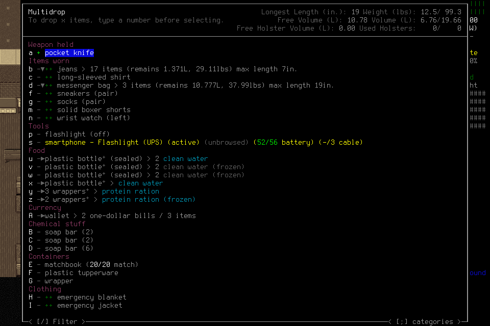

# Rendered inventory markers: bounded native qualification

[#268](https://github.com/CVX-Hull/enactive/issues/268) exposes the literal mark
drawn beside a visible row separately from its label and focus. The single
technical admission observed **`- → + → -` on the same pocket-knife row**, canceled
without confirming a drop, then completed registered Save, owned normal exit0
and a separate Finish(stopped). This qualifies that native observation boundary.
It does not complete [#264](https://github.com/CVX-Hull/enactive/issues/264),
establish player-authored executable application or qualify apparent gameplay
latency. The lead operated this engineering probe; no deciding model ran.

## Candidate, migration and reuse

The frozen source was `2693badcdf5b629fc70e912057a4c4564c38da31`, with engine
`7b2efa5cea38e4d4d97dd0e63b28b9148623da59`. The matching built binary SHA256 was
`6645bf1537319cdfcf4f1cbc6e4384d8e6c7ed41a97e66a2c6c475c34f6db528`;
the normally installed/signed project-local binary was
`71e51f5301e873e6832eb50c7456f29b5e40e9c7f2e7a38d241e36873c778597`.
Native source hashes, wrapper, admission and original image hashes are in the
[small acceptance manifest](assets/native-markers-001/manifest.json).

The integration reuses the pinned inventory renderer's actual glyph draws and
the existing row collector, serializer, evidence store, MCP/Pi path and program
projection. It introduces no perception model or menu-state inference. A marker
is reported only when its own draw cell is visible; unavailable is null. A label,
selection highlight and marker remain distinct. Generic consumers receive literal
text rather than a universal CDDA selection interpretation. The lead maintains
the thin renderer hook with the existing native adapter.

This is a coordinated native7/store6/program-view2 cutover. Current callers and
fixtures move together; previous native6/store5 ledgers and donor evidence remain
immutable archives, unsupported by current readers. No null fields were invented
for old observations and no old authority was restored. Upstream CDDA saves were
loaded normally by the engine. Future donor use must satisfy the current format
or receive a separately scoped truthful migration; this probe imports no library.

Deployment found 127 durable old admissions without correlated terminal ACKs plus 6
earlier historical references. The existing incident loader now admits at most 256
references and 128 KiB aggregate JSON bytes, retaining its per-reference integrity
guards. The aggregate bound protects the existing status response even when its
history is repeated. All 133 references and 8,660 archived bridge files
(749,360,209 bytes) were preserved with verified hashes; no unknown was declared
resolved merely because its process was absent. The old bridge is project-local
at `.runtime/incidents/native6-to7-marker268/bridge`.

The owned incremental build cache was incomplete. Only missing metadata/files
were restored from the recorded project provenance and verified pinned archives;
the unchanged setup ownership guards then passed. Normal
`tools/setup.py --build --jobs 6`, installation and signature verification succeeded.
This recovery added no dependency, global install, save repair or ownership-guard
exception. Detailed cache/build/install receipts remain in `.runtime/iteration268/`.

## Native observations and ending

Mission `marker-qualification-001`, actor `technical-marker268`, loaded the
existing EnactiveLearning04/Ellis baseline. Its complete original envelope was
160 inputs/160 mappings,192 requests,512 frames/128 MiB,1500 wall/600 game seconds, with
40 inputs/300 wall/64 frames/16 MiB reserved for cleanup. The ordinary cutoff was
1200 seconds; no second admission or allowance extension occurred. The wrapper
used a project userdir, windowed 960×640 output and a 120×40 terminal.

Load's ENTER had an unknown ACK. Explicit observation found normal play;
same-root Load reconciliation, separate provisional readmission, actual character
inspection, source-grounded world/character Claims, dismissal and adoption
established the normal session. The original ACK remained unknown.

The actor followed the visible main-menu Action menu → Inventory → Drop item
choices. Inside Multidrop, the only inputs were `a`, `a`, `ESC`. No ENTER or
transfer confirmation occurred. The naturally present row was enabled, hotkey`a`,
ID`row-0`, selected`row-0`, label`pocket knife` throughout:

| Observation | Source ID | Literal marker |
| --- | --- | --- |
| Before marking | `eb2dc57c04d481bde421d719c6007b84c87479b33c7414a7056aff639cc40aa5` | `-` |
| After marking | `cfe9b4fcc4163aacb50e73c8e1af391e2344bc7e757d3e6b9278a153bf35260f` | `+` |
| After unmarking | `7a4c048aa9ea1285209739f60946087d79731099c075a5f0eee6002d028657a8` | `-` |

The first and third PNG hashes are identical; their source identities remain
distinct captures. [Cancellation](assets/native-markers-001/canceled.png) returned
to normal play with the knife visibly wielded and no new drop message. No item
was manufactured, acquired or transferred for this probe. No partial`#` marker
was naturally exercised; its coverage is compiled-fixture-only.

Save's uppercase confirmation also had an unknown ACK. Explicit Observe and
same-root Save reconciliation recorded `SavedCheckpoint` at operation
`op-f04970bc97b34205b4badad4a50338a8`. The owned exit confirmation retained an
unknown ACK separately from the registered `OwnedNormalExit`, operation
`op-25bd99b04ac244719acba57cc52fb518`, actual child returncode0. A separate
Finish `op-7b54d4dca8f24affbb65b5b1b2867b82` stopped the mission 569.45 seconds
after admission, with no active phase, lease or unresolved effect. This is normal
technical cleanup with objective completion unclaimed by the runtime.

Two lowercase`y` inputs only highlighted Yes in case-sensitive questions; neither
confirmed the transition. The exit input's original rationale incorrectly called
the question non-case-sensitive. The next decision explicitly corrected that
interpretation against the actual image and chose uppercase`Y`. These returned
inputs and incorrect rationale remain retained. One local source-binding refusal
submitted no request. A separate wrong-schema source-read attempt failed MCP
validation before submission; the interactive wrapper could not parse its plain
error as JSON. Its console traceback explains absent call009; the call directory
alone cannot reconstruct that error. The subsequent source read used the actual
advertised schema. No uncertain game input was replayed.

Final accounting: **20 charged primitives,17 returned and 3 unknown ACKs**;
0 unreconciled effects;33 accepted mission operations;64 retained frames,
5,249,316 image bytes;0 game seconds advanced. There were zero provider requests,
zero Keychain reads and zero API spend. These technical timings do not measure
model inference or useful apparent latency. All 248 save files remain;10 changed
only within EnactiveLearning04 through normal game Load/Save, with no additions,
deletions or restoration. Other worlds' file hashes are unchanged. The custodian
recorded no failure, cleanup error or signal fallback; its mission worker and
both owned process sessions ended, and port 8766 was verified closed.

## Verification and limits

Compiled component fixtures use actual patcher output, production row types,
marker helper and serializer with explicit engine/rendering doubles. They cover
literal`-`/`+`/`#`, null, clipping, item-symbol offsets, focus, nonselecting/inactive
rows, duplicate labels, overflow32 and topmost ownership. Host tests cover current
closed schemas, retained reopen, label agreement and a passive JavaScript reader.
Actual MCP presentation → pinned Pi serialization preserves the field. Those
fixtures are separate from the native observations above.

Focused local checks passed 321 cases/1050 subtests, then the new compiled UI and
retention cases passed 4 cases/15 subtests; pinned Pi/MCP checks passed 64 cases.
Initial receiver fault fixtures still sent the previous protocol version; those
sentinels were migrated. The first compiled UI fixture setup also omitted its
patcher invocation; it failed before compilation, then was corrected to compile
actual patched output. A broader source run had two further fixture failures after
the version change;
the CLI unsupported-version sentinel and mismatched fixture UI/status were fixed,
and the affected lane passed 34 cases/53 subtests. Additional incident-cap fixtures
passed 2 cases/3 subtests. Protected full checks on the exact frozen source passed
2196 tests/4158 subtests in
[PR run40535474044](https://github.com/CVX-Hull/enactive/actions/runs/40535474044),
with 434.43 seconds checker time. Final publication checks belong in
[PR269](https://github.com/CVX-Hull/enactive/pull/269); a source CI pass alone does
not establish native acceptance.

After shutdown, the production EvidenceStore reopened the actual 64-frame archive.
Each triplet's retained UI exactly matched its MCP observation and original PNG
hash. Production `program_view` supplied that same UI under`program-view/2`;
a passive test program read`-`,`+`,`-`, always yielding with inputnull. Existing
label-agreement checks still passed. Every retained file hash was unchanged by
this verification. This is representation evidence, not player authorship,
revision, active program execution or useful learned application.

Independent reviews covered design, implementation/migration, the frozen native
package and actual outcome. Review receipts and complete calls/images/ledger,
build provenance, opaque save comparisons and guardian records remain project-local
under `.runtime/iteration268/` and `.runtime/missions/marker-qualification-001/`.
The tracked small manifest and original gameplay PNGs are the portable subset;
the much larger private archive is not present or wholly verified on a fresh
checkout. Broader renderer/widget cases, native`#`, fresh-player use, useful
corrected-routine application and complete apparent cadence remain unqualified.
