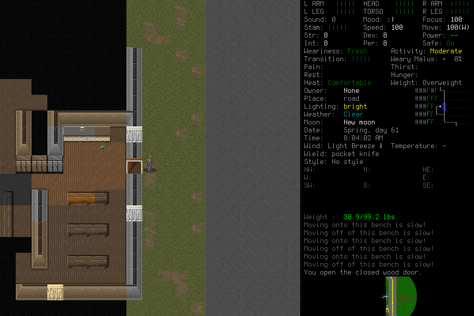
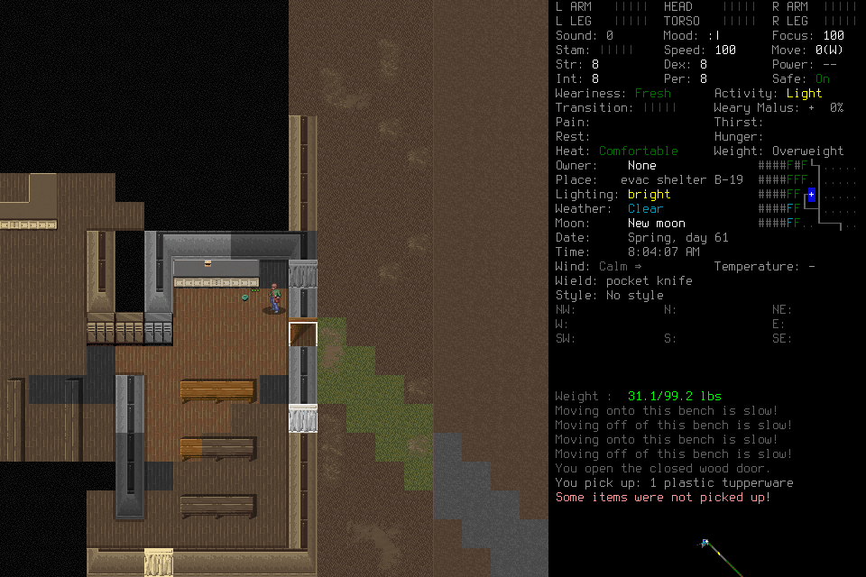

# Fixed endpoints through real gameplay

The [selected #280 scope](https://github.com/CVX-Hull/enactive/issues/280#issuecomment-6483917908)
was exercised with the mandatory generic Pi host. OpenRouter BaseTen and Fireworks
both read actual game images, used current tools and completed bounded episodes
with registered Save, owned exit0 and distinct Finish. Serving is substantially
more promising than the retained DeepInfra reference, but **useful progress remains
too shallow and slow**. Neither endpoint qualifies the complete player.

This continues the [retained-data and endpoint research](2026-10-28-latency-diagnostics.md),
whose source-only scope remains historical. The integrated source adds bounded
stream/local-output diagnostics, read-only retained analysis and a frozen provider
route with isolated credentials. No new broker, model hierarchy, dependency,
native patch or automatic retry was added.

## Conditions and comparison limits

All three native cases froze source `3d532af83873f529b9808fc0b1d1fbac4e5de18c`, Pi1.4.0,
route4, model `deepseek/deepseek-v4.1-flash-1017`, nominal medium effort, 16,384 output,
240s request timeout, 30 retained images and all16 tools. OpenRouter routing fixed
`only`/`order` to `baseten` or `fireworks/us`, with fallback disabled, parameter
support required and explicit default tier. Generation metadata confirms BaseTen
or Fireworks and model alias `deepseek/deepseek-v4.1-flash-20261017` on every native
response. Applied tier and backend effort semantics remain unattested. Full tags
still have OpenRouter's documented prefix/variant matching limits; `baseten` is
**not identified with the separate FAST benchmark variant**. Quantization is unknown.
The provider's [routing](https://openrouter.ai/docs/guides/routing/provider-selection),
[tier](https://openrouter.ai/docs/guides/features/service-tiers) and
[cache](https://openrouter.ai/docs/guides/best-practices/prompt-caching) contracts
were checked on October28; mutable documentation is not a serving SLA.

The prepared windowed native binary stayed
`71e51f5301e873e6832eb50c7456f29b5e40e9c7f2e7a38d241e36873c778597`, engine
`7b2efa5cea38e4d4d97dd0e63b28b9148623da59`, using the explicit project userdir.
Players loaded actual EnactiveOrganic26/Robin progress sequentially, without save
editing/restoration, target manufacture, lead tactics or donor routines. Case003
therefore began outside where002 had saved; starting scenes differ. There was no
concurrent native baseline, randomized crossover, matched task distribution or
causal provider comparison. Historical DeepInfra remains a reference, not a control.

## Screening: retain the setup error

The finite screen used23 of24 allowed inference attempts. Screen001 made17 actual
requests but passed raw shorthand context to Pi's low-level stream API, omitting
the intended guide/tools from the constructed payload. This was a lead setup error.
Those results are retained **image-only observations**, excluded from full-context
or tool qualification. An invented argument under a missing schema is not evidence
of failure against a supplied schema. One Fireworks request returned429; subtype
and upstream attempts are unknown, with no retry. Screen002 was never executed.

Corrected screen003 used Pi's maintained `normalizeContext` and asserted the guide
and all16 declarations in the actual payload before fetch. Each route answered
the same retained phone image and emitted a schema-valid forced snapshot `{}`;
tools were not dispatched. Complete client responses, seconds:

| Route | Image answer | Forced snapshot |
| --- | ---: | ---: |
| Direct DeepInfra pinned1017, priority |4.747|1.579|
| OpenRouter BaseTen, default |1.806|0.775|
| OpenRouter Fireworks US, default |1.633|0.925|

These six requests establish shallow image/function eligibility, not broad skill,
phase, correction or programming competence. Cache warmth was not controlled;
first request does not mean cold. Nominal effort is not backend equivalence.
The earlier dated public Max benchmark table shortlisted these endpoints; it
does not predict medium-effort, image-heavy gameplay response times.

## Organic outcomes, including failed work

| Case | Actual result | Limit |
| --- | --- | --- |
|001, BaseTen|Reached active play; physical takeover generation1 stopped input and the player settled.|181s host;11 charged primitives;0 game seconds. Exact human input unknown. Exceptional owned cleanup, no normal ending or useful-goal completion. Retain as interrupted.|
|002, Fireworks US|Exited the dark shelter through an ordinary final RIGHT; normal Save/exit0/Finish.|450s host,42 game seconds. Two authored navigation routines failed; no new provisions verified. Inventory/Work totals unsupported.|
|003, BaseTen confirmation|Entered the existing shelter, inspected existing provisions, acquired one plastic tupperware; normal Save/exit0/Finish.|451s host,31 charged primitives,8 game seconds. Partial pickup, no routine, no successor or completed Work. Existing shelter entry is not securing/provisioning/rest or sustained safety.|

Case001 motivated a small operational focus mitigation: existing SDL hints remain,
and the browser was returned to the front once after the owned window appeared.
Cases002/003 had takeover generation0. This does not prove the startup cause or
guarantee background window ordering. The owner requested moving on; no focus
watchdog, SDL fork, OS setting change or disabled takeover followed.

In002, R1 executes a four-tile loop six times. R2 opens the wood door and reaches
`[4,-6]`, then issues23 UP inputs without movement. Its first outdoor candidate
was diagonal; its generated direction mapping handled only cardinals and defaulted
to UP, into a concrete wall. It also lacked an outdoor-success stop. A separate
ordinary RIGHT at request47 reaches `[5,-6]`. The player's final credits R2 with
getting outside; **the retained executable/result contradict that attribution**.

002's existing inventory includes nested ration packaging and frozen water. Its
Work's14-ration total and13 clean-water-bottle count do not reconcile all visible
rows. Do not credit existing knife/provisions as acquired gains or silently fix
the original Work.003 avoids exact water/ration totals in Work, but its final
still says it loaded inside, secured shelter and used approximately4.46k wall
seconds. Actual adoption is outside on the road; host elapsed is451s, with4957s
remaining at Finish. These inaccurate summaries remain original evidence.

003's Work `shelter-b19-supplies` is active, observed output1 tupperware; two remain
visible afterward. No Procedure/Decision or reusable routine was recorded. Its
ordinary corrections include unavailable interaction binding, partial pickup,
craft-menu dismissal and Save confirmation recovery. Neither completed case
created a genuine successor opportunity, and no successor ran. Both ended after
about7.5 minutes despite much larger prospective allowances. Safe ending is useful
evidence; premature satisfaction with shallow progress is a player/brief issue,
not evidence of substantive campaign competence or an exhausted budget.

## Apparent latency and diagnostic decomposition

No20-decision meaningful familiar cohort emerged. Do not split menu keys or count
transport responses to fill [#164](https://github.com/CVX-Hull/enactive/issues/164).
Its routine p95≤2s, unexplained stall≤5s and local useful effect≤500ms requirements
remain unchanged and unqualified.

Selected explicit-intention→exact-DOM proxies illustrate why serving is insufficient.
In002, the first recorded doorway movement intention at160.287s precedes the
outdoor DOM witness at328.950s by **168.663s**, including exploration, both routines
and ordinary repair. In003, the counter-pickup intention at123.956s precedes the
first verified partial gain DOM at164.062s by **40.106s**. The requested three-item
pickup was not completed. These are selected retrospective proxies, not earliest
attention, physical paint, full-goal success or a qualified distribution.

Per-response diagnostics below are **not apparent useful latency**, seconds:

| Case | Attempts | Response median / p95 / max | Requests as host time | Median output/post-body proxy, tokens/s |
| --- | ---: | ---: | ---: | ---: |
|001 BaseTen|28|4.094 /13.691 /17.401|88.28%|246.5|
|002 Fireworks US|63|4.572 /10.290 /32.794|81.73%|230.7|
|003 BaseTen|58|5.659 /16.179 /30.428|86.18%|248.6|

The [retained DeepInfra originals](2026-10-28-latency-diagnostics.md#corpus-and-reproducibility)
had selected response medians9.717–22.326s and output/post-body proxies68–76 tokens/s.
Changed scenes/history/source make a causal speedup or quality-equivalence claim
invalid. Native request intervals still dominate elapsed time here. Median
fetch→first semantic field is1.214/1.775/2.573s; it includes upload/network, routing,
queueing and prefill that client clocks cannot isolate. Maximum consecutive field
gaps are1.478/0.659/1.410s, despite longer complete responses. Headers/body alone
would hide this distinction. A first semantic field can be reasoning, not an action.

Reported cache-read fractions of accumulated input are92.0%/71.9%/75.5%; reasoning
is75.6%/60.1%/71.6% of output, already included rather than added again. Stable
prefixes help, but large cache counts coexist with slow or wrong decisions.
Payload maxima2.64/5.99/6.75MB are constructed JSON, not wire bytes.003 reaches the
30-image projection cap. Native cached-token metadata corroborates usage, without
proving all prompt components were cached or quality was preserved. Future context
changes should measure prefix reuse and lost decision evidence; no automatic
summarization or new pruning policy follows from token counts.

Measured event output is35.4/194.4/216.6MB. Total synchronous callbacks take
60/235/236ms, maxima3.82/7.54/7.82ms, with zero backpressure signals. These measure
callback/stringify/enqueue, **not disk flush/drain**. Median SDK-after-payload spans
are3.17/6.79/8.11ms. Local work is visible but these measurements do not support
making logging optimization the primary latency intervention; archive growth stays
with [#281](https://github.com/CVX-Hull/enactive/issues/281).

Exact distinct frame/capture DOM joins yield13/113/54 witnesses, medians164/120/143ms,
p95s783/285/315ms, maxima783/550/2614ms. Unmatched source rows22/121/41 remain visible;
exports dropped no retained frames/status records. Startup export coverage is
incomplete and source rows can share a frame. Same-host wall clocks and DOM
replacement are assumed; this is neither physical paint nor player attention.

## Provenance, cost and delivery

Private inputs, frozen manifests, screen mistake, traces, metadata and derived
reports remain in `.runtime/openrouter-164-20261028/` and the matching campaign/
mission directories. Regenerate with `tools.evaluate host-summary` and
`witness-summary` as documented in [evaluation](../evaluation.md#retained-host-and-browser-analysis).
The [selected public diagnostic summary](assets/endpoint-gameplay-280/diagnostics.json)
records source/native identities, original trace hashes and byte-identical PNG
hashes. Independent outcome review checked002/003 against actual frames and ledger;
003's95 referenced PNG hashes matched. Original actor summaries were not rewritten.

There were172 new inference attempts:23 screening plus149 native. Actual native
counts28/63/58 include final-generation calls, which the two final summaries omit.
All native usage is known; the screen429 has unknown usage. Conservative consumed
reservation increased by$69.1470336 to **$461.8878976**; cumulative attempts1915.
Known configured estimates increased by$1.771796390 to **$11.530216146**. Existing
older missing usage remains unknown; neither figure is an invoice. Native generation
metadata totals agree with configured native estimates.163 read-only metadata GETs
are separate from inference attempts. Upstream correlation IDs are present, but
`num_fetches` is null and does not attest inference attempt counts. Service clocks
are not additive with client timing. The [generation endpoint](https://openrouter.ai/docs/api/api-reference/generations/get-generation)
owns the reported fields; unused admission slots were retired.

Focused source/fixture checks passed:111 pinned host SDK/MCP/CLI tests and79 Python
campaign/analysis tests, plus the earlier32 analyzer/evaluation cases and fast
checks. Independent source review covered route/credential isolation and analysis
failure semantics; integrated review found no material issue and passed70 focused
Python cases. That review's separate sandbox Node run could not connect in five
existing production-loopback handoff cases, before provider requests; it does not
replace the retained outside-sandbox package pass. Evidence review verified the
public numbers/assets and found one stale evaluation limit, now corrected.
Protected full PR/actual-main validation remains pending at this report freeze;
later receipts belong in the owning PR. No native rebuild was needed for unchanged
native code.

## Next decision

Keep both fixed routes eligible for development; BaseTen regular is a provisional
continuation candidate, not a proven winner over Fireworks. The screening gap from
DeepInfra warrants using faster serving, while this stateful comparison cannot rank
endpoint quality. Preserve route, effort, cache, context and failure provenance.
The provider is replaceable; useful outcomes are the selection criterion.

The next gameplay-first slice should address observed stagnation/direction errors,
quantity reconciliation and premature completion through concise current context
and player-authored correction, then test substantive acquisition/exploration and
safe continuation organically. Let supported useful unfinished work motivate any
fresh handoff. Reuse the existing executor and ordinary inputs; do not add a
game-specific route planner or hard-code a successful trajectory. Establish a
prospective whole-goal cohort and count all repairs, failures and early endings.
The existing GitHub issue owns the selected next allowance and acceptance;
this report grants no new admission. The approximate8-hour iteration forecast was
not a minimum run duration or measured labor; engineering/review dominated, and
the short episodes exposed a need for more substantive future play.
