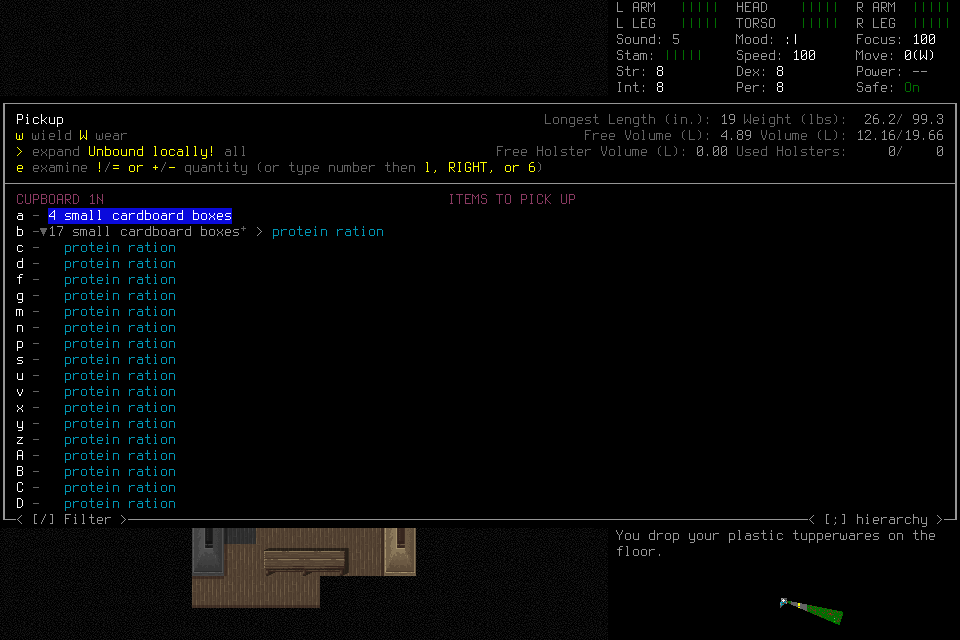
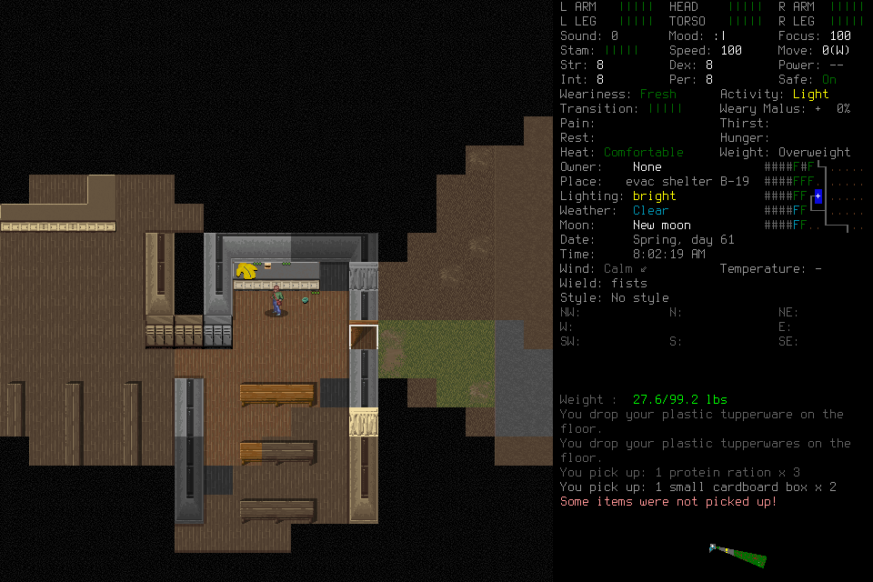

# Organic useful play and observed blocker repairs — 28 October 2026

Case **organic-264-027** demonstrates the required gameplay core of
[#264](https://github.com/CVX-Hull/enactive/issues/264): an original player authors
and executes a current routine, learns a substantive same-family correction from
actual consequences, leaves verified useful work, and hands that exact executable
to a registered fresh successor. Its generated selection and confirmation acquire
**three additional rations**. Normal Save, owned exit 0 and distinct Finish follow.
At this report's source freeze, protected PR and actual-main validation remain
pending. The owning PR/check receipts under #264 record subsequent delivery.
This native evidence does not certify another candidate. Apparent useful cadence, broader
learning generalization and unattended seven-day survival remain unqualified.

The selected appetite was **8–12+ hours** of combined engineering and real
experimentation, with low confidence. This is a planning estimate; inactive gaps
are not measured labor. Real trajectories drove the repairs below. Earlier failures
remain failed, including case 026 despite its useful ordinary progress and normal
ending. No source fixture retroactively accepts a failed game trajectory.

## Conditions and ownership

Deciding actors used mandatory generic **Pi 1.4.0/route 2**, DeepInfra DeepSeek V4.1
Flash 1017 `zRTkTPfs`, medium effort, 16,384 maximum output, 240s timeout and 30 context
images. Sixteen selected MCP tools supplied observations, input, lifecycle and
memory. No adviser or extra deciding tier was active. The lead selected finite
admissions, repaired closed-run blockers and independently checked evidence;
it supplied no gameplay inputs or tactical rescue during the organic cases.

The prepared windowed English 120×40 native binary stayed unchanged at
`71e51f5301e873e6832eb50c7456f29b5e40e9c7f2e7a38d241e36873c778597`, engine
`7b2efa5cea38e4d4d97dd0e63b28b9148623da59`, using the explicit project userdir.
Every case froze source, configuration, brief and native conditions. No save
editing, restoration or manufactured target was used. Case027 loaded the actual
normal saved progress from 026. Its initial context preloaded no historical routine
library and foregrounded the existing feasibility/executable-contribution criteria.
This operational candidate is **not a causal comparison**: earlier route history
helped 026 explore but also expanded handoff retrieval. The player chose tactics/code.

## Failures and useful intermediate outcomes

| Case | Actual result | Limit or failure |
| --- | --- | --- |
|019|Owned Load reached identity work.|Incorrect world grounding retired the phase; cancellation also exposed child-session isolation. No adoption or useful play.|
|020|Ordinary travel, current procedure revisions and outdoor entry.|Tree attempts produced no material gain and visible knife damage. Handoff completed in the runtime but the host rejected its still-active completed request envelope. No successor.|
|021|Original host settled and a genuinely fresh successor retrieved/Claimed.|Equal native state with different retained PNG bytes blocked Resume. The route routine repeated the first successful direction; a refused draft was not an executed parent.|
|022|Load reached provisional normal evidence.|Premature paused inspection retired setup before separate Resume/adoption. No useful play.|
|023|Explicit Resume, inspection and adoption worked; a revision of an executed imported parent produced travel.|No current authored-parent chain or supplies gain. Ellis died in hostile engagement during the last program root. No successor or normal ending.|
|024|The existing environment guard refused setup before acknowledged admission.|The lead had unnecessarily renamed the opaque compatibility identifier. Zero player hosts, native launches or inference attempts.|
|025|Fresh default creation/adoption, exploration, current authored parent execution and substantive correction execution.|Known native rejection left an obsolete source binding after rotation. Later input/handoff failed; no supplies verified, successor or normal ending.|
|026|Current executed parent, genuine correction and material gains; original settlement, fresh Claim/Resume, ordinary fresh water acquisition, normal ending.|Remaining opportunity before handoff unproven. Exact fresh correction only opens/yields at a direction prompt; ordinary inputs perform semantic selection and transfer.|
|027|Current executed parent, genuine correction, verified remaining food, exact fresh executable acquisition of three rations, normal ending.|Quantity prose and unexercised branches remain fallible; no cadence/generalization claim.|
|028|One published known rejection reproduced.|Cached rejected status failed a ready-only guard; diagnostic Observe could not restore custody. Wait/Save refused, exceptional cleanup, no normal ending.|
|029|One published known rejection, explicit Observe/new wait, normal Save/owned exit 0/Finish.|Technical branch check only; no organic-usefulness or cadence credit.|

Cases 020–025 retain settled-writer/native-absence evidence, using exceptional
cleanup where a native child existed. Cases 026/027 separately prove normal ending
through their ledger chains. Case 019's original native-cleanup custody remains
unknown; a later process census cannot repair that receipt. Case 024 has zero
inference attempts, player hosts or native launches. It is a preparation refusal,
not an admitted gameplay experiment.

In 025 the honest parent executes six east moves and one south move; its record's
“two-step south” account confuses a two-input budget with one actual DOWN. The
same-family serpentine correction executes six LEFT then DOWN, detecting benches
but verifying no supplies. Native rejection then blocks succession. The record
stays unedited. In 026 the original's corrected pickup routine makes material gains,
but remaining useful contents are not established before handoff. Fresh exact R3
only opens/yields at a direction prompt; ordinary selection/confirmation obtains
water. Inherited program-root metadata cannot turn ordinary decisions into
program-generated choices.026 therefore fails the full core despite normal ending.

## Case027: actual learning and useful fresh application

The original's current R1 executes `a,ENTER,g,g,g,g` and acquires **one box with a
ration**. “Some items were not picked up!” and remaining disabled boxes expose a
real capacity limitation. Ordinary exploration expands the 21 remaining boxes into
inner ration rows. This is an executed honest parent followed by a consequential
counterexample, not a deliberately bad routine or parser-only repair.

Current same-family R2 changes expansion handling, row selection, confirmation
and bounded progress checks. Its original invocation generates `g,a,b,c,d,ENTER`;
a later activity observation verifies **four rations** transferred. R2's expansion
branch is not exercised: ordinary exploration had already expanded the interface.
The prehandoff image supports **17 remaining rations**, nested in 17 boxes, plus
four empty boxes. Those nested rows do not represent 34 separate food items. Work
records 17 available/acquired 4 with source support. Actual capacity is 4.89L; the
claim is a useful remaining opportunity, not that all 17 will fit simultaneously.

The original issues registered Handoff `op-3c766d3a…` and settles. The fresh actor
retrieves the actual correction, Work/support and eight source-image replies,
then Claims and explicitly readmits. The selected exact R2 source SHA256 is
`97e7a8082443678f23d2866dcd580f4ac07168363cd9b6c34e3b6f959fc6f8a2`.
Its own program root `op-87c0b43c…` starts with no phase and empty state. Ordinary
setup opens the picker and chooses North; it does **not** preselect the items.
The initial program evaluation has all rows marked `-` and an empty picked pane.

R2 generates **`a,c,d,f,ENTER`**: it selects four empty boxes and three rations and
confirms. All five native inputs return. Explicit activity Observe `op-f75b8137…`
shows three rations and two empty boxes acquired; inventory `op-d23464a7…` shows
eight rations in a box versus five before this application, with seven wrapped
rations unchanged. This establishes a useful contribution from the exact corrected
executable, even though its local outcome is partial/act and some packaging does
not fit. No further ordinary row selection/confirmation completes this pickup.

Limitations remain consequential. R2 treats enabled non-expansion rows as candidates;
it is not a general food-only selector and also selects packaging. Its expansion
and no-progress branches are unexercised here. The original's supposed second
cupboard is the same cupboard viewed from another position. The successor later
creates R3 and makes separate gains; those do not count as exact R2 application.
Its final report overcounts a coalesced pickup message: evidence supports 14 new
rations across this mission and inferred final 21 carried/eight remaining, not a
verified final 27. The last inventory is earlier than final pickup. Canonical Work
remains the original 17-available/acquired 4 record after later updates fail; Finish
has no completed Work event. Useful acquisition is verified, complete Work closure
and final quantity reconciliation are not.

Save `op-e51aa025…` settles through reconciliation `op-50062698…` to a retained
SavedCheckpoint. Owned launch `225331fa…` exits with returncode0 in
`op-24c3e350…`, linked to that checkpoint. Distinct Finish `op-f2be66d1…` records
NormalFinish/stopped. Save and exit retain their original unknown terminal ACKs
with **separate effect proofs**; delivery is not rewritten. Custodian receipts
confirm both hosts/driver/controller settled and native absence. Its final
`not_launched` cleanup snapshot is not a claim that no historical child launched,
nor the proof of normal ending; the retained ledger chain supplies that proof.

## Repairs and verification boundaries

| Checkpoint | Observed problem addressed | Evidence boundary |
| --- | --- | --- |
|`cfd28d2`|Healthy wrong-world grounding refusal and owned cancellation isolation.|Focused provenance and real child-process-group checks; prior 019 remains failed.|
|`c4f5387`|Authenticate terminal lifecycle preflights; accept the exact completed handoff envelope.|Actual runtime/HTTP/MCP/Pi source fixture; successor starts in 021, but later Resume fails.|
|`2931f3a`|Use existing native-state equivalence for registered claimed normal handoff Resume.|Exact actor/epoch/Claim/Pause/custody checks retained; no global pixel tolerance. Case 026 exercises normal succession with matching pixels; genuine pixel drift remains pending.|
|`a6bafc1`|Keep healthy paused identity prerequisite refusal observable under rendering drift.|Focused real-component source tests;023 and 025 continue through separate Resume/inspection/adoption.|
|`c736260`|Retain authenticated current unknown publications as advisory data.|Actual 023 export retains unknown ACK/effect and immutable originals; unresolved episodes cannot support/counterexample a procedure or become current bindings.|
|`be5d9ae`|Read-only observation continuation after known semantic/native rejection.|69 focused regression tests plus the added miscorrelation test; independent final nine-test refusal review and fast checks pass. Native lane remains separate.|
|`3f68253`|Bind unresolved historical entry to its owning request and native custody.|Ten recomputed session/revision/boundary/control/Pause attacks now refuse through export/import;69 focused tests and actual retained023/025/027 exports validate.|

The known-rejection repair preserves the published rejection/charge and requires
explicit Observe before a new decision. It adds no retry, hidden Resume or source
promotion. Corruption, takeover, user Pause, exhaustion, processing failure and
miscorrelated ACK still stop. Source and lifecycle repairs reuse existing contracts;
there is no persisted-version change or compatibility path. The archive exception
retains current unknown publication only as historical data, never effect proof,
procedure support/counterexample or live authority. Independent integration review
found the original-entry custody gap; its narrow fix and regression matrix were
reviewed separately. Actual 023 unknown/death history still validates unchanged.

The final focused native check 028 exposed a fixture blindspot: the real native
kept `status=rejected` until explicit Observe, while the fixture immediately
published ready. The read-only guard then revoked the lease. Repair `d53e6c5`
retains one private settled-primitive pointer and matches the exact cached ACK
only during read-only refusal/Observe checks. Actual input admission stays strict;
real Observe must return ready evidence and clears the pointer. Ten focused tests
cover persistent cached rejection, aged/menu/navigation-prefix cases, wrong ACKs,
wrong pointers and storage/custody/global faults, with no hidden Observe; eleven
controller/semantic boundary tests also pass. Independent source review found no
material residual issue.

029 on that commit repeats exactly one `examine_and_pickup` probe, with an actual
published rejected ACK and no after-source. The mission stays active in its
read-only scope. Explicit Observe `op-657a2342…` returns a fresh ready source and
closes the spent one-input macro. New ordinary wait `op-7da1d2dd…` advances turn
5212946→5212947. SavedCheckpoint `op-1aaa186c…`, owned exit 0 `op-e97c6c4a…` and
distinct Finish `op-9155e31d…` prove normal ending. All children settle with native
absence verified. This tests recovery, not useful learning; 028 remains failed.
Native code/build were unchanged, so no new build was needed. Formal protected
PR and actual-main receipts belong to the integration PR linked from #264; fast
and focused source checks alone qualify neither gameplay nor full regression.

The first protected full run [40748935230](https://github.com/CVX-Hull/enactive/actions/runs/40748935230)
retains one failed Pi conformance wrapper, with 2,322 other tests and 4,359 subtests
passing. Its two-second host-deadline fixture expired during real MCP startup,
before the backoff it intended to test; the expanded conformance suite also
outgrew its 90-second outer watchdog. A delayed-startup reproduction fails with the
same zero-request assertion. The repair reuses the existing controlled-clock
pattern: reach actual retry eligibility, advance the original host clock, require
abort before cleanup pumping, and verify one attempt/no retry. Only the whole-suite
watchdog becomes 180 seconds; production host/request deadlines and gameplay limits
are unchanged. The failed run is retained; the corrected candidate still requires
full protected regression and actual-main verification.

## Apparent latency, context and cost

Apparent useful latency includes learning, context acquisition, repair, useful
effects, succession and ending. The fresh 027 R2 root is admitted 17:37:47.805UTC;
five returned native inputs finish 17:37:49.300. The retained pickup verification
capture is 17:38:26.079: **38.274s after root admission**, and **528.023s after
handoff admission**, including retrieval/Claim/readmission, reasoning, navigation
and setup. This is a conservative verification witness, not necessarily the first
effect. Its exact browser DOM replacement follows 81ms later, assuming a shared
host wall clock. DOM replacement/animation callbacks do not prove physical paint
or model attention. Fast key execution alone does not make this useful interaction
responsive. No 20-useful-decision cohort, useful p95≤2s or local useful-effect≤500ms
is qualified; no filler samples are introduced.

027 has 128 actual HTTP attempts (70 original/58 successor), 12,025,216 SDK cache-read
tokens, 4,562,597 uncached input and 148,785 output. Stable guide/tool prefixes permit
caching, but token counts alone establish neither causal speedup nor useful cadence.
The 30-image projection cap and handoff image burden remain context tradeoffs.
Current metadata lacks a public cache-write/retention policy. Provider request wall
spans, individual keys and internal termination are diagnostics, not independent
useful decisions. Older 020's first outdoor capture took 953ms from program admission
but 174.415s after its prior yield—another reason to preserve the complete trajectory.

Through 027: **1,431 actual HTTP attempts**, **$7.704002332000 known configured
estimate**, **$311.3992192 consumed conservative reservation**. Earlier missing
usage and all provider invoices remain unknown. Reservation is not spending.
Every retry counts; unused finite partitions are retired.
028/029 add 26/37 attempts, all with usage, for a cumulative bank of
**1,494 attempts/$7.783639460000 known configured estimate/$325.2305920
consumed reservation** within $450. These include earlier iterations; 019–029 alone
use 727 attempts. Known closed custodian windows total 215.002 minutes, including
setup/teardown and 024's preparation refusal; that is not a labor or accepted-play
duration. Unmeasured engineering labor and inactive gaps are not inferred.

Observer exports contain mixed page history; actual status
sequence ranges overlap and no frames were dropped. The final 027 export was later
than its planned 15-minute cadence; retained overlap supports the selected joins,
not an assumption that the precaution was followed.

## Evidence and next decisions

The [portable manifest](assets/organic-play-264-027/manifest.json) identifies exact
source, ledger/index and trace hashes, selected original PNGs and learned code.
PNG/code copies are byte-identical retained historical evidence, not production
helpers or universally applicable tactics. Full ledgers, traces, observer exports
and frozen admissions remain project-local under their mission/campaign IDs;
private artifacts are not all published or independently reproduced by this report.

Current next actions belong to GitHub: #164 retains apparent cadence/context
qualification, #176 organic control, #177 broader useful learning/generalization,
#178 optional reflection, and #194/#195/#217 their remaining native/control gaps.
#175/#186 remain deferred; #145 stays no-go behind #164. Reconcile Work quantities
and typed pickup applicability before broader automated acquisition. One useful
fresh application does not close the wider research or survival milestones.
