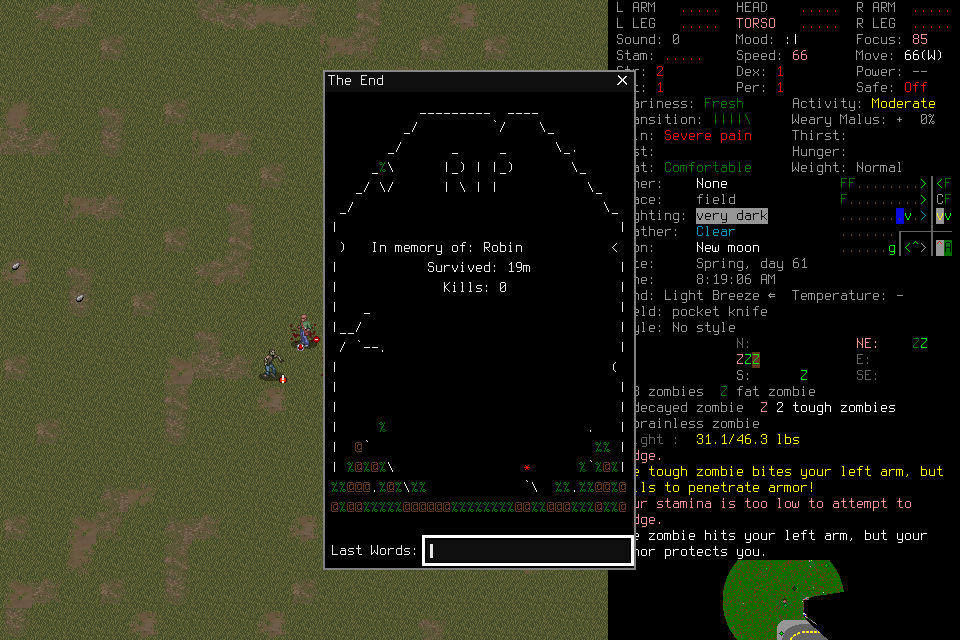
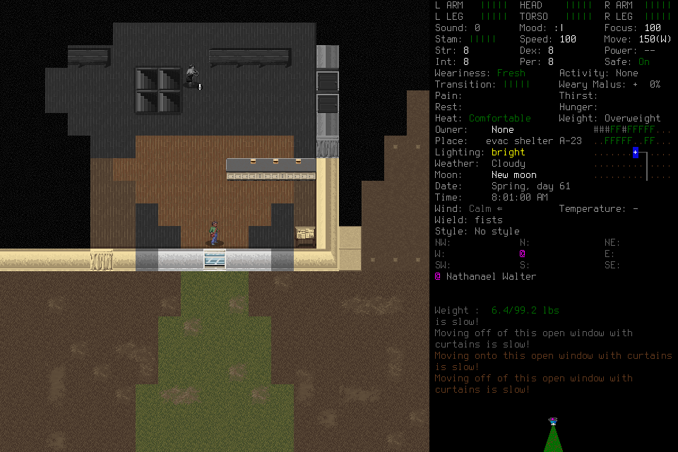
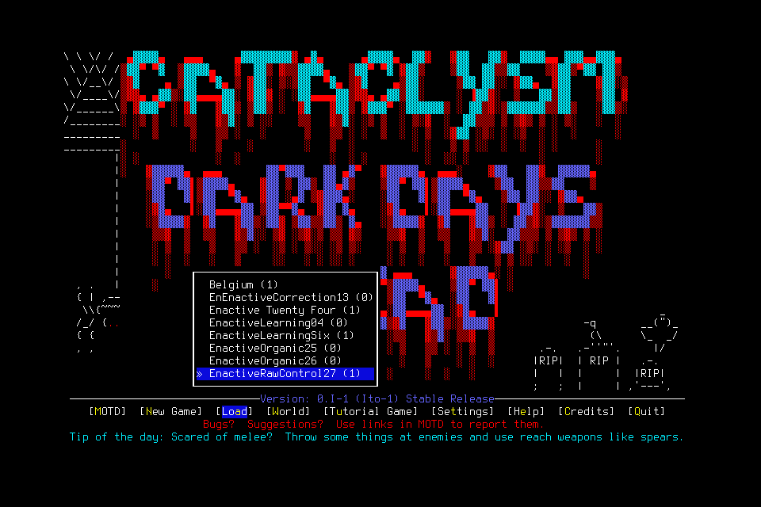

# Basic computer control through organic gameplay

The owner selected [ADR006](../decisions/006-computer-control-boundary.md): the
harness owns only computer mechanics; the entire playing system owns game meaning.
[#181](https://github.com/CVX-Hull/enactive/issues/181) investigates one backend,
not the complete [#176](https://github.com/CVX-Hull/enactive/issues/176)/
[#284](https://github.com/CVX-Hull/enactive/issues/284) migration. The
[implementation and reviewed cutover map](../changes/070-computer-control-proof.md)
separates the isolated experiment from current native7/mission11 production.

## Backend and evidence lanes

A nonprompting local Apple CoreGraphics preflight reports screen capture permitted
and event posting unavailable. No OS permission/settings change was made. Selected
one small SDL2/Foundation dyld shim in the exact owned child; no game headers,
scene/category/item/activity/identity/turn/save predicates or hidden game state.
The existing prepared wrapper retains windowed/project-local paths and background
hints but unsets the old semantic bridge. Signing/interposition and SDL input were
actually exercised, not inferred from API documentation. This Mac/SDL2 candidate
is not a universal desktop backend.

Portable focused checks cover bounded shapes, whole-sequence validation, exact
results/no replay, original limits, cancellation/Pause, capture/target integrity,
local refusal continuation, immutable frames, ACK retirement and independent
cleanup failures. Actual native fixture evidence is separate: raw key/text/shift,
click coordinates/virtual device state, unit640×400→800×500 resize, old-click
refusal0 and continued non-spatial keys; simulated unowned-event takeover; and
actual renderer destruction, input refusal and no capture retarget to its
replacement. Hidden fixture Unicode events do not qualify actual widget text/IME.

The first real episode exposed an error absent from the first fixture: SDL's active
offscreen texture was queried as though it were the default window output. The
repair keeps default-only pixels, validates pointer dispatch against captured
geometry plus independent window/pixel witnesses, and leaves rendering untouched.
Fixture009 holds a123×77 texture throughout polling and confirms input/resize/
loss behavior; fixture010 retains normal-target/takeover coverage. Two exact
read-only post-loss Observe receipts keep capture33 across a delay. These are
real SDL assertions, not portable mocks or actual-human takeover.

Private family: `.runtime/computer-control-181-20261029/`. Preserve fixture001's
no-first-present failure, fixture004/005's sandbox display/startup failures, and
fixture007/008's incorrect test assumptions about late receipt arrival and
latest-frame publication. Later passes do not rewrite those results. Final native
build manifest records exact source/input/output hashes and compiler arguments.

## Case001: scouting, pointer refusal and death

Frozen source`cda679b019b89ab0d77e8bc3167ba5671467b325`, original prepared game
SHA256`71e51f5301e873e6832eb50c7456f29b5e40e9c7f2e7a38d241e36873c778597`,
shim`bb0d9e66616894497af5463e3d7f28972232ecb28e315fb5f2fc773292747dae`.
One deciding generic Pi/DeepSeek Flash1017 medium host, OpenRouter fireworks/us
only/no fallback, pixels/basic controls;400-attempt/4500-host-second ceiling inside
5400 custodian seconds. No lead tactics/inputs, save edit or replacement character.

| Goal chain | Original evidence and outcome |
| --- | --- |
| Load and inspect | Requests1–8; frame3 shows Robin in EnactiveOrganic26, frame227 actual play at Spring day61,8:11:29. Frame535 shows existing supplies, not new acquisition. |
| Movement and route discovery | Requests9–17 initially leave time unchanged with repeated safe-mode warnings (frame491). Player revises and moves (frame639). Map panning, notes/route attempts and reading consume time; frame2375 says nothing to read. No cabin route established. |
| Pointer failure | Request45/op`8ac0be2f0ddc40ac86f072d6289e72a3` against frame3343 refuses before any event: Default renderer target required. Keys continue. This was a mechanical backend defect, not a semantic veto. |
| Limited scouting | Frame3776 establishes landfill traversal at8:16:30; frame4020 a building exterior at8:17:53. No shelter entry or useful supplies acquired is established. |
| Fatal combat | Directional choices near zombies lead to injuries, bleeding and grabs (4199/4320/4552). Frame4320 records some successful grab breaks; later failures continue. Frame4643 shows Robin's death,19m total survival,0kills. Episode game time8:11:29→8:19:06 is7m37s;19m is not new episode survival. |
| Failed normal ending | Post-death interfaces return to EnactiveOrganic26(0), frame5146. Frame5147 focuses No in Really quit; ENTER dismisses it. Frame5205 remains at the menu. Custodian later sends SIGTERM; normal_native_exit_zero=false, despite eventual code0. Exact actor/native/MCP absence is verified. |

The player's final report is retained unedited and corrected by independent review:
73 HTTP attempts, not72; some grabs were broken; affirmative cancellation of the
initial auto-move prompt is unproved; and normal quit was not established. Saving
game messages do not establish a surviving character or normal Save/exit. This is
an authentic failed scouting/survival attempt, with limited observations and no
manufactured success. The player owns these errors; the harness never interprets
menus or danger to gate ordinary inputs.

## Case002: repaired pointer and fresh organic episode

Frozen source`f1c0c6a78a16211c3c191c6f9ff7e3ad0236f78a`, same game binary,
shim`507cc7df7b1659f892791dc753035a47371f799dd61d46caa3af0d6d89496767`.
Fresh one-host allocation240HTTP attempts/3000host seconds inside3600custodian
seconds, after case001 was fully closed. This player created the default world
EnactiveRawControl27 and Alex through normal UI; no resurrection or save editing.

- Failed name editing and movement/look-around probes remain setup costs. Frame1195
  shows world name,1548 Alex entry,1745 Alex's sheet and1670 actual evac shelter.
- Starting inventory and cupboard rations were inspected, not acquired. NPC dialogue
  and supply location were observed; no recruitment, job completion or basement
  exploration is established.
- The selected reconnaissance loop reaches outside south of the shelter (2622,
  8:00:41), inspects the overmap north of Francestown (2673) and returns inside
  shelter A-23 (2930,8:01:00). This supports brief useful scouting, not safety or
  survival qualification.
- Request3/op`cc741d943c954db6b3c1fdd2ec28d736` emits3pointer events with no renderer
  refusal. Frames9/37/95 are byte-identical: SHA256
  `c503d445fdbf219f5c9ecd6b1f86f5337f69a4f7208602c904cf84746642befb`.
  There is no proven click effect. A later engineering configuration read records
  ENABLE_MOUSE=false; preparation sets that option and the old bridge overrides
  it. This is a relevant configuration explanation, not proof of the sole cause.
  The candidate leaves application semantics/settings alone. Normal mouse-enabled
  application and widget behavior remain #176/#284 work.
- Ending requests78–80 show Save-and-quit, Yes selected (3242), then the Load list
  EnactiveRawControl27(1) (3290). This supports visible save-to-menu; no reload was
  tested. Native SIGTERM follows, normal_native_exit_zero=false. The player's claim
  of normal application exit is corrected; exact actor/native/MCP absence is verified.

The engineering brief said “Existing items are inspected, not acquired in this
episode.” The player explicitly treated this as a prohibition on acquisition.
That ambiguity constrained the episode: it cannot establish unconstrained acquisition
behavior or a model preference against picking up supplies. Future context must say:
“Do not count starting inventory as newly acquired. You may acquire resources through
ordinary play.” The frozen failed wording remains unchanged. Also,3176seconds in the
final report is the custodian remainder, not host time; the final report consumes
request81, leaving159 of240 afterward.

## Costs, apparent time and limitations

| Episode | Whole custodian time | HTTP attempts | Configured API estimate | Gameplay outcome |
| --- | ---: | ---: | ---: | --- |
| Case001 |451.8516s|73, allHTTP200|$1.489915764|Limited scouting; no acquisition/shelter; death; normal quit failed. |
| Case002 |433.7805s|81, allHTTP200|$1.172239038|Shelter/outdoor scouting; visible save-to-menu; forced process cleanup. |

Case001 includes failed movement, abandoned route/read attempts, combat, post-death
menus, final report and cleanup.500 input operations comprise498keys,1text and1
rejectedclick;8waits;72capture operations/71unique PNGs/10,621,577bytes. These are
diagnostic counts, not useful decisions or progress targets. Median completed
response5.459s/p95 10.906s, tool median.297s/p95 2.023s; request intervals account
for90.7% of450.976host seconds. Fast serving did not produce successful survival.
Reported uncached input3,053,608tokens, cached read2,113,596, output53,761 (reasoning
37,199 is a subset). Cache use is real but not a useful-outcome claim. Observer
68DOM-load samples have median176ms/p95 302ms/max4383ms from presentation; coverage
is partial, and DOM load is neither physical paint nor model/user attention.

Case002 includes201inputs(195keys,5text,1click),98waits and80tool/capture
operations,78unique PNGs/6,473,685bytes. Response median3.756s/p95 8.960s,
tool median.896s/p95 2.167s; requests occupy76.5% of433.005host seconds.
Different goals/setup/waits prevent a causal speed comparison with case001.
Both episodes together use154HTTP attempts and$2.662154802 configured estimate;
conservative cumulative reservation becomes$677.9699200 over2346observed attempts,
within the selected$1200ceiling. Previously known configured estimate plus these
runs is$21.120664152, excluding older/cancelled unknown usage. Unused finite
allowances are retired; no old session/authority can restart.

Known configured estimates are not invoices; historical/cancelled unknown usage,
conservative reservation and actual reported usage remain separate. These two
different episodes do not form a qualified useful-decision latency cohort; no
responsiveness percentile is accepted. Engineering/setup/review labor was not
separately metered, so runtime and API spending cannot establish workflow efficiency.
Host traces retain tool
intents/results and timing/usage, but intermediate visible player narration is
not retained; frozen mission, actual frames and final report support the semantic
assessment, with the report's mistakes corrected rather than assumed true.

Original real window/output/viewport resize, non-unit pointer mapping, stale/current
mapping under that change, actual-human takeover and actual widget Unicode/IME
remain unqualified. Current logical renderer transforms are unsupported. The
independent SDL fixture is not a second real game. No #164 responsiveness cohort,
#177 learning/succession benefit, #145 survival or full product cutover is claimed.

## Review, retention and delivery

Independent design/source/standards/outcome review found and resolved the pointer
geometry, cleanup, cancellation, integrity, ACK-handoff, wait-completion, boundary
type and migration-map findings. The reviewed scope allows bounded #181 completion
from raw operation mechanics plus the organic goal attempt; it does not qualify
usable CDDA clicking or the migrated product.35focused development tests and fast
checks passed; warnings-as-errors native builds and fixtures009/010 passed.
Protected full PR and actual-main receipts belong to
[#181](https://github.com/CVX-Hull/enactive/issues/181) and its implementing PR;
no fixture or report substitutes for those gates.

[The small machine-derived summary](assets/basic-computer-control/summary.json)
retains source/frozen-input/binary hashes, original receipts and scoped counts.
Original JSONL/operations/PNGs/frozen packages and observer downloads stay in the
private project-local family, under existing evidence-retention rules; a fresh
checkout does not contain all private media. Native/repaired-library bytes are
retained by hash in retained-binaries. Case001's original library was overwritten
by the repair build before collection: reconstruction from its frozen source is
byte-identical to the recorded original hash, and reconstruction.json labels it
as post-run reconstruction, not collection of the loaded original. Future runs
must retain native/library bytes before overwriting build outputs. No game save
was copied, edited or restored for that retention work. Authentic death and the
new saved character remain normal upstream state.

Both finite runs end with persistent input revocation, exact process absence and
host quiescence; the viewer listener closes. The worker checkout and scratch build
copies are retired after needed receipts/artifacts are retained. Old paused source
3177329 and its evidence remain preserved. The prototype has no runtime path from
the supported product CLI and must be retired during the coordinated #176 cutover.
