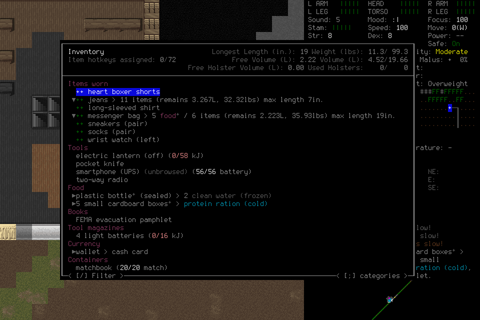
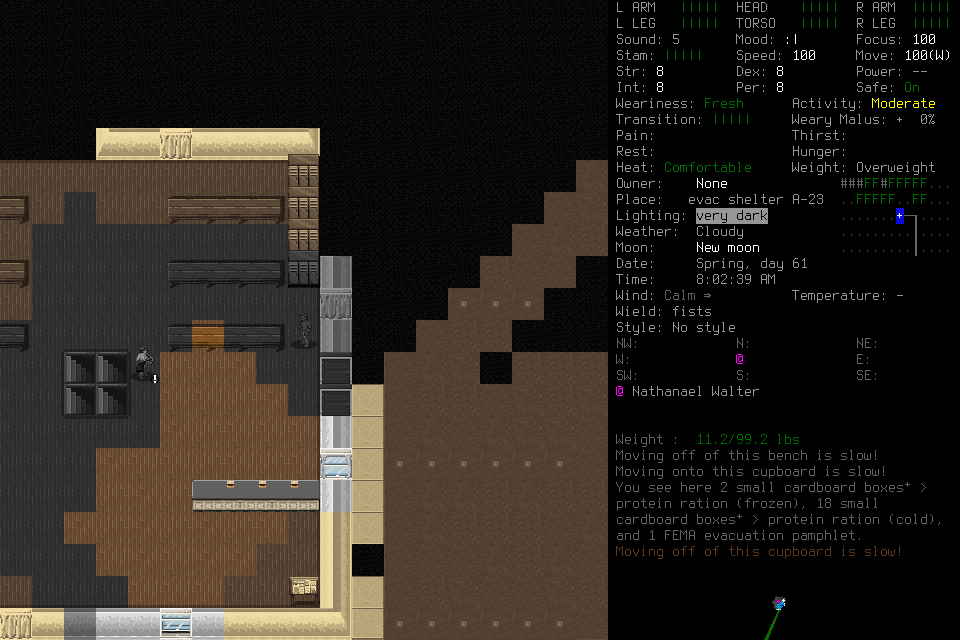
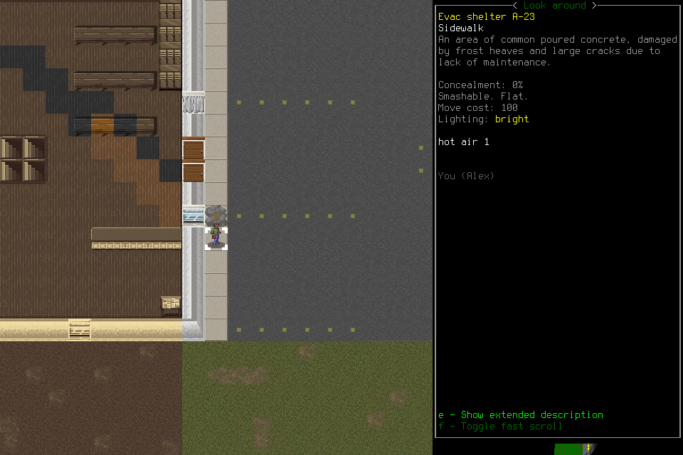
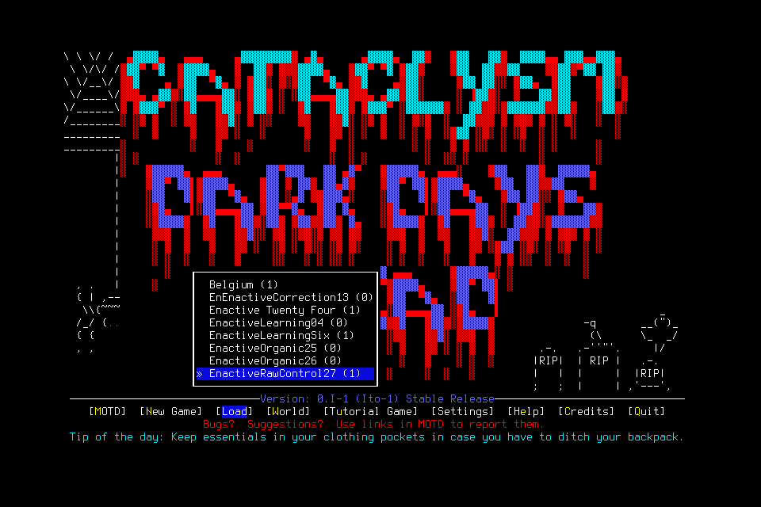

# Production computer control through actual play

The [#176](https://github.com/CVX-Hull/enactive/issues/176) cutover implements one
[mechanical computer boundary](../contracts/computer-control.md). Actual CDDA play
now demonstrates useful acquisition, image-conditioned local programs, fallible
memory/correction, clean actor succession, deliberate Save verified by a fresh
child, and a final separate normal application exit. These are composite evidence
lanes across authentic continuations; failed finite admissions remain failures.
Protected source-delivery receipts belong in the owning Issue and linked PR.
This report supplies outcome evidence, not a claim that CI passed.

## What changed

The harness supplies pixels, geometry, basic key/text/pointer/wall wait, one writer,
original limits, independent permanent Pause, original-result collection and owned
cleanup. Game phases, menus, items, identity, tactics, save/load and success claims
belong to the playing system. No semantic eligibility or automatic loop recovery
was added to resolve player mistakes. The former semantic runtime, current old-format
readers and isolated prototype were removed together; unsupported formats reject.

The mandatory generic Pi host uses the current MCP/computer port. Optional player
services retain source-backed claims, immutable program lineage, actual derived
RGB, bounded V8 execution and handoff context. A program proposes the same basic
controls under the original resources. Its fault/yield can return to ordinary play;
unknown input permanently stops automation and is never replayed.

## Evidence by responsibility

| Lane | Observed result | Limit |
| --- | --- | --- |
| Basic control, organic004 | A cupboard click opened pickup; text filtered inventory; confirmed actions acquired a lantern, four batteries and radio. | Lantern/batteries were empty. Preview weight and delivery alone were not accepted as pickup. |
| Useful play, organic005 | Five boxed cold rations were confirmed in the successor's inventory; four remained after one was left outside. | Packaging is not verified servings/calories. No food consumption or usable-water gain. |
| Local execution, organic005 | Actual RGB-conditioned programs produced six north/two east displacement in 4.026s, then a revised program produced four north in 1.855s for the successor. | First run ended at a limit. Both versions entered darkness; the revision's prevention claim was false. |
| Knowledge and succession, organic005 | Real failed program revision, source-backed correction, immutable context and clean old host/MCP exit preceded a fresh actor's reads and program application. | Functional reuse and conditional scouting, not causal learning benefit or general safe navigation. |
| Persistence, organic006→007 | Deliberate Save-and-quit in006; a different native child in007 loaded Alex at08:03:31 with matching position and carried stock. | Earlier forced-close005's last73 game seconds were not demonstrated retained. |
| Final ending, organic008 | Visible Save confirmation→title menu, then a separate Quit; native exit0 with no signals before cleanup. | Quit ACK remains unknown/EOF. Independent process evidence establishes exit, not the uncertain receipt. |

The first program failed before input because its key omitted modifiers. Revision2
`2ca31a4f3ad44e80958caf142e586403` then used actual96×90RGB. Its gradual-darkness
guard failed and its10 inputs ended at the original limit. Revision3
`748fbb881d2444769f4f9d67ac25ed57` was handed off and actually applied by the fresh
successor in run`5253b10db2f243dc8dc32d312f4ce5bb`. Four inputs moved Alex north;
it yielded at mean37.4/dark fraction0.53, after the screen already said very dark.
The helper remained fallible and ordinary input continued.

Correction`43398a05b40f4553b4b9ac6e88cbb8a7` supersedes the prior unsupported
deadlock decision. The new child's responsiveness does not prove the old process
never stalled. The actual handoff binds context`3359058e409c4cbaae74fd79f892068e`
and SHA`375c07197be79f0d91d10c3a175030d91cd2da8734a21960b94d7e728169acc6`.
The successor read sources and correction, checked inventory and reused the program.
References alone were never counted as proof of reading.

## Save, continuity and final exit

Organic006 resumed Alex with four cold ration boxes, two frozen clean water in a
sealed bottle, empty lantern/four batteries, radio, smartphone56/56 and matchbook19/20.
These were starting possessions in006, not new gains. A three-tile east-and-back
scout advanced six game seconds. Save-and-quit confirmation reached the title menu,
then a separate Quit ended the native process normally.

Organic007's different child loaded the deliberate checkpoint at Spring day61,
08:03:31, the same sidewalk position beside the shelter window and the same carried
inventory. HUD10.7lb and inventory10.8lb are distinct display contexts. The load
list shows playtime00:24:42, not08:24:42. No new gain or game-time advance occurred.

Organic008 loaded the same08:03:31 position, then recovered from a genuine menu
mistake: a click highlighted a row but Enter opened Help. Escape and ordinary
cursor navigation selected Save-and-quit; Left then Enter confirmed Yes and reached
the title menu. This observation does not establish a hidden cursor implementation.
Inventory was not opened in008, so007 owns the full inventory verification.

Its separate Quit operation`3277fdf2bc184879be85fcb81d913214` returned unknown/native
EOF. Original collection preserved that uncertainty; no replay occurred and further
observe was fenced. The owned native receipt independently records returncode0,
no forced signals and process/group absence. A normal exit does not rewrite an
unknown SDL acknowledgment or certify a save file by itself.

## Failures and endpoint disposition

The [development record](2026-10-29-computer-control-development.md) retains early
prototype failures, native fixtures, review findings and production organic001–005.
Fireworks US failed repeatedly on shared-pool429. Explicit BaseTen continuation
provided useful play and006's normal ending, but005 ended on HTTP400 whose exact
cause was not retained, and007 ended on repeated shared-pool429 before final Quit.
Organic007's delivered clicks landed at/right of the Quit label and changed no
pixels; neither click was a normal exit. Forced SIGTERM zero remains forced cleanup.

The [recorded backend dispositions](../changes/071-computer-control-cutover.md)
selected BaseTen, then OpenRouter DeepInfra regular`deepinfra/fp8` for008, preserving
the same model snapshot/medium effort and disabling fallback. Five read-only
[generation metadata](https://openrouter.ai/docs/api/api-reference/generations/get-generation)
samples corroborate BaseTen for005–007 and DeepInfra for008, model alias
`deepseek-v4.1-flash-20261017`. These samples do not attest every response or effective
backend effort. Current [public endpoint metadata](https://openrouter.ai/api/v1/models/deepseek/deepseek-v4.1-flash-1017/endpoints)
has null speed fields. The ending-only trial is no causal provider ranking or SLA.

The host keeps one eligible provider-only429 retry under original request/host
limits; every attempt is charged. No third attempt, tool replay or actor revival.
The existing bounded/cancellable refusal reader now records normalized identifiers
for every HTTPerror, excluding raw messages. It cannot recover005's missing cause.

## Apparent latency and caching

Organic005 native intent→receipt median was25.1ms, p95351.2ms across390 original
receipts. First model tool arguments had actor medians7.156s/9.625s and p95s
17.909s/25.823s. Headers medians were2.672s/4.077s; host payload inspection medians
4.64ms/5.32ms. These locate substantial delay in the remote request/generation
path, not a proven server-inference component. Local intervals are not additive
with provider clocks, and heterogeneous tasks preclude a causal endpoint comparison.

Reported cached input totaled4,890,880 tokens across the102 usage-known responses;
uncached input2,831,017 and output144,152, including122,255 reasoning tokens.
Cache hits coexist with wrong interpretations and seconds of decision delay.
The stable prefix and bounded30-image history were used; projection omissions and
provenance remain explicit. Counts do not show which omitted evidence mattered.
Useful local execution is demonstrated by the short scouting runs above, not by
API speed, token throughput, program invocation or a manufactured decision cohort.
The earlier browser DOM witness is separate from physical paint/attention.

## Source, review and retained artifacts

[Selected diagnostics](assets/computer-control-176/diagnostics.json) record exact
source/session/native identities, original trace/receipt hashes, byte-identical
curated PNG hashes, selected generation metadata and derived timing scope.
Full packages, saves and original failed chains remain project-local under ignored
`.runtime/computer-sessions/` and `.runtime/cutover-176-20261029/`; a fresh clone
contains the selected public evidence only. No save editing/restoration or semantic
engine bypass manufactured these outcomes.

The native adapter was built while unrelated integration changes were present.
Its three exact input hashes match the current committed files; original dirty
build provenance remains unchanged. Actual socket/backpressure/EOF/expiry/duplicate/
inherited-lock fixtures and the production SQLite/V8/SDL pipeline passed separately.
The authentic game has only the pinned deployment-target build patch. The bundled
FreeType warning and broader platform qualification gaps remain.

Independent reviews repaired custody/storage/cancellation seams and found a final
helper-setup defect: unknown program lookup could stop healthy basic input before
any native call. Retained terminal helper faults now preserve basic input; seventeen
focused HTTP/client/SQLite/V8 tests and independent rerun passed. Actual uncertain
input still stops. Documentation review corrected stale resume/CI/rotation guidance.
No new review queue, compatibility reader or telemetry service was added.

Final008 used17 attempts/144.301s, configured estimate$0.00795927776, no missing usage;
all owned groups closed normally. Cumulative2617attempts consumed conservative
reservation$773.384142848 within the standing$1200 ceiling. Known configured
estimates total$22.75827283576 with historical/missing usage separate. Reservation
is not spending or an invoice. Unused allocations retired; five metadata GETs were
separate from inference attempts. Review/coordination labor was not measured fully.

Remaining claims stay with their existing owners: useful whole-player cadence#164,
causal learning#177, independent survival#145 and broader portability#191/#284.
Usable-water/lighting, non-unit geometry/resize, actual-human takeover, Unicode/IME
and a second real game are unqualified. Gameplay remains the primary feedback loop;
source fixtures, native mechanics, player outcomes and protected delivery are
separate evidence lanes.
