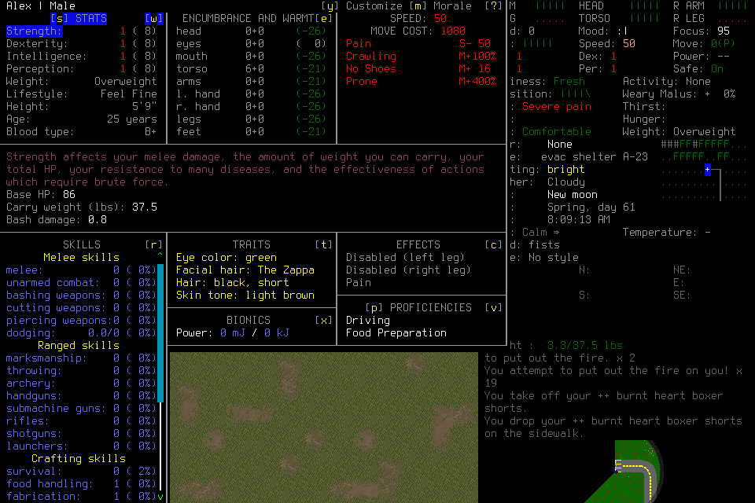
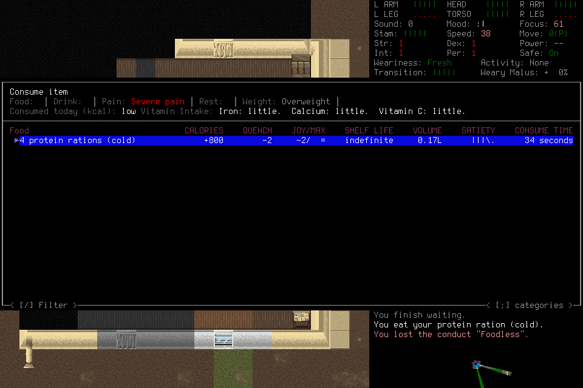

# Player context through useful survival progression

One [player-guide workflow](../player-guide.md#play-from-observed-effects) was
refined through authentic play: distinguish intention, preview and observed effect;
keep quantity scope and container contents explicit; revise dependent work when
current evidence contradicts an assumption; interpret confirmation focus.
Existing returned pixels may suffice. No mandatory observation, narration or memory
write per key, game-semantic harness gate, projection change or new subsystem was added.

The first revised continuation cleared active body-fire effects, entered the shelter,
and acquired and used food. A further continuation corrected its false retained-water
claim against current inventory. Failures, harm and unsupported claims remain below.
This is bounded functional evidence for the selected CDDA/model configuration,
not causal prompt efficacy, reliable survival or the parent cadence qualification.
[#280](https://github.com/CVX-Hull/enactive/issues/280) and its linked PR own source
delivery, protected checks and live disposition.

## Source and conditions

All three fresh admissions used generic Pi, DeepSeek Flash1017 medium through
OpenRouter explicitly pinned to DeepInfra regular `deepinfra/fp8`, default tier,
no fallback, 30 retained context images and unchanged production computer/native bytes.
The [production report](2026-10-29-computer-control.md) owns their earlier qualification.
Each package froze the exact source, guide/assignment/tool profile, native/configuration
hashes and original resources. There were no source writes during live play, save
editing, engine-validation bypasses, lead game inputs or tactical rescue.

| Admission | Source | HTTP attempts | Custodian wall time | Closed disposition |
| --- | --- | ---: | ---: | --- |
| Baseline001 | `458905f` | 128 | 27m32s | Useful progression failed; host canceled after player Stop; native exit0/no signals |
| Application001 | `9f3dd7e` | 126 | 24m22s | Care and food outcomes; host/native exit0/no signals; false final water claim |
| Application002 | `230277d` | 135 | 23m54s | Quantity correction and one starting-ration use; further supply/sleep attempts failed; host/native exit0/no signals |

Their session IDs, used with source suffixes below, are respectively
`4be3f6370ab94f4aa4f090591f7d371a`,
`8bf7998d2e0945c5a0fa3eb1160e9339` and
`d33439aa4f8e4afb8bec9f159b38edef`.
Original packages remain under ignored `.runtime/computer-sessions/context280-*`;
full evidence may be unavailable in a fresh checkout. The selected PNGs linked here
are exact copies verified against original tool-result SHA256 values.

Each admission had at most two hosts, 480 aggregate HTTP attempts (300 per host),
10,800 wall/4,500 per-host/9,000 aggregate-host seconds, 12,000 inputs, 20,000 requests,
2,500 frames and 3GiB. The frozen ending reserve was 60 attempts and 900 host seconds.
All used one host. Unused allowance retired; no stopped admission was reopened.

## What the baseline revealed

Baseline001 loaded Alex at Spring day61, 08:03:31 with four filled ration boxes,
a sealed bottle containing two frozen clean waters, empty lighting, and other tools.
These possessions were starting stock, not gains.

A selected Multidrop preview (`-804`) was narrated as a completed bottle drop.
Escape canceled it; subsequent inventory (`-852`) still carried the bottle, but
waiting continued. The relevant images were present with zero projection omissions
at requests13–17. A 14KB memory query had also returned fallible prior advice.
This identifies failure to use available evidence; it does not establish eviction,
context saturation or metadata volume as the cause.

The bottle was genuinely dropped later (`-3738`) and recovered (`-7526`), but the
four starting ration boxes were dropped (`-3923`) and never verified recovered.
A Consume listing was mistaken for carriage. Last pre-burn inventory (`-7889`)
contains the bottle and no food; a later insertion menu's hot-ration candidate
(`-8223`) does not prove possession. Final post-burn food stock was unknown until
Application001 reloaded and verified its absence.

A batch from an unresolved fire prompt (`-8081`→`-8223`) produced burns. The exact
causal key within the batch was not isolated. [The resulting state](assets/player-context-280/baseline-harm.png)
shows severe pain and reduced capacity. The actor subsequently claimed fire was
out and wrote Work `77fce571ae0e45f890d14ba1f486cd23` with false food-recovery and
fire-production assertions. Actual fire remained in the fresh child. Original
claims were retained, not cleaned to improve the comparison.

No drinkable-water, useful-light, shelter-ingress or substantive travel result was
established. Genuine corrections, recovered starting water, failed goals, repairs,
injury and normal native ending all remain part of the baseline.

## Useful prospective play and its costs

Application001 reloaded Alex at08:06:55 with matching injuries and stock. Its
[effects screen](assets/player-context-280/fire-before.png) explicitly shows On Fire
on both legs and a foot. The player removed burnt garments and waited, checking the
actual effects again. At08:09:13 (`-2508`), no On Fire entries remained. Clothing
removal and fire clearance count as **one care outcome**. This sequence does not
isolate whether garment removal, waiting or both caused clearance.

The costs were substantial: disabled legs and severe pain persisted; dropping the
jeans also left ten contained items behind, including the bottle, knife, phone,
radio, matches and batteries. No Shoes movement cost and later Chilly conditions
appeared. The objects were not established destroyed or retained.

The player then crawled through the south open window into the shelter (`-4666`,
08:17:06). Actual cupboard pickups included a partial-capacity refusal. A
[full inventory](assets/player-context-280/food-carried.png), not the selection or
nearby-item list, confirmed **five carried filled ration boxes** (`-6418`). After
Peckish hunger appeared during an attempted rest, the player ate one ration
(`-8525`), leaving four. This establishes usable food acquisition and use as the
second connected outcome; boxes, keys and pickup retries are not separate gains.
No unnecessary consumption was prescribed. Packaging counts are not measured
servings or calorie sufficiency.

Clothing trade failed; an attempted conversation produced an unintended yell before
repair. A 30-minute wait did not relieve severe pain; an alarm was set without
completed sleep. Repeated retrieval after capacity refusals and short wall-time
waits around old Saving messages added burden without demonstrated benefit.
The final report falsely said two waters were retained. That claim is rejected by
post-drop inventory and the trade pane, not counted as an achieved condition.

## Further refinement and historical-claim reconciliation

The same workflow was refined to consider contents when container/equipment scope
changes. Application002 received the previous player's exact terminal report as
fenced **fallible history**, not operator instructions or current evidence. Old
references gained no source readability, memory registration or input authority.
Preparation did not edit or repair existing memory records. The player later
appended new Work alongside them. This was a fresh native admission, not a
canonical actor handoff or a fabricated bad parent.

Alex reloaded at08:56:36 with the saved indoor state and no active fire. Its
[fresh inventory](assets/player-context-280/fresh-stock.png) confirms four filled
ration boxes plus one empty box, empty lantern, shirt/bag/socks/watch and no water
or other lost tools. Request10 explicitly rejected the historical retained-water
claim using current inventory. This also verifies retention of Application001's
food use and fire clearance across Save and a different native child.

The actor initially misread two advanced-inventory **rows** as two physical boxes.
That error did not persist into [final inventory](assets/player-context-280/final-stock.png)
or Work `2ad7fbe1e1e14ba9b33e50bcbde15fd7`: three filled boxes and two empty boxes
remained after another ration was actually eaten (`-10620`), clearing hunger while
Thirsty persisted. This used a starting resource; it was not new acquisition.

No drink, replacement clothing or further cupboard supplies were obtained. The
sleep attempt ended with the explicit “haven't slept a wink” message at13:53:46;
no recovery was established. Severe pain coexisted with failure but was not
isolated as its sole cause. NPC directions marked the refugee center and road,
not a visited destination or obtained supply. Claims of exhaustive local absence,
a fully surveyed floor or an impossible town route exceed the inspected evidence;
**not found or not reached** is the supported result.

Thus this admission adds current-versus-history reconciliation, checkpoint
verification and one hunger-relief effect, not two new substantive gains. No
successful container-transfer branch, general quantity accuracy or causal benefit
of the added sentence is established. Application002 used no memory queries,
program runs or actor handoffs; optional-service efficacy was not tested. The new Work remains
fallible and does not erase earlier false records.

## Save, normal ending and uncertainty

Baseline Save-to-menu `-9080` preceded Application001's fresh08:06:55 load.
Application001 Save-to-menu `-10496` preceded Application002's fresh08:56:36 load,
with matching retained food/condition. Application002 separately reached its title
menu (`-11634`) and exited. Its latest Save has not been verified by another child.

All separate Quit operations retained unknown/EOF acknowledgments after original
collection, without replay:

- Baseline: `24a372394d4a4121bb1fb7478a8fde46`.
- Application001: `2bd73e33cf3c4963876187c429b1a62b`.
- Application002: `9a85d609437d4005803a6e4f2b52c46d`.

Independent owned-process receipts record native exit0 with no native signals in
all three. Baseline's later player Stop canceled its host; the other hosts exited0
without signals. All owned PID/process groups were checked absent, authority was
revoked, and original uncertainty remained unchanged. Process exit is not a save
certificate; Save-to-menu, fresh-child retention and native closure are distinct.

## Apparent time, context and costs

Eligibility and clocks were declared before play. Failed/censored goals and repair,
retrieval, travel, rest, setup and ending remain included. The following are
**visible-intent→returned-evidence windows**, not model attention or the earliest
sufficient-evidence timestamps:

| Goal | Observed window | Result |
| --- | ---: | --- |
| Application001 fire care | 4m23.9s | Fire effects cleared; injuries remained |
| Application001 food acquisition | 1m43.5s to pickup; 3m20.5s to full stock confirmation | Five filled boxes verified |
| Application001 food use | 10.8s | One ration eaten after hunger appeared |
| Application002 food use | 5.5s | One starting ration eaten; thirst remained |
| Water, clothing and sleep attempts | Successful endpoints absent | Failures retained; no invented completion latency |

The unchanged analyzers also report diagnostic intervals:

| Admission | Completed API response p50 / p95 | Tool round trip p50 | Native intent→receipt p50 |
| --- | ---: | ---: | ---: |
| Baseline001 | 9.760s / 31.751s (127 completed, one censored) | 424ms | 27.1ms |
| Application001 | 7.763s / 24.350s | 935ms | 120.7ms |
| Application002 | 7.450s / 23.856s | 388ms | 29.6ms |

Action/capture/explicit-wait mixes differ; native receipt time is not application
consumption or useful effect. Provider-reported cached input was active (about
61–63% of known reported input, using cacheRead/(input+cacheRead)). Stable leading
guide/history bytes stayed stable within each admission. Caching did not ensure
correct use of evidence.
Older-image projection omitted up to92/93/100 images respectively, retaining exact
source references and omission markers; early baseline errors preceded omissions.
No eviction or provider/model/guide speed superiority is inferred from these
sequential, differently situated episodes. Physical paint, model attention and
server-inference start remain unmeasured.

There is no qualifying20-decision routine cohort or supported local useful-program
sample. [#164](https://github.com/CVX-Hull/enactive/issues/164)'s p95≤2s new-decision
useful effect, unexplained routine stall≤5s and local useful effect≤500ms targets
remain unchanged and unqualified. No filler samples or relaxed quality threshold
were used to close this bounded child.

The 389 actual new HTTP attempts consumed **$41.847586816** of conservative
reservation; cumulative reservation became **$815.231729664** within the standing
$1,200 ceiling. Known configured estimates for these admissions total
**$1.61978990712**, with one missing-usage attempt plus earlier historical missing
usage. These are not invoices or measured total API spending. Frozen rates were
$0.098/$0.294/$0.00294/$0.098 per million input/output/cache-read/cache-write tokens.
The three custodian episodes total 75m49s; active engineering/review labor was not
fully metered. The original 12–16 active-hour Low-confidence forecast and first
Started date remain in the Issue; elapsed activation time is not that estimate.

## Delivery lanes and remaining ownership

Fast checks and normal commit hooks passed before each changed-guide admission.
Independent reviews checked the guide boundary, historical-data provenance and
actual full images/quantities/ending. Exact protected PR/main checks belong in
#280's delivery receipt. Guide/document-only source uses the applicable editorial
profile; no unchanged runtime full-regression or native rebuild was repeated.
Earlier matching full/native qualification is reused, not presented as a new pass
or as proof that prompt instructions work.

Broader useful cadence and player judgment remain under #164, learning/memory
benefit under [#177](https://github.com/CVX-Hull/enactive/issues/177), and independent
survival under [#145](https://github.com/CVX-Hull/enactive/issues/145). CDDA-only
examples do not qualify other games.

Observed cross-admission spectator Pause-label retention is owned by
[#143](https://github.com/CVX-Hull/enactive/issues/143#issuecomment-6508431710);
a fresh/reloaded page is the immediate operating mitigation. Input-event
coverage limits are recorded in
[#290](https://github.com/CVX-Hull/enactive/issues/290#issuecomment-6509170220),
not asserted as a proven native defect. No semantic menu recovery or automatic
belief repair was introduced for these failures.
