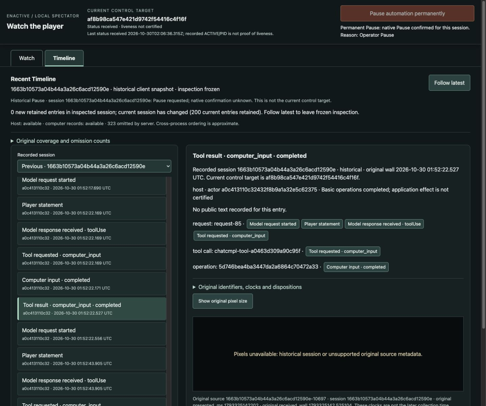

# Watch gameplay and investigate recent evidence

Watch makes actual pixels, source age and fallible public statements readable.
The recent Timeline connects statements to recorded request, tool, operation and
source identities; inspection stays frozen while activity continues. A persistent
control bar distinguishes current custody from historical inspection. The real
same-page chain below demonstrates normal ending, fresh admission, operator Pause
and another fresh admission without inheriting the old Pause latch.

The [observer component](../components/observer-operations.md) and
[contract](../contracts/computer-control.md#passive-spectator-projections) own current
behavior. [#293](https://github.com/CVX-Hull/enactive/issues/293) and its linked PR
own protected delivery receipts. The [curated summary](assets/spectator-293/summary.json)
binds selected assets and original closed receipts; it is not another live tracker.

## Source and finite admissions

A ran on `ec8a01a`; B, C and D ran on `b9b41b2`. All used generic Pi, OpenRouter
pinned to DeepInfra regular `deepinfra/fp8`, no fallback/default tier, DeepSeek
Flash1017 medium and 30 retained context images. Native/adapter bytes were unchanged
from the [production qualification](2026-10-29-computer-control.md). There were no
source writes during live play, hidden-state/save edits or lead tactical inputs.

| Admission | Actual elapsed / HTTP attempts | Closed disposition |
| --- | --- | --- |
| A / watch001 | 44m31s /146 | Incomplete development; native0/no signals; second host's final report canceled |
| B / watch002 | 25m50s /88 | Host0/native0, no signals; normal ending independently recorded |
| C / watch003 | 11m49s /54 | Operator Pause; host0; native SIGTERM/exit0, explicitly **not normal exit** |
| D / watch004 | 3m12s /18 | Host0/native0, no signals; separate normal ending |

Each fresh package froze source, context/tools/route, native/configuration hashes
and original resources. A allowed two hosts, 240 attempts, 4,500 custodian seconds
and 1,800 per-host/3,600 total host seconds. B/C each allowed one host, 240 attempts,
2,400 custodian/1,800 host seconds; D allowed one host, 120 attempts, 1,200
custodian/900 host seconds. All kept the original mechanical maxima of 12,000
inputs, 20,000 requests, 2,500 frames and 3GiB. Normal-ending reserve was five minutes
or 25 attempts; D began ending after load checks. Unused allowances retired.

Original packages, PNGs, host traces and stores remain under ignored
`.runtime/computer-sessions/observer293-watch00*`; complete private evidence may be
unavailable in a fresh checkout. B/C/D used a separate selected player store from A.

## Linked investigation and same-page control

During B, request 8's world-selection uncertainty linked to original tool-result 98,
operation `80da9fa2c3db42b082d2f6763e3ac97f` and source 143. Frozen selection/scroll
survived 40 new retained entries. Later request 34's route uncertainty linked to
operation `f3b122aba80c4d6f8ed3c0f8d62133a7` and overmap source 2629, despite the
player calling it a local map. Its [linked inspection](assets/spectator-293/route-inspection.jpg)
survived 30 new entries before Follow latest. The links identify recorded evidence;
they do not establish that an input caused the intended game effect.

Actual browser tab 16 reloaded once at B's start, then stayed through B→C→D without
reload. On C, B's selected source 10697 became explicitly historical/unavailable,
while current-session Pause was available. The operator clicked Pause **from
Timeline while inspecting B**. Initial requested/unconfirmed feedback changed to
received native confirmation for **C**, with C's control disabled:

Pause was prospectively planned at about 12 minutes, then brought forward roughly
one minute when the player began an early ending. It was not conditioned on a
supply success. The original post-click status independently records C paused,
reason `Operator Pause`. C's following input was `NoDispatch`/submission `none`, not
an unknown submitted operation or permission to replay a candidate ID.

The [fresh D witness](assets/spectator-293/fresh-after-pause.jpg) shows D's Pause
available, C's confirmation labelled historical, and B's older inspection evicted.
The old witness also retains a label defect: its selector fell back to Current
session although the inspected session was evicted. Final source adds an explicit
unavailable option, checked with the eviction fixture and rendered inspection.
No old pixels were replaced with unrelated current pixels. Keyboard arrow navigation
moved tab focus without activation; Enter activated Watch. Original-pixel sizing
changed presentation without requests or control effects.

A's temporary tab 15 disappeared before its cross-admission observation; original
partial witnesses remain private. A is not promoted into this same-page chain.
A's long final report was canceled by the existing 45-second native-ending grace.
Later assignments requested concise reports; controller deadlines/graces were unchanged.

After all play closed, final source fixed a separate source-review finding: preserve one
identified Pause receiver outside current/previous history, without guessing opaque
ID freshness or losing confirmation to reordered responses. Causal Node fixtures
and an explicitly synthetic browser layout checked this branch. That fixture is
not native evidence. The ordinary native/server/control paths were unchanged;
review found no dependency invalidating reuse of the explicitly pinned play above.

## What organic gameplay established and failed to establish

A's Claudio Whitman traversed into daylight but established no new carried supplies.
An NPC name was initially mistaken for its own. A selected rock pickup was
canceled/uncompleted, not acquired then mysteriously lost. Save-to-title was visible;
its subsequent Load did not establish restoration. Later visible movement prevents
calling earlier unchanged frames proof of a blanket input defect.

B genuinely created Papaikou/Parker West (Guru, Refugee Center). It entered the
communal hall and advanced from 08:00:00 to 08:00:18 without visible injury. This is
limited useful exploration, not durable safety or new supplies. Knife, bag, phone
and waterskin were starting equipment. The [inventory](assets/spectator-293/starting-stock.png)
says waterskin **“remains 1.5L”**, not a verified 1.5L of contained water. B/C's “full”
claims are unsupported. No acquisition, filling, consumption or completed barter
was established. B also visibly logged Mission “Faction succession” failed; its
cause was not isolated.

B mistook a Saving-game log line for continuing save blockage. Between quicksave
source 4567 and responsive Escape/Main Menu source 9603, **12m14s** passed with 29
wait calls plus SPACE. Disk slowness, a blocked main thread and queued harmless
input were not established. Actual save duration remains unknown. Later
Save-and-quit reached title 10580; Load dialog 10582 listed Parker West, then B backed
out without loading. The listing cannot isolate quicksave from the later Save.

C provides actual fresh-child restoration: source 185 returned to B's hall at08:00:18;
source 2441 identifies Parker. The inherited Saving-game log coexisted with responsive
play. C verified a powerless vending machine, a stone slab and one broken-console
tile; these failed local leads do not prove exhaustive supply absence. It wielded
its existing pocket knife at source 3453 and reached 08:01:08 without visible injury.
No barter screen or exchange followed the NPC-interaction attempts.

C reached Save-and-quit confirmation 3978 with **No selected**. Its next batch
returned to gameplay/look 4292, not title, before operator Pause. Its assertion
that the prior save remained unchanged was also too strong: D restored 08:00:50,
fists, and a changed played-time listing. Some C progress persisted; the later
knife equip was not restored. The persistence mechanism was not established.

D did no new survival work. It loaded Parker, observed [Save-to-title](assets/spectator-293/final-save-to-title.png)
and separately reached Really quit 1491. Its newest save was not tested by another
child. Original Quit acknowledgments remain unknown/EOF after collection without
replay: A `4044b3885efd46cd9ed1212ad075a2d5`, B `d8a29bd4fa9a4bbea34b564e34b8bbca`,
D `8f2aa140392445158778680bd6903d40`. Independent owned-process receipts establish
normal native exits for A/B/D, not completed input ACKs or save certificates.
All owned hosts/native groups were absent at closeout and input authority revoked.

## Time, context and cost

| Host | Completed API response p50 / p95 | Tool p50 |
| --- | ---: | ---: |
| A1 / A2 | 14.831/39.553s; 15.486/49.283s | 361/446ms |
| B | 11.666/27.555s | 438ms |
| C | 11.489/25.292s | 503ms |
| D | 7.675/28.347s | 382ms |

These are diagnostic spans, not useful apparent latency, inference-server timing
or endpoint comparisons. A2 has one censored request. B's explicit waits raised
its tool p95 to 14.399s and reduced observed request share to 73.3% versus about 97%
in A. The 12-minute belief/verification delay matters beyond individual call speed.
Cache fields remained provider reports; no causal cache or prompt benefit is claimed.

All 148 B/C/D sources have exact session/source/capture DOM matches in the retained
export, with zero omitted rows or invalid-clock joins. Received-source→DOM p50/p95
was 538/943ms for B, 491/916ms for C and 319/993ms for D. B's initial late-opened source
had a 4.671s received→DOM interval; presentation age and startup are not removed.
A has no retained timing export. Shared wall clocks are assumed; DOM replacement
can happen while Watch is hidden. Physical paint, visibility, attention and useful
outcomes remain unmeasured by this export.

The four admissions charged 306 attempts, including A's one missing-usage attempt.
Cumulative attempts rose 3006→3312; conservative reservation rose
$815.231729664→$848.150396928 within the standing $1,200 ceiling. Known configured
estimates total about $1.06606, with missing usage retained; these are not invoices.

## Assurance and remaining scope

Focused observer/server/player tests passed 23 cases; Node viewer race fixtures and
fast checks passed. Independent source and original B/C/D outcome reviews retained
the findings above; final receiver-summary review resolved both disclosure and
reordering defects. Protected full PR and actual-main execution belong
to #293's linked receipts; no redundant local full suite or native rebuild was used.

This is bounded agent-proxy usability/evidence review, not a human study or proof
that observability fixes player judgment. Detailed Knowledge/Analysis (#294/#295),
useful cadence (#164), broader learning (#177), survival (#145) and generalization
(#191/#290/#291) remain separate open outcomes. No optional program use was observed
in B/C/D's complete host coverage; that is not missing telemetry or a service verdict.
