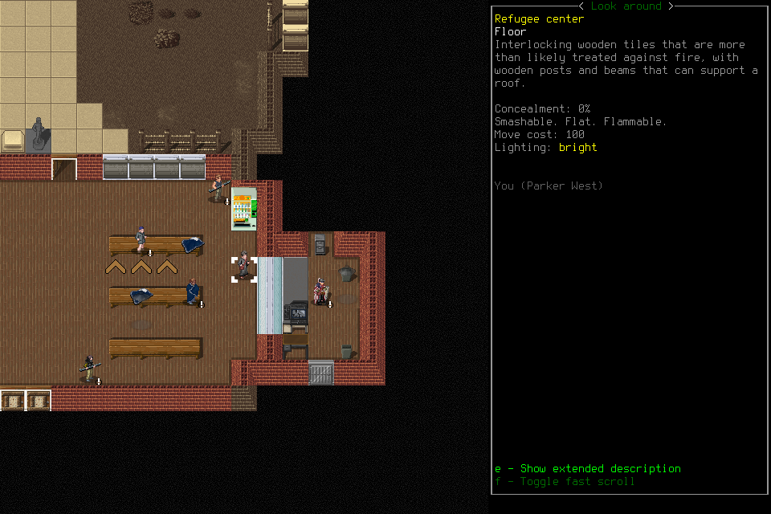
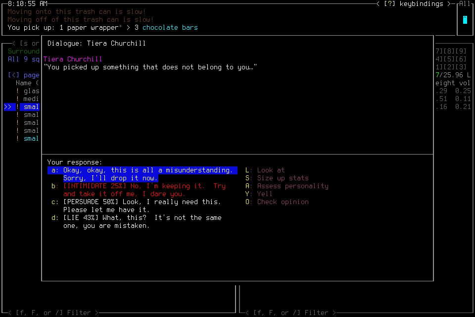
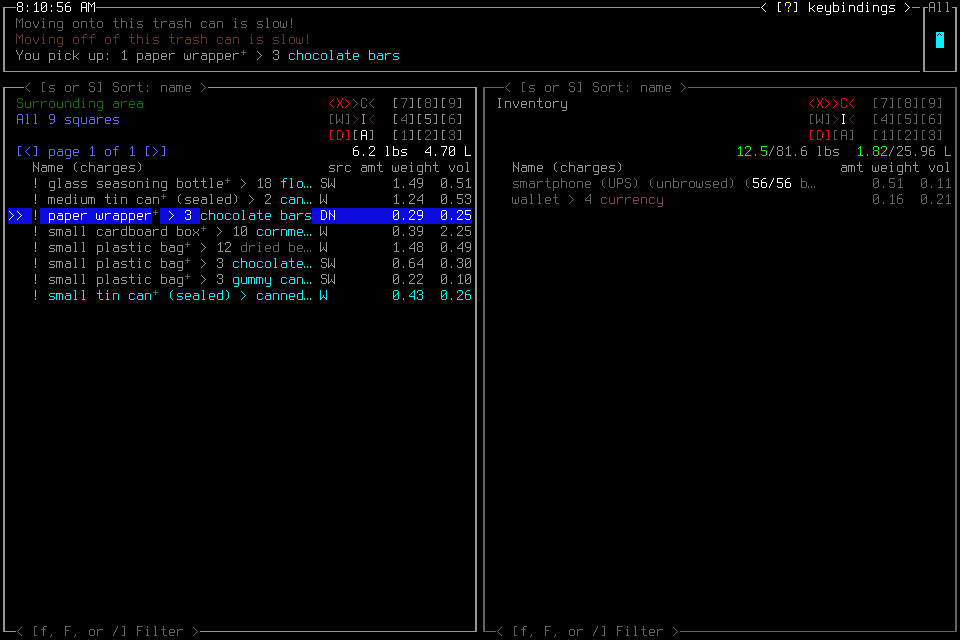

# Observed effects and useful continuation

Two organic episodes on the unchanged fast configuration produced limited useful
exploration and some local corrections, but **no retained new provisions, treatment,
consumption or demonstrated needs improvement**. This completes the finite
[#298](https://github.com/CVX-Hull/enactive/issues/298) diagnosis, not acceptance of
the player's survival readiness. No guide, context policy or runtime repair was
adopted. Spatial grounding and the scope of negative conclusions need investigation
before selecting a remedy; another warning or a smaller image window is not yet
supported.

The [evidence summary](assets/effects-298/summary.json) pins original inputs,
protocols, traces, receipts, diagnostic populations and eight unchanged source PNGs.
Complete traces, protocols, saves and all 194 PNGs remain project-local; they are
unavailable in a fresh checkout. This report gives the decision and selected
counterexamples rather than publishing private reasoning or a second raw archive.

## Prospective method and unchanged conditions

Before baseline, the frozen protocol defined a coherent survival-readiness task,
source-supported useful effects, all failed/recovery/ending work and negative or
censored outcomes. Starting stock, purposeless movement, menu completion and
player assertions alone do not constitute new useful gains. Campaign elapsed uses
original receipt start → source-received wall time; same-host diagnostic spans use
that host's monotonic clock. These are separate from first opportunity, publicly
stated intent and physical display. No cross-clock subtraction establishes model
attention or server inference.

Baseline 001 ran on clean source `4f7d8d2`, mandatory generic Pi, OpenRouter pinned
BaseTen without fallback, DeepSeek Flash1017 medium/default, current 14-tool schema
and 30-image context policy. It received the unchanged compact player guide, a
useful survival task and the unchanged fallible prior terminal report from #295.
No engineering corpus or evaluation protocol was given to the deciding player.
It owned tactics, menus, needs and success interpretation; the lead supplied no
rescue inputs. Native/adapter qualification was reused from
[production](2026-10-29-computer-control.md), with exact bytes pinned in the summary.

After baseline closed and was independently assessed, the lead selected #298's
**no-change branch**, then froze the assessment supplement before launching it.
Route, MCP template, prompt and target were byte-identical; context changed only
the case heading. The original prior report was reused, not baseline's new report.
The actual save, location/time, actor and ensuing decisions differed. Assessment 001
is therefore an **unmatched continuation**, not a controlled replication or evidence
that a fresh context improves play.

Each admission froze one host/240 HTTP attempts/2400 host/3000 custodian seconds,
12,000 inputs/20,000 requests/2500 frames/3GiB and a five-minute/25-attempt ending
reserve. No source writes occurred during play. All game semantics remained in
the playing system; no menu, loop or success detectors were added to the harness.

## What happened, and what did not

| Original episode | Source-supported effects from campaign start | Limits |
| --- | --- | --- |
| Baseline 001: 1285.937s, 96 requests | Inactive vending-machine discovery at 330.391s; opening a reinforced door reveals a new room at 949.731s; actual Save/title/list at 1243.800s | New room/item-bearing shelves support exploration; proposed larder/item types and broad search conclusions are unverified. No new retained supplies or needs improvement. |
| Assessment 001: 1404.640s, 104 requests | Overmap orientation at 236.798s; adjacent food opportunity at 384.838s; temporary pickup/confrontation at 446.899s and return at 454.170s; refusal after another ownership warning at 566.564s; explicit position anchor at 724.906s; Save/title at 1362.248s | Some corrections are real. Returned food is not retained readiness; exploration does not establish exhaustive coverage, safe ownership or a useful needs outcome. |

These selected anchors include incidental information and recovery, not a qualifying
routine-decision cohort. No successful retained-supply/needs endpoint occurred by
either closeout; its latency remains unsuccessful/censored, not zero or the time
to the transient pickup. Neither episode earned substantive readiness acceptance.

### Baseline: position and search claims exceeded the evidence

The player loaded Parker/Papaikou. Inventory source 242 contained the existing knife
and six murky water; these are not new gains. It concluded dialogue had exhausted
rewards while source 1302 still showed unvisited topics. A failed local pickup or
examine action did not establish that the whole room was empty.

Requests 50/53 described a confirmed southwest corner/bench blockage. Actual look
source 3230 explicitly identifies **You (Parker West)** beside the east wall. Repeated
east inputs had produced unchanged images 2977→3153; the player noticed that without
establishing its replacement location explanation. Later opening the reinforced
door genuinely revealed a new room at 5706. That success does not validate the
previous position, supposed food types or complete-search claims.

The final claims of exhaustive search, universally owned stock and no safe useful
improvement also exceeded partial inspection. Green body bars, Minimal pain, blank
hunger/thirst fields and the game's Safe On toggle do not establish general health,
hydration or safety. Several early ending intentions were reconsidered before more
exploration; this was not one uninterrupted ending sequence.

### Assessment: a real pickup and return, with bounded correction

The player claimed an initial Parker 00:48:54 listing, but assessment source 3
shows a plain title screen and does not support that assertion. Loaded scene 181
restored the stockroom pose, visible time 08:10:14, knife and retained log; inventory 223
again showed six murky water. These support bounded visible persistence of baseline's
saved state, not every save field or a new water gain. Nearby-list 225
shows **The Free Merchants** as owner of the selected container; its 257-item count
alone does not prove ownership of every listed item.

Wrong-mode actions recurred: request 10 opened Multidrop, then correctly canceled;
RIGHT did not establish travel, whereas subsequent DOWN changed the scene/time.
Look 680→685 moved a cursor; ESC 686 returned to the same corridor. The later claim
of being beside shelves preceded a failed pickup 871. Requests 34/35 opened, recognized
and canceled Main Menu/Options rather than proving appliance interaction. These
are examples of grounded corrections alongside unsupported location/task claims.

Food selection 2154 led to theft confirmation under a keybindings modal. The modal
was dismissed;2699 highlighted Yes but inventory was still unchanged. Enter then
produced source 2792's explicit pickup of a wrapper containing three chocolate bars
and Tiera's confrontation. The next apology action produced 2793: bars in Surrounding
area, inventory weight back at 12.5lb; source 2794 closed the active encounter, and 2932 showed
them left behind. This is temporary acquisition followed by return, not retained
food, proved lasting faction repair or proof that stealing never occurred.

Requests 43/44 correctly recognized the pickup and return. Request 45's relevant full
clause was “food was dropped; weight unchanged at 12.5 lbs, so not stolen”. Its
weight-based conclusion is unsupported, but the wording preserves the drop: it is
**not unambiguous evidence of forgetting the pickup**. The lead initially overstated
that interpretation and corrected it during analysis. Later, an unsupported claim
that trash was unowned met an actual theft warning 3124; the player declined the
transfer by 3346. That local correction does not establish all-camp ownership or safety.

Continued interior exploration reached an explicit position anchor 5299, a dining
hall seen through Look 6015 and Fatima 7114. It did not complete exterior foraging,
food/water treatment or another needs improvement. Final assertions of exhaustive
testing, no reachable useful option and healthy/provisioned status remained too broad.

## Save, continuation and ending are separate claims

Baseline's final report cited 8573 as saved-to-title; that source was confirmation
with Yes focused. **8575** actually shows title/Load and Parker 00:48:54 versus initial
00:29:01. Assessment's Load supplies the subsequent visible persistence check.

Assessment's quicksave message 8925 shows invocation, not independent persistence.
Its confirmation 9407 was canceled, with more real movement afterward. Later
LEFT+ENTER produced actual title/world list 10720. This supports Save-to-title;
that latest save was not subsequently reloaded. The final report's stronger claim
of confirmed preservation remains unverified.

Both final application-Quit operations returned unknown/Native-channel-EOF:
`d39ca0d2d1754da9ba8003d9f55f1272` and
`724ac44fb37b4a06a4e78f545121f3a9`. Each original ID was collected without replay.
Both acknowledgments **remain unknown**. Independent receipts separately establish
host 0/native 0, no signals, actual quiescence/absence and revoked input authority.
The retained Watch EOF/Pause fencing presentation is not an operator Pause test or
evidence of forced process termination. No harness receipt certifies gameplay Save.

## Where time went

Fresh eligibility screening made six forced observe-tool responses, with no game-tool
dispatch: BaseTen 3/3 valid median 1.281s, Fireworks US 3/3 median 1.524s. BaseTen led that
small check; cache/token conditions differed. Neither provider was disqualified by
history, and no paid DeepInfra fallback ran. A shallow eligibility probe does not
predict long-context organic-gameplay latency or establish a provider ranking.

| Diagnostic endpoint | Baseline 001 | Assessment 001 |
| --- | ---: | ---: |
| Complete response p50/p95 |11.785/24.702s (n=96)|11.788/27.547s (n=104)|
| Headers p50 |5.004s (n=96)|4.191s (n=104)|
| First tool arguments p50 |11.812s (n=95)|11.925s (n=103)|
| Tool interval p50/p95 |0.454/0.753s (n=95)|0.412/0.530s (n=103)|
| Image projection p50/p95 |4.070/8.578ms (n=96)|3.240/7.073ms (n=104)|
| Source presented→DOM p50/p95 |0.828/1.321s (88/93 sources)|0.764/1.260s (101/101 sources)|

All 200 gameplay responses completed. Summed request intervals were 1230.608/1353.111s;
tool intervals 51.073/48.437s, without request/tool overlap in either host. In this
configuration most measured host time is in the request path. Tool argument delay,
repeated unsupported conclusions and recovery all precede useful outcomes; faster
serving alone is not demonstrated to repair decision quality. Phase percentiles
are separate populations, not additive components. Queue versus prefill/inference,
physical paint and attention remain unknown.

Each episode used only six seconds of explicit wall waits, during loading. There
were no player memory/program calls: no local useful procedure or preparation cost
can be claimed here. The 30-image policy preserved current tool-image groups;
maximum protected count was one, with no blocked projection. Baseline overclaims
occurred both before and after the first omission. Text and omission provenance
remained; this does not prove attention, visual comprehension or a context-length
cause. Cache-read tokens were reported in both runs; the summary retains reported
input/output/cache populations. Cache volume is not causal speed evidence.

DOM witnesses include hidden Watch updates, not physical visibility or useful
cadence. Baseline misses its first five sources because attachment followed start.
The assessment export also contains 88 prior baseline presentations: those are
unmatched to the assessment session, not missing assessment coverage. Existing
Analysis supported following a fallible position statement to exact source 3230;
this is operator-proxy use, not a new UI or real-human usability qualification.

## Review, workflow and next decision

Independent outcome reviewers checked both complete original trajectories, all 194
PNG hashes, frozen inputs, quantities, correction/ending claims and receipts. The
lead verified decisive originals and manifest arithmetic. Review of a proposed
static image question caught the lead's truncated interpretation of request 45:
the live player had already recognized pickup/return. That paid probe was deferred
without requests; it would not establish organic benefit or context causality.
Lowering the image cap to eight was also an untested hypothesis and was not adopted.

Monitoring was imperfect despite the earlier lesson: extended lead analysis left
several gaps, including about 213s between primary checks. No planned operator Stop
window existed or was missed; original mechanical limits stayed in force. A late,
finite read-only status watcher supplied additional observation without input/Stop
authority or a new service. The first brief's path ambiguity was corrected. Do not
claim continuous monitoring or a guaranteed watcher interval. Future extended
analysis should use the existing delegation rule while the lead keeps short runtime
checks; another control framework is not needed.

All 206 new HTTP attempts, including six probes, have known configured usage;
estimate **$3.77412426**, zero missing usage. Actual native time totaled 44m50.577s;
144/136 unused native attempt allocations retired. Cumulative 3698 attempts reserve
**$972.727517184** conservatively under the standing $1200 ceiling. Estimates,
reservations and invoices are different; no invoice total is claimed. The original
8–12-active-hour estimate/12-hour appetite remains historical. Active engineering
and parallel review labor were not metered; no extra work is added to consume hours.
Protected delivery receipts and actual finish/Project reconciliation belong in #298.
Only evidence/navigation documents changed; runtime/guide contracts stayed fixed.

The next discriminating question is whether the current player can maintain
**avatar/world position separately from look/map cursor and attempted movement**
across a short original sequence, while limiting a failed local search to what it
actually tested. Use retained examples to decide whether perception/presentation
or working-state feedback deserves one bounded repair, then test its consequences
in substantive organic play. Do not infer that a shorter context, more guide text,
a critic or another provider will fix it, or schedule unchanged runs merely hoping
for success. Keep all semantic reasoning in the playing system. No additional
spectator tab/evaluator platform is a prerequisite. #164 cadence, #177 learning,
#145 survival and #191 portability remain unqualified.
