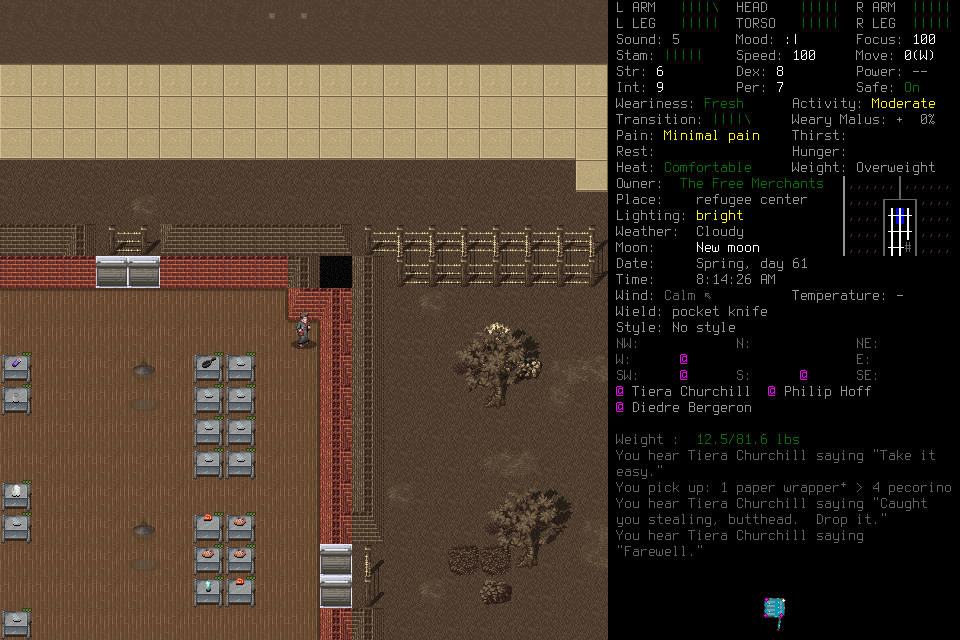

# Spatial grounding through retained evidence and organic play

[#300](https://github.com/CVX-Hull/enactive/issues/300) tested one compact spatial
context addition and **rejected it**. The original camera-versus-avatar error
persisted even with its worked example. Untouched examples contained both grounded
answers and false claims; organic play again confused interior/exterior position
and produced no retained new supplies or needs improvement. The current player
guide is restored to its preceding version. No game semantics, tool, schema,
renderer or native behavior changed.

The [bounded evidence summary](assets/grounding-300/summary.json) retains exact
candidate text/hashes, exposure limits, populations, accounting, source/time joins
and selected unchanged PNGs. Full original answers, protocols, labels, traces,
saves and research extraction corpus remain ignored project-local evidence and
are unavailable in a fresh checkout. This is an assessed rejection, not another
unchanged-guide run relabeled as a repair.

## Research changed the proposed experiment

The [primary-literature review](../research-spatial-grounding.md) reads ten primary
papers/HTMLs across spatial reasoning, camera frames, GUI inspection, working state
and uncertainty, with a 30 October 2026 cutoff. Methods and negative results matter:
trained camera/pose methods do not establish a prompt fix; zoom can lose global
relations or select the wrong region; extra reasoning, maps and critics do not
uniformly help. The same player would choose any crop, so region errors would remain.

An initially proposed optional crop API was **deferred before implementation**.
The one implemented prototype instead added an actor/focus/landmark/effect/unknown
frame and a source-backed historical transition example through the existing guide.
It was engineer-authored context, not player-learned memory, current-state truth,
a prescribed route or a per-key recording requirement. Existing memory/program
services remained optional. No second prototype or mandatory critic was introduced.

## Retained assessment and its limits

Four discovery episodes came from original #298 PNG/action sequences. Each was
asked in two conditions: final image plus its literal preceding input, or the
short original sequence. First-frame inputs lacked a preceding baseline. The
unchanged guide received two repetitions: 16 actual HTTP attempts, 15 nonempty
answers and one empty error after HTTP200/130.436s. Its exact SDK cause was not
retained; timeout, rate limit and provider ban are not established. No retry hid it.

After research and independent source review, candidate source `85aa045` received
8 discovery questions. The candidate was then assessed on 8 questions from four
previously reserved episodes. Candidate bytes were frozen before those images or
labels were opened for design; independent labels preceded their queries, and no
tuning followed. Earlier #298 human reports and same-episode overlap limit this
withholding: it is not novel-task or independent-episode generalization. No matched
old-guide assessment control was run. All 32 diagnostic attempts are retained;
none dispatched game tools. Model, effort, 14 schemas and image policy stayed fixed.

| Original evidence | Assessment |
| --- | --- |
| Discovery 686→871→920 | Avatar travels one tile upward relative to the doorway, then a later Look cursor/camera moves. Both original sequence answers and the candidate sequence answer deny the first travel. Fixed screen position was mistaken for fixed world relation. |
| Reserved 5546→5670 | Candidate recognizes southward travel and separates inspection from avatar, but says roughly two tiles where the landmarks support one. Two attempted keys do not establish two travelled tiles. |
| Reserved H3 sequence | Candidate recognizes changed landmark-relative position. This correct response is not a demonstrated correction or causal candidate gain without a matched old-guide control. |
| Reserved H1/H4 | Explicit You/Parker identification is weakened by an invented conflict with a sidebar NPC name; visible selection corners are missed. Current-only missing-baseline and local-search uncertainty are mostly appropriate. |

The original discovery includes byte-identical sources whose hashes were visible
in the question. Recognizing them is not visual-only evidence, and neither unchanged
pixels nor attempted direction proves the cause of failed movement. Two reserved
answers also exceeded the requested 220-word limit. The prospective local repair
criterion was not established; uncertainty was not graded as an error when evidence
was genuinely absent.

[Before actual travel](assets/grounding-300/discovery-before.png),
[after actual travel](assets/grounding-300/discovery-after.png), and
[later inspection](assets/grounding-300/discovery-inspection.png) preserve the
critical distinction without labels embedded in the original pixels.

## Organic play: consequences and recovery

One substantive admission, `grounding300-play001`, used that fixed candidate with
mandatory generic Pi, OpenRouter pinned Fireworks US, DeepSeek Flash1017
medium/default, 30-image history and the existing 14 tools. Native/adapter bytes
were reused from qualified production and pinned exactly. The original survival
readiness task and fallible #295 report were retained. The actual save, route and
context differ from #298: this is an **unmatched continuation**, not prompt or
provider superiority evidence. The player owned every tactic and input; no lead
rescue, live belief correction, hidden save inspection or semantic gate occurred.

The package allowed one host/180 HTTP attempts/2400 host/3000 custodian seconds,
with both 300 host seconds and 25 attempts reserved for ending. The player
voluntarily ended after 112 attempts, 765.995 host seconds and 767.100 campaign
seconds. Unused capacity retired; no second admission was launched for a hopeful
repeat. No source edits occurred until the run had closed.

| Source-supported event | Seconds from original campaign start | What it establishes |
| --- | ---: | --- |
| Storage approach, source1653 | 191.109 | Real travel toward item-bearing shelves; not acquired supplies. |
| Food pickup, source5775 | 624.620 | Wrapper containing four pecorino and a theft confrontation. |
| Return, source5778 | 630.412 | Wrapper back in Surrounding area, carried stock back at12.5lb/1.82L. The 5.792s recovery does not prove the guard is calm or faction relations unchanged. |
| Final inventory, source6637 | 710.318 | Same visible gear and six murky water as initial192; no retained food, consumption, treatment or repair established. |
| Last world image, source6742 | 732.549 | Still interior beside the brick wall; attempted outside/forage work did not establish outdoor arrival. |
| Title/list, sources6788/6789 | 739.470 /746.027 | Normal Save/title and a changed list value; no fresh Load afterward. |

Inspection/camera confusion recurred before storage. Later the player claimed
courtyard/path arrival while remaining inside. It discovered ownership, returned
the temporary food and reconsidered an early ending intention without operator
prompting. These are actual exploration/recovery events; not all elapsed time is
waste. They still provide no successful retained-gain endpoint. That latency is
**censored at voluntary closeout**, not zero or the temporary-pickup time.

The player reported save-list values `[01:11:29]→[01:23:20]`; original
[initial](assets/grounding-300/initial-load-list.png) and
[updated](assets/grounding-300/updated-load-list.png) images show
**`[01:11:23]→[01:23:28]`**. The update is real; the reported digits are false.
Final Quit operation `de617475a2364cee81c13048965279a2` remains **unknown/EOF**
without a delivered acknowledgment or returned frame. Separately, the maintained
receipt verifies native exit0 without signals, host/MCP quiescence, absence and
revoked input. No uncertain input was replayed. New saved-state reload and broader
persistence remain untested.

## Latency, resources and delivery

Fresh same-payload screens completed 3/3 on each route: Fireworks US median1.308s,
BaseTen1.374s. Both were eligible; the small probe selected Fireworks without
fallback, not a causal gameplay ranking. A preceding launcher argv failure made
zero HTTP attempts and remains recorded. No paid DeepInfra fallback was used.

Gameplay's 112 completed responses had p50/p95 **6.130/11.760s**; first-body
p50/p95 **3.086/4.846s**. The 111 tool intervals were **0.415/0.601s**.
Request spans totaled710.874s, tool spans52.441s, no overlap, and2.515s of host
telemetry time lay outside those spans. These same-host diagnostics do not measure
server inference, attention, physical paint or useful-goal latency. Reported cache
reads were5,818,754 tokens against4,451,278 uncached input tokens; this is observed
usage, not a controlled caching benefit. Source availability and an optional
working-state representation do not establish that the player used either.

The iteration charged **150 new HTTP attempts**: 6 route screens, 32 diagnostics
and112 gameplay. Known configured-rate estimates total **$2.390438**, with one
missing-usage diagnostic attempt; these are not invoices. Original conservative
accounting moved3698/$972.727517184→3848/**$1047.428726784**, within$1200.
Unused conditional admissions retired. Accounting totals, configured rates and original-failure metadata are in
the summary; complete usage traces remain project-local.

Development fast checks, independent primary-source/candidate-fit review and
independent original-image outcome review support this scoped rejection. Final
protected PR/actual-main receipts belong in #300. Only documentation/evidence
changes remain; unchanged Python/native code was not rebuilt or given another full
regression to prove prompt efficacy. An editorial CI pass establishes structure,
not player competence. Parent cadence, learning, survival and portability remain
unqualified. The next diagnostic should distinguish perceptual capability from
representation failure on original failed transitions before funding another
context intervention; useful organic play remains the adoption test.
