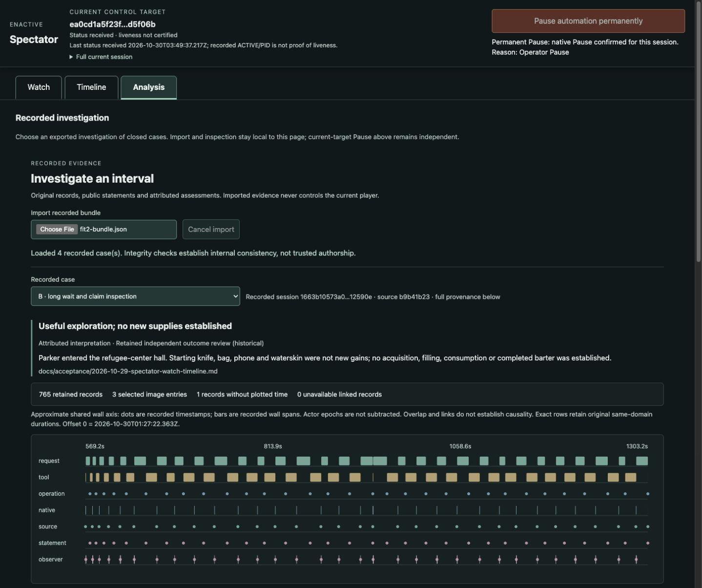
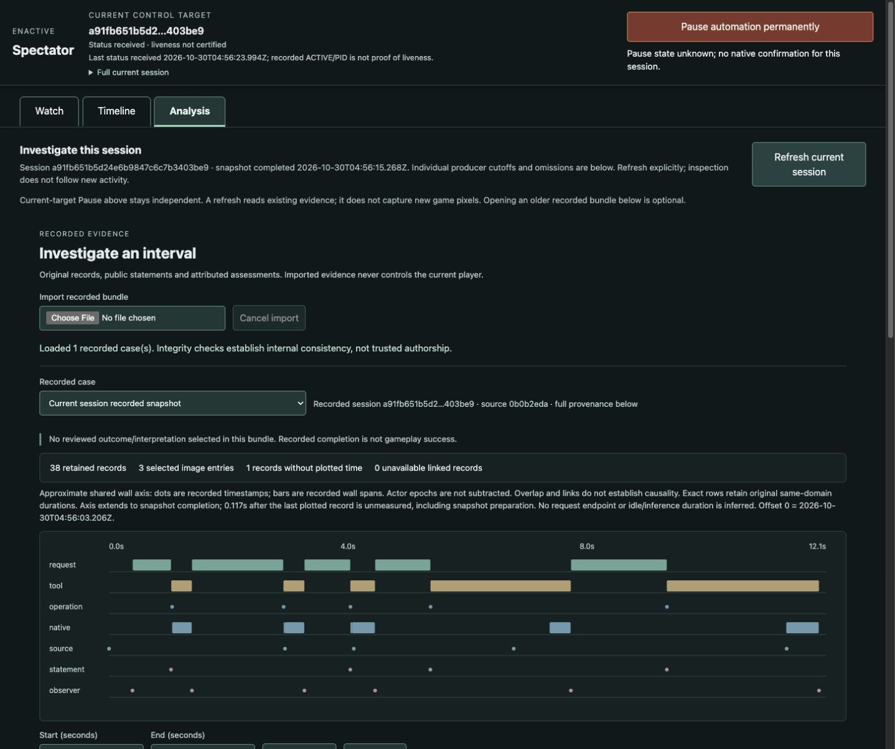
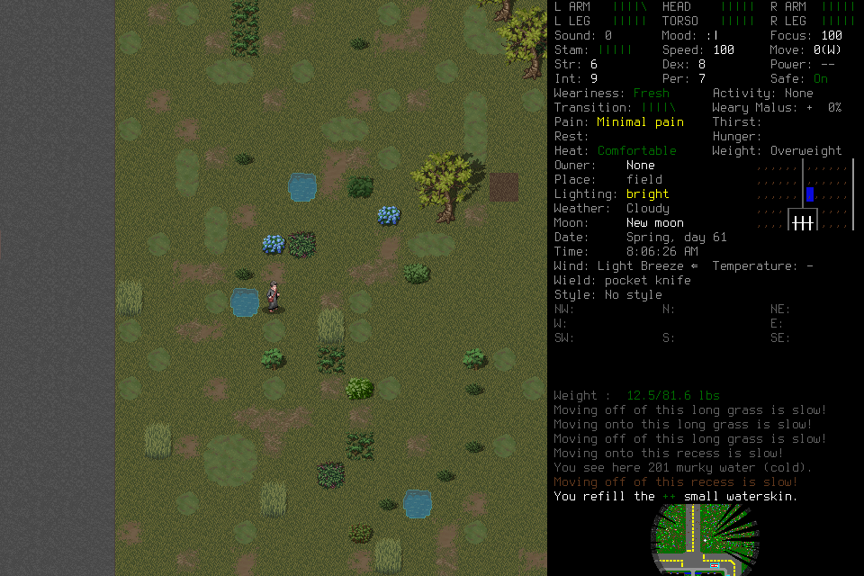
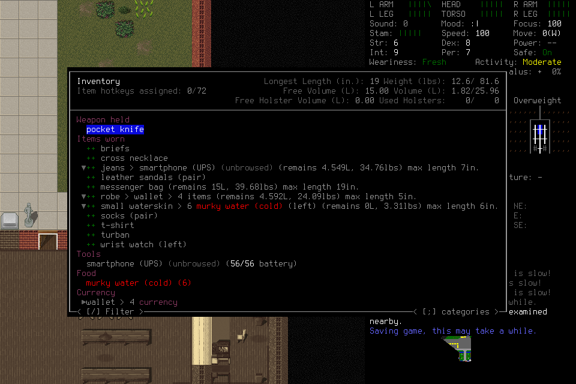

# Investigate gameplay through current and recorded evidence

Analysis attaches a bounded current-session **as-of snapshot** automatically.
Explicit Refresh advances it; activity and session turnover preserve deliberate
inspection. Older closed cases remain optional imports. The shared recorded reader
connects measured intervals, original records and selected verified screenshots,
while current-target permanent Pause remains outside the inspection state.

The [observer component](../components/observer-operations.md) and
[investigation contract](../contracts/observer-investigation.md) own current
behavior. [#295](https://github.com/CVX-Hull/enactive/issues/295) and its PR own
delivery state. The [small evidence manifest](assets/investigation-295/summary.json)
binds original source/receipt hashes, resources, selected assets and the
[public selected archive](https://github.com/CVX-Hull/enactive/issues/295#issuecomment-6515374811).
Complete private traces, saves and PNG histories remain project-local and are
unavailable in a fresh checkout; the archive declares its actual contents.

## Source, resources and separate outcomes

All admissions used the mandatory generic Pi, DeepSeek Flash1017 medium/default,
OpenRouter with one pinned provider and no fallback, and at most 30 context images.
Native/adapter bytes were unchanged from the [production qualification](2026-10-29-computer-control.md).
There were no source writes during play, lead tactical inputs, save edits or new
game-semantic harness primitives.

| Admission / source | Actual campaign elapsed / attempts | Outcome |
| --- | --- | --- |
| play001 / `c683114` / DeepInfra FP8 | 305.164s /24 | Genuine Analysis Pause; host0; native SIGTERM/0, explicitly exceptional |
| play002 / `43a35cc` / BaseTen | 955.602s /117 | Organic acquisition and Save-to-title; request 117 provider-error, host1; native SIGTERM/0 |
| ending001 / `0b0b2ed` / BaseTen | 164.010s /33 | Actual persistence check, Save-to-title and separate normal native0/host0, no signals |

The two main packages each froze one host/240 attempts/1,800 host/2,400 custodian
seconds; ending001 froze one host/80 attempts/900 host/1,200 custodian seconds.
Each bound 12,000 inputs, 20,000 requests, 2,500 frames and 3GiB. Unused 216/123/47
attempt allowances retired. Every receipt records actual quiescence, native absence
and revoked input authority. These are mechanical facts, not gameplay verdicts.

## Reader assessment during real play

On play001, the operator imported the four closed historical cases and clicked
Pause **from Analysis while inspecting B**. Requested then native-confirmed Pause
belonged to current session `ea0cd1a5f23f46a5b683f266eed5f06b`, not historical B.
The following refused-before-dispatch input was submission `none`, not an unknown
submitted operation or permission to replay a candidate ID.

Play002 demonstrated automatic attachment, original source/reverse-link navigation
and stable inspection while new gameplay continued. Its two retained snapshots
were completed at 04:12:10.095Z (74 rows) and04:17:27.989Z (524/526 rows); neither
contains the later water acquisition, Save or provider failure. A malformed optional
import retained the selected image/row, but its shell initially stayed at “Opening”.
Closeout source fixes that feedback and lends unused row capacity across kinds;
an actual retained organic005 projection then kept 1018/1018 rows, rather than 878/1018.
This read-only retained-input probe is not a gameplay-latency measurement.

Ending001 exercised those fixes on actual source `0b0b2ed`: automatic attachment
at 04:56:15.268Z had 38 rows/three images and explicitly labelled 0.117s after the last
plotted record unmeasured. A malformed optional import immediately reported failure
in shell and reader, keeping the snapshot inspectable and Pause independent.

The final four-case bundle contains 2490 events and 13 verified original PNGs. During
ending001, the operator followed organic005's actual program run `771f…bd0ace`
through its child operations, same-version authoring tool row 365 and model request 358.
The 4.026s local execution does not include those preparation/repair spans or prove
safe navigation. Original actor/source ownership survives successor collection.

The lead's early layout comparison favored time lanes above linked details over
the larger-image concept for interval diagnosis; Watch retains image priority.
Actual reader confusion exposed missing disposition/reverse navigation/focus,
import feedback and needless row omissions; each was corrected. Source-bound Node
fixtures cover keyboard focus/cancellation and exact alternatives to tiny marks.
Assessment was an agent/operator proxy, not a human study; per-task assessment time
and a causal navigation improvement were not measured. Direct `file://` launch of
the standalone HTML was blocked by the test browser policy and remains unverified;
shared rendering over allowed HTTP, export integrity and CSP checks are separate evidence.

## What gameplay actually established

Play001 adopted Parker/Papaikou and explored the backroom, without new supplies.
Its terminal “Hungry/Thirsty” and unchanged-state claims exceeded the images:
the visible hunger/thirst fields were blank, movement occurred, and persistence
was not rechecked. The pre-existing Saving-game log did not establish a new Save.

Play002 restored Parker West, wielded the existing pocket knife (source 1178),
explored outside and **refilled a small waterskin** at source 5586. Its original
receipt is 752.710s after campaign start,04:24:05.613Z; carried weight rose 9.2→12.5lb.
This is new raw-water stock. Earlier images warned about filtering/sterilization;
there was no established treatment, consumption or safe hydration. “Can't drink
spilt liquids” and unavailable choices do not establish the player's speculative
unsafe-water-filtering explanation. Save confirmation attempts eventually reached
the actual title/Load image 7427 at 940.568s. A subsequent provider error interrupted
the planned application Quit.

Ending001 loaded Parker from initial source 3→174, restoring the refuge-center
boundary at 08:07:45, knife wielded. Source 207 at 21.319 campaign seconds shows
**6 murky water(cold)** in the waterskin: the acquired stock persisted. This cannot
isolate which prior Save wrote it, and it is not safe hydration. The terminal report
incorrectly cited later source 1356 as the initial Load listing; original evidence
retains that provenance error.

Save was not one uninterrupted successful sequence. Ending requests 14/20 called
Yes selected while sources 427/734 visibly highlighted **No**; Enter returned to play,
followed by unnecessary waits/retries. The player eventually corrected the choice.
Source 1355 is actual title at 128.629s; 1356 lists Parker 00:29:01 versus initial 00:28:34,
supporting the new Save-and-quit write. That newest save was not subsequently loaded.
Separate Really-quit source 1510 appeared at 144.712s. Final operation
`df518a7b07a14692be64d28d9466341a` returned unknown/Native-channel-EOF; the player
collected that original ID without replay. Its acknowledgment **remains unknown**.
Independent process receipts establish native0/no signals and absence, without
retroactively converting the input receipt into delivered or certifying a save.

No player program was used in these three new admissions. Historical program
inspection demonstrates reader functionality, not new organic program uptake.

## Latency, route selection and accounting

The owner stopped the slow DeepInfra admission. After an initial approval rejection
sent no request, the owner explicitly authorized a six-attempt same-payload endpoint
screen: retained game image, current guide/14 tool declarations, forced observe call,
no tool dispatch. BaseTen 3/3 returned valid calls, success median 0.879s; Fireworks US
2/3 median 1.201s, with 429 then recovery. Cache warmth and token accounting differed;
this shallow screen informed admission, not useful-gameplay ranking. Fireworks
remains eligible; historical failures are not future bans. No paid DeepInfra recheck ran.

| Actual host | Completed responses | Response p50 / nearest-rank p95 |
| --- | ---: | ---: |
| play001 |24|9.293/30.641s|
| play002 |116|7.280/12.835s|
| ending001 |33|4.291/7.128s|

These are nonrandomized, different-task/context diagnostics. Play002 headers had
median 4.612s, first tool arguments 7.252s; model response time was substantial,
but repeated interpretation/confirmation/wait choices also prolonged useful work.
Snapshot joins and DOM timings cannot expose server queue versus inference,
physical paint, attention or a causal cache benefit. Play002 request 117 aborted
before headers/body after 13.32s; no HTTP status/refusal cause was recorded and
stderr was empty. The exact transport cause remains unknown. Ending001 then
completed 33 requests on the same route; that does not prove reliability.

Exact presented→DOM matches were 19/21 (play001) and 107/116 (play002), with missing
first 2/9; median/p95 1.213/5.148s and 0.918/1.345s. These include updates while Watch
was hidden, not physical visibility or apparent useful cadence. Broader
[#164](https://github.com/CVX-Hull/enactive/issues/164) qualification remains open.

The planned second Pause was **not executed**: the lead last checked near 13 minutes,
did extended analysis and noticed the closed provider-error case late. This is a
monitoring deviation, not a planned Pause outcome. The runbook now calls for short
elapsed/receipt checks and explicit missed-window reporting; ending001 was monitored
through its 164s closeout. Play001's actual Pause supplies the required separate lane.

All 180 new HTTP attempts, including the429 and transport failure, are charged.
Known configured estimates total $1.8853801452 with two missing-usage attempts;
these are not invoices. Cumulative 3492 attempts reserve $903.374045184 conservatively
under the $1200 ceiling. The manifest retains per-case actual use and retired capacity.

## Review, limits and next experiment

Independent source review corrected initial image-validation, original-owner/source
joins, retention and snapshot clock guards; the final focused review found no
remaining material source findings. Independent outcome review checked original
screenshots, hashes, receipts and claim errors. Archive disclosure/integrity review
verified all 13 PNG identities/bytes and original program links. Its specifically
authorized GitHub upload was downloaded again with the same hash. Full protected
PR and actual-main receipts belong in #295; fixtures do not replace these outcomes.

Keep the generic harness boundary and fast-first route policy. The next gameplay
experiment should target **observed-effect verification and meaningful continuation**
in a coherent survival-readiness task on a freshly eligible fast route: distinguish
selected confirmation from completed effect, test a concrete treatment/food/shelter
need, and retain time to independently supported useful milestones alongside
context/cache/failure diagnostics. Use the existing compact guide first; repeated
confirmation errors despite its advice do not establish that more prompt text helps.
If a player-context change is selected, compare its actual trajectory and repair
burden with this baseline rather than requiring prescribed keys or adding semantic
gates. No new Knowledge UI, telemetry platform or paid provider contest is required
before returning to gameplay. #143/#164/#177/#191/#145 retain their broader outcomes.
