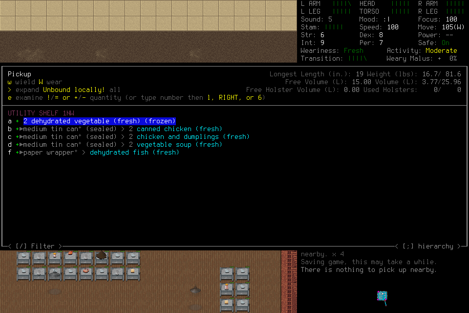
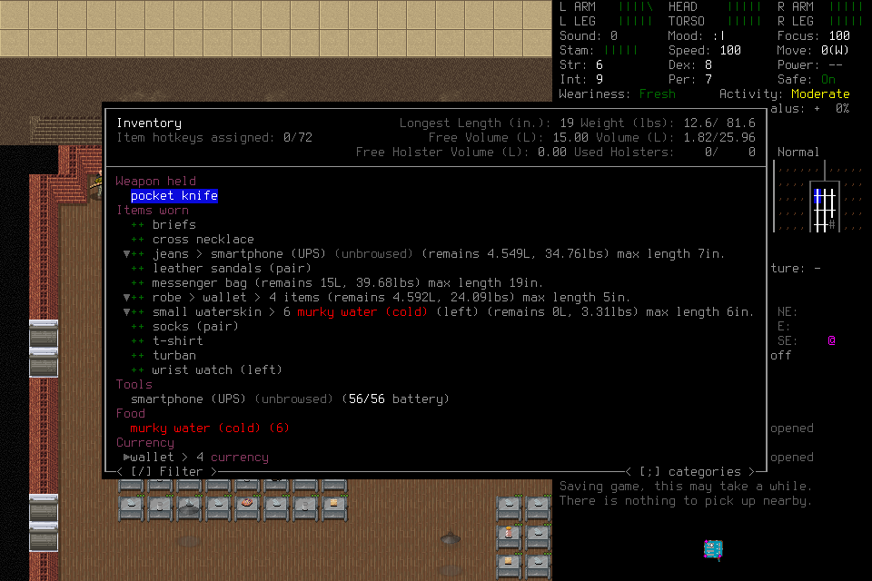

# Visual-player qualification through actual consequences

[#302](https://github.com/CVX-Hull/enactive/issues/302) **rejects adoption of the
tested Qwen3.8-27B configuration**. Wafer served two substantive native cases
without an HTTP failure, including fresh Load and separate normal endings. The
player nevertheless repeatedly misread spatial relations and pickup state, with
no retained new supplies or survival-needs improvement. DeepSeek Flash1017 remains
the deployed selection; neither this decision nor its earlier deployment qualifies
general competence or useful apparent cadence.

The [evidence summary](assets/visual-player-302/summary.json) binds populations,
configuration, source/native hashes, original failures, selected unchanged PNGs,
timing, usage, monitoring deviations and accounting. Full original packages,
answers, labels, protocols, traces and saves remain ignored project-local evidence
and may be unavailable in a fresh checkout. This is a completed bounded
qualification decision, **not successful capability acceptance**.

## Serving failures were investigated, not made permanent exclusions

Initial screening used the pinned Pi SDK, all 14 current schemas, actual images,
tool-result history and an allowlisted public-history approximation: 257625 text
bytes and 30 original PNGs. It reconstructed no private reasoning. The approximate
long workload is not the earlier full 175k request or a matched cache replay.
ModelRun/fp4 passed short checks but returned two long-request HTTP400s with no
retained cause. DekaLLM passed 4/4 and became the initial Qwen route. Cerebras's
65536 endpoint did not fit this unchanged long-context scope; that is an eligibility
limit, not a model or permanent provider rejection.

The same long payload reported 136496 Qwen prompt/cache tokens versus 103019
DeepSeek tokens. Deka first/repeated completion spans were 18.845/6.113s;
Fireworks US 5.715/2.550s. Identical-repeat hashes and cache reports are retained,
but output/order variability prevents a causal cache benefit or global speed claim.

Both initial native cases failed after three successful responses followed by an
HTTP429 and its one eligible retry. Each made 5/140 attempts, stopping on title/Load
surfaces without a returned world view; case002 may have initiated Load. Native
SIGTERM cleanup occurred after 22.872/15.206 campaign seconds. Return code 0 after
SIGTERM is not a normal ending; both normal-exit flags are false. Custody was
revoked and owned process groups closed. Useful-effect latency is censored there.

The safe server classification was `upstream_provider_shared_pool`, not proof of
a quota, account fault or upstream mechanism. Neither response supplied a parsed
retry delay. Actual waits of 0.423/0.492s were brief retries, not meaningful
cooldown experiments. [OpenRouter's error documentation](https://openrouter.ai/docs/api_reference/errors-and-debugging)
and [HTTP429](https://www.rfc-editor.org/info/rfc6585/) do not establish a universal
request-counting window; raw refusal bodies were deliberately not retained.

The owner approved a prospective rescope preserving those failures and the combined
356-attempt cap. A fresh ModelRun long request again returned HTTP400; safe code400
was retained, typed cause/provider code/limit source absent. Deka then completed
four independent requests and four SDK-growing tool-result requests, with a declared
20s pause between arms. Neither arm triggered its conditional 15s recovery probe:
**cooldown effectiveness remains untested**. Eight successes do not erase the two
native failures or prove a three-per-minute limit. Wafer/fp8 completed the same long
workload in 17.886s and was selected for actual gameplay as a competitive fresh
alternative, not a proven globally fastest provider. No production retry/routing
policy changed and no hidden fallback or paid DeepInfra request occurred.

## Fixed visual assessment exposed capability limits

Before queries, discovery froze D1–D4, two complete configurations and two evidence
conditions: original visual sequences versus neutral per-frame textual facts.
Sixteen attempts produced 15 answers and one Fireworks429 with missing usage.
Both visual D4 answers denied supported one-tile northward avatar travel; both text
answers derived it. Qwen omitted supported identity in D1 and chose wrong actors
or locations in D2/D3. Text resolved important identification errors. This is a
retained modality difference, not isolation of neural perception or attention.

Eight reserved original-visual queries completed on the original configurations.
Qwen recognized H2 displacement and H4's separate selection where DeepSeek missed
them, but chose an upper NPC despite explicit You in H1. Both recognized H3 travel
without fully grounding its directions. The [original transition images](assets/grounding-300/discovery-before.png),
[after travel](assets/grounding-300/discovery-after.png) and
[later inspection](assets/grounding-300/discovery-inspection.png) retain the crucial
avatar-versus-camera distinction.

After the first Wafer case closed, its unchanged configuration received the same
eight frozen visual questions, D1–D4/H1–H4. All answered, with mixed quality:
wrong actor in D2/H1, denial of real northward travel in D4, and avatar/landmark
confusion during H4 panning. H2 correctly recognized travel but omitted direction.
D2/H2/H4 exceeded 220 whitespace words; H3 was borderline by counting convention.
Earlier word-limit violations remain in the summary. No tuning followed.

These are one-response cells on previously exposed, overlapping #300 sources,
not newly untouched or independent tasks. D3 duplicate hashes were disclosed.
The text control supplied extraction facts only offline; it never entered live
context. Complete model/provider/quantization configurations differ, so the result
supports neither a backbone-only causal claim nor general model superiority.
The [primary-literature review](../research-spatial-grounding.md) remains relevant:
trained spatial methods, zoom and quiz success do not establish a gameplay remedy.

## Organic play made the adoption decision concrete

Cases 003/004 used Qwen3.8-27B, OpenRouter pinned `wafer/fp8`, medium/default,
262144 context, 16384 maximum output and the existing 30-image history. Source
`68966c3` changed only host diagnostic documentation from initial source `a6ff0988`;
native/adapter bytes, current guide SHA256 `14ac97fe…` and all 14 schemas were
unchanged. The mandatory generic Pi player owned all tactics, interpretation and
input. No semantic harness gate, prescribed route, corrective live facts, crop,
required note/program or operator rescue was introduced.

Each case had one host, 2400 host/3000 custodian seconds, 12000 inputs, 20000
requests, 2500 frames and 3GiB. Attempt caps were 140/110. Both 300 host seconds
and 25 attempts were reserved for ending, beginning when either threshold was
reached. Both ended voluntarily with ample reserve; unused allowances retired.

| Case | Actual attempts / campaign seconds | Supported outcome |
| --- | --- | --- |
| 003 | 88 / 995.116 | Loaded world, explored storage, repeatedly selected then canceled supplies; Save/title and separate normal native exit. |
| 004 | 74 / 865.111 | Fresh Load verified unchanged stock; continued navigation/dialogue and a glass opening, no exit or readiness gain; Save/title and separate normal exit. |

In case 003, weight increases to 14.1, 13.1, 13.2 and 16.7 lb were **selection previews**,
followed by deselection or ESC. No completed new food, salt, weapon or armor pickup
is evidenced. The last full inventory, source 5383 at 797.512s, matches starting
gear and six murky water, without food/salt. The earlier theft confrontation was
already historical in the first loaded log, not a new confrontation in this run.

The case 003 terminal report invented auto-save interference, overwritten progress and
reversion. Responsive menus and movement do not support those explanations. Its
190 words exceeded the 100-word cap. Case 004 received that exact unedited report
as explicitly fallible history, alongside the unchanged original assignment and
fallible #295 report. It received no audit conclusions or current item truth.

Fresh Load displayed Parker West/Papaikou at 08:15:22. Inventory at 28.088s showed
the original equipment, six murky water, smartphone 56/56 and wallet 4 currency:
12.6 lb/1.82 L, **no edible food or salt**. This establishes continuation after case 003's
Save and resolves the alleged stock reversion; it does not qualify useful-gain
continuation. The visible saving message was already historical on Load.

004 repeatedly searched perceived openings, talked to a guard and opened
reinforced glass with closed shutters at 553.146s. It canceled a proposed shove
at confirmation. It remained inside at the last world frame, source 6030 at 773.787s,
08:18:57, 12.5 lb; no completed transfer, consumption or needs improvement occurred.
There was no later full inventory. Its terminal report correctly admitted failure,
but misstated starting game time and used 138 words. No public statement repeated case 003's
food/reversion claim; absence of such narration does not prove an internal correction.

Both cases visibly reached title after Save confirmation. Their original Quit
operations remain **unknown/Native channel EOF**, unreplayed. Separate maintained
receipts establish native exit0 without signals, owned host/MCP/native absence and
revoked custody. No fresh Load followed004's Save, so its final persisted state
is unverified. No extra ending admission was needed. Useful readiness-gain latency
is **censored at voluntary closeout** in both cases, not zero or menu-preview time.

## Latency, cost and delivery limits

| Same-host diagnostic | 003 | 004 |
| --- | ---: | ---: |
| Completed response p50 / p95, seconds | 10.485 /17.028 (88) | 11.793 /19.520 (74) |
| First body p50 / p95, seconds | 7.277 /8.709 | 7.584 /10.593 |
| Tool p50 / p95, seconds | 0.394 /2.376 (87) | 0.526 /2.390 (73) |
| Request / tool span sums, seconds | 932.288 /59.941 | 810.634 /52.257 |
| Uncached / cached input tokens | 3001715 /2989312 | 2818571 /2209024 |
| Output tokens, including reasoning subset | 47027 (33412) | 40256 (29138) |

Both cases had zero request/tool overlap and zero missing usage. Roughly 94% of
each observed host span was provider-request time, not proven server inference.
The 30-image projection omitted 1647/943 image parts across repeated history events
(maximum 54/41 per event), retaining text; these are repeated omissions, not counts
of uniquely missing latest observations. No context refusal occurred. Caching,
token throughput and host timing do not measure attention, physical paint, useful
effects or their causal bottleneck. Recovery work and failed objectives dominate
the outcome regardless of transport percentiles.

Lead checks violated the frozen 45s maximum twice in case 003 (45.022/46.219s) and once
early in case 004 (105.977s, attempts15→27). These remain deviations, not rounded passes;
bounded read-only 15s polling subsequently restored cadence. Full protocol
conformance is not claimed. Original traces and negative outcomes remain usable;
no positive reliability qualification is inferred from incomplete monitoring.

The iteration charged **226 new HTTP attempts**: 22 screening, 32 diagnostic and 172
native. **218 have usage; 8 remain missing.** Known configured estimates total
**$1.098561**, not an invoice. Cumulative conservative accounting moved
3848/$1047.428726784→4074/**$1066.799857664**, within $1200. The remaining 130 of the
combined 356 cap retire; failed/missing-usage fetches retain their full reservations.
No third substantive case or further spending is implied.

The host README now accurately describes existing sanitized non-429/repeated
refusal metadata and missing-body/identifier limits. HTTP400 and controlled-clock
Retry-After fixtures passed; they do not prove real provider recovery. Independent
configuration, original-image outcome and consolidated-publication review support
this decision. Appropriate protected PR/actual-main receipts belong in #302.
The ancillary README requires full protected coverage under existing CI policy;
unchanged native bytes were not rebuilt. Actual engineering/parallel review labor
is unmetered; original 8–12 active-hour estimate/12-hour appetite and forecast changes
remain in the issue, without invented effort savings.

The remaining uncertainty is how an eligible visual player can ground the actor
and landmarks and commit ordinary UI effects during useful work. Further context
or perception changes need a concrete hypothesis from these failures and actual
gameplay validation; no new model, prompt repair or harness semantics are selected.
Cadence, learning, independent survival and second-game qualification remain open.
