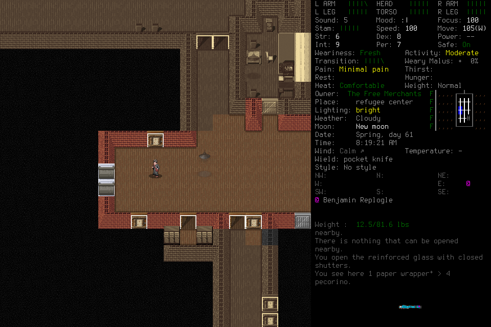
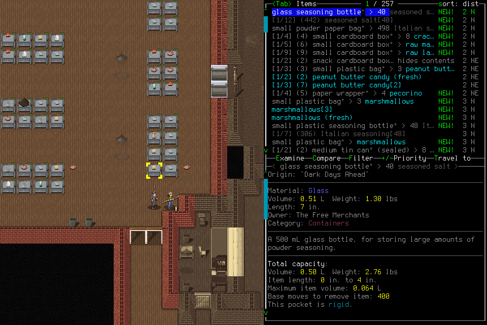
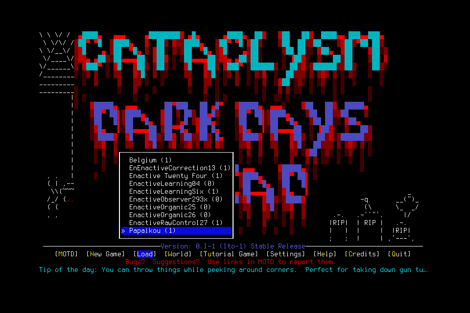

# Capable-player qualification

[#304](https://github.com/CVX-Hull/enactive/issues/304) tests whether a more
capable complete configuration can actually play: ground the avatar and UI
effects, make retained progress, and continue it. Speed counts only once a
configuration can play. Original packages, answers, labels, traces and saves remain
ignored project-local evidence under `.runtime/iteration304/` and
`.runtime/computer-sessions/capable304-*`, and may be unavailable in a fresh checkout.

**Decision: reject adoption of Gemini 3.8 Flash.**
- It led the fixed visual check.
- In play it grounded the avatar and UI, explored areas earlier players never reached,
  and completed one normal Save/Quit ending.
- It made no retained survival-readiness gain, and its terminal report overstated
  the outcome.
- DeepSeek Flash1017 remains the deployed selection, which this decision does not
  qualify either. Haiku 5.5 and MiniMax M3.1 Flash remain unqualified: they were
  never played, not rejected.
- Two of the three admissions ended before any ending: one on an exhausted provider
  account (HTTP 402, an operator failure with no balance check before admission) and
  one on a transient HTTP 503. Retrying transient failures is
  [#308](https://github.com/CVX-Hull/enactive/issues/308); checking account funding
  before admission is [#310](https://github.com/CVX-Hull/enactive/issues/310).

The [evidence summary](assets/capable-player-304/summary.json) binds configurations,
hashes, receipts and accounting.

## Conformance under player-host/1

Three configurations were frozen through the current Pi adapter at mapped medium
effort, with OpenRouter routing pinned to one endpoint, no fallback, 16384 maximum
output and the default service tier. Endpoints were chosen fastest-first from the
OpenRouter provider pages on 31 October 2026:

| Model | Endpoint | Context | Conservative configured rates, $/M in / out |
| --- | --- | ---: | --- |
| `anthropic/claude-haiku-5.5` | `google-vertex/europe` | 1000000 | 0.55 / 2.75 (the over-100k-prompt tier) |
| `google/gemini-3.8-flash` | `google-ai-studio` | 1048576 | 1.50 / 7.50 (list price; the 50% promotion is ignored) |
| `minimax/minimax-m3.1-flash` | `fireworks` | 1048576 | 0.15 / 0.60 |

Each model received the same three requests, using the current guide and all 14 schemas:
- a short image request;
- the #302 long public-history approximation (257625 text bytes and 30 original PNGs);
- that request's own SDK-grown continuation with a returned tool result.

No game tool executed. A local SSE double first exercised the probe offline, including
the 429-retry path. It caught one probe bug: Pi returns provider failures instead of
throwing, so the retry was unreachable. That was fixed before any paid call.

All 9 paid requests succeeded on the first attempt. The 3 remaining conformance attempts
were held and later used to conform the Vertex endpoint. The serialized payloads verified the pinned route, `allow_fallbacks: false`,
`require_parameters: true`, `reasoning.effort: medium`, default tier, 14 tools and
16384 maximum output. Every continuation forwarded the assistant's `reasoning_details`
and matched tool-call IDs. Haiku requests carried Anthropic cache-control breakpoints.
Every continuation reused most of its long prefix from cache (Haiku 151326, Gemini
155793 and MiniMax 102749 cached prompt tokens). This was the first real-provider
use of `player-host/1`; no contract defect appeared.

| Seconds: short / long / continuation | Haiku | Gemini | MiniMax |
| --- | ---: | ---: | ---: |
| Completed response | 3.44 / 6.01 / 5.74 | 3.54 / 7.39 / 6.45 | 2.18 / 5.40 / 2.96 |
| Long prompt tokens | 152138 | 155812 | 102750 |

These spans are single samples. They measure neither attention nor gameplay latency.
MiniMax's short call returned no visible text despite the 25-word request.
Provider-reported cost was $0.267.

## Fixed visual check

The questions and supported/unknown labels were frozen before any query. The question
was #302's unchanged four-part prompt, sent with no tool dispatch. There were four
sequences:
- **D2:** Look cursor pan with a stationary avatar.
- **D4:** a one-tile northward step, then Look selection.
- **P1:** a pickup selection preview (12.6 → 16.7 lb) cancelled with ESC.
- **P2:** a fresh-Load inventory with only murky water.

D2 and D4 were previously answered by DeepSeek and Qwen. P1 and P2 are #302 native-case
frames not previously asked. A clean-context reviewer labelled P1 and P2 from the
original PNGs alone. Twelve attempts succeeded at $0.058 provider-reported cost.

| Model | Decisive outcome | Word limit (220) |
| --- | --- | --- |
| Gemini 3.8 Flash | Captured every decisive fact, including the D4 step and the P1 cancellation; small overclaims about NPC positions and an unseen clock | Within on all four |
| Haiku 5.5 | Most careful about unknowns, but denied the supported D4 avatar travel (the DeepSeek/Qwen miss) and left the P1 cancellation open | Over on all four |
| MiniMax M3.1 Flash | Treated the P1 preview as changed carried load, invented items and weights, misread the clock, and misidentified the avatar | Over on all four |

An independent rescoring from labels and answers gave the same ranking. These are
one-response cells on four fixed frame sets, not a comparable game score. Gemini
became the first gameplay configuration, with Haiku as the alternate.

## Organic gameplay

Every admission used Gemini 3.8 Flash, the unchanged guide and all 14 tools, a
30-image history, and one host with 2400 host / 3000 custodian seconds. #304's ending
reserve of 300 host seconds and 25 attempts applied throughout. Each player received
only the case 004 terminal report, marked as fallible history; the first two runs
produced no report to pass on. The sole player chose Load, tactics and menus. No lead
tactics, state hints, save reads or prompt changes were used.

Lead checks ran as a read-only loop every 15 seconds. The largest gap across all three
runs was 15.03 seconds, so the 45-second limit was never missed.

Clean-context agent reviewers assessed play001 and play003 from the original frames and
traces (agent review, not human review). play002 ended after 36 attempts and was not
separately assessed.

**Deviation from #304's admission rules.** #304 reserves its final admission for a
promising configuration's named continuation question, and points to the frozen alternate
(Haiku) after a concrete failure. Here Gemini received all three admissions; the third used
a newly conformed Vertex endpoint and named no continuation question. The lead's rationale:
both earlier stops were external (account credit, then a provider 503), so Gemini had no
completed run to judge. The cost of that choice is that the alternate's admission was used
up, so **the rejection rests on one model** and Haiku received no gameplay evidence.

| Case | Route / source | Attempts / seconds | Ending |
| --- | --- | --- | --- |
| play001 | `google-ai-studio` / `72a8e05` | 80 of 140 / 572 | HTTP 402 `openrouter_in_flight_budget` at request 80; SIGTERM, no Save |
| play002 | `google-ai-studio` / `40f83e9` | 36 of 140 / 214 | HTTP 503 at request 36, terminal by host policy; SIGTERM, no Save |
| play003 | `google-vertex/global` / `40f83e9` | 88 of 110 / 1071 | Player Save to title, then Quit; native exit 0 without a signal |

### What the player did

**Grounding was sound.**
- In play001 and play003 the player opened Look on its own tile and read "You (Parker West)".
- It closed Look before moving, picked dialogue options that matched the listed choices,
  and read a locked metal door as impassable after "nothing that can be opened".

**It reached areas earlier players never reached.** play001 left the storage room within
about 25 calls, though case 004 never found its exit.

**It accepted a quest but made no retained gain.**
- In play001 it accepted an NPC fetch quest, and play003 reached a new food-storage room.
- Carried weight stayed at 12.5/81.6 lb in every run. Inventory stayed at the starting
  pocket knife, clothing and six murky water.
- It saw pecorino on the floor and did not take it. It only previewed the
  Free-Merchants-owned shelf stock.
- It did not treat the water and tried no trade or job alternative. play003's message-log view
  (frame 1949) shows an older entry, from before #304's runs, in which a pecorino pickup drew
  Tiera's "Caught you stealing… Drop it." That makes leaving owned stock defensible. It does not make
  the run useful.

**It wasted many attempts.**
- Three blind multi-key batches in play001, and about 13 key presses in play003, ran into
  walls. Identical frame hashes confirm two of the play003 no-op batches.
- About 12 play003 attempts went to repeated overmap and keybinding-filter attempts to
  view missions, which produced nothing.

**It recovered partially.** It used Look to find a door after the wall bumps, backed off
the locked door, and rerouted out of a dead-end locker alcove.

**play003 ended with discipline.** It began ending at request 83 with 27 attempts and
about 1400 host seconds of reserve left. The Save-to-title and separate "Really quit?"
frames match the receipt's normal exit. The original Quit acknowledgment remains
unknown (native channel EOF), as in #302.

**The play003 report was inflated.** It fit in 85 words, but claimed "Failures: None"
and that it "resolved prior room obstruction". The assignment asked for useful survival
work, and this run started outside that room and resolved no obstruction. A configuration
whose report cannot be trusted to assess itself is a serious adoption risk. No later Load
verified play003's saved state, because no admission remained.

Useful-gain latency is censored in all three runs: two by external provider failures,
one at voluntary closeout. It is not zero.

### Serving, cost and telemetry

| Same-host diagnostic | play001 | play002 | play003 |
| --- | ---: | ---: | ---: |
| Completed response p50 / p95, seconds | 6.72 / 10.38 (79) | 4.84 / 7.74 (35) | 6.47 / 38.51 (88) |
| Tool p50 / p95, seconds | 0.415 / 0.544 | 0.387 / 0.582 | 0.396 / 0.576 |
| Uncached / cached prompt tokens | 4662445 / 1313884 | 398024 / 1092421 | 3882234 / 2603669 |
| Output (reasoning) tokens | 14349 (10145) | 10420 (8822) | 27757 (23419) |

Other findings:
- **402 in flight.** The play001 refusal arrived while the account still had about $2.37.
  The balance was unchanged eight minutes later despite the owner's auto top-up, and the
  owner then added credit manually.
- **503 is terminal.** The play002 503 ended the admission because the host retries only
  an eligible pre-output 429.
- **Vertex conformance.** The three-request conformance of `google-vertex/global` (the last
  3 of #304's 12 conformance attempts) passed, taking 10.9 seconds on the long request and
  29.0 on the continuation, with no cache reuse in that one sample. Part of the 29 seconds is
  generation length: 2753 output tokens (2440 reasoning) against 84 on AI Studio. In play003
  on Vertex, 80 of 88 requests read from cache and 40% of prompt tokens were cached.
- **Image window breaks caching.** The 30-image projection drops the oldest image every
  turn, which changes the prompt prefix. Cache reuse was 22% in play001. That cost and
  latency question belongs to #164.
- **Untraced tool call.** In play003, request 73 streamed 89 bytes of tool-call arguments
  and stopped with `toolUse`, yet no tool started. This matches the documented zero-dispatch
  SDK argument refusal, which the host does not trace as a tool event. The next request
  proceeded normally. The trace gap is noted in #308.

No cadence, learning or survival claim follows. This is whole-configuration qualification,
not #24's matched model comparison.

## Accounting

Actual spend is reported first; the cumulative reservation is only the admission cap
check (see [campaign run](../operations/campaign-run.md)).

| Lane | Attempts | Actual cost |
| --- | ---: | ---: |
| Conformance (AI Studio, Vertex) | 9 + 3 | $0.267 + $0.248 provider-reported |
| Visual check | 12 | $0.058 provider-reported |
| play001 / play002 / play003 | 80 / 36 / 88 | about $3.46 (key daily usage) / $0.31 / $3.29 (account usage deltas) |
| **Iteration** | **228 of 414** | **about $7.64** (OpenRouter account usage delta) |

The host traces carry only configured-rate costs, so gameplay cost came from OpenRouter
usage readings instead. The account is shared beyond this project ($29.06 of about $819 was
this key's), so the deltas may include unrelated spend. The configured estimates at Gemini's
undiscounted list price were $7.30, $0.84 and $6.42.
One attempt has missing usage in each of play001 and play002. Cumulative accounting moved
from 4074 attempts and a $1066.80 reservation to 4302 attempts and a $1435.99 reservation,
within the $2600 ceiling. The 186 unused attempts retire.
