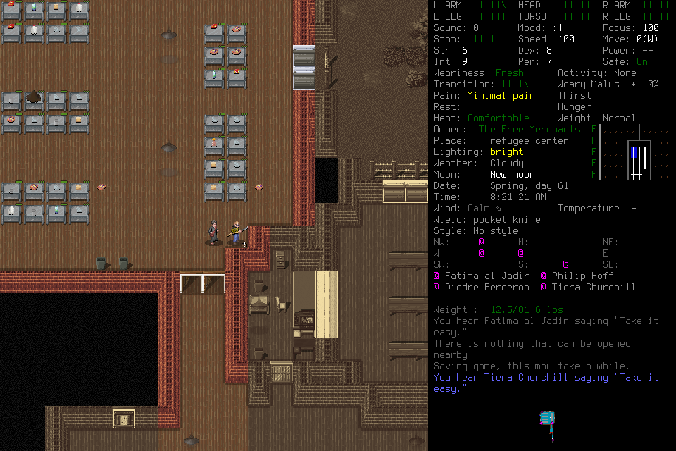
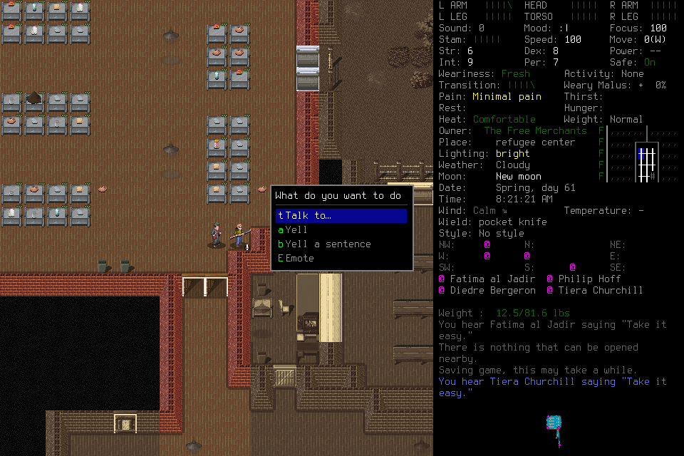

# Transition corpus: structure at sensor resolution

[#320](https://github.com/CVX-Hull/enactive/issues/320) collected a corpus of screen-state
transitions under a pre-registered protocol and tested three structure hypotheses for the
multi-level player decision ([#319](https://github.com/CVX-Hull/enactive/issues/319)). It is
a **method calibration**, not a capability or adoption claim: nothing from it enters the
player. Packages, traces, frames, labels and retained post-run state stay ignored
project-local evidence under `.runtime/research/corpus/`, `.runtime/iteration314/retained/`
and `.runtime/computer-sessions/corpus320-*`.

**Finding.** On the 7-symbol interface-mode alphabet A1, the only alphabet where claims are
allowed, with the corpus's own labeller disagreement **d = 3.1% [Wilson 95% 1.6–6.0%]**
gating each reading:
- **H2 (action predicts the next state): a predictive claim.** Knowing the coarse action
  class improves held-out prediction by 0.354 bit per transition (SE 0.026). This is
  consistent with the expectation stated in advance, that the gain comes largely from
  interface mechanics; no decomposition was pre-registered or computed. It says nothing about
  intervention.
- **H3 (slow modes): a negative claim, bounded.** There is no two-set metastable split with
  a timescale of 40 steps or more (simulated at τ = 40–60, runs of about 70 transitions), at
  this alphabet resolution, policy and N. Timescales near 20 are not excluded.
- **H1 (memory beyond one step): indeterminate.** All three H1 rules fire, but d is above the
  1.9% level at which label flicker is controlled, so the result cannot be separated from
  labelling noise.

The gate uses the point estimate of d. Its upper interval bound, 6.0%, is above the 3.8% gate
for H2 and H3, so those readings can themselves be the gate's misclassification (protocol
finding D4).

On the 5-symbol location alphabet A2 every result is descriptive or uninformative, as
pre-registered. The guards held: 37 complete runs, 2,605 transitions, κ 0.96 (A1) and 0.87
(A2). **#320 spent $95.49 actual of its $120 cap.** One procedural deviation is recorded:
collection resumed after run 01's failure on the lead's reading, before the owner was
consulted (see [Deviations and failures](#deviations-and-failures)).

[Editable source](../diagrams/transition-corpus.mmd). Evidence summary with the hashed
manifest: [summary.json](assets/corpus-320/summary.json).

## Design as frozen

- **Protocol v3**, sha256 `9a4ec83e8c9d52147d3858a01e0f38b13326147f0ac6bd1f9a39cb6a858c766f`,
  posted on #320 before any spend. Three rounds of independent clean-context review
  (C-REVIEW) by one reviewer preceded it; the blocking findings B1–B5, N1 and N2 were resolved
  and v3 was approved before freeze. Every frozen input hash was re-verified at analysis time,
  except `accounting.json`, which the driver and labeller update by design.
- **Player:** #314 arm A unchanged: Gemini 3.8 Flash pinned to `google-vertex/global`,
  `player-host/2`, 100 attempts, the same guide, assignment and predecessor report. Source
  `2e5fba4`, docs-only since #314's `c698347` with `docs/player-guide.md` unchanged.
- **State:** before every run the frozen `.runtime/user/` tree and player store were
  restored and every hash verified; each post-run state was retained first. Saves were never
  edited, and no hint, hidden state or lead input was added. Read-only lead checks ran every
  15 s.
- **Alphabets** (pilot, sha256 `ba33e82b…`): A1 `interface_mode` with 7 symbols; A2
  `spatial_location_type` with 5. **L1** (Gemini 3.8 Flash) labelled every frame; **L2**
  (Claude Haiku 5.5) labelled frames where `int(sha256("run|capture"), 16) % 10 == 0`, a rule
  on identifiers only. The action of a transition is the input that produced its next frame,
  in 7 coarse classes.
- **Rules** (frozen in `power_sim.py`, `lag_sim.py` and `analyze_corpus.py`):
  - **H1** fires if the dwell-shape Bayes factor exceeds 10, or the held-out order-2 gain on
    the raw or collapsed sequence exceeds 2 SE and 0.001 bit.
  - **H2** fires if the held-out gain of the action-conditioned model exceeds 2 SE and
    0.001 bit.
  - **H3** fires if, on the lag-5 operator, the 5th run-bootstrap percentile of the slowest
    timescale τ is at least 10 and of the spectral gap at least 3.
  - **Readability gate:** the corpus's own L1–L2 disagreement d decides what may be read as
    a claim (protocol table). On A1, H1 needs d ≤ 1.9%; H2 and an H3 negative need
    d ≤ 3.8%. On A2, H1 and H2 are descriptive and an H3 negative is uninformative.
- **Stop rules:** 2,600 complete transitions, 40 runs, the $105 play cap, a balance below one
  worst-case run, any incomplete run, a check gap over 45 s, or any failure.

## Collection and labelling

| | Value |
| --- | --- |
| Runs | 38 launched, 37 complete (`host_completed_unassessed`), 1 incomplete (`corpus320-01`) |
| Stop | "target reached" after run 38 |
| Transitions | 2,605 complete, from 2,642 frames and 2,759 host attempts |
| Read-only checks | maximum gap 15.34 s (limit 45 s) |
| Labelling | 5,804 calls, all ending HTTP 200 (one transient retry, as permitted), 0 calls without a valid label, 5,798 labels, 0 missing |
| Reliability (260 L2 pairs) | A1: d 3.1% (8 pairs), Wilson 95% [1.6%, 6.0%], κ 0.957. A2: d 9.2% (24 pairs), [6.3%, 13.4%], κ 0.875 |

- **Run 01 failed.** The provider returned HTTP 200 and then no events for about 134 s, then
  an error. Under the incomplete-run stop rule, collection stopped and the run was excluded,
  retained and never analysed. One minute later the lead resumed with run 02, recording its
  reading on #320 first (see the deviation below).
- **The driver ran three times:** run 01 (stopped on the failure), runs 02–07 (one batch),
  and runs 08–38 (stopped on the target). There were no player-ended runs.
- **Three captures appear at two adjacent positions** (`corpus320-10|1054`,
  `corpus320-16|2`, `corpus320-26|1928`): two operations reported the same unchanged screen,
  and the frozen frame loader emits one frame per operation. Each was labelled twice per
  alphabet. All 6 pairs agreed, the store keeps the last, and the analysis joins one label
  per capture, as designed. This was recorded on #320 before analysis.

## Results

| Hypothesis | A1 (claims allowed) | A2 (descriptive) |
| --- | --- | --- |
| **H1** memory beyond one step | All rules fire. Raw order-2 gain 0.073 bit (z 11.0); collapsed 0.044 bit (z 3.4); dwell-shape log10 Bayes factor 44.5. **Indeterminate** at d 3.1% [1.6–6.0%]: d exceeds 1.9%, and label noise alone produces false positives up to 0.245 at d 3.8% | All rules fire; not separable from label noise (d 9.2% [6.3–13.4%]) |
| **H2** action predicts the next state | Gain **0.354 bit** per transition (SE 0.026, z 13.6); secondary log10 Bayes factor 254. **Predictive claim** at d 3.1% [1.6–6.0%] (noise false-positive rate up to 0.085 at d 3.8%) | Gain 0.191 bit (z 16.8); not separable from label noise |
| **H3** slow modes | Lag-5 τ 2.7 (5th percentile 2.4, needs 10); gap 1.43 (5th percentile 1.22, needs 3). Lag 1 also does not fire. **Negative claim** at d 3.1% [1.6–6.0%] against two-set metastability with τ ≥ 40 (simulated τ = 40–60; power ≥ 0.84 at d ≤ 3.8%); τ = 20 not excluded (power 0.55–0.76) | Lag-5 τ 10.1 (5th percentile 9.1); gap 2.31 (2.08); does not fire. **Uninformative** |

- The **gate is a point estimate** (protocol finding D4). A1's Wilson interval for d, 1.6% to
  6.0%, spans both thresholds. The H2 and H3 readings hold at the observed d. If the true
  disagreement were above 3.8%, H2 would be uninterpretable and the H3 negative
  uninformative; below 1.9%, H1 would become a claim.
- The **sensitivity analysis** pooled with #314's two arm-A pilot runs (2,749 transitions)
  gives the same rule outcomes on both alphabets.
- **Exploratory** (none decides anything):
  - With the scripted first 5 and last 3 frames of each run trimmed, all A1 H1 rules still
    fire (raw gain 0.049 bit, z 8.2). This is exploratory, not a test of the scripted ends.
  - The collapsed-sequence order-2 Bayes factor, a secondary H1 statistic, favours order 1 on
    A1 (log10 −3.7) while the held-out collapsed gain is positive.
  - Mean persistence: 0.68 on A1 (SD across runs 0.044) and 0.79 on A2. Every run ends in the
    same symbol on both alphabets, the Save/Quit screen. No run contains a death or other
    terminal event.
  - Support: 34 of 49 (symbol, action) pairs seen on A1 (9 with fewer than 10 transitions);
    33 of 35 on A2 (10 with fewer than 10).
  - Slow-set split (used only to read H3): A1 {meta_and_loader, action_prompt_menu} against
    the other five symbols. A2 two against three.
  - The objectives report's zero-spend calibrations (its tests 1–3), listed as exploratory in
    the protocol, were **not run**: the frozen analysis does not implement them.

[Editable source](../diagrams/corpus-a1-operator.mmd). The map view is the hub: players open
menus, dialogue, examine and overmap views from it and return.

### Worked examples

**H2: what the action-conditioned counts look like.** From the standard map view, arrow keys
keep the player in the map view 96% of the time (557 transitions), but a modified key
(`SHIFT+…`) opens an action prompt 51% of the time (136). From examine mode, `ESC` returns
to the map view 84% of the time (62). Counts like these are what an action-conditioned model
can use and an unconditioned one cannot. The gain was not decomposed by case.

In `corpus320-02`, the player is on the map view at position 7 and sends `SHIFT+C`. The
next frame shows the chat prompt "What do you want to do" with Talk to, Yell and Emote. L1
labelled the two frames `standard_hud_exploration` and `action_prompt_menu`.

| Position 7: `standard_hud_exploration` | Position 8, after `SHIFT+C`: `action_prompt_menu` |
| --- | --- |
|  |  |

**H3: why the negative is bounded.** The slowest lag-5 mode on A1 relaxes in about 2.7 steps,
far below the 10-step threshold. In simulation, a split of these symbols into two sets that
each persist for 40–60 steps, in runs of about 70 transitions, is detected with power of at
least 0.84 at this noise, so its absence here is informative. A 20-step split could still hide under the measured noise.
Whether a player's own sub-goals would appear as such sets at this resolution is not tested
here.

## What this means for #319

Using the interpretations frozen before the data:
- **H3 negative (A1)** removes support for discovering levels directly from the sensor
  operator (MSM or PCCA+-style coarse-graining) **at this alphabet resolution, this policy and
  this N**. It does not refute that route in general.
- **H2 positive (A1)** supports a grounded operator as a **predictive** action model. The
  empowerment and viability uses discussed in #319 need interventional semantics, which this
  test cannot give.
- **H1 indeterminate** gives no support either way for history beyond the current symbol.

Proposed next steps are on #319; they are proposals, not pre-registered readings.

## Limitations

- **Coverage.** One start state (a faction-owned refugee centre), one policy and one model.
  A2's categories, such as `merchant_trading_floor` and `communal_shelter_hall`, were fitted to
  this start, so A2 does not transfer to other places in the game.
- **d is a bound on L1's error only under independence.** If L1 and L2 err alike, d
  understates L1's error, and the gate and the noise false-positive rates are optimistic for
  the H2 claim and the H3 negative. The simulations charged all disagreement to L1, which is
  conservative only when the labellers err independently.
- **Run length.** H3's power was simulated only at τ = 20, 40 and 60 with runs of about 70
  transitions; power at double noise was lower at τ = 60 (0.84) than at τ = 40 (0.91), so it
  need not rise with τ. Splits slower than the runs themselves cannot be seen.
- **Pre-registered alternatives remain.** Between-run policy differences, so any H1 positive
  would be pooled structure only; policy confounding of H2; and render lag under machine load
  (load average about 90 at freeze).
- **Accounting** uses whole-account deltas on a shared account, so costs are upper bounds.

## Deviations and failures

- **Deviation: resuming after run 01 without consulting the owner.** The incomplete-run stop
  rule fired and stopped collection, as designed. The protocol does not say whether
  collection may restart after such a stop, but it does say that when a deviation is needed,
  "collection stops and the owner is consulted". At 01:57 UTC, one minute after the stop, the
  lead resumed with run 02 on the lead's own reading ("a stop for lead review"), posted on
  #320 before resuming with a self-imposed escalation on a second such failure. The owner was
  not consulted first. Runs 02–07 ran before the owner's decision "Finish #320" (03:26 UTC),
  which continued collection under v3 unchanged. For overnight running the owner then set
  "Stop and wait": any incomplete run stops collection for an owner decision. No frozen input,
  rule, threshold or guard changed, and no further incomplete run occurred. This is recorded
  as a procedural deviation for the owner to classify. The checkpoints on #320 that said
  "no deviations" are corrected there.
- **Failures:** run 01's provider error, above. No check gap exceeded 45 s; no restore, verify
  or build failed.

## Accounting

- **Play:** $84.37 actual for 38 runs, from whole-account readings before each run and after
  a 60 s settle wait.
- **Labelling:** $11.12 actual for 5,804 calls, equal to the ledger's reported cost.
- **Total:** **$95.49** of the $120 item cap; the play cap was $105 and the labelling cap $20.
  Automatic top-ups kept the balance above the one-run worst case throughout.

Evidence summary: [summary.json](assets/corpus-320/summary.json). It holds the frozen input
hashes, the output hashes (`analysis.json`, `labels.jsonl`, `responses.jsonl`,
`run-log.jsonl`, `accounting.json`), every metric and rule result, and the costs.
