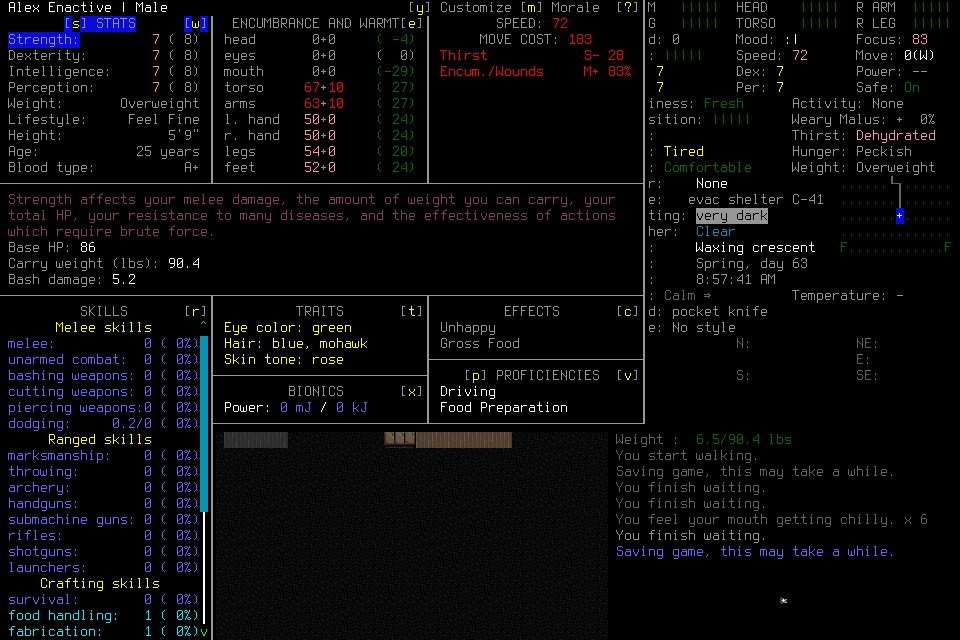
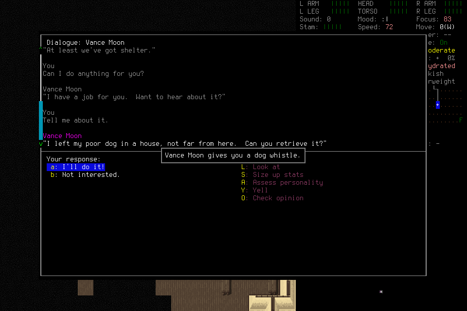
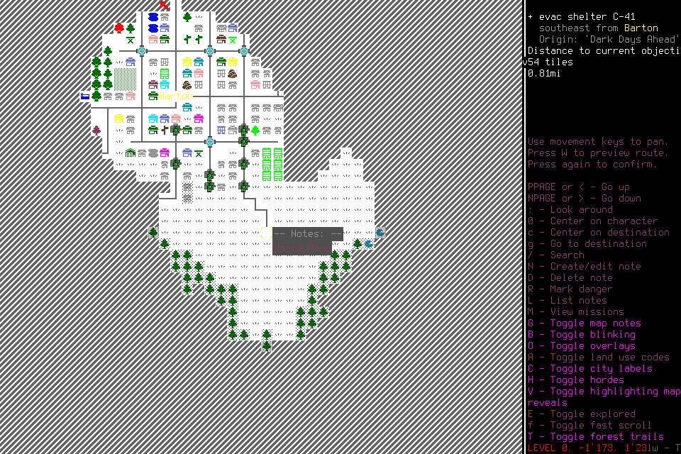
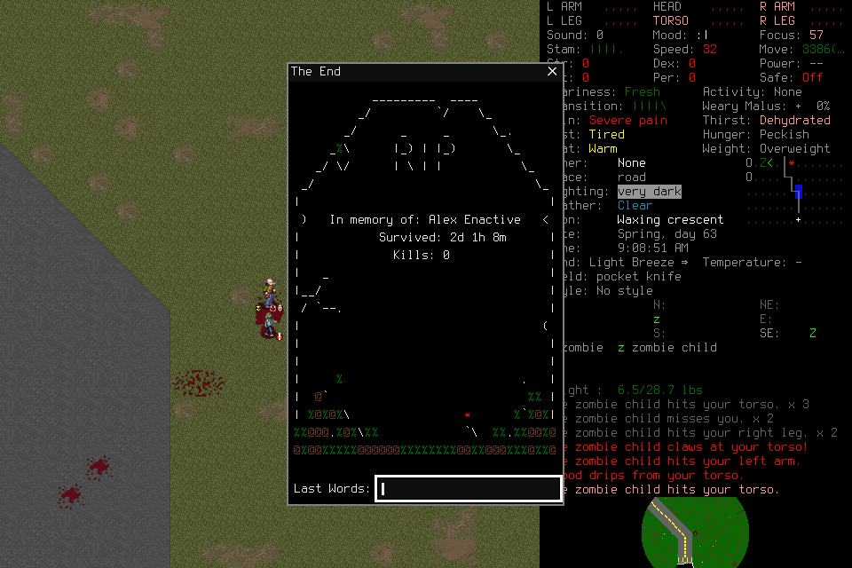

# Ongoing objective under finite test control

Keep [#164](https://github.com/CVX-Hull/enactive/issues/164)'s full cohort and
[#145](https://github.com/CVX-Hull/enactive/issues/145)'s seven-day gate held.
The replacement reached unassisted play and Alex died after 11m10s of additional
game time. No food, water or needs improvement was demonstrated; no local program
ran. One new dog whistle was visibly acquired, with survival utility unproven.
The player recorded a fallible lesson and directly reported `cannot_continue`.
This demonstrates sampled context separation and direct stopping, not survival,
learning benefit, useful cadence or all of #359's real-use acceptance.

The two admissions cost **$1.410764544** together. The first was truncated by the
lead's missed spectator deadline; the independently approved replacement retained
watch coverage through closure. No source repair or third admission followed.
[Reviewed first failure](https://github.com/CVX-Hull/enactive/issues/164#issuecomment-6662418109)
and [replacement approval](https://github.com/CVX-Hull/enactive/issues/164#issuecomment-6665288007).

## Frozen scope and evidence

Source was clean main `e6adfb7e277a5bcb85725eb0279cc1f782a51217`, following
[PR #360](https://github.com/CVX-Hull/enactive/pull/360),
[PR #363](https://github.com/CVX-Hull/enactive/pull/363) and
[PR #364](https://github.com/CVX-Hull/enactive/pull/364). The exact source's
[protected full PR check](https://github.com/CVX-Hull/enactive/actions/runs/42049959819)
and [actual-main smoke check](https://github.com/CVX-Hull/enactive/actions/runs/42050539573)
passed. Native executable and bridge bytes were reused with verified provenance;
no new native build or game modification was part of this diagnostic.

Both admissions selected OpenRouter / `fireworks/us` / DeepSeek Flash1017 at medium
effort, default tier and no fallback. Frozen context was 1,048,576 tokens, maximum
output 16,384, request timeout 60s, 30 images/block1 and context reserve 65,536.
Each admission allowed 400 charged attempts including retries, 7,200 aggregate
host seconds, 7,800 wall seconds and at most two hosts sharing original resources.
Mechanical limits were 20,000 inputs, 10,000 operations, 2,000 captures and 32GiB;
ending reserves were 1,800s, 20 attempts, 6,144 inputs, 256 operations, 256 captures
and 16GiB. The original finite reserve forecast remained a fallible scenario.

Each used a distinct opaque copy of the preserved original Alex userdir and fresh
`player-memory/2`. The original 530 files remained unchanged during copying and
shared no file identities with the copies. The replacement did not reuse the
first stopped state. No save contents were interpreted, edited or restored.
The mission required visible world/survivor verification, followed by indefinite
survival with player-chosen plans. No old quota-bearing report, experiment
countdown, tactical suggestion or program-use instruction entered the player.

| Admission | Session | Result | Requests | Settled charge |
| --- | --- | --- | ---: | ---: |
| Initial | `20f89b24784e4d3794a851027f7e2597` | Operator watch deadline; incomplete | 13 | $0.037240632 |
| Replacement | `810e172f12b742408b70788c1c18df75` | Alex died; direct `cannot_continue` | 79 | $1.373523912 |

The [derived summary and original-image hashes](assets/player-test-diagnostic-359/summary.json)
bind the replacement source, manifest, raw receipts and host trace. Complete local originals
remain in `.runtime/iteration164/candidate-research-2026-11-05/ongoing-alex/`,
including the 41-file initial and 107-file replacement evidence inventories.
The public summary is a selected derivative, not the complete raw corpus.

## Replacement observations

Identity was established before ordinary play: original c3 lists Alex under
Enactive Twenty Four; c215 explicitly reads **Alex Enactive | Male**. The latter
result arrived at 24,028.456 host ms, before the inventory action.

The player inspected inventory and terrain, talked to Vance Moon, accepted a
dog-retrieval mission and received a dog whistle. Operation
`aac393ccb3d54d83820ccdc1ea960b34` returned c1830 with the transfer message.
This is a verified item acquisition; it does not establish a survival-readiness
gain. The player then found a window exit, encountered zombies, disabled the
game's safe mode, attempted travel and retreat, and fought with its pocket knife.

The $0 follow-up inspected three original cue/action/effect chains. These are
particular findings, not an exhaustive error rate or a model comparison.

| Chain | Original evidence and finding |
| --- | --- |
| Map centering | Request47 intended destination centering but sent `C` with SHIFT from c1900. The visible command is lowercase `c`; uppercase `C` toggles city labels, matching c2037. Operation `0d88109191414694b32480ac498bfc10` completed. |
| Direction selection | Request66 said northwest but sent ten `u` keys from c3272. The shipped binding maps `u` to up-right; up-left is `y`. No user keybinding override existed. Operation `211f15a855154da0bcefe16c60db963e` completed. |
| Threat response | From the c3166 result to request65 dispatch was 8.482s; dispatch to its result was 1.399s, for 9.882s total. This is an observed host/result interval, not physical attention, a useful-decision percentile or an isolated cause of death. |

The installed binding file SHA256 was
`5b55b23960b42f52249398254a7557303a0987ce6a7f5a23f0f39ef1e00be3b3`.
Bindings were inspected for engineering diagnosis and were not supplied as hints
to the player. Native receipts and matching frames support these command-choice
errors; they do not prove every action's effect or attribute the whole outcome
to the model, latency or a single mistake.

The clock advanced from **08:57:41 to 09:08:51**, Spring day63. Original c4147
shows Alex dead, lifetime **2d1h8m**, kills0. The player's report and stored lesson
say 2d1h6m, and misread the initial list count/time. Universal safe-mode, patrol,
mission-location and lethality claims exceed this episode's evidence. Preserve
the original report and record `331649e49a5e4a30a802160efd5cb7f6` as fallible data;
no corrections were written into player memory by the lead or reviewers.

## Control, accounting and limits

Independent outcome and control reviews were checked against original records.
The lead verified all77 PNG hashes/dimensions and the maintained read-only control
analysis: 77 completed computer operations and 482 delivered native receipts.
Those receipts include captures; useful game effects require the images.
Player storage contains zero programs, one claim record and one memory service
operation. A stored claim establishes neither learning benefit nor successor use.

The frozen guide/assignment matched the observed initial 9,626 text bytes. All77
mechanical actor results used `player-computer-result/1` without global remaining
resources or `deadline_monotonic`; operator originals retained accounting. This
samples actual delivery paths. Program views, handoff and external orderly-stop
were unexercised, and no ending threshold was reached.

All43 Watch checks matched the current session/source/digests. Six completion
intervals exceeded the 15s target, including readiness to the first check
(15.236s). The largest completed-check interval was 19.857s; minimum headroom
under the original strict 45s cutoff was 24.563s. Terminal coverage and owned
cleanup were verified. One full-page browser screenshot briefly showed a narrow
layout; a fresh viewport inspection restored a readable source before the next
acknowledgement. The target misses and observation anomaly are retained.

Request79 directly invoked `player_finish(cannot_continue, control_id=null)`;
matching settlement followed with no further requests. Actual host/MCP, native,
gateway, custodian and keep-awake groups closed; a separate process inventory
found no matching survivors. Native cleanup used SIGTERM. Its final code0 is
not normal application exit or persistence evidence. No manual Pause receiver,
external finish-up or new-child reload was qualified by this run.

Whole shared-provider-account deltas matched both configured trace estimates,
with no missing usage. Combined spend stayed below the $220 ceiling; no credit
or auto-refill setting changed. The replacement's 321 unused attempts were
retired, alongside the initial run's 387. New actual upper baseline is
$255.523617179 at 11,331 cumulative attempts. Reservations are not invoices.

The initial invocation also selected system Python and failed importing
`jsonschema` before any marker/child; the corrected command used the pinned venv
after verifying every admission marker absent. The lead's initial absent-URL
claim was wrong: the maintained supervisor prints its readiness URL with flush;
the first exec yield preceded readiness. Both mistakes remain in the issue record.

## Decision and next work

Keep #359 open for remaining real-use acceptance and #164's cohort unqualified.
The direct finish and sampled context separation worked; useful survival,
organic-program effects, external finish-up, continuity and normal ending remain
unqualified. Original20-decision/2s p95/5s stall/500ms local-effect criteria and
#145's gate are unchanged. Do not infer a benefit from removing quotas from n=1,
or replace the failed outcome with the successful control receipt.

The completed $0 action/effect audit points to control grounding and decision
quality as the next evidence question. Review prior model comparisons and current
documented compatibility before proposing any changed deciding player. No new
architecture, prompt patch, game-specific harness rule, paid probe or third play
admission follows from this record. A subsequent design/spend choice needs its
concrete scope, examples, independent review and owner agreement.
