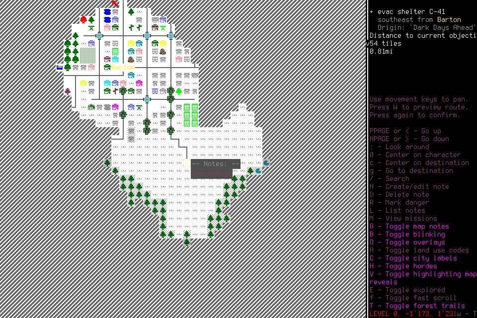
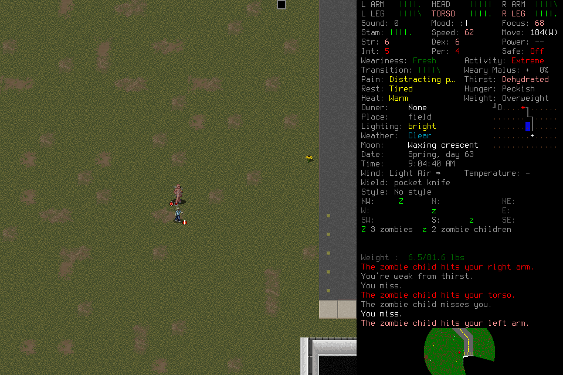
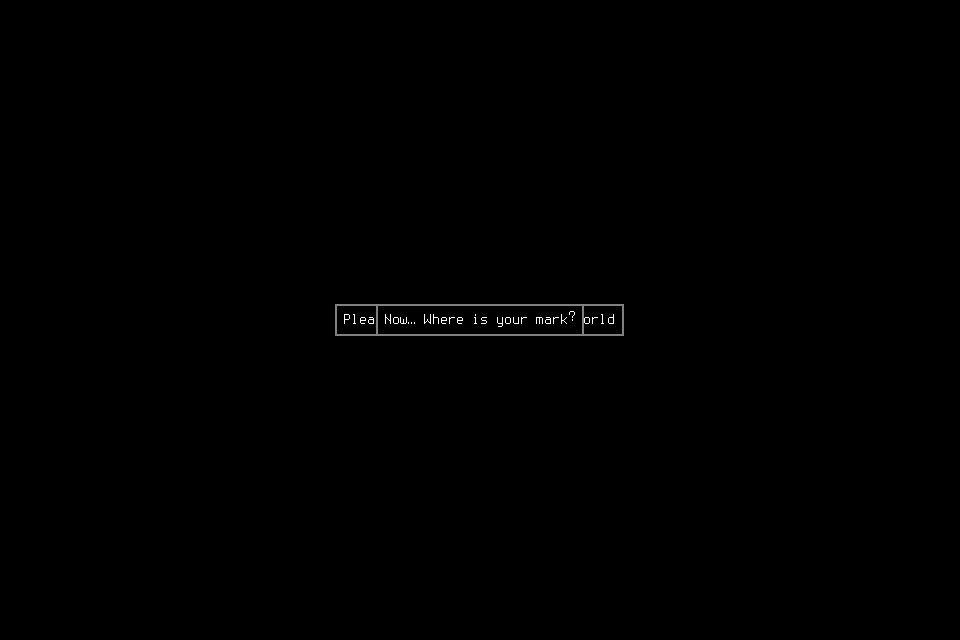

# Recorded-screen candidate assessment

GPT-6.1 Terra medium served both selected cases through the unchanged player
host and proposed controls consistent with its stated intentions and the retained
evidence. Independent LLM review found both **narrowly promising under the frozen
eligibility rule**. This supports shaping an unassisted development game with the
candidate. It establishes no executed control, useful effect, survival, organic
program, comparative model ranking, cadence qualification or adoption.

## Original conditions and accounting

The owner approved the exact [#366 assessment](https://github.com/CVX-Hull/enactive/issues/366#issuecomment-6668342825):
two fresh hosts, at most two charged attempts each including retries, $15 and
330 seconds including closure. The [brief](../changes/074-recorded-player-assessment.md)
retains the design and earlier source-delivery failures. Source was main
`6db526e2d823f65c0136b77a900366daf56e9907`, using `player-host/3`, its locked
adapter/SDK, GPT-6.1 Terra medium, OpenRouter's pinned default `openai` endpoint,
default requested tier and no fallback. The current selected player was unchanged.

Execution on 5 November took **29.744 seconds**, four charged requests, no retries
and no missing usage. Provider generation records total **$0.08744005**. The
whole-account usage delta and reconstruction from the selected endpoint's actual
rates independently match that amount, with no credit purchase/refill delta.
The conservative configured-rate estimate was $0.269895; it is not the bill.
The unused $14.91255995 is retired. The actual upper baseline becomes
$255.611057229 across 11,335 cumulative attempts.

| Case | Original last source | Images in second request | Provider actual cost |
| --- | --- | --- | --- |
| Map, before original request 47 | `810e172f12b742408b70788c1c18df75-1900` | 4 | $0.02667375 |
| Retreat, before original request 66 | `810e172f12b742408b70788c1c18df75-3272` | 30 | $0.06076630 |

Each host first requested the recorded observations, then proposed one basic
input. Both proposals were logged and refused by the read-only fixture. Both
hosts settled **`ok:false`, `request-limit`, two requests**. This unsuccessful
host completion was anticipated by the protocol; complete bounded assessment
evidence is a separate finding. Neither invoked `player_finish` or handoff, and
both reserved final-report files remained unchanged. No extra response was added.

## What the candidate proposed

### Map: inspect the mission before committing to travel

The candidate identified the overmap, shelter southeast of Barton and 54-tile
objective distance. It distinguished the earlier highlighted dialogue response
and historical acceptance narration from confirmed mission status, and treated
the earlier dehydration evidence as relevant without asserting a safe route or
known water source. It proposed Shift+M to inspect missions. The selected frame
explicitly displays **M — View missions**; the retained technical binding agrees.
This is a consistent proposed next step, not evidence that a mission panel opened
or a mission/survival benefit occurred.

### Retreat: prepare to change movement mode

The candidate correctly identified the field, adjacent southern zombie child,
other nearby enemies, safe mode off, dehydration, tiredness, distracting pain and
speed 62. It treated current bleeding severity, the apparently open eastward route
and escape as uncertain. It proposed opening movement controls before considering
a single movement and reassessment, rather than continuing the historical batch
of southward inputs.

Its actual proposal was **Shift+double-quote**. The exact previously hash-recorded
installed binding names that command **Movement mode menu**, not a direct Run
toggle. Opening the menu is a consistent preparatory step toward its stated
intent to try changing from walking to running; the candidate did not claim the
change had already occurred. Correct menu selection, a running-mode change,
movement and escape remain untested. Crediting a successful Run toggle would
overstate this result.

## Verification and limits

Lead and independent LLM review checked original pixels, public narration and
tool arguments. All 53 frozen files matched their hashes. Original IDs, clocks
and PNGs remained unchanged; condensed public histories ended at original
requests 46/65 and explicitly disclosed omitted images and fallible statements.
No private reasoning, later outcome, engineering bindings, answer key or quota
entered candidate context. Assessment outputs/corrections were not added to
player memory or future game context. The later binding audit read only the
already hash-recorded technical file; no save or hidden game state was inspected.

All four responses reported provider OpenAI and the allowed model alias;
provider generation metadata identifies `openai/gpt-6.1-terra-20261026`.
Requested medium effort and default tier are configuration evidence, not a
claim that unreported backend settings were attested. Original tool-result
image references and second-request counts establish the tested fresh-host
image/tool continuation. They do not establish long-conversation reliability or
behavior with live native results, programs or memory services.

HTTP fetch to completed response took 2.912/7.729 seconds in the map case and
2.059/14.844 seconds in the retreat case. These are serving diagnostics, not
time to a useful game effect. No comparison with another player's differently
constructed context or the original #164 targets follows.

Both host/fixture process groups closed without forced signals; receipts and
independent process inspection verified absence. No native game, target,
computer authority, player store or program executor existed. The two selected
situations came from one historical trajectory with condensed context. This is
neither a controlled model comparison nor evidence that more play will succeed.

## Outcome and next decision

The result resolves the immediate compatibility uncertainty: these recorded
client-tool calls worked through the existing host. It supplies no reason to add
an API adapter for the next test. Keep the current player and original gates;
shape a separately reviewed, substantive unassisted development campaign with
an ongoing survival objective and finite limits outside player context.

That campaign still needs its own exact design/spend agreement. It should expose
actual consequences and long-term planning without prescribing tactics or forcing
a program demonstration. #164 still requires a clearly permitted useful action
and an organic supported program with original ready/dispatch/child/useful-effect
records on compatible clocks before credible cohort admission. The original
20-decision, 2-second p95, 5-second stall, 500-ms local-effect and #145 seven-day
gates remain unqualified. #359's unexercised real-use paths remain open.

The [public summary](assets/recorded-player-assessment-366/summary.json) preserves
scope, source joins, limits, charges and known unknowns. Full frozen inputs,
original host/fixture transcripts, provider generation receipts, accounting,
review and file hashes remain under the project-local ignored directory
`.runtime/iteration164/candidate-research-2026-11-05/recorded-probe-preparation`.
Git does not contain that complete runtime corpus. The owning issues and PR
record publication/main validation and the next allocated action.

## Subsequent development attempt: interrupted during setup

The owner approved [#369](https://github.com/CVX-Hull/enactive/issues/369)'s
fresh-world, ongoing-survival development campaign and additional $600 ceiling,
explicitly trusting automatic refill. One admission ran on unchanged main
`7ad0ef30a0a1fa089cb027b1054759c82c57b083`, session
`2061bdc1c1dc4248a37205d456904210`, manifest SHA256
`5dd4484869a9732a2245a6bddce7080dac74080970229233f2a97bb0be6a6f5f`.
It ended **incomplete after 171.47 seconds**, because the lead missed the frozen
45-second spectator deadline. Four checks were accepted; all four intervals
exceeded the 15-second target. The last accepted observation was at
21:16:07.319 UTC; the guard fired 45.00078 seconds later. The lead attributes the
miss to context compaction/recovery in the operator conversation; the package
itself establishes the missed deadline, not that explanation. Terminal watch
coverage was not verified. This is an operator failure, not a funding refusal
or a player-quality result.

The original frames show setup menus, item verification and then an unchanged
overlapping dialog. Nine captures have identical bytes. No in-play identity,
elapsed game time, useful survival change or organic program was established.
The final Escape-and-wait operation is **unknown**, with no following frame;
it was not replayed. Independent review checked all 16 PNG hashes, frozen files,
watch timing and original tool records. Host/native shutdown required signals;
receipts and independent process inspection confirmed owned absence. Neither a
normal ending nor persistence is claimed. The cause of the unchanged display
remains unknown.

Eighteen HTTP attempts were charged against capacity. Provider generation records
for 17 total **$0.04723975**, matching the observed account-usage increase. The
cancelled eighteenth attempt has neither a generation ID nor usage; retain its
**$2.74788** worst-case reservation rather than assert it was free. The additional
actual upper bound is $2.79511975; cumulative actual upper bound $258.406176979
and cumulative attempts 11,353. The configured $0.6102375 estimate and original
receipt's conservative reservation are not invoices. The 182 unused attempts
and $597.20488025 unencumbered allowance were retired, with no automatic restart.

Original receipts, recorder database/PNGs, host log, settlement and independent
review remain in `.runtime/iteration164/terra-development`. Its
`execution-evidence-index.json` has SHA256
`50783884867c7fa858020549284f9835861d298de6d6ea46db5767fc5a898398`;
the selected public PNG is byte-identical to source ending `2187`.
This brief finding consolidates the interrupted attempt without changing the
player, contract or qualification gates. Continuous operator availability needs
resolution at $0 before proposing another paid admission; automated acknowledgements
would not constitute observation. #164 and the full cohort remain unqualified.
