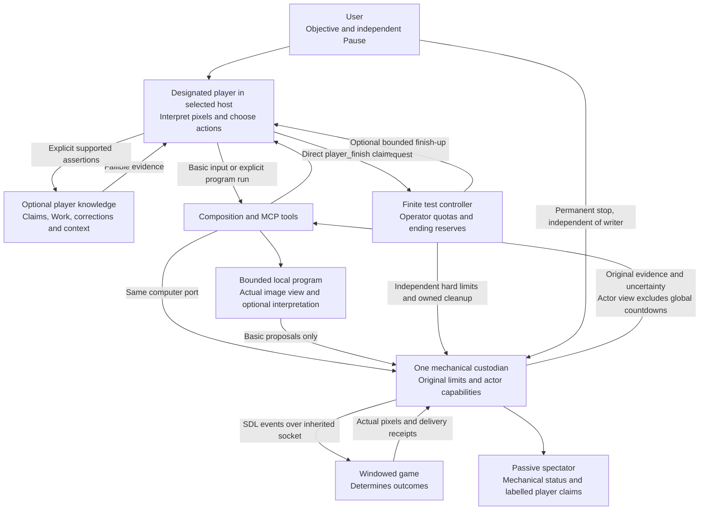
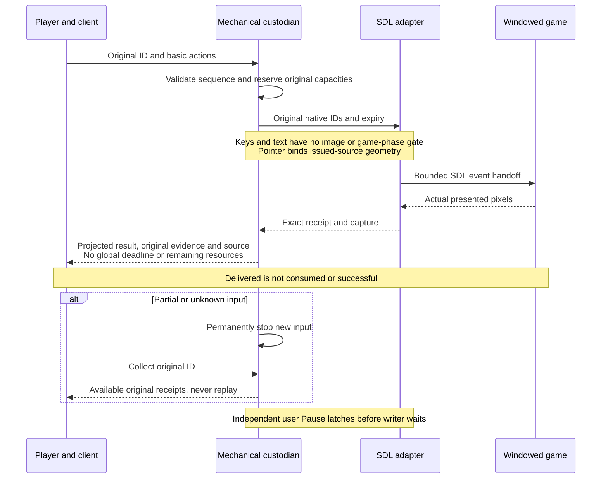
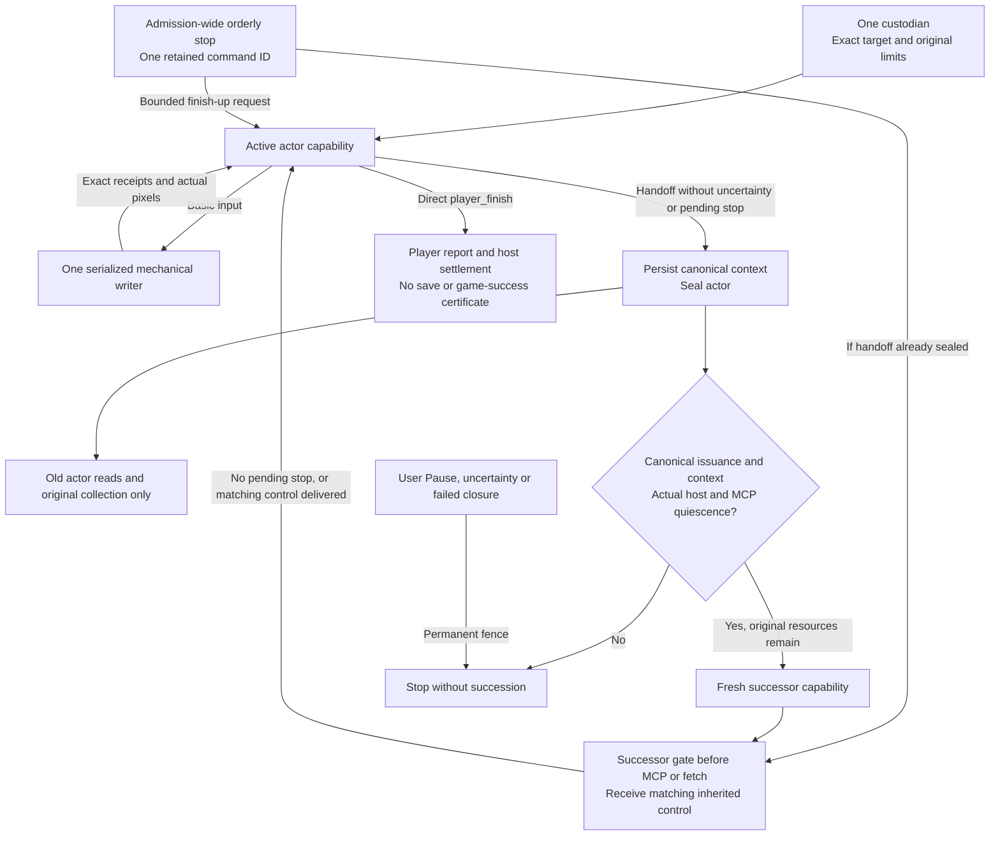

# Current architecture

Enactive separates mechanical computer custody from player-owned interpretation.
The [overview](overview.md) owns capabilities and limits; the
[computer-control contract](contracts/computer-control.md) owns exact fields,
versions and failure behavior.

## Scope and responsibilities

This current diagram answers “Who decides and who can stop input?” Boxes identify
logical responsibilities; arrows identify requests, results or user control.
Its text equivalent is below.

| Responsibility | Owned state and authority | Component |
| --- | --- | --- |
| Deciding player / player host | Ongoing user objective, visual interpretation, game choices and fallible claims; direct finish reports, explicit provider/context/tools | [Player interface](components/player-interface.md) |
| Finite test controller | Operator-only quotas and ending reserves, external finish-up request and exact owned process cleanup; no game-save guarantee | [Campaign procedure](operations/campaign-run.md) |
| Optional player services | Knowledge, corrections, source provenance, program lineage and bounded context; no custody | [Memory and learning](components/memory-learning.md) |
| Composition service | Connects player proposals to the computer port; retains service requests and context snapshots | [Execution](components/mission-execution.md) |
| Computer custodian | Exact child/socket/lock handles, serialized operations, original resources and actor capabilities | [Native control](components/native-control.md) |
| Observer / operator | Supervised control path (status, frame, independent permanent Pause with a recorded reason) and an unsupervised read-only viewer of interpretive evaluation | [Observer operations](components/observer-operations.md) |
| Run evaluator | Offline, versioned interpretive records and metrics with a game binding; never player-visible, gates nothing | [Evaluation contract](contracts/evaluation.md) |
| Curator shadow (ADR 009, not adopted) | Sealed-trace projection and workbench; sandboxed curator sessions, a key-holding model proxy, a gate-only knowledge repository and drafts; no custody, no player access, never reached by the player | [Curator and trace workbench](components/curator.md) |
| Game | Consumes ordinary SDL input and determines outcomes | Windowed prepared CDDA; no semantic engine bridge |

## Runtime and state

`tools/campaign_run.py` is the sole finite custodian. It validates a fresh frozen
`campaign-run/6` package and reserves exclusion before launch. `OwnedTarget` keeps
exact subprocess handles and passes an inherited shared-lock descriptor and a
nonblocking Unix socket to the SDL adapter. Native retains the shared lock for
its lifetime, including after the custodian loses its own reference.

The computer receive thread decodes bounded packets without writing files or
SQLite. The serialized runtime records intent and capacities before publication;
the custodian publishes PNGs/SQLite outside the native event loop. Failure at the
authoritative computer-store/source boundary permanently stops input;
restart cannot reconstruct custody from history. Passive observer read failures
instead report unavailable evidence and cannot change custody.
The source modules are [launch](../harness/computer/launch.py),
[channel](../harness/computer/channel.py), [runtime](../harness/computer/runtime.py)
and [store](../harness/computer/store.py).

The loopback [HTTP server](../harness/server.py) exposes passive status and
source reads, independent Pause and authenticated per-actor tools; it serves no
page. Under supervision the [gateway](../tools/campaign_watch.py) serves the page and
forwards view reads to a separate read-only viewer
([observer operations](components/observer-operations.md)).
The [application](../harness/application.py)
composes the computer port with optional player memory/program services. A
project-local stdio MCP adapter owns no writer, native child or provider key.
The selected [player host](contracts/player-host.md) owns model calls; the campaign
driver owns exact host/MCP group cleanup. The driver sends bounded JSONL control
through host stdin; the initial prompt is a frozen file. Pending stop identity
survives actor turnover and gates a successor before MCP/fetch. Player-facing
MCP projection excludes global deadline/remaining fields while canonical
operator records retain them. No game-specific save or Quit step gates stopping.

An optional [finite-test supervisor](operations/campaign-supervision.md) wraps
the custodian. Nobody is required to watch: run limits and the operator's Pause
stop a run. Its independent
guardian owns the custody clock and exact newly launched child groups; a separate gateway
forwards spectator reads and receiver-verified Pause. It adds no player input
producer or native custody. Supervision, host settlement and game outcomes stay
separate; source fixtures do not qualify actual play or human attention.

Fresh session stores live under `.runtime/computer-sessions/`. A selected
`player-memory/2` store may span fresh native-child sessions. Old runtime formats
stay inert, except that the evaluator reads the closed set of archived
`campaign-run/4` development-loop sessions read-only; no current reader imports
executable old libraries.

## Action and recovery views

### What happens when the agent acts?

The client assigns an operation ID before HTTP submission. The custodian validates
the entire basic sequence, reserves original resources and serializes dispatch.
The adapter reports exact delivery and captures actual presented pixels. Keys and
text have no image-age, equality or game-phase predicate. Pointer actions bind
mechanical geometry and a source actually issued to that actor. Delivered input
is not game success.

### How do I recover control?

An optional orderly-stop request offers bounded player-chosen finish-up. Only a
direct `player_finish` tool invocation settles its report; ordinary narration
does not. The finite controller forecasts ending capacity before admission and
retains the admission's stop request across handoff. This opportunity is separate
from the immediate mechanical fence below. Neither a report nor stopped input
certifies persistence, a paused game or normal native exit.

Pause sets the permanent stop event before executor/DB work and sends through a
separate bounded path; failure to send closes the write side to signal EOF.
Real native input takes precedence and fences automation. Partial or unknown
input remains charged and unreplayed; collect the original result. There is no
Resume/rearm or phase-based recovery. Native manual interaction can still recover
the application. [Pause procedure](operations/pause-timeout.md).

## Observation and deployment boundaries

The supported deployment is a local Mac with a prepared windowed CDDA app and
project userdir. Captures contain the actual default-renderer presentation and
original geometry/time; repeated pixels remain valid. The native adapter sends
bounded image bytes over its inherited socket. File publication is outside its
callbacks; this does not promise resistance to upstream save I/O, PNG CPU or
arbitrary OS hangs. The publication-stall cause in [#128](https://github.com/CVX-Hull/enactive/issues/128) remains unknown.

## Game-family portability

The computer package imports no game interpretation. Shared player claims,
programs and context consume only the computer port and explicit player data.
CDDA-specific preparation stays outside that package. This separation is a source
boundary; actual portability to a second game remains unqualified.

Current coupling. None of it is in the shared player code. The entries inside
`harness/computer/` are platform coupling (macOS, SDL and dyld injection), not game coupling:

| Coupling | Where | Owner |
| --- | --- | --- |
| CDDA prepared launch script and app paths (`Cataclysm.app`, `cataclysm-tiles`) | [`harness/prepared_app.py`](../harness/prepared_app.py) | [Setup](setup.md) |
| Game download, verification, patching and installing the built adapter | [`tools/setup.py`](../tools/setup.py), [`tools/patch_game.py`](../tools/patch_game.py), [`tools/prepare_game.py`](../tools/prepare_game.py) | [Setup](setup.md) |
| CDDA screen readers and the only registered evaluation binding | [`harness/evaluation/cdda/`](../harness/evaluation/cdda), `BINDINGS` in the viewer and in [`tools/evaluate.py`](../tools/evaluate.py) | [Evaluation contract](contracts/evaluation.md) |
| CDDA-class vocabulary in the game-neutral evaluation core (modes including `dead`, threat buckets) | [`harness/evaluation/core/binding.py`](../harness/evaluation/core/binding.py) | [Evaluation contract](contracts/evaluation.md) |
| CDDA vitals (`hunger`, `thirst`, `weariness`, `pain`, `vital.limb.*`) hard-coded in the viewer's `NEEDS_READERS` and metric-to-reader map, and in the spectator page's game-state panel | [`harness/viewer/views.py`](../harness/viewer/views.py), [`web/app/supervise.js`](../web/app/supervise.js) | [Evaluation contract](contracts/evaluation.md) |
| macOS SDL adapter loaded into the game process | [`harness/computer/native/`](../harness/computer/native) | [Native control](components/native-control.md) |
| Adapter injection through `DYLD_INSERT_LIBRARIES` | [`harness/computer/launch.py`](../harness/computer/launch.py) | [Native control](components/native-control.md) |
| CDDA-specific play guidance | [Player guide](player-guide.md) | Player guide |

## Separate recovery and memory boundaries

Remembered sources/claims and old process IDs never restore custody. Player
corrections retain prior records and contradictions. Program failures/yields leave
basic input available if mechanical custody is healthy. Mechanical Pause or
uncertainty cannot become a resumable handoff.

## Bounded planning without execution authority

Local JavaScript sees an explicit image view and optional player interpretation.
It proposes the same basic controls; the coordinator alone submits them under
original deadlines/capacities. Candidate advice and applicability are fallible
player data. No semantic supervisor or planner is required for ordinary control.

## Run ownership and operator takeover

Handoff persists a canonical bounded context, then seals the actor. A sealed token
can collect originals and read retained knowledge, but cannot capture anew or
mutate. Only the driver, after canonical issuance/context verification and actual
old host/MCP group quiescence, can mint a successor under original limits. It
requires no save, menu or identity check. [Run procedure](operations/campaign-run.md).

This current diagram answers “What permits a successor after handoff or a stop
request?” Boxes are logical custody/control states; labelled arrows are allowed
transfers or requests, not separate processes. The driver retains one stop ID;
an already sealed handoff requires verified old-group quiescence and a successor
control gate before MCP/fetch. Pause and unknown input prevent succession.
Direct player finish is a claim, not saving or game acceptance.
[Exact host control](contracts/player-host.md#external-control) owns the fields.

## Coordinated change

The main current formats (not an exhaustive list; the contracts own every field)
are `computer-wire/1`, request/target/receipt `/2`,
`computer-session/1`, `computer-operation/1`, `computer-source/1`,
`player-memory/2`, `player-record/1`, `player-program/2`, `program-view/4`,
`player-handoff/1`, `player-host/4` and `campaign-run/6`. Model-facing operation,
error and transport envelopes are `player-computer-result/2`, `player-computer-operation/1`, `player-error/2`
and `player-transport/2`; canonical operations/HTTP records are unchanged.
The [host contract](contracts/player-host.md) and [campaign procedure](operations/campaign-run.md)
own telemetry4, `player-driver/4`, `campaign-receipt/4` and `player-host-inputs/2`.
The [evaluation contract](contracts/evaluation.md) owns `evaluation-record/1` and the
tracked `dev-run/1` ledger and `run-metrics/1` snapshot; the
[evidence procedure](operations/evidence-cleanup.md) owns `evidence-index/1` and its
`shasum -a 256` manifests for the sealed raw-evidence store.
The exact contracts own the complete fields.
[Migration](operations/migration.md) rejects old stores before effects and preserves
artifacts/saves as history. Rollback closes writers and selects a coherent earlier
source/data deployment; mixed readers and replay are unsupported.

## Change boundaries and verification

### Responsibility assurance

| Changed boundary | Evidence to inspect and limit |
| --- | --- |
| Packet/input/custody | Strict schema, socket/backpressure, writer/deadline and uncertainty assertions; [native control](components/native-control.md#assurance-and-evidence) adds compiled behavior. |
| Memory/program/context | Pure player and composition assertions for provenance, helper fault isolation and original child IDs; [memory](components/memory-learning.md#assurance-and-evidence). |
| Host/driver | Contract conformance and actual adapter/MCP fixtures, origin-bound handoff, attempt accounting and exact group quiescence; [player interface](components/player-interface.md#assurance-and-evidence). |
| Spectator/operation | Control-path checks and Pause independent of the viewer, provenance labels and viewer-unavailable behaviour; [observer](components/observer-operations.md#assurance-and-evidence). |
| Evaluator/viewer | Synthetic-run evaluator tests, held-out reader validation, viewer API tests and the replayed graphical lane; [evaluation contract](contracts/evaluation.md). |
| Curator shadow | The sandbox escape suite against the real listeners (macOS), projection secret guards, gate and close-out negative tests, and proxy allowlist and settlement tests; [curator](components/curator.md#assurance-and-evidence). |

The [testing guide](testing.md) selects lanes. [Production outcome evidence](acceptance/2026-10-29-computer-control.md)
covers actual basic input, useful stock, conditional scouting, succession and
Save/new-child reload/normal ending. Source fixtures alone cannot qualify those
effects; useful cadence, general safe navigation and survival remain separate.
