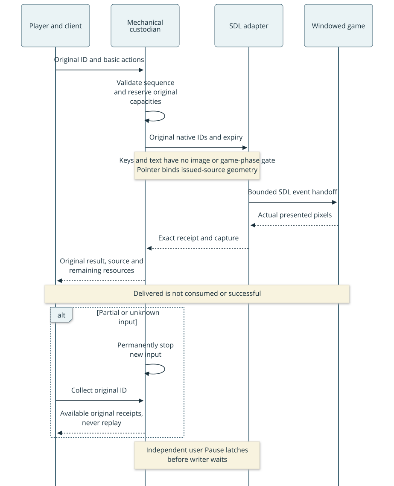

# Current architecture

Native-v3 recovery and integrated bounded gameplay architecture. The
[foundation acceptance](acceptance/2026-10-17-foundation-implementation.md) records
fresh windowed native-v2 probes and separately scoped portable evidence tests.
[MVP acceptance](acceptance/2026-10-17-mvp.md) remains historical v1 evidence.
Protocol version: 3.

## Coordinated change

All project-controlled boundaries follow
[S-MIGRATION](engineering.md#s-migration-one-current-contract-coordinated-migration):
one current contract, with producers, consumers, persisted formats and guidance
migrated together. There is no runtime compatibility layer or downgrade. Current
native wire v3, gameplay records `gameplay/1`, evidence store version 2 and build
manifest version 1 name separate contracts, not alternate versions of one interface.
Historical artifacts are retained as evidence without being accepted as runtime input.

## Scope and responsibilities

The [overview](overview.md) provides the user-facing system picture. One local
macOS game and one controller are supported. Codex in an active chat is the
planner, normally through a dedicated player sub-agent. The service executes
explicitly admitted waypoint tasks with feedback; general autonomous survival and
other hosts remain unverified. Normal
windowed operation and project isolation are [charter constraints](charter.md).

| Boundary / owner | Input and output | Authority and failure behavior |
| --- | --- | --- |
| Lead / active Codex chat | User objective → bounded task admission and supervision | Owns shared runtime and verification; explicit start/continue; no automatic restart |
| Player / dedicated sub-agent | Bounded retained visible evidence → stage candidate | Proposes data only through external handoff; same model roles need not be different tiers; missing/late player stops; role instructions do not create OS isolation |
| Gameplay runtime / harness maintainer | Task and candidate → verified skill progress and public status | Sole run worker; exact controller lease and native receipt mapping; fresh revalidation after planning; original budgets and unknown effects preserved |
| Controller / harness maintainer | Observed-state-bound commands → validated bridge requests, results and journal | One process with separate serialized gameplay and recovery writers; explicit run lease; process lock; deadlines; pause revokes ownership and freezes dispatch; never mutates saves or game state |
| Native bridge / integration maintainer | Bounded requests → actual input events, metadata and rendered frames | Game thread only; engine validates outcomes; session/revision/expiry checks; unsupported input boundaries cannot claim success |
| Spectator / viewer maintainer | Frames and state → display and operator controls | Input authority only after matching current image decodes; stale state stays visible; browser controls require origin/token validation |
| Gameplay evidence and memory / harness maintainer | Native observations → retained original frames and bounded typed task views | Passive only; validates provenance, freshness, source disputes and invalidation generations; never dispatches or promotes historical facts into current authority |
| Setup / build maintainer | Pinned sources and existing toolchain → isolated app and manifest | Explicit stages, checksums and ownership; failures stop the stage; no global installation or automatic launch |

These roles may be held by one maintainer. Ownership names describe accountability,
not extra services or a requirement for additional people. Implementation paths:
[controller](../harness/controller.py), [server](../harness/server.py),
[native bridge](../native/cdda_harness.cpp), [viewer](../web/app.js),
[gameplay records](../harness/gameplay/contracts.py),
[evidence store](../harness/gameplay/evidence.py), [task memory](../harness/gameplay/memory.py), [setup](../tools/setup.py).

## Runtime and state

Observe → choose a bounded action → validate current session/revision → dispatch
at an eligible engine input boundary → observe the next boundary → interpret the
result. A prompt is a valid outcome. `ready` means returned to input, not objective
completion. A timeout produces an unknown outcome and freezes further actions.
Observe/reconcile then explicitly resume; never automatically replay the input.

Native keyboard/button input latches takeover. Pause prevents subsequent remote
dispatch; it cannot cancel an already-started engine activity. Explicit operator recovery can request the native activity query, answer
its exact owned prompt, or deliver one Space at the current raw debug prompt.
These operations stay paused and preserve the original gameplay outcome. The
spectator, CLI and separate authenticated recovery endpoint expose them without
waiting for the ordinary gameplay writer. A service restart revokes durable input tokens and retains unfinished
admissions as unknown without replay. World entry/exit, including same-process
save/reload, invalidates old session and relative-position authority. Full details:
[protocol and guarded play](protocol.md).

## Action and recovery views

These are **current behavior** explanations for the operator and maintainer;
[protocol](protocol.md) owns the detailed contract. They summarize the implemented
flow, not a new API or fresh native verification.

### What happens when the agent acts?

Read top to bottom: vertical columns identify responsibilities; solid arrows are
requests/input and dashed arrows are observations/results. The two alternative
outcomes are mutually exclusive paths for this request. The controller obtains
current authority but rejects a stale planner choice instead of silently updating
it. The native bridge validates again before delivery. A rejection dispatches no
input. The eligible next boundary can be a prompt: `ready` does not prove success.
After timeout, observe to reconcile and explicitly resume; never replay blindly.
The spectator shows the returned frame/state. [Editable sequence](diagrams/action.mmd).
The native commit check includes the positive boundary, matching rendered frame
and durable host token; a later Pause cannot reverse that committed input.

### How do I recover control?

Rounded boxes are operator workflow states; arrow labels are the conditions that
change them. The initial dot marks controller startup/restart; attached notes
state limits. This is a workflow summary, not an exhaustive combination of internal
flags. Paused dispatch can coexist with an unresolved input; its timeout still
requires reconciliation. Successful observation restores current knowledge, not
proof of the prior objective. Resume must succeed with current authority; concurrent
pause/takeover can prevent it. If observation fails, remain frozen and inspect the
native window; dismiss unsupported screens there if necessary. A world reload or
game restart invalidates old session authority. No arrow replays an uncertain action.

Pause/takeover stops **new remote dispatch**. An already-running game activity
may continue. Explicit recovery asks the engine to interrupt; cancellation is
never inferred from an input-delivery result. Native controls remain available. Follow the [recovery procedure](runbook.md#pause-timeout-and-recovery)
for operational steps. [Editable state view](diagrams/recovery.mmd).

## Observation and deployment boundaries

The viewer uses actual presented SDL frames, including rendered popups. Structured
scene metadata is deliberately restricted to player-visible facts; it excludes
save contents, undiscovered map data and hidden threats. See the exact observation
allowlist and routine limits in [protocol](protocol.md).

All services are local. The spectator binds loopback; it is not designed for
public network exposure. The game wrapper explicitly supplies the project userdir
and windowed settings. New packages, outputs, caches and saves stay project-local
or in the setup manifest's owned temporary build. [Setup](setup.md) and the
[environment ledger](environment.md) own installation facts and history.

## Change boundaries and verification

Keep the controller independent of HTTP/server and setup tooling; only the server
and CLI assemble it. The gameplay package cannot import controller/server/CLI, build tooling or
network/process launch modules. Its retention reservation is capacity accounting,
not an input lease. The viewer consumes the local service contract. Native game
access stays in the integration patch. Configured Import Linter dependency contracts and narrow protocol checks catch
specific source drift; review and real native probes establish broader behavior.
The [control map](controls.md) identifies implemented checks and remaining gaps.

A native bridge/input/renderer, compiler, source-pin or protocol change requires
fresh relevant native acceptance before a new gameplay claim. A documentation-only
or governance-check change does not revalidate the game. [Operations](runbook.md)
provides recovery and acceptance procedures.

Architecture decisions: [native platform](decisions/001-native-platform.md),
[serialized bridge and stack](decisions/002-local-contract.md). Re-evaluate their
assumptions when scope changes. Current architecture is authoritative about what
exists; superseded decisions and dated reports remain historical evidence.

## Separate recovery and memory boundaries

The [recovery contract](protocol.md#explicit-operator-recovery) keeps the control
inbox, duplicate ledger, durable admissions, pending slot and unknown history
separate from ordinary gameplay. The game thread consumes both. Recovery cannot
bypass native interruptibility, own an unrelated confirmation, or resume gameplay.
The [recovery flow diagram](design/native-control.md#user-visible-design) shows
request, exact prompt, uncertain outcome and reconciliation paths.
One controller process lock covers both host writers; revocation and admission
share the data lock. Native validates its current prompt and the host token again
at input commit. Delivery after that gate cannot be undone by a later Pause.

Task memory composes the evidence store; it has no controller dependency or frame
copy of its own. Explicit refresh retains facts, while snapshots revalidate
bounded existing records. Source disputes preserve historical uncertainty; a
process-local store generation prevents intervening invalidations from disappearing
when an earlier frame returns. Candidate validity is advisory data, not dispatch
authority. Retirement/restart never reconstructs an execution lease. See the
[bounded memory contract](protocol.md#passive-task-memory) for ceilings and costs.

## Bounded planning without execution authority

The [planner port](protocol.md#bounded-injected-planner) accepts an immutable task,
visible evidence and caller-supplied capabilities. It invokes trusted injected
provider code with serialized data, validates a returned candidate and accounts
for the call. It owns no controller, dispatch lease or recovery tools. There is no
concrete model provider connected to the service.

One task run owns one port, one physical provider slot and its original admission
clock/start evidence. Cancellation and stale results permanently remove candidate
applicability; late completion can update accounting only. A provider that ignores
cancellation occupies the slot until it exits. This bounds resource growth without
claiming that Python can forcibly terminate provider code. Independent deterministic
fixtures test this lifecycle; they do not measure model quality or native gameplay.

## Passive skill verification

The movement skill is a bounded local verifier. It returns one proposed input,
then waits for its correlated result. The caller owns authority and dispatch;
there is no background player or automatic retry. The controller's existing walk
and the skill share `harness/movement.py`, so their visible terrain/creature rules
cannot drift into independent copies. Version-3 cardinal skills verify the current
boundary at an exact credited target; eligibility for another step additionally
checks its next neighbor. Public walk retains its conservative post-step next-tile
check. Import Linter keeps that policy free of
controller, gameplay, networking, clocks and filesystem dependencies.

[Editable diagram](diagrams/skill.mmd). The [skill contract](protocol.md#passive-bounded-movement-skills)
owns identity, budgets, generation checks and failure behavior. The manual native
acceptance driver supplied the caller role; it is not a production supervisor.
The planner port still requires an explicitly supplied accepted capability tuple.

## Passive task supervision

The waypoint supervisor composes that planner, retained evidence, task memory and
movement skill. One explicit task preserves its origin, waypoint, route history
and budgets across pauses and remaining-route plans. The module offers one intent
and consumes its exact correlated result; it cannot send an input or grant a lease.
Outbound completion prompts a fresh return decision. Both verified legs and a
fresh current-boundary guard are required for task completion. Starting the return
leg still validates the actual next tile before requesting a fresh plan.

This current logical diagram answers “Where do feedback and correction happen?”
Boxes are responsibilities/states in one serialized caller, not processes. Solid
arrows show decisions and evidence flow; the dotted edge identifies the runtime
adapter that owns the real controller lease and native receipt mapping. The [editable diagram](diagrams/supervisor.mmd) and
[exact contract](protocol.md#passive-waypoint-supervision) distinguish eligible
intents from real authority. Explicit continuation verifies the remaining route;
unknown effects stay unresolved, and complete legs need verification without
another move. A new timestamp or model assertion cannot clear a nonprogress stop.

The runtime instantiates this passive supervisor on explicit task admission,
connects it to a controller lease and exact native receipts, and supplies the
external-chat planning handoff. Fresh revalidation permits slow planning without
weakening input freshness. The supervisor package itself still grants no lease.
Portable composition tests establish no native or model-performance claim; real
acceptance remains a separate lane.

## Run ownership and operator takeover

This current logical view answers “Who can send the next input, and how do I take
over?” Boxes are controller/caller responsibilities in one host process; arrows
show acquisition, attempted input and revocation. Native token validation still
occurs inside the game at commit. Status is descriptive, not a capability.

[Editable diagram](diagrams/run-ownership.mmd). A trusted in-process caller claims
only fresh normal-play authority with empty writer queues. It receives an exact
object capability for single semantic actions. External key/action/walk/resume
reject while owned; Observe/status/goal remain available. Pause, recovery, native
takeover, transport failures and shutdown revoke the owner. Explicit release also pauses;
Resume restores transport only. Queued requests retain their original admission
generation and cannot cross takeover or acquisition. No process restores a lease.

[Protocol](protocol.md#controller-run-ownership) owns the precise contract. This
controller capability is consumed by the run service. The
[integration contract](protocol.md#integrated-gameplay-lifecycle) explains task
lifecycle, planning, exact logical/native receipts and the spectator.
