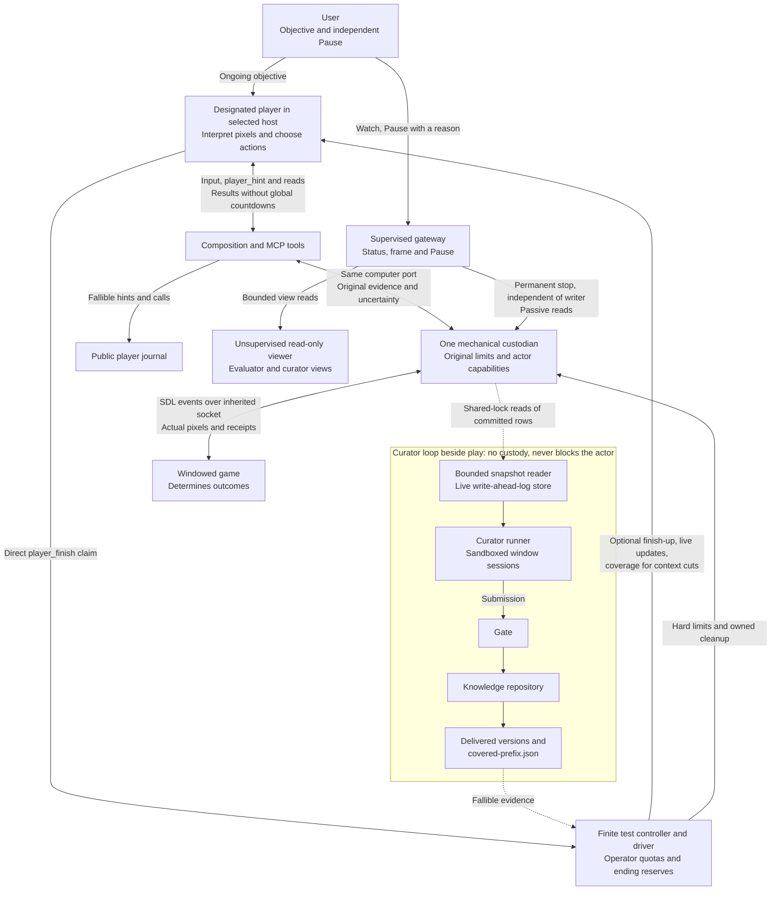
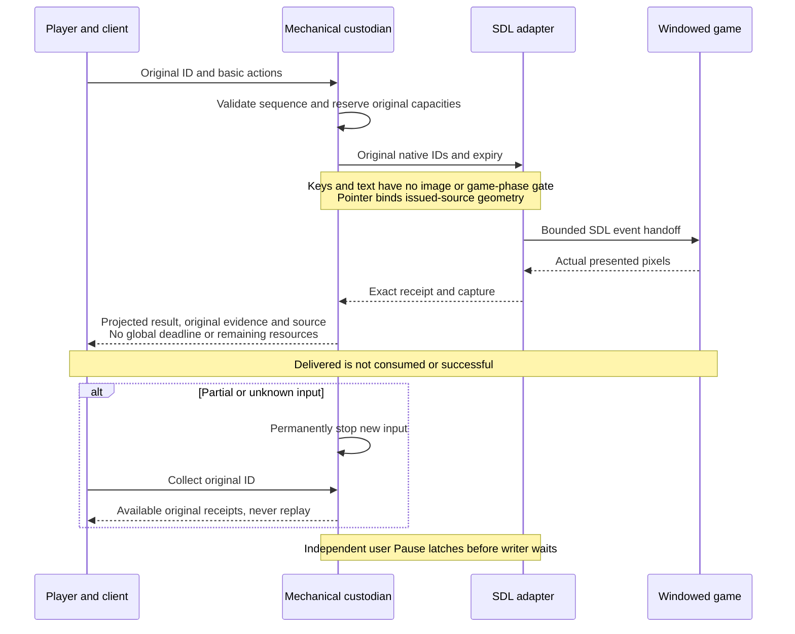
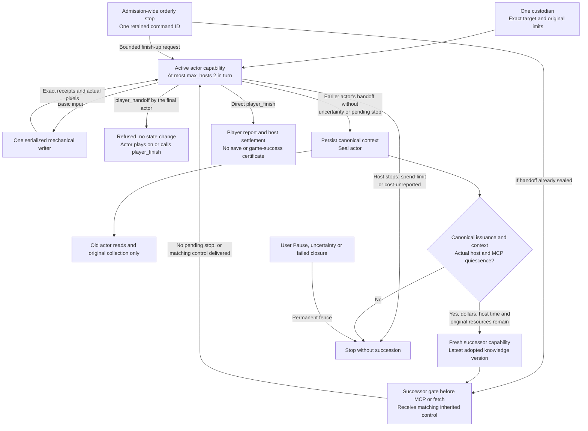

# Current architecture

Enactive separates mechanical computer custody from player-owned interpretation.
The [overview](overview.md) owns capabilities and limits; the
[computer-control contract](contracts/computer-control.md) owns exact fields,
versions and failure behavior.

## Scope and responsibilities

This current diagram answers “Who decides, who can stop input and how does curated
knowledge reach the player?” Boxes identify logical responsibilities; solid arrows
identify requests, results or user control. Dashed arrows cross between play and the
curator loop as files read at best effort. The driver also serves an adopted version to
the player's knowledge reads, and a package's frozen export supplies the first briefing.
The host contract owns
[live updates](contracts/player-host.md#a-newer-version-during-play) and
[context cuts](contracts/player-host.md#coverage-gated-context-cut).
The text equivalent is below.

| Responsibility | Owned state and authority | Component |
| --- | --- | --- |
| Deciding player / player host | Ongoing user objective, visual interpretation, game choices and fallible claims; direct finish reports, explicit provider/context/tools; the host adopts knowledge updates and applies coverage-gated context cuts between requests | [Player interface](components/player-interface.md) |
| Finite test controller / driver | Operator-only quotas and ending reserves, external finish-up request, verified succession, adoption of delivered versions and exact owned process cleanup; no game-save guarantee | [Campaign procedure](operations/campaign-run.md) |
| Player journal and knowledge | Public calls, hints, source provenance and curated delivery; no custody | [Memory and learning](components/player-interface.md#journal-and-knowledge) |
| Composition service | Connects player proposals to the computer port; retains service requests and context snapshots | [Execution](components/execution.md) |
| Computer custodian | Exact child/socket/lock handles, serialized operations, original resources and actor capabilities | [Native control](components/native-control.md) |
| Observer / operator | Supervised control path (status, frame, independent permanent Pause with a recorded reason) and an unsupervised read-only viewer of interpretive evaluation | [Spectator](components/spectator.md) |
| Run evaluator | Interpretive records and metrics from retained evidence with a game binding; never player-visible, gates nothing | [Evaluation contract](contracts/evaluation-record.md) |
| Curator | Sandboxed sessions over bounded live snapshots or sealed traces, and a gate-only knowledge repository that scopes facts and articles by world and declared context axes and tracks lineages; frozen exports and live versions reach the player; no custody | [Curator and trace workbench](components/curator.md) |
| Game | Consumes ordinary SDL input and determines outcomes | Windowed prepared CDDA; no semantic engine bridge |

## Runtime and state

`tools/campaign_run.py` is the sole finite custodian. It validates a fresh frozen
run package and reserves exclusion before launch. `OwnedTarget` keeps
exact subprocess handles and passes an inherited shared-lock descriptor and a
nonblocking Unix socket to the SDL adapter. Native retains the shared lock for
its lifetime, including after the custodian loses its own reference.

The computer receive thread decodes bounded packets without writing files or
SQLite. The serialized runtime records intent and capacities before publication;
the custodian publishes PNGs/SQLite outside the native event loop. Failure at the
authoritative computer-store/source boundary permanently stops input;
restart cannot reconstruct custody from history. Passive observer read failures
instead report unavailable evidence and cannot change custody.
The source modules are [launch](../harness/computer/launch.py),
[channel](../harness/computer/channel.py), [runtime](../harness/computer/runtime.py)
and [store](../harness/computer/store.py).

The loopback [HTTP server](../harness/server.py) exposes passive status and
source reads, independent Pause and authenticated per-actor tools; it serves no
page. Under supervision the [gateway](../tools/campaign_watch.py) serves the page and
forwards view reads to a separate read-only viewer
([spectator](components/spectator.md)).
The [application](../harness/application.py)
composes the computer port with journal and delivered-knowledge services. A
project-local stdio MCP adapter owns no writer, native child or provider key.
The selected [player host](contracts/player-host.md) owns model calls; the campaign
driver owns exact host/MCP group cleanup. The driver sends bounded JSONL control
through host stdin; the initial prompt is a frozen file. Pending stop identity
survives actor turnover and gates a successor before MCP/fetch. Player-facing
MCP projection excludes global deadline/remaining fields while canonical
operator records retain them. No game-specific save or Quit step gates stopping.

An optional [finite-test supervisor](operations/campaign-supervision.md) wraps
the custodian. Nobody is required to watch: run limits and the operator's Pause
stop a run. Its independent
guardian owns the custody clock and exact newly launched child groups; a separate gateway
forwards spectator reads and receiver-verified Pause. It adds no player input
producer or native custody. Supervision, host settlement and game outcomes stay
separate; source fixtures do not qualify actual play or human attention.
The [process diagram](operations/campaign-supervision.md#process-ownership-and-credentials)
shows each process group and which processes hold a key.

With `--curator-runner` the guardian also starts an unsupervised
[curator runner](components/curator.md#runner-windows). It reads the live store in one
bounded transaction under a shared lock, runs sandboxed window sessions and publishes
through the gate. When the package sets
[`live_knowledge_updates`](operations/campaign-run.md#live-knowledge-updates), on each
poll the driver adopts the highest newer confirmed version it can verify and publish for
the application and any successor, and forwards version and coverage lines to the host.
Between requests, the host delivers the newest verified update that fits within context
capacity and applies coverage lines internally to govern cuts. On a route with
`context_cut` enabled, the host can then replace covered turns with a fresh briefing.
Neither the runner's exit nor a missing update stops
play. After the admission is sealed, the operator can run
[boundary grooming](operations/curator-hosts.md#post-admission-boundary-grooming) on the
same repository.

Fresh session stores live under `.runtime/computer-sessions/`. A selected player
journal may span fresh native-child sessions.

## Action and recovery views

### What happens when the agent acts?

The client assigns an operation ID before HTTP submission. The custodian validates
the entire basic sequence, reserves original resources and serializes dispatch.
The adapter reports exact delivery and captures actual presented pixels. Keys and
text have no image-age, equality or game-phase predicate. Pointer actions bind
mechanical geometry and a source actually issued to that actor. Delivered input
is not game success.

This current diagram answers “What happens between an action the player chooses and the
result it reads?” Columns are logical participants, not separate required processes.
Solid arrows are requests or events, dashed arrows are results, and the framed part
happens only after partial or unknown input. The
[custody contract](contracts/computer-control.md#computer-operations-and-custody) owns
the fields.

### How do I recover control?

An optional orderly-stop request offers bounded player-chosen finish-up. Only a
direct `player_finish` tool invocation settles its report; ordinary narration
does not. The finite controller forecasts ending capacity before admission and
retains the admission's stop request across handoff. This opportunity is separate
from the immediate mechanical fence below. Neither a report nor stopped input
certifies persistence, a paused game or normal native exit.

Pause sets the permanent stop event before executor/DB work and sends through a
separate bounded path; failure to send closes the write side to signal EOF.
Real native input takes precedence and fences automation. Partial or unknown
input remains charged and unreplayed; collect the original result. There is no
Resume/rearm or phase-based recovery. Native manual interaction can still recover
the application. [Pause procedure](operations/pause-timeout.md).

## Observation and deployment boundaries

The supported deployment is a local Mac with a prepared windowed CDDA app and
project userdir. Captures preserve the actual presentation and its original
geometry and time. The [native channel contract](contracts/computer-control.md#native-channel)
defines the limits of keeping file publication outside the game callbacks.

## Game-family portability

The computer package imports no game interpretation. Shared player hints and context consume only the computer port and explicit player data.
CDDA-specific preparation stays outside that package. This separation is a source
boundary; actual portability to a second game remains unqualified.

Current coupling. None of it is in the shared player code. The entries inside
`harness/computer/` are platform coupling (macOS, SDL and dyld injection), not game coupling:

| Coupling | Where | Owner |
| --- | --- | --- |
| CDDA prepared launch script and app paths (`Cataclysm.app`, `cataclysm-tiles`) | [`harness/prepared_app.py`](../harness/prepared_app.py) | [Setup](setup.md) |
| Game download, verification, patching and installing the built adapter | [`tools/setup.py`](../tools/setup.py), [`tools/patch_game.py`](../tools/patch_game.py), [`tools/prepare_game.py`](../tools/prepare_game.py) | [Setup](setup.md) |
| CDDA screen readers and the only registered evaluation binding | [`harness/evaluation/cdda/`](../harness/evaluation/cdda), `BINDINGS` in the viewer and in [`tools/evaluate.py`](../tools/evaluate.py) | [Evaluation contract](contracts/evaluation-record.md) |
| CDDA-class vocabulary in the game-neutral evaluation core (modes including `dead`, threat buckets) | [`harness/evaluation/core/binding.py`](../harness/evaluation/core/binding.py) | [Evaluation contract](contracts/evaluation-record.md) |
| CDDA vitals (`hunger`, `thirst`, `weariness`, `pain`, `vital.limb.*`) hard-coded in the viewer's `NEEDS_READERS` and metric-to-reader map, and in the spectator page's game-state panel | [`harness/viewer/views.py`](../harness/viewer/views.py), [`web/app/supervise.js`](../web/app/supervise.js) | [Evaluation contract](contracts/spectator-view.md#spectator-view-api-spectator-view3) |
| macOS SDL adapter loaded into the game process | [`harness/computer/native/`](../harness/computer/native) | [Native control](components/native-control.md) |
| Adapter injection through `DYLD_INSERT_LIBRARIES` | [`harness/computer/launch.py`](../harness/computer/launch.py) | [Native control](components/native-control.md) |
| CDDA-specific play guidance | [Player guide](player-guide.md) | Player guide |
| Curator: one knowledge repository per game, and the shadow runner over sealed lineages, the live runner and boundary grooming use the game name `cdda`; the fact format, articles and briefs name no kind of thing in a game | [`harness/curator/knowledge.py`](../harness/curator/knowledge.py), [`tools/curator_host/shadow.py`](../tools/curator_host/shadow.py), [`tools/curator_host/live_runner.py`](../tools/curator_host/live_runner.py), [`tools/curator_host/groom.py`](../tools/curator_host/groom.py) | [Curator](components/curator.md) |
| Memory measure: the anchor check's frozen prompt and `anchor_verdict` labels are worded for going to a known place with goods, kept only to re-judge the measure gate's 30 owner-labelled pairs; the standing packets, labels and measures name no kind of thing in a game | [`tools/memory_measure.py`](../tools/memory_measure.py), [`harness/evaluation/core/judge.py`](../harness/evaluation/core/judge.py) | [Evaluation contract](contracts/measurement-tools.md#checks-of-a-changed-judge) |

## Separate recovery and memory boundaries

Referenced sources, hints and old process IDs never restore custody. Curated
knowledge and player hints are fallible. A hint failure leaves basic input
available if mechanical custody is healthy. Mechanical Pause or uncertainty
cannot become a resumable handoff.

## Run ownership and operator takeover

Handoff persists a canonical bounded context, then seals the actor. A sealed token
can collect originals and read retained knowledge, but cannot capture anew or
mutate. Only the driver, after canonical issuance/context verification and actual
old host/MCP group quiescence, can mint a successor under original limits. It
requires no save, menu or identity check. [Run procedure](operations/campaign-run.md).

This current diagram answers “What permits a successor after handoff or a stop
request?” Boxes are logical custody/control states; labelled arrows are allowed
transfers or requests, not separate processes. The driver retains one stop ID;
an already sealed handoff requires verified old-group quiescence and a successor
control gate before MCP/fetch. A package admits one or two hosts in turn. Every actor has
the same tool table, so the final one learns that it has no successor only from the
refused call. A successor starts from the latest knowledge version adopted in the run, or
from the package's frozen file when none was. A host that stops with `spend-limit` or
`cost-unreported` ends the run's succession, as Pause and unknown input do.
Direct player finish is a claim, not saving or game acceptance.
[Exact host control](contracts/player-host.md#external-control) and
[spend](contracts/player-host.md#spend) own the fields.

## Coordinated change

Change producers and consumers together across the boundaries in the
[contract index](protocol.md#contract-navigation). The [migration procedure](operations/migration.md)
governs storage, preservation of evidence and coherent rollback.

## Change boundaries and verification

### Responsibility assurance

| Changed boundary | Evidence to inspect and limit |
| --- | --- |
| Packet/input/custody | Strict schema, socket/backpressure, writer/deadline and uncertainty assertions; [native control](components/native-control.md#assurance-and-evidence) adds compiled behavior. |
| Journal and hints | Player and composition assertions for provenance, hint isolation and original IDs; [memory](components/player-interface.md#journal-and-knowledge). |
| Host/driver | Contract conformance and actual adapter/MCP fixtures, origin-bound handoff, attempt accounting, exact group quiescence, knowledge-update adoption and `context_cut` decisions with their request serialization; no real play has used a context cut; [player interface](components/player-interface.md#assurance-and-evidence). |
| Spectator/operation | Control-path checks and Pause independent of the viewer, provenance labels and viewer-unavailable behaviour; [spectator](components/spectator.md#assurance-and-evidence). |
| Evaluator/viewer | Synthetic-run evaluator tests, held-out reader validation, viewer API tests and the replayed graphical lane; [evaluation contract](contracts/evaluation-record.md). |
| Curator, live and shadow | The sandbox escape suite against the real listeners (macOS), projection secret guards, gate and close-out negative tests, and proxy allowlist and settlement tests; snapshot staging from a growing store, runner windows and covered prefix, live delivery, boundary grooming and the coverage that gates `context_cut`; the [live validation run (#889)](acceptance/2026-11-22-live-validation-run-889.md) covers staging, delivery and grooming in real play, and not handoff; [curator](components/curator.md#assurance-and-evidence). |

The [testing guide](testing.md) selects lanes. [Production outcome evidence](acceptance/2026-10-29-computer-control.md)
covers actual basic input, useful stock, conditional scouting, succession and
Save/new-child reload/normal ending. Source fixtures alone cannot qualify those
effects; useful cadence, general safe navigation and survival remain separate.
