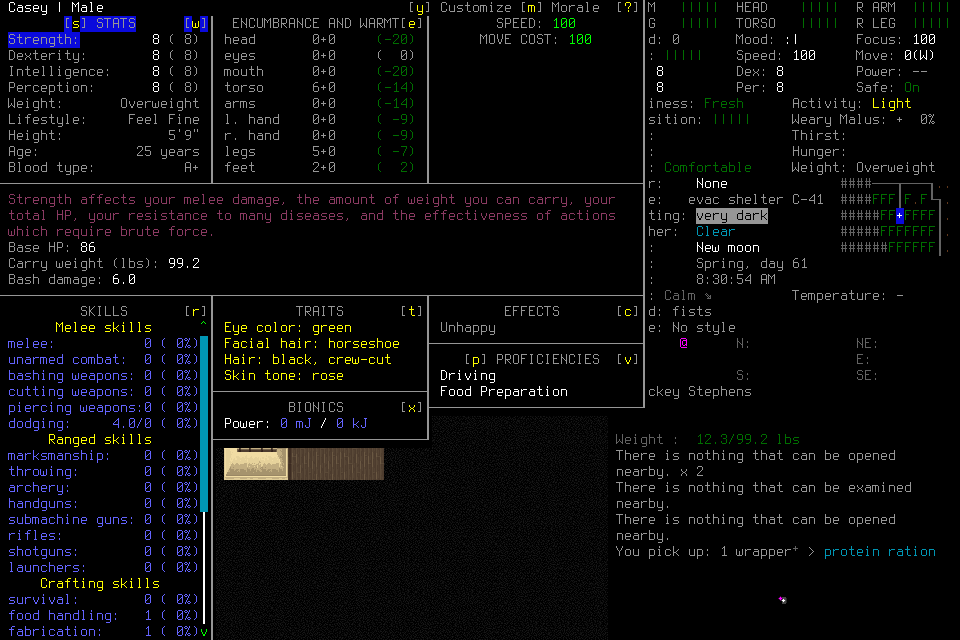

# Responsive independent play

## Decision and user consequence

The present player is too slow. Successful input delivery, a large token cache or
an asynchronous adviser does not establish watchable progress. Admit the complete
player configuration against useful progress and quality, rather than selecting
a model by its capability, size or name. A slow model belongs on the active path
only when genuinely useful execution covers its delay and the whole configuration
meets the same responsiveness target. The engineering lead remains outside play.

This is a proposed implementation change. The [standards](../engineering.md)
state the requirement; current behavior remains in [architecture](../architecture.md)
and [protocol](../protocol.md). No source, budget, acceptance condition or actor
brief in an already deciding campaign is changed by this proposal.

## Evidence and diagnosis

The completed original player of campaign010 made 122 post-admission MCP calls,
including 84 skill calls. Across 121 adjacent nonoverlapping calls, the gap was
6.665 seconds median, 18.091 seconds nearest-rank p95 and 117.428 seconds maximum.
These gaps include reasoning, other work, scheduling and transport; they do not
isolate inference. Skill tool duration had a 1.166-second median and 6.953-second
p95. This actor is only a campaign prefix, including lifecycle work, not a whole
campaign or representative routine-play cohort.

Its 128 activated-role responses accumulated 30,937,286 input tokens, of which
30,230,272 were cached. Counts include repeated context and reporting through
FINAL; they are neither unique context nor billing measurements. The closed host
also contains 91 nested result envelopes: 5,472,271 serialized text characters
versus 1,453,376 in their inner result text. These are persisted event envelopes,
not measured model-facing duplication. A subsequent audit of 137 forwarded exec
outputs parsed 260 JSON text blocks and found no nested MCP result envelopes.
For example, event line164 wraps a result whose adjacent forwarded output at
line165 is the direct 12,294-character value. The earlier inference that nesting
was model-visible is retracted. Raw events and model-forwarded records are
different observation layers; typed images must not be counted as textual base64.

The private original trace is pinned by SHA-256
`dd87845904c3287e8b3a77ed3fcc9b4cd2b34e083e83f2111aabb51421bd3a21`.
Its actor-evidence analysis and independent measurement review are retained with
campaign010. Raw host transcripts remain private. This assessment does not accept
an elapsed survival day or the seven-day outcome.

Code inspection confirms `_finish` retrieves another snapshot after every write;
`snapshot` returns nearly the full mission and selected source/image. The MCP
adapter returns JSON text and structured content. That SDK shape is not by itself
proof that the model receives both; actual host presentation must be tested.
The producer already derives common wire bindings and some skills already batch
primitives. The remaining problem is not solved by claiming no automation exists.

## First source slice and its limits

The first source slice added the `player-view/1` MCP projection described in
[the protocol](../protocol.md#integrated-mission-lifecycle). It preserves complete
selected evidence, operations, obligations and uncertainty; removes matching
native visible-state duplicates; and references progress only when identical to
the included operation result. Independent review caught lost progress when an
ID was absent and lost native details when source retrieval failed. Both were
corrected, with regression cases also retaining a genuinely different latest view.
This is a presentation change; cached canonical results and dispatch stay intact.

An offline paired canonical-JSON measurement on120 parsed original-player results
reduces1,754,116 to1,308,602 UTF-8 bytes;253 parsed successor results reduce4,623,962
to3,759,209. Four original and32 successor records were unparsed and excluded.
These include preflight and different tool families. They are reconstructed inner
result bytes, not actual model token counts, outer host envelopes or measured
latency. Advisory values are not shortened by this projection; adding the marker
slightly increases their size. Those offline measurements do not qualify actual
loaded-host framing.

The subsequent [Luna/low diagnostic001](../acceptance/2026-10-22-luna-responsiveness-first-attempt.md)
does show23direct `player-view/1` results and19typed images in actual forwarded
output, without nested MCP envelopes. It failed setup before verified identity or
routine play, so apparent responsiveness remains unqualified. Its48activated-role
responses grew from41,509 to165,720input tokens; broad documentation/source reads,
including one recursive runtime search, entered the hot path. This supports a
bounded interface working set and better tool/workflow guidance, not the claim
that old controller-event histories were repeatedly forwarded: the adapter already
excludes those. The [player guide](../player-guide.md) is the current compact entry
point. Its actual independent sufficiency and reduced overhead remain to test.

Passive advisory next reads can now wait up to40 seconds on the existing condition
variable. Other waits remain15 seconds; claim/collection retains the original
remaining allowance and stable identity. This can reduce idle model round trips
without a new daemon. It neither eliminates idle turns nor qualifies responsive
play. The first short trial used the user's Luna/low selection; bounded context,
automatic plumbing, useful execution coverage and actual performance remain the
broader tracked work below.

The integrated player/presentation/lifecycle/reflection focused lane passes91
tests in162.415s. Separate clean-context source reviews found no remaining
material findings after the presentation fixes. These are component and SDK
results; no loaded-host performance or new graphical acceptance is inferred.

The second source slice is current `player-view/2`: it reuses the32-entry snapshot
cache for complete returned snapshots and adds exact-as-of, read-only
`enactive_detail` sections. Default presentation removes declared technical audit
fields; full requested evidence/obligations and canonical request bindings remain.
There is no new store, dependency, executor or compatibility mode.58focused tests
pass in152.292seconds; a clean reviewer independently passes15presentation/detail
tests and finds no material defect. Project configuration adds only this read-only
tool to the existing allowlist. A subsequent actual Luna/low preflight still lists
20 tools without `enactive_detail`, although its snapshot returns `player-view/2`
and the actor reports21. No mission is admitted from that report. The actual
forwarded output, rather than readiness prose, establishes the loading gap.
This preflight also forwards a whole MCP envelope, unlike001's direct values.
These are host/caller findings under#164, not evidence that valid SDK framing is
wrong or that the new source has passed graphical qualification.

Offline application to24parseable actual forwarded Luna001 results (including its
preflight) reduces200,566 to169,381canonical UTF-8 bytes. Median9,099 becomes7,572;
nearest-rank p9510,457 becomes9,322bytes. This is a modest15.5% reduction in that
text subset, with image parts unchanged, not new host/token/latency qualification.
It enables progressive access but does not solve broad source reads, manual
semantic drafting, unnecessary captures or long decision gaps by itself. Those
remaining changes must follow measured useful progress and the whole objective.

## Selected implementation direction

| Responsibility | Owner and change |
| --- | --- |
| Intent, novel interpretation, raw-input discovery, applicability and revision | Deciding player; compact current context, ordinary-input fallback and optional useful skills |
| IDs, request binding, submit/collect, cursors, serialization and presentation | Existing adapter/software; preserve stable admitted identity and uncertain-delivery handling |
| Confirmed supported execution and stop conditions | Existing single writer; finite closed-loop continuation, current observations and interruption, without a model round trip per primitive |
| Trajectory selection, exposure/selection/result attribution and idle waiting | Software; existing receipts, bounded jobs, event-driven wakeup rather than model polling |
| Candidate procedures, contradictions and longer-horizon advice | Bounded background model jobs; provisional, source-linked and independently consumable |
| Source history and audit | Existing ledger/archive; complete canonical records retrievable by reference |

The model's default result should contain the decision-relevant disposition,
operation/source handles, current control state, relevant limits, unresolved
effects and next decision. Supply the applicable image as an image part when the
decision requires it. Avoid nested transport JSON, repeated mission histories and
unnecessary new screenshots. Full receipts stay available to machines and audit.
Do not strip fields needed for an actual decision or silently truncate complete
handoff obligations. Migrate the presentation and all callers/tests together;
no legacy result mode is retained as a compatibility path.

Use progressive context revelation within that boundary: a small current decision
view first, selected tool/phase guidance next, focused memory/map/evidence retrieval
for a concrete need, and complete technical receipts for diagnosis. Detail reads
must address the same retained snapshot/source, never silently fetch a newer
binding or grant authority. Keep opaque handles for exact recall; cryptographic
verification, wire headers, clocks, serialization and correlation belong to
software. Full canonical records stay in the existing store. Do not add a second
archive, vector database or generic context framework merely to reveal sections.

For every proposed model task, ask what interpretation or consequential choice it
requires and when its result could change a decision. Software owns deterministic
binding/collection/verification, execution under declared stop conditions, resource
accounting, exposure/use/effect joins and known-failure classification. The player
owns goals, novel interface/threat interpretation, applicability and replanning.
Reflection handles source-linked candidate lessons, conflicting knowledge and
procedure revision when novelty, recurrence or consequence justifies it; it does
not poll empty queues or certify every input. A detected mismatch is not itself a
reason to escalate to a stronger model. Supply a specific unresolved question and
expected decision benefit; preserve unknown delivery instead of asking a model to
guess it. These are the existing active/background responsibilities, not mandatory
extra tiers or an automatic claim that semantic success can be mechanically proved.

Exact cached detail and scoped technical-field omissions are implemented in
`player-view/2`; actual loaded-host qualification remains separate. Remaining
adapter work should machine-bind mechanical arguments where the selected current
snapshot already determines them and remove measured caller-side plumbing.
Migrate the MCP view/tool callers together under S-MIGRATION, retaining complete
explicit memory/handoff/advice payloads and uncertainty. Measure actual bytes,
round trips, context sufficiency and useful progress; removing hashes alone is not
an adequate performance remedy. A compact guide can reduce avoidable investigation
but cannot substitute for ergonomic tools or whole-player qualification.

Use existing SDK result types and a thin explicit presentation boundary. The
official [event-export issue](https://github.com/openai/codex/issues/44126) and
[current source](https://github.com/openai/codex/blob/main/codex-rs/core/src/mcp_tool_call.rs)
separate event truncation from the returned model/tool result. They corroborate
the distinction, not exact parity with this host version. No production unwrap
fix is justified by the event wrappers. Test errors, partial/unknown settlement, image blocks
and actual loaded-host forwarding. Reduce bookkeeping fields by software binding,
without allowing a newer snapshot to silently retarget an existing operation.

Context is a working set, not the archive. Preserve objective, selected plan/skill,
current source, obligations, unknown effects, relevant procedure versions and
invalidators; retrieve older detail on demand. Use fresh-context continuation to
test sufficiency. The current Codex coding host also injects instructions, tools
and accumulated conversation: changing MCP responses alone cannot promise control
of that host's context. Assess supported host/runtime capabilities before choosing
a dedicated player host. No paid provider or new spending is authorized here.

An already justified closed-loop skill can execute while another bounded model
job prepares a future decision. If its useful remaining work lasts W and planning
takes L, overlap requires L to fit W at the relevant tail, with production keeping
pace with consumption over time. Stale queued work supplies no coverage. When no
justified action exists, expose deliberation; do not hide it with filler movement,
Waits or animation. Never speculate native input, fork saves for rollback or
replay uncertain delivery. Larger batches are not a substitute for feedback.

## Admission experiment and controls

Before the next responsiveness experiment, #164 must freeze finite scenario
cohorts, exact host/model/reasoning/context/tool settings, repeated attempts,
numerical thresholds and quality/ending requirements. Suggested initial targets
are routine new-decision-to-visible-effect p95 at most 2 seconds, no unexplained
routine stall over 5 seconds, and useful visible effects within 500 ms during
supported local execution. These are engineering starting points, not literature
constants or passed gates. Loading, intentionally long activities and novel
reasoning need separately declared cohorts and finite ceilings; retain their
frequency and costs in the whole-run result instead of excluding inconvenient
samples. The existing native ACK and browser targets remain separate measurements.

Measure full event-to-confirmed-effect intervals, calls per meaningful outcome,
visible progress/stalls, response bytes and actual model-visible context, p50/p95/
maximum and deadline misses, refusals, failures, unknowns and resource cost.
Disclose sample counts and unsupported clocks; do not substitute tool gaps for
isolated inference or browser decode for actual paint. Predeclare how useful
progress and permissible exceptions are assessed. Reject configurations that fail
the frozen target; test faster configurations or improve useful execution before
another long responsiveness qualification. Do not weaken outcome or authority
requirements to pass a speed target.

C-REVIEW checks the boundaries, actual-host result shape, prior-research crosswalk
and action-item dispositions. C-USABILITY checks cadence and honest visible
deliberation. Existing focused portable/SDK tests should cover presentation and
continuation invariants; native graphical evidence must establish actual host
behavior and measured progress. These tests are planned work, not implemented
latency enforcement. Full CI remains an integration gate, never a latency proof.

## Delivery, reuse and maintenance

GitHub owns live scope: [#164](https://github.com/CVX-Hull/enactive/issues/164)
owns result/host/context automation and configuration admission;
[#178](https://github.com/CVX-Hull/enactive/issues/178) event-driven advisory work;
[#177](https://github.com/CVX-Hull/enactive/issues/177) memory working-set and
procedure continuity; [#145](https://github.com/CVX-Hull/enactive/issues/145) the
independent campaign outcome. This is not a second status tracker.

Lead owns interface design/integration. After contracts freeze, one worker may own
the adapter/presentation/tests and a second the disjoint advisory scheduling/tests,
in separate worktrees; shared runtime changes stay with one integrator. A clean
reviewer tests model-facing and machine-facing evidence separately. Changes remain
isolated until the deciding run closes and every actual player/adviser/successor
is FINAL. Preserve partial outcomes and costs if a run ends before its objective.

A measured runtime hot path also repeatedly serializes already-validated frozen
gameplay records into manifests. Trust their constructor immutability for encoding;
keep raw parsing and explicit incoming-receipt validation at their actual boundaries.
Move validation-only serializer calls together with that change, without adding a
second serializer, history cache or format. Component timing and unchanged output
checks support this optimization; whole-player responsiveness still needs real play.

The second Luna diagnostic exposed nested skill goals and memory entries as
`unknown` in the actual host declaration despite complete SDK schemas. Export
selected current tool/variant help through the existing project setup helper;
freeze only the needed references and reveal them on demand. This reuses the
schema producer and changes neither the MCP catalogue nor the gameplay contract.
Actual independent usability remains to be qualified; generated help alone is not
a host fix or a speed result. Track native cleanup before identity separately.

The [third frozen Luna attempt](../acceptance/2026-10-23-luna-responsiveness-third-attempt.md)
loads all21tools and makes valid calls using focused help, but cannot cancel an
incidental setup confirmation because ordinary lifecycle children are forbidden.
The repair reuses OrdinaryInputSkill/InputObservation, the existing lifecycle
lease and durable dispatch records. It migrates producer, receiver and retained
proof validation together, preserves explicit creation-route/identity/Save proofs,
and extends menu-only cleanup to settled exploration. A physical key is not a
creation/save certificate. The CDDA character-stage commit remains an explicit integration constraint;
the later owned-exit follow-through removes its semantic-only confirmation gate; wrong/unadopted normal
cleanup remains open. Review must challenge actual preflight receiver changes and
retirement of stale creation intent, not only successful cancellation. No new
tool, executor, native protocol, dependency or compatibility mode is introduced.
The next actual player/native run must qualify this source change;003 stays failed.

The [fourth frozen attempt](../acceptance/2026-10-23-luna-responsiveness-fourth-attempt.md)
confirms the refreshed host and ordinary setup/cancellation, then fails when an
old selected snapshot becomes a fatal lifecycle evidence error. Reuse the existing
receiver exception/result boundary for a correctable zero-input refusal, preserving
healthy custody and original limits. The model still selects intent/evidence; no
silent retarget or retry is justified. Current snapshot guidance belongs in the
compact guide. New controller startup loads this receiver-only repair; no further
Codex restart or expanded allow rule is needed.004 remains failed and supplies no
routine latency cohort.

The [fifth frozen attempt](../acceptance/2026-10-23-luna-responsiveness-fifth-attempt.md)
reaches a real editor but exposes ineffective semantic clearing and a known native
Ctrl+Backspace rejection. Transport publication was wrongly promoted to an uncertain
effect candidate. Reuse the authenticated receipt distinction in runtime, creation
chronology and menu cleanup: nondelivery stays charged, restores the unchanged
stage and permits only explicit Observe/new choice within healthy original scope.
Native translation should match the existing SDL Ctrl-letter/named-key contract;
rebuild and qualify it separately. Do not infer success from accepted editor keys
or add a handler for this menu.005 remains failed, with no routine latency cohort.
All21tools already load; this source/native repair needs no Codex restart.

[Diagnostic006](../acceptance/2026-10-23-luna-responsiveness-sixth-attempt.md)
creates the world but expires its chosen420s setup scope before identity. Explicit
pre-normal menu reads/zero-input aborts must use their own bounded deadline rather
than that expired execution deadline; preserve exact custody and all input ceilings.
Show root headroom in the existing summary instead of making the player reconstruct
technical receipts. A cached rejected ACK is history; judge readiness after the
fresh read. The first pre-read fence failed three existing rejection-continuation
regressions and was moved after capture; retain that failure separately.

For #175, use the existing admission's explicit initial-load mode to validate
skills/memory from an ordinary saved world under new visible identity/adoption and
zero inherited game-time credit. Do not build a save-proof import service; later
reloads still require this mission's own Save. Fresh seven-day acceptance stays
fresh. Existing modes/null fields represent the distinction, with live/ledger/
timeline readers and tests migrated together; no wire/storage format is added.

A read-only [supported CLI exec](https://learn.chatgpt.com/docs/non-interactive-mode)
probe reused the existing signed-in account and explicit current project MCP
configuration, with no new provider, admission or game input. The first invocation
failed configuration loading before a model session; the corrected invocation
made direct snapshot/detail calls but supplied null to the detail schema and
reported nested skill arguments as `unknown`. It demonstrates neither a full
catalogue nor faster deciding play; Desktop remains selected for006. No global
configuration, credential copy, hidden app IPC or permission bypass was used.

Retain the existing MCP SDK, ledger, archive, memory store, observer timing and
test lanes. No new workflow engine, history store, tool-search service, vector DB
or robot runtime is justified by these findings. A dedicated small player runtime
can be a useful accelerator if the current host cannot meet the measured need;
compare actual capabilities and recurring cost before building it. Retire custom
presentation glue when supported SDK/host capabilities cover the gap.

Refresh research on a host/model/context redesign or before claiming current
performance; requalify affected cohorts after material changes or a measured
regression. Revisit numerical budgets with prospective evidence, retaining old
failures and reasons. Do not renew controls merely by changing dates. The
[research synthesis](../research-responsive-gameplay.md) owns external sources,
read scope, transfer limits and the prior-document crosswalk.

[Diagnostic007](../acceptance/2026-10-23-luna-responsiveness-seventh-attempt.md)
exposes wrong-domain reconciliation: a missing ordinary recovery candidate is
reported as custody loss even during an expected Load transition. Preserve only
positively verified healthy lifecycle state after a zero-input wrong-tool refusal;
keep genuine custody/Pause/fault failures fatal. Improve selected-phase tool
presentation and software-owned terminal cost reporting. The actor confused
remaining frame/byte allowance with usage; actual17PNGs/648248bytes give no evidence
of excessive capture. Track these under #164/#176/#195 using existing mechanisms,
not a menu-specific handler, new reporting framework or extra approval gate.

The owned source repair reuses `LifecycleRequestRefusal` and the original expected
transition guard when ordinary recovery has no candidate. It positively checks
paused unknown accounting, clock, controller and absent lease, then names the
original lifecycle operation/root without input or automatic conversion. Existing
compact-view refusal reason identifies the needed tool. Passive status does not
duplicate the transition guard or promise continuation from retained diagnostic
correlation. Initial-Load tests
continue through correct reconciliation, visible identity, own Save/new-child
reload and reopened history, with paired operator Pause, controller failure,
native takeover and original-root expiry negatives. These synthetic checks do not
qualify real play;007 stays failed and the next finite actor starts independently.

The [008 diagnostic](../acceptance/2026-10-23-luna-responsiveness-eighth-attempt.md)
passes initial Load/current identity and normal Save, then fails the separate
literal owned-exit confirmation restriction. It supplies neither useful higher-level
supply/travel progress nor a complete routine latency cohort. Preserve ordinary
keys/text/clicks during owned exit and derive normal terminal effect from exact
published input/owned-child exit evidence, rather than a magic question/YES value;
all readers and negative custody tests must migrate together. The source follow-through below addresses this boundary; actual requalification
remains open, without an extra per-action review.

Measured repeated normal action vocabulary, receipt bindings, configuration and
image parts justify a small further presentation slice. Default normal-play results
now omit that general vocabulary, repeated configuration and technical receipt
fields behind existing exact detail. Menus/scenes/uncertainty and unique feedback
remain. One bounded tuple under the existing producer lock suppresses an identical
implicit PNG only in a known unchanged player/control context; explicit snapshot
and historical source reads always forward pixels, and historical reads invalidate
the comparison. This does not skip capture or establish handoff source reads.
Synthetic/SDK checks and independent source review establish these boundaries;
actual-host context/latency improvement remains unqualified. New producer code must
be loaded and verified; the already loaded21-tool catalog alone is insufficient.
No new store, dependency, compatibility path, native build or global setup is added.

The integrated presentation/detail/lifecycle adapter lane passes61tests in144.314s;
independent review passes15new tests and finds no source defect. Existing baseline
expectations are migrated to the current omissions. The SDK fixture forwards one
image across six identical implicit results while explicit snapshot/source reads
remain actual images. Synthetic compact JSON snapshot bytes fall4,603→1,607 and
operation envelope4,782→1,786; these are fixture sizes, not measured host tokens or
latency. Fast checks pass. Protected candidate/main CI and actual fresh-producer
qualification remain separate gates.

## Owned-exit source follow-through after008

The source now admits ordinary key/text/click exit children through existing
OrdinaryInputSkill/InputObservation, and optional semantic/native-row controls.
It removes literal question/YES and fixed cancellation-history gates from runtime
and history readers. The existing registered Resume/QUIT helper can also terminate
without a confirmation. Known input plus a healthy changed menu or unexplained
policy result returns control to the player; missing evidence authority or custody
still revokes. Actual published native input and original root dispatch custody
remain part of normal exit proof, distinct from unknown ACKs. The native admission
parser is factored from the existing receipt validator, not duplicated. Current
wire shapes and closed evidence notes stay unchanged; explanation text is not an
authority predicate. No native rebuild, new service or compatibility mode is added.

Review found and corrected key-kind orphan proof, healthy newer-current/row-jump
classification, native admission/binding correlation and a source-invalidation
case hidden by semantic normalization. Retained local failed lanes also exposed a
pre-existing Pause test's scheduling assumption: queue admission can either reject
a stale epoch or accept a current one before the writer refuses lost custody. The
revised test asserts no dispatched input, no regained scope and preserved user
Pause across both lawful schedules. The actual008 failure remains unchanged;
new source/SDK checks do not supply its missing normal ending or qualify speed.

Final combined exit/lifecycle/receipt/ledger source validation passes175tests in84.303s.
Fast checks and independent review are clean after the recorded corrections; the
reviewer separately passes4focused health/correlation regressions in3.711s.
Exact candidate/protected-main CI and a new real normal-ending/useful-play run
remain separate obligations. The original failed lanes and reasons are retained.

The first exact owned-exit candidate CI ran 1,745 tests and failed one assertion
that still expected the former action/key-only error wording. The assertion now
uses the current ordinary-input wording; all 130 controller tests pass in 21.612s.
No production behavior was changed by this test correction, and the failed CI
remains evidence rather than a passing result.

## Durable spectator timing export

The existing spectator now uses standard browser Blob/download capabilities to
export its retained timing history. It keeps up to 8,192 samples per stage, reports
overflow, and still displays only the latest 32. Current `observer-timing/3` replaces
the active v2 shape; no compatibility reader, service or telemetry submission is
added. The [evaluation guide](../evaluation.md#latency-budgets-for-interactive-play)
owns clock, page-lifetime, session filtering and coverage limitations.

Viewer regressions and independent source review pass. An actual browser button
download was copied and byte-verified in private project evidence: 38 status samples,
one historical frame sample, zero overflow. The temporary Downloads copy was
removed after verification. This qualifies transfer from a disconnected spectator,
not active-game display latency, complete run coverage or player responsiveness.
The previous 008 partial display evidence remains partial. Export the next run's
retained history before closing/reloading its page and assess the actual cohort.

## Closed009 and actionable lifecycle context

[Diagnostic009](../acceptance/2026-10-23-luna-responsiveness-ninth-attempt.md)
actually loads the fresh CLI producer and forwards compact results, exact detail
and typed images. It reconciles initial Load but selects recovery readmission for
the existing lifecycle's provisional identity step. The local refusal preserves
the phase, yet supplies no corrective route; the player stops before adoption.
The compact summary omits the stage, the guide says “Readmits”, and the separately
named tool does not distinguish this lifecycle case. Stop only pauses, and normal
Finish remains unavailable without the owned child's normal exit. Preserve the
failed actor, unchanged saves, unknown ACK/effect resolution and exceptional close.

The smallest follow-through exposes the existing lifecycle stage, distinguishes
the two tools in current descriptions/guide, and rejects that wrong-domain
readmission at the adapter before submission with an explicit same-operation
lifecycle route. This reuses the selected as-of snapshot and existing phase; it
does not check hidden game state, add a menu handler, route a request implicitly,
Resume, refresh sources or renew limits. Actual continuation still validates all
current custody/proof/budget requirements. The Stop description states its Pause
semantics. No new tool, service, protocol variant or native build is introduced.

The durable display export now has an actual local raw dataset, unlike008's
partial retained display summary. Its full download includes later paused samples;
filtering to the original admission-to-actor-FINAL interval gives22setup samples,
not a routine useful-effect cohort. Export automation itself took274.5904s after
actor FINAL; retain this tool overhead separately. Selected-schema truncation and
redundant collection/context work remain under#164, with no inference/performance
benefit established by this repair or one small failed trace.

The first80-test source lane had six loopback socket-bind PermissionErrors under
the default sandbox; its other tests passed. The appropriate loopback-enabled
19-test rerun passes in16.240s, including lifecycle stages and the cache-only
wrong-tool refusal. Independent clean-context review passes55focused tests and
reproduces the closed report's counts/archive/browser calculations without finding
an actionable defect. Fast checks pass. These are source/evidence checks, not a
new graphical continuation, useful-play or speed result.

## Closed010 and startup correction

[Diagnostic010](../acceptance/2026-10-23-luna-responsiveness-tenth-attempt.md)
read the complete guide but selected source-free Load before any child launch.
It stopped on a generic source-selection error: zero game inputs, no native child
or new frame, all191saves unchanged. A source-free create/load request from an
unlaunched admission now gets a cache-only corrective Launch hint; the selected
tool description and guide expose that entry point immediately. Explicit newer
menu evidence with an older admission snapshot still composes normally. This
changes error guidance, not routing, authority, source selection or numerical caps.
The guide also corrects an existing ambiguity: null does not import a cached
current source; non-Launch skill/lifecycle calls still select returned source IDs.
Mechanical source binding remains a tracked ergonomic improvement.

The47-test adapter/producer/view lane passes in2.092s; independent review passes
35focused tests and verifies the frozen guide, costs and save preservation. Review
caught an overbroad initial hint that rejected explicit newer source selection;
the narrowed guard and regression preserve it. A reported byte-count scope was
corrected to23schema-card objects excluding index/newlines. Fast checks pass.
These checks do not establish actual player continuation or speed.

The source review of009's Load ACK identifies pending-ID removal during native
menu-to-game session rotation after nonterminal dispatch publication. Timeout or
serialization tuning alone cannot repair that contract. #164/#195 track whether
its measured cost justifies a truthful cross-session terminal receipt and rebuilt
native qualification; it is not an additional blanket gate. Current reconciliation
must continue to retain unknown ACKs separately from resolved effects.

Remaining mechanical source binding, memory fields and collection/accounting stay
under#164; no new automation or model-performance benefit is claimed here. The next
finite actor must use the current producer. Failed010 remains permanently FINAL.

## Claim authoring after011

[Closed011](../acceptance/2026-10-23-luna-responsiveness-eleventh-attempt.md)
reaches the character screen and completes Load reconciliation, then
fails five Claim writes before adoption. The player authors a forbidden native
fact and guesses reserved identity coverage fields. Payloads also contain copied
source-ID errors and empty support groups; those later checks were not reached.
These are authoring failures, not evidence that the visible name is wrong. The complete
failed trace and unchanged saves remain private evidence supporting its dated report.

The source replaces the model-facing Claim variant of `enactive_remember`/`enactive_correct`
with one semantic intent. The canonical memory/wire record and existing
writer/ledger remain unchanged. There is no old-shape fallback. Other memory entry types
retain their distinct current contracts. The adapter reuses the selected snapshot/source
cache, canonical schema validators and existing immutable SDK request staging:

- The player chooses key, value, text, coverage, status, grounding and explicit
  support groups. Identity keys choose world/character; software supplies the
  existing name unit/coverage constants. Other keys retain semantic unit/coverage.
- Source grounding selects an explicit retained source or null for the exact
  cached snapshot source. Software binds mission/session/native observation order.
  A nullable coordinate epoch uses an already published matching coordinate scope;
  otherwise the player selects the epoch from an existing provisional/historical
  scope. Never guess zero. Source-free grounding explicitly selects its session
  and epoch and retains unknown observation order. Its support groups must have
  no primary or additional image citations; claims-only support remains available.
- Each support group explicitly chooses whether it cites the primary source, plus
  any additional source/claim IDs. Software expands those selections and the
  declared source union; it does not infer support, success or semantic truth.
- Software supplies interpretation kind, schema/record type and a request-derived
  Claim ID. Correction supersedes come from the explicit retired IDs. Host assertion
  receipt time is generated once, never borrowed from the native clock. Reuse the
  existing staged immutable request to recover that time on a duplicate; changed
  semantics with the same ID still conflict, and uncertainty permits collection
  only. No second history store, request daemon or new HTTP read per write.
  Concurrent first calls may race at the existing exclusive stage creation; a
  losing different-time payload safely refuses. Do not add transparent retry or
  collect a changed intent. The supported single player/writer normally serializes
  these calls; subsequent calls reuse the winner's original staged time.
- Skill/lifecycle null source selection also binds the exact selected cached
  snapshot source. Launch stays source-free; explicit separately read source
  selection stays available. Missing/evicted snapshots or unavailable sources
  refuse without refresh, retarget, Resume, new authority or renewed allowance.

Design review preceded implementation and closed the source-free citation rule;
the existing exclusive staging race may safely refuse, without transparent retry.
Qualification covers canonical equivalence, explicit
support/unknown distinctions, source-free hypotheses, correction/retirement,
stable duplicate time/identity across adapter instances, stage conflicts/partial
files, exact cached binding/eviction and all active caller migrations. Native and
complete player/learning/latency qualifications remain separate. Scope metadata
that is not actually available must remain explicit rather than be fabricated.

011's actual forwarding also duplicates17decision values in `structuredContent`
wrappers, adding87,191UTF-8bytes. The MCP producer now returns one standard JSON
text content block plus any typed image, with no duplicate structured payload.
Canonical SDK/HTTP records and exact detail remain available; no second MCP output
mode or compatibility reader is retained. All SDK framing consumers were migrated;
actual stdio content/error/image checks verify that framing. Observed duplicate bytes are not
token, inference or whole-player latency qualification.

The worker's139-test Claim/client/contracts/producer/binding/view lane passes
in50.228s; the integrated140-test source/HTTP/SDK/image/advice lane passes in4.332s.
These overlapping lanes are not summed. The one-copy26-test framing/image/view
lane passes in1.296s. A previous command named a nonexistent SDK test class twice;
the two other selected tests passed, and the corrected four-test command passes.
Actual new-player continuation, useful learning/normal ending and cadence remain
unqualified. This source changes no numerical run caps or native build.

Independent clean-context review finds no actionable defect; its61focused
Claim/adapter/image/reflection tests pass in3.163s. The initial sandbox run
had eight fixture socket-bind setup errors; the loopback-enabled rerun passes.
Review independently reconstructs011's costs/forwarding counts and verifies all30
frozen hashes and191unchanged save entries. No new native or actual player
continuation is inferred from this source review.

The subsequent full local lane on9cc5234 fails:1,768tests/718.457s,
20errors from the structured lifecycle fixture's inherited old full-record Claim
helper and one exact-countdown comparison across asynchronous status publication.
The focused lanes and independent review missed this caller composition. The
fixture now authors semantic Claims and uses the returned generated IDs; the
canonical-runtime fixture remains unchanged. The countdown assertion permits
only elapsed time while preserving exact original deadlines, phase, lease,
ledger, inputs and source. No production behavior or guard changes.

The repair's26-test lane passes25cases but exposes a wrong field name in the new
countdown assertion. Correcting it to `remaining_limits` makes the isolated case
pass in2.012s; the prior25passing cases are unchanged. Viewer regressions pass
separately. These results do not relabel the failed full run or qualify the new
publication head; exact hosted full CI and protected publication remain separate.
The existing full regression/migration controls caught this gap; no second
compatibility shape or extra per-action review is added.

## Interface follow-through after012

[Closed012](../acceptance/2026-10-23-luna-responsiveness-twelfth-attempt.md)
exercises the new one-copy producer and semantic Claim API, then expires its chosen
120-second Load root before adoption. Its stored world Claim cites an image that
does not establish the world name. Mechanical authoring success is not semantic
support, accepted memory, procedure learning or responsiveness. The source and
frozen facts stay separate from prospective improvements.

The existing receiver already rejects visible-control perception for direct,
navigate, inspect and activity inputs. MCP unnecessarily replaced each branch's
null perception with the general union. Keep the receiver-derived null for those
branches; only menu/edit/item use the shared control union. The existing focused
SDK export omits that unused definition for selected non-control skills. No new
schema renderer, parser or dependency is needed; full/menu cards retain it.

Null source selection still means the exact selected cached snapshot source.
Actual012 Observe has neither current source nor snapshot source, but lists a
diagnostic source in its result. A proposed cache fallback cannot fix that absent
identity and would risk selecting different evidence. Retain refusal and make its
message name the existing explicit read/select path. No implicit archive read,
refresh, source choice, Resume or allowance renewal is added. Tests preserve an
unrelated cached source and prove no I/O or submission on this path.

The guide clarifies whole-root lifecycle budgets and actual support selection;
it supplies no game tactics or curated Claim. The runbook removes a stale tool
count instead of duplicating the configured catalogue. Existing S-UX/S-MIGRATION,
C-REVIEW and C-PORTABLE own these obligations; no extra per-action control is added.
An88-test integration/SDK/lifecycle lane passes87cases but finds a missing phase
field in the newly added synthetic regression. Correcting that fixture to the
actual paused shape yields25Claim/configuration cases passing in0.277s; the other
87cases are unchanged. The focused four-card/configuration lane passes0.030s.
These overlapping runs do not establish a new full portable or native acceptance.

Next context experiment: use the CLI's existing `enabled_tools` filter to expose
only the admitted role's needed tools (no lead-only Start or adviser-only tools
in a no-adviser baseline), while retaining the same project-preapproved table,
server, schemas and writer. Freeze and verify that actual profile before admission;
a smaller catalogue alone does not establish speed or capability sufficiency.
Compare whole useful outcomes and reported usage, not cached-token percentage.
Broader automatic budget/collection/accounting ergonomics remain under#164; do not
add a new scheduler/store or change root deadlines to conceal slow execution.

Official [MCP configuration](https://learn.chatgpt.com/docs/extend/mcp#other-configuration-options)
supports both `enabled_tools` and `required`. The next dedicated CLI profile can
therefore narrow role context and require its essential server at startup through
existing host behavior, without a custom tool registry/bootstrap service or global
change. Actual profile loading, continuation and latency still need qualification.
An independent clean-context source/evidence review finds no actionable defect;
25targeted tests pass in0.271s, frozen hashes/counts/PNG/support and191unchanged
save entries are independently verified. It executes no native or full current
suite; source review and the old51CI result cannot qualify the new profile/run.

## Software-owned invocation and closed013

[013](../acceptance/2026-10-23-luna-responsiveness-thirteenth-attempt.md) independently
loads/adopts, picks up a ration and normally Saves/exits/Finishes stopped. Its
596wall seconds for two game seconds confirms that the whole player is still too
slow. Eighteen matched inspection/closure/look/navigation/pickup/Observe calls,
including failed attempts, have0.446s median execution but1.7–12.5s completion-to-
next-custom-call gaps. The host trace cannot isolate inference, and there is no
20-useful-decision or correlated display cohort. Actual70MCPcalls carry378662text
bytes/43image parts without structured duplication. The dated report owns exact
scope, failures, token accounting and normal-ending evidence.

The current MCP contract removes model-supplied request IDs and transport
waits. `tool_specs()` derives public schemas from the existing imperative SDK
specifications; the stdio producer advertises only these current shapes and
rejects removed fields. Focused cards use the same schemas. Before delegation to
the SDK, software assigns one UUID to tools already requiring a request ID and
retains original mission/reflector collection arguments across dispatch and
presentation errors. Existing immutable staging and bounded submit/collect do the
work. No new ledger, scheduler, journal or dependency is added. Internal per-job
reflection claims keep their deterministic IDs. JSON-RPC correlation is not a
durable operation identity.

Collection waits become15seconds, with40seconds for advisory next; they neither
extend execution nor force a settled operation to wait. Exact selected snapshot,
source, scope, finite execution limits and semantics remain explicit. Removing
those selections too would require an explicit as-of-context/budget policy; it is
not justified by a transport ID change. A lost settled identity after producer
restart still requires quiescence, not inferred replay. The imperative SDK's
explicit IDs remain an engineering interface, not a compatibility mode accepted
by the MCP producer. Canonical requests/storage, frozen historical runs and
`player-view/2` remain unchanged.

Focused checks exercise real SDK staging, uncertain POST/collection, original-ID
collection after adapter restart, cancellation, assigned-ID errors, exact binding
and actual stdio rejection of old arguments. Independent source review, exact
current CI and a new useful-play attempt remain separate evidence. This slice
removes measured bookkeeping responsibilities, not the need for semantic choices,
useful execution coverage, future context improvement or honest full-campaign
qualification. It establishes no model admission or latency improvement by itself.

Actual fresh CLI014 passive preflight subsequently verifies the changed argument
declarations and one-copy snapshot in14.002s, with no admission or game. The
e49candidate's exact full [CI](https://github.com/CVX-Hull/enactive/actions/runs/40010561087)
passes. Its observed013 context grows16528→211819input tokens per response with no
compaction; these differ from aggregate turn usage. A prospective per-run
`model_auto_compact_token_limit=128000` uses the supported
[Codex setting](https://learn.chatgpt.com/docs/config-file/config-reference#model_auto_compact_token_limit),
preserving Luna/low and all mission/role instructions. Compaction delay belongs in
whole-player latency; retained operation/budget/grounding context must survive and
missing images require explicit presentation. This is an unqualified experiment,
not a speed remedy established by source or the passive probe.

This prospective128000experiment is now superseded for future profiles by
[Learning009's actual compaction evidence](../acceptance/2026-10-23-discovery-learning-ninth-attempt.md#responsiveness-and-context).
Both Sol hosts compacted near that threshold with long stalls despite a reported
475000-token window. Use maintained model defaults in the next frozen profile;
the original reasoning and failed outcomes remain historical evidence.

Browser download-event collection has repeatedly stalled despite short download
button handling. The implemented passive UI slice reuses the existing observer-timing/3
snapshot in a one-shot visible JSON export, readable through ordinary DOM tools.
Polling does not rewrite the prepared export. No new telemetry endpoint/store or
codec is added. Actual passive Cua collection saves26777UTF-8 bytes containing63
status samples and zero frames in0.471s, including the local artifact write. This
qualifies that status-only collection route, not native display or whole-player
latency. The evaluated run still needs its own complete correlated measurements.

## Closed015 and restart checkpoint

Actual015 freezes source`e696bfb384310ad435c00b5032135eba858d6db5`, the unchanged
signed native and31 input files. Its fresh Luna/low host passively verifies the
selected current argument declarations and one-copy output in11.423s. The
intentional deciding-role filter configures15 of the project's21 tools; the
complete actual loaded inventory remains uncounted. The new producer assigns
operation IDs during actual Launch/Load/Stop without model-authored IDs or waits.

The activated player stops after24.384s before loading a character. A premature
same-root Load continuation reaches a Create-specific stage check and is treated
as a fatal ControlError. No input is sent for that child, but the healthy Load
phase is revoked. This violates the existing S-ARCH distinction between a
correctable request and lost authority. At that frozen checkpoint the repair was
absent. Current source implements [#176](https://github.com/CVX-Hull/enactive/issues/176)'s
actionable no-input applicability refusal after existing phase/source, lease and
original-deadline checks. It preserves a healthy phase for explicit player-chosen
control under the same root. Synthetic regressions cover correction through Load
identity adoption, immutable duplicate collection, Create correction, frozen
controller, lost lease and original-root expiry. Actual new-player qualification
is pending. No menu script, renewed authority, tactical rescue or reactivation
of015 is justified.

The ledger records five requests and one returned primitive; four PNGs total
134556bytes. The activated CLI forwards five MCP results,21399text bytes and two
image parts, without structured duplication. The passive browser export retains
189status samples and40distinct frame replacements with no dropped samples. It
qualifies collection from this short native-menu run, not useful-play latency.
Within015, compaction at128000tokens was unexercised. There is no adopted identity, game time,
memory learning or normal ending. The player is permanently FINAL; owned
controller/native cleanup is verified and all191save files remain byte-identical.

The project configuration still preapproves the same21 tools. A desktop restart
loads their current producer declarations; it neither repairs015 nor approves
gameplay. No run is admitted at this checkpoint. After restart, verify the loaded
contract and qualify the local refusal with a fresh finite actor.
Independent useful learning and fresh seven-day survival remain incomplete.

## Closed016: organic correction and responsiveness stay coupled

The fresh CLI016 freezes`af4e8d0beea7acf6d7aa1882834984d8564c7434` and unchanged
signed native690fe96. Its11.475s passive preflight verifies one null-mission,
one-copy snapshot and selected current declarations; configured role15 is not a
complete loaded-inventory count. After separate Start it independently launches,
loads, observes/reconciles the unknown Load input, reads the identity screen and
retains two Claims. It does not exercise015's premature-stage refusal.

Adoption rejects the character Claim's state`Casey (Male)` instead of admitted
name`Casey`. The generic error hides that exact failing predicate. The player's
diagnosis that the pre-load world Claim session was invalid is incorrect: the
owned lifecycle explicitly permits that menu lineage. Its attempted world-Claim
retry then introduces a separate cross-session support error. The player stops
without lead/user rescue. These causes are verified against the actual calls,
ledger validator and successful013 Claim/adoption trace, not accepted from the
player's final narrative.

Current source names the mismatched identity subject/value and explains the
same-session citation rule. The selected schema and guide document existing
constraints. Software neither rewrites a belief nor generates input or adoption
on the player's behalf. A whole-runtime regression demonstrates explicit Claim
correction/retirement and successful adoption under the same original phase,
lease and deadline. This is synthetic source evidence, not actual player success.

The activated player lasts147.616s; sixteen ledger requests charge six primitives
(five returned, one unknown). Twenty-one PNGs total1458294bytes. Actual22MCPcalls
include two failed calls,120698text bytes and11image parts, with no structured
duplicates. CLI turn aggregates are1934643input/1849728cached-input/11219output
tokens, including5368reasoning tokens; these are not unique context or billing.
The browser retains571status samples and74distinct frame replacements, no drops.
There is no adopted game-time anchor, useful routine cohort, procedure learning,
Work completion or normal ending. The FINAL actor, owned native and controller
are closed; all191save hashes remain unchanged.

Configuration admission requires organic closed-loop autonomy **and** useful
apparent responsiveness. A deterministic/scripted demonstration, automatic belief
rewrite or lead-curated tactic cannot substitute for the player's own discovery,
interpretation, error correction, procedure adoption/revision and fresh-context
reuse through ordinary-input fallback. Nor does organic exploration excuse poor
cadence.016 satisfies neither gate. Existing #164/#176/#177/#178 and parent#136
retain these combined requirements before the genuinely fresh#145 campaign.

The read-only ergonomics sweep also finds two still-manual bindings for #164:
navigation's nested coordinate scope and an activity answer's interrupt-owner ID
already exist in the selected snapshot. Migrate these model-facing fields through
existing binding facilities, keeping target, answer, explicit outer scope/source
and limits as player choices. Missing/mismatched selected bindings must refuse
without refresh or submission; no new ledger, scheduler or universal framework.

### Selected-snapshot intent binding

Use the existing pure `compose_request` boundary for both fields, so all current
SDK/MCP intent callers migrate together. Navigation intent supplies a target;
the builder copies only the selected source's matching published coordinate
scope, with no zero/default epoch. An activity answer supplies its choice; the
builder binds the selected activity phase's exact checkpoint and unanswered
interrupt owner to the selected native boundary owner. Other activity steps bind
null ownership. Explicit outer scope, source selection, limits and all semantic
choices remain unchanged. Missing/mismatched context refuses before submission;
the runtime still owns actual freshness, custody and delivery checks.

Remove both nested fields from the current SDK/model intent shapes and reject
caller-supplied copies, rather than translating an old mode. Canonical mission/10
receiver records retain those generated fields. MCP server3.0.0 identifies the
new producer; presentation remains player-view/2. No source fetch, inferred
intent, root renewal or new cache/store is introduced. Source/component checks
must cover selected historical context, mismatch/absence, immutable input and
uncertain-original-ID collection; actual organic useful play and responsiveness
still require their separate combined qualification.

## Closed017: organic adoption remains coupled to cadence

The [actual017 report](../acceptance/2026-10-23-luna-responsiveness-seventeenth-attempt.md)
retains independent ordinary correction, knife wielding, six one-tile navigation
completions with software-owned scope, and normal Save/owned exit/Finish. It also
retains seven game seconds in557wall seconds, failed drafts/unknown ACKs and no
procedure authoring/use/revision or reflective overlap. A refusal saying unknown
or blocked is not evidence of a confirmed impassable edge. Current source binding
works narrowly; activity-answer ownership remains unexercised.

Keep organic discovery/adoption/reuse/counterexample revision/fresh-context
application and useful whole-player cadence together in #164/#176/#177/#178 and
the integrated outcome. Neither scripted speed nor organic but slow play passes.
Use the next integrated mission to exercise existing memory and high-level
execution, with an evidence-backed change or distinct question before another
same-configuration diagnostic. Do not make the engineering lead the reflector or
tactics provider. Exact source35 CI and subsequent publication are separate from
this completed run. All191saves remain,16changed normally only in the admitted
world; actor/game/controller are closed and failures retained.
