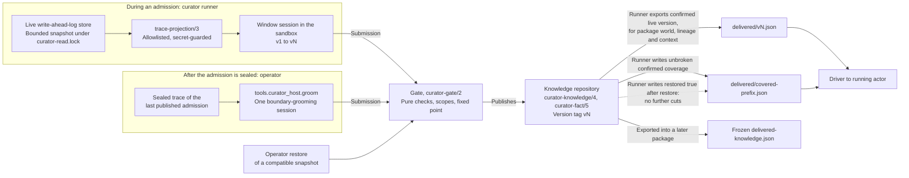

# Curator and trace workbench

The curator reads projected traces and holds no custody or direct player access.
The player and computer do not import curator code. The runner supports windowed
sessions beside an admission. Live evidence covers full single-actor multi-window
publication, `curator-fact/5` scoped claims and articles, within-admission delivery and
post-admission boundary grooming ([live validation run #889](../acceptance/2026-11-22-live-validation-run-889.md),
following [first paid live run #859](../acceptance/2026-11-21-live-curator-run-859.md));
real-play actor handoff briefing adoption remains unverified beyond offline tests and the
[stand-in run](../acceptance/2026-11-20-live-curator-stand-in-run-851.md).
The run package can enable [delivery to a running actor](#delivery-to-a-running-actor)
with `live_knowledge_updates`. Otherwise the actor uses its frozen knowledge export.

## From live trace to delivered knowledge

This diagram answers “How does what happened in play become knowledge an actor can
read?” Boxes are data or the step that writes it, the two frames separate work beside
play from work after it, and arrows give the direction of data. The dashed arrow is the
invalidation the runner writes after a restore. After `repo.ensure()` initializes `v0`,
the gate is the only writer of subsequent repository versions and operator restores, and
nothing here holds custody. The sections below own each step.
The [host contract](../contracts/player-host.md#coverage-gated-context-cut) owns how the
actor uses the covered prefix.

## Internal responsibilities

| Part | Owned data and consequence |
| --- | --- |
| [Trace projection](../../harness/trace/projection.py) | `trace-projection/3`: an allowlisted, secret-guarded copy of sealed sessions (frames, steps, received text, handoffs) for a curator workspace. [Projection and evidence readers](#projection-and-evidence-readers) |
| [Sealed readers](../../harness/trace/stores.py), [memory reader](../../harness/trace/memory_reader.py) | Immutable SQLite opens that refuse a non-empty write-ahead log; a read-only current journal reader and explicit data-only historical readers |
| [Workbench](../../harness/trace/workbench.py), [images](../../harness/trace/images.py) | Read-only JSON lines from the [workbench commands](#workbench-and-sidecars) |
| [Sidecars](../../harness/trace/sidecar.py) | `container-manifest/1` and `container-index/1` beside sealed evidence (`data/containers/`), which is never rewritten |
| [Sandbox](../../harness/curator/sandbox.py) | Default-deny Seatbelt profile and polling supervisor: writes only in the workspace's writable directories, one loopback port, and bounded memory, processes, time and size of the session's own files. It does not watch or protect the rest of the disk ([what is bounded](../operations/curator-hosts.md#what-the-sandbox-bounds)). [Research and residual risks](../research-curator-sandbox.md) |
| [Model proxy](../../harness/curator/proxy.py) | Holds the provider key and allowlists requests through a provider-neutral `Provider` value. Reserves the worst case, settles at reported usage, and revokes on any surprise |
| [Providers](../../tools/curator_host/providers.py) (an adapter) | Model service adapters define routes, key and forwarding headers, request validation and conversion of reported usage to dollars. Provider and model identities stay in the curator host's adapters; the proxy receives them from its caller. |
| [Knowledge repository](../../harness/curator/knowledge.py), [gate](../../harness/curator/gate.py), [check](../../harness/curator/check.py) | One Git repository per game. Pure checks validate submissions before and at the gate ([checks](../contracts/curator.md#gate-and-pre-validation)), and the gate handles [operator restore](../contracts/curator.md#operator-restore). |
| [Windows](../../harness/curator/window.py) | A range of one actor's steps as the whole of a session's trace, and the coverage stamp the gate publishes with each version. Windowed admission and grooming projections remove the journal JSON. Only retained tool calls can carry hints. [Window rules](../contracts/curator.md#windows-of-decisions) and [coverage stamp](../contracts/curator.md#coverage-stamp-curator-coverage2) |
| [Drafts](../../harness/curator/containers.py), [sessions](../../harness/curator/session.py) | Draft lifecycle (open, stale, abandoned, promoted) and ephemeral sandboxed sessions whose close-out never follows a link. [Drafts](../contracts/curator.md#drafts) and [close-out](../contracts/curator.md#session-close-out) |
| [Curator host](../../tools/curator_host) (an adapter) | Workspace-only tools (`validate_submission`, atomic writes), budget phases and a frozen prompt with no game knowledge. [Operations](../operations/curator-hosts.md) |
| [Shadow runner](../../tools/curator_host/shadow.py) | Replays the seven-day development lineage (#397) and the development-loop sample (#372) under a dollar cap. The runner refuses the held-out lineages (#382, #522) by name. The lead knows #382's from operating them and reviewing admission summaries. The [curator memory study](../design/curator-memory-study-protocol-revised.md#limitations) records that exposure. |
| [Curator runner](../../harness/curator/runner.py) | Window triggers, the durable record of examined ranges, publication watching, covered prefix and lag, stops, and status. [Runner windows](#runner-windows) |
| [Runner process](../../tools/curator_host/live_runner.py) (an adapter) | The process the guardian starts with `--curator-runner`: its `curator-runner-config/1` file, sessions through the shadow runner's proxy under the runner's cap, its own knowledge repository, signal handling and [delivery to a running actor](#delivery-to-a-running-actor) |
| [Boundary grooming](../../tools/curator_host/groom.py) (an adapter) | Runs one grooming session against an existing live runner repository and the sealed trace of its last published admission. Writes a [`curator-boundary-grooming/2` summary](../contracts/curator.md#boundary-grooming-summary-curator-boundary-grooming2). |

## Projection and evidence readers

The workbench and the curator window require the same [projection format](../contracts/measurement-tools.md#trace-projection).
A sealed session and a closed staged snapshot use the same immutable reader.
The projection keeps evidence the actor could see or produce, with the public
identifiers needed to cite it. Raw custody, route, configuration and process files,
custodian and viewer records, receipts, raw host logs, run manifests and the raw
session database stay outside the projection.

The projector checks frame identifiers against the session and verifies PNG bytes
against sealed SHA-256 metadata before copying. It omits an unavailable, linked or
unindexed frame from its step. A digest mismatch, foreign frame identifier, unreadable
store or malformed host event fails projection. It skips linked actor directories
and requires a frozen manifest in each included actor directory. Optional label
evidence has its own [diagnostics](../contracts/measurement-tools.md#trace-projection).

Reports, handoffs, records and error reasons can contain free text. The projector
builds a sibling directory and scans its files for known custody and route values
from readable actor configuration and process files, and for key-like patterns.
Public session and actor IDs remain available for citations. Only a completed
projection that passes the scan is renamed into place. The [design rationale](../design/trace-workbench.md)
explains the choice of projection and read-only tools.

The [historical memory reader](../../harness/trace/memory_reader.py) reads sealed
`player-memory/2` records with supports and sources, programs and source metadata.
The projection can instead include the current public journal without image bytes.
The [sealed reader](../../harness/trace/stores.py) refuses a nonempty write-ahead log
because immutable mode would ignore it. [Reader evidence](../acceptance/2026-11-09-moved-results.md#trace-workbench-evidence-reader)

## Workbench and sidecars

The workbench emits JSON lines. `steps` filters by actor, sequence range and kind,
`frames` gives source IDs and paths for a range, and `tools` lists calls, optionally
by tool. `diff` measures per-cell change on a grid. `similar` ranks other frames by
64-bit difference-hash distance. A threshold for screen equivalence needs calibration
on labelled pairs. [Hash and secret-scan measurements](../acceptance/2026-11-08-moved-measurements.md#trace-workbench-secret-scan-and-perceptual-hashes)

The sidecar manifest describes actor sessions, curator sessions, submissions and drafts
by identity, kind, owner role, inputs, pinned versions, budgets, lifecycle, provenance
and retention. The actor-session index records frozen prompt and context digests
beside the sealed evidence and excludes custody and route files from those input
digests. [Tracked sidecar example](../../data/containers/397-seven-day.json)

## Runner windows

The guardian starts the runner alongside the custodian. Its exit leaves play running.
The [launch](../operations/campaign-supervision.md#freeze-launch-and-inspect) and [cleanup](../operations/campaign-supervision.md#failure-and-owned-cleanup) procedure
owns process setup and termination. The runner handles cancellation by interrupting
the session and closing the proxy and any active read. Input revocation proceeds independently.

The runner stages at most one snapshot per poll. In admission order, it selects the
oldest contiguous finished operations beyond one actor's examined cursor. Defaults
are a 15-second poll, a 20-step trigger and a 40-step ceiling. The ceiling also applies
at handoff. An ended actor's verified nonempty tail can run below the trigger before
the successor's range. A repository lock admits one session at a time. After a lock
refusal the next poll selects again. Backlog never blocks player input.

A sealed session advances the cursor on acceptance, no submission, rejection or an
unknown verdict. Rejection and an unknown verdict count as failures. An aborted or
interrupted session leaves the cursor in place. The [examined and publication records](../contracts/measurement-tools.md#runner-records-and-schedule-replay)
keep examination separate from confirmed coverage.

### Staging a growing trace

The [snapshot reader](../../harness/trace/snapshot.py) takes a shared read lock,
checks the closing marker and collects rows from the live write-ahead-log store in
one bounded read transaction. It closes the cursors and connection before releasing
the lock. After revoking input the custodian marks the store as closing and waits
up to the read bound for an admitted reader. Reads add disk work and can delay
checkpointing. An overrun can leave a log the sealed reader refuses.

The staged directory keeps the session name. Each included actor contributes its
longest finished prefix in creation-time and operation-ID order. Each operation needs
a terminal row. Until the actor ends it also needs a matching host result by operation
ID and settled native receipts or collections. Staging keeps frozen actor inputs,
whole host-log lines, verified frames, metadata for the secret scan and the package
and supervisor launch records when present. The window excludes the journal.
Clock reversals, wall-time ties and late frame associations can affect comparisons
with later snapshots. Failed snapshots are discarded, and a poll releases its staged copy.

### Publication and coverage

The runner watches version tags before, during and after a session. Tags present
on its first successful look form the baseline. For a newly seen tag, publication
falls between the start of the last look without it and the end of the first look
with it. Confirmation requires a seen tag, a recorded publication verdict and a
stamp matching the session's window. A session can publish and subsequently fail.
Its confirmed publications still count, and unresolved publications are recorded for
reconciliation. A stamp describes one window. The covered prefix joins contiguous
confirmed ranges from the first step and crosses actors only when the ended actor's
final step is covered.

Lag counts finished operations after that prefix. The runner locates its endpoint
by operation ID in the latest successful snapshot, across actors. An unplaceable
endpoint leaves lag unknown. At the first restore, the runner counts versions only through the restore target (through
the version preceding the restore if the target is unknown). Coverage beyond that
point and lag are unknown. The [spectator status contract](../contracts/spectator-view.md#curator-runner-status)
gives the read position, backlog, unexamined ranges and status fields. Later steps
must be counted from the sealed trace. The [schedule replay](../contracts/measurement-tools.md#runner-records-and-schedule-replay)
maps this prefix to player requests for the [context cut](../contracts/player-host.md#coverage-gated-context-cut).

The live runner runs admission sessions against its configured knowledge repository.
After the admission's trace is sealed, the operator can start
[boundary grooming](../operations/curator-hosts.md#post-admission-boundary-grooming)
on that repository using the trace of its last published admission. A repository
with no published admission yields a skipped summary. Grooming uses the
[last admission's citations and actor boundary observations](../contracts/curator.md#admission-and-grooming).
The citations accumulate across published windows of that admission.
The [first-run rationale](../design/live-curator-integration.md#what-a-first-live-run-measures)
explains which lag, cost, staging and player-pace questions require real play.

### Delivery to a running actor

When the package sets [`live_knowledge_updates`](../operations/campaign-run.md#live-knowledge-updates),
the [runner process](../../tools/curator_host/live_runner.py) looks once after each
poll that returned for a newly confirmed version. It exports the highest confirmed
publication that is not a restore and is above the last version it exported, restarts
included, as `delivered-knowledge/3` for the package's world, lineage and context. It writes the file whole
to `curator-runner/delivered/vN.json` (temporary name, sync, rename), so the driver
never sees a partial file. A failed export is reported on stderr once per version and
error and tried again at the next poll. The runner reads `live_knowledge_updates`
and the world only from a manifest whose bytes have the SHA-256 that the supervisor's
`campaign-watch-start/4` launch record names for the same session, the checks the
[trace projection](../../harness/trace/projection.py) makes before it reads labels.
After the corresponding `vN.json` is on disk, the runner atomically publishes
`curator-runner/delivered/covered-prefix.json` (`curator-covered-prefix/1`). It
names the session, actor directory and ID, final operation ID and version of the
[unbroken covered prefix](#publication-and-coverage). A gap holds the prefix in
place while later versions can still reach the actor. A restore publishes
`restored: true` with null actor, operation and version fields, invalidating the
prefix for the admission. Curation proceeds even when the runner cannot verify the
manifest or write the delivery files. The
[host contract](../contracts/player-host.md#a-newer-version-during-play) owns
adoption by the driver and the host.

## Failure, bounds and ownership

- **Close-out and the gate.** Execution failure, unknown cleanup or surviving processes
  prevents gating. Handled failures record an abort where writable; a later close-out error
  cannot undo an earlier atomic publication. Each gate publishes atomically or not at all.
- **Runner failure.** Two consecutive failed sessions (including two consecutive `provider-error` sessions) or three consecutive failed or over-bound snapshots stop the runner. A single `provider-error` session that published nothing retries the same window once without halving; one that published a validated prefix advances the cursor. A missing store retries, a closing store ends the runner, and other read refusals stop it. A refused reservation leaves any published work in place. If the window did not publish, the runner retries the same starting step over half as many steps. A refusal at one step stops it as `spend-reservation-refused`. A fully spent cap stops it as `spend-cap-exhausted`. Proxy revocation, unsettled accounting and unconfirmed host cleanup also stop it. [Runner process](../../tools/curator_host/live_runner.py) and [guardian cleanup](../operations/campaign-supervision.md#failure-and-owned-cleanup)
- **The proxy.** It reserves the worst charge for the bounded prompt and full output
  limit across the reachable frozen price tiers. Missing usage keeps the reservation
  except on a fully read HTTP refusal with no usage. An over-reservation charge
  revokes the session. The runner stops on unsettled exposure and holds the session
  cap across restart if the proxy left no closure receipt.
  [Accounting and shutdown](../operations/curator-hosts.md#pi-curator-host-the-shadow-session-host)
- **Knowledge and records.** Close-out retains session records and removes workspaces.
- **Ownership.** The lead owns this code.

## Assurance and evidence

- **Tests:** The sandbox escape suite checks the real listeners on macOS. The
  [documentation map](../documentation.md#from-code-to-its-documents) lists the suites.
- **Records:** the [probe baseline](../acceptance/2026-11-08-probe-baseline-449.md),
  the [shadow sessions](../acceptance/2026-11-08-curator-shadow-454.md), the
  [baseline and workbench outcome](../acceptance/2026-11-08-adr009-p0.md), the
  [prompt-cache stability record (#489)](../acceptance/2026-11-08-context-stability-489.md#follow-up-the-cause-found)
  and the curator memory study's
  [completion and registered no-go](../acceptance/2026-11-12-p1-descriptive-completion-178.md).
- **Standing:** The [first paid live run approval](../decisions/owner-decisions-archive.md#one-paid-live-curator-run)
  is used ([run record](../acceptance/2026-11-21-live-curator-run-859.md)); any further
  paid live play with the runner requires a new owner approval.
  Curator ownership of the store follows the
  [“Let's keep the dedicated curator” decision](../decisions/owner-decisions.md#curator-keeps-writing-memory).
  Any claim of benefit needs a fresh prospective protocol and owner decision and
  rests on campaign outcomes under the
  [“Live run, then campaigns” decision](../decisions/owner-decisions.md#memory-benefit-measured-in-campaigns).
- **CI coverage:** Linux CI runs the portable tests. The Seatbelt-lane tests, sandbox
  and real-host sessions, run only on macOS.

## Facts, articles and grooming

The curator records durable claims as facts that cite frames, and groups them into
articles an actor can read (including world-bound articles). A grooming session
merges, narrows, retags, retires and refiles them between admissions. The
[curator contract](../contracts/curator.md) owns the record and submission shapes,
validation, the gate, sessions, drafts and restore; the
[frozen instructions](../../tools/curator_host/prompt.md#submission-contract) restate the
submission shapes to the curator. [Host operations](../operations/curator-hosts.md) owns
adapter configuration and the zero-spend stand-in lane.

A curator variant is scored on sealed development admissions by comparing its published
facts with later visible actions and re-observations
([method and limits](../acceptance/2026-11-13-curator-scoring.md#method)). Publishing
only after checks on later evidence is an unbuilt
[proposal](../design/prospective-curator-gate.md).
