# Evidence, memory and learning

Parent: [system architecture](../architecture.md). This view answers: “What can
the player remember and learn, and who decides whether it is useful?” Evidence
records observations; memory makes fallible source-linked assertions and reusable
procedures; background reflection proposes interpretations. None grants input
authority. Functional memory use is distinct from measured learning benefit.

This current responsibility view answers “How does reflection help without owning
input?” Solid arrows carry ordinary play/memory updates; dotted arrows carry
bounded advisory data. Boxes are logical roles, not necessarily separate processes.
The flow below is its text equivalent. [Editable source](../diagrams/asynchronous-reflection.mmd).

The live reader accepts only immutable `advisory-export/1` artifacts. Engineering
exports sealed current missions before admission; an explicit offline migration
can preserve the selected native6/store5 baseline without rewriting its original
bytes. The importer independently binds captured data to those originals and
checks terminal closure, source and ancestry, preserving authenticated current
unknown publications without inventing an effect. Historical procedures use a
distinct advisory node and images use `advisory-source/1`; neither is a current observation
or executable routine. New missions use native7/store6 evidence and ledger13.
The [protocol](../contracts/gameplay-evidence.md#passive-gameplay-records-and-evidence) owns migration
and historical-source limits.

The current library permits eight explicit donor pins to cover the observed
four-ancestor plus fifth-donor continuation. Full donor closure and exact archive
pins remain mandatory, including for a self-contained procedure in that donor.
The existing aggregate 256-record and context/handoff/image bounds still apply;
there is no recursive fetch, pruning or compatibility reader. This bounded
headroom is not a long-campaign scalability claim. Revisit the representation
when measured closure, payload or setup cost approaches those limits under
[#177](https://github.com/CVX-Hull/enactive/issues/177).

## Internal responsibilities

| Block | State and responsibility | Implementation |
| --- | --- | --- |
| EvidenceStore | Immutable selected observations/frames, integrity, source disposition and finite retention reservations; exact metadata length cache avoids repeated serialization | [evidence.py](../../harness/gameplay/evidence.py) |
| MissionLedger | SQLite canonical requests, primitives, effects, memory/procedure/reflection records and costs | [mission_ledger.py](../../harness/gameplay/mission_ledger.py) |
| CampaignMemory | Derived claims/Work/context, conflicts, applicability, procedure ancestry and selected packets | [campaign_memory.py](../../harness/gameplay/campaign_memory.py) |
| Passive memory ports | Memory data, repository/source interfaces and source failure types; no mission executor or CDDA visible-schema assumption | [contracts](../../harness/gameplay/memory_contracts.py), [ports](../../harness/gameplay/memory_ports.py), [sources](../../harness/gameplay/source_contracts.py) |
| Mission/CDDA adapters | Exact admitted mutation payloads; visible world/character identity, literal scene facts and turn/continuity interpretation | [mission memory](../../harness/gameplay/mission_memory.py), [identity](../../harness/gameplay/cdda_identity.py), [scene](../../harness/gameplay/cdda_memory.py), [time](../../harness/gameplay/cdda_timeline.py) |
| Offline export and historical library | Validate sealed current donors, publish immutable exports, independently check original-byte bindings and qualified dependencies; no old actor or current world facts | [export](../../harness/gameplay/advisory_export.py), [library](../../harness/gameplay/procedure_library.py) |
| Reflective exchange | Bounded passive work claim/results and candidate proposals | [reflection.py](../../harness/gameplay/reflection.py), [mission_reflection.py](../../harness/mission_reflection.py) |
| Program evaluator | Execute selected procedure data over current supplied observations, yielding ordinary proposals | [policy_program.py](../../harness/gameplay/policy_program.py), [program_input.py](../../harness/gameplay/program_input.py) |

This current logical view answers “Which observation and clock assumptions belong
to CDDA?” Arrows carry validated data/provenance, never input permission. The table
and flow below are its text equivalent; boxes do not imply separate processes.
[Editable source](../diagrams/binding-projections.mmd).

The shared reducer receives passive data ports, with no controller/process
reference. `MissionMemory` validates the complete mutation and equality with its
durable admitted payload; an abstract append method does not bypass admission.
The retained `revision`/`turn` fields are optional partial-order counters, never
elapsed seconds in shared memory. CDDA scene interpretation is outside the reducer.
Import Linter prevents direct or indirect reintroduction of mission/CDDA/storage
implementation dependencies into these shared modules. Independent data fixtures
exercise [memory ports](../../tests/test_memory_ports.py) and [projected time](../../tests/test_observed_time.py);
they do not qualify another game or establish useful memory application.

SQLite and ordinary OS/library contracts supply their configured persistence and
file/process behavior. Project code owns domain provenance, finite capacity and
uncertain delivery, rather than another transaction/history/recovery system.
Context views and cached spectator packets are projections, not new authorities.

Context retrieval collects qualified procedure dependencies before reading support
images. One operation-scoped cache shares checks across claims, Work and procedures;
the source-work limit includes checked candidates later omitted for packet size.
Oversized closures are omitted before image I/O. Complete handoff fails rather than
truncating required support, and actual procedure selection still verifies it.

## Current flow and feedback

The writer retains intent/dispatch/result sources and charges automatically.
The player authors claims, unfinished Work and procedures from selected support,
reads current context, selects applicable routines and revises them against actual
outcomes. Revision retains support/counterexamples and ancestry. Historical
procedures are fallible candidates; game/configuration applicability and current
visible evidence govern use. Old world facts do not become current possession.
The player's bounded descriptive parent cache retains canonical completed accepted
Procedure write results as well as records explicitly returned by context. Explicit
original-result collection can reveal the same stored record after delay or
restart; no write is replayed. An explicitly retrieved HistoricalProcedure may be
the exact parent of a new current Procedure in the same family. Its old code is refused before input; the
player must author a current revision against current evidence. The player chooses
the qualified parent, and the writer retains its current-head, branch, source and environment checks. Cache
presence establishes neither applicability nor successful learning/application.

The existing advisory mailbox accepts passive work while a skill runs. Writer
boundaries/idle ticks commit records; the runtime performs no model/network wait
for advice. One admitted adviser claims bounded work, reads allowed evidence and
submits candidate data. The learner authors semantic candidates/code; software supplies canonical metadata
from original admission/job context. The player reads compact snapshot-indexed
advice and can explicitly select a candidate without copying its record. Direct
authorship and raw input remain available. The writer checks the same source,
lineage and environment contracts. The player owns adoption. Automatic selection/action/result
joins reduce narration; exposure, explicit selection, delivery, interpreted success
and causal benefit remain distinct. Queued or finished advice proves no usefulness.
Advisory budgets do not become gameplay approvals or a required lead slow path.
Deterministic original-horizon credits, routine count/age and exception priority
spread bounded work; unreviewed and omitted rows remain distinct. An optional
frozen adviser profile waits through empty polls in software within the original
deadline. No maintained subgoal tree or additional permanent model tier is assumed.

## Failure, bounds and ownership

Unknown delivery and disputed/lost sources remain explicit. A sealed current donor
can retain a fully authenticated unknown publication as advisory data while its
ACK/effect remain unknown; the [import contract](../contracts/historical-import.md)
keeps that eligibility separate from current input and the legacy baseline.
Unresolved requests cannot qualify procedure support/counterexample episodes;
unrelated validated history remains available. Corrections preserve history and
conflicting premises. A complete handoff Work packet must fit its
declared bounds before relinquishing the player lease. Reopen can validate history
but cannot restore private phases, consent or a fresh observation.

Current whole-donor dependency validation can saturate the finite donor-pin bound
even when one selected procedure appears self-contained. Retrieval/performance
improvements and bounded cache changes do not solve that dependency closure.
[Procedure learning #177](https://github.com/CVX-Hull/enactive/issues/177) owns the
remaining design; [reflection #178](https://github.com/CVX-Hull/enactive/issues/178)
owns useful work allocation and candidate authoring. No silent cap expansion,
lineage pruning or second store is implied.

## Drill down and verification

The [execution-first learning proposal](../design/asynchronous-reflection.md#execution-first-learning)
separates decision horizons within the existing player/learner/writer split. It
motivated the [implemented source boundary](../changes/064-execution-first-learning.md):
shared authoring, explicit candidate selection and horizon-aware allocation.
It retains broader questions about relevance, strategic questions and learning
benefit; these are not established by source checks or offline timing.

[Ordinary/procedure contracts](../contracts/procedure-programs.md#ordinary-discovery-and-procedure-data),
[handoff](../contracts/handoff-issuance.md#quiescent-player-replacement) and
[passive memory](../contracts/injected-planner.md#passive-task-memory) own exact rules. The older
passive TaskMemory/planner/supervisor libraries are offline study components,
not the current deciding player or live mission API.

Review data ownership/lineage first, then derivation/retention and producer/consumer
bounds, then code/tests.

## Assurance and evidence

These representative risks connect source-linked learning to existing
[C-RUNTIME](../controls.md#c-runtime--live-authority-and-input-guards-runtime)
guards. [C-PORTABLE](../controls.md#c-portable--portable-regression-lane-automatic)
executes the fixture cases; neither the markers nor a passing case measure learning
benefit or complete memory coverage.

| User consequence | Invariant and contract | Mechanism, representative assertion and limit |
| --- | --- | --- |
| Lost evidence revives an old possession claim, or invalid support becomes trusted | Preserve unknown frontiers and reject forward/cyclic support. [Evidence](../contracts/gameplay-evidence.md#passive-gameplay-records-and-evidence) and [procedure/memory contract](../contracts/procedure-programs.md#procedure-roots-learning-and-memory-validation). | CampaignMemory validation: [memory tests](../../tests/test_campaign_memory.py), selected by `assurance_memory`, assert unknown newest stock after SQLite reopen and rejection of durable cyclic support. Real retained files/SQLite with synthetic observations do not prove current game possession. |
| A generated routine renews its budget or blocks ordinary fallback | Programs propose within one original request; faults yield no input and healthy ordinary fallback remains available. [Program contract](../contracts/procedure-programs.md#ordinary-discovery-and-procedure-data). | Evaluator plus the [mission writer](mission-execution.md): [program execution](../../tests/test_program_execution.py) `test_original_input_limit_stops_without_new_request_or_allowance` asserts two deliveries under one request; `test_program_fault_is_zero_input_and_preserves_ordinary_fallback` asserts zero program deliveries and a later ordinary input. `assurance_program` uses real JavaScript execution with synthetic transport, not game efficacy. |
| Conflicting advice silently becomes an adopted procedure | Advisory proposals remain candidate data; source/cutoff checks precede player adoption. [Procedure/advice contract](../contracts/advisory-reflection.md). | ReflectionLedger validation: [reflection tests](../../tests/test_reflection_ledger.py) `test_conflicting_command_and_proposal_cutoff_refuse_without_adoption` asserts refusals and empty proposal/procedure records. This `assurance_advice` case proves refusal bookkeeping, not useful advice or model judgment. |
| A failed or stopped donor either loses useful procedures or restores authority | Historical archives preserve validated data and pins without current permission. [Procedure/library contract](../contracts/historical-import.md). | Offline sealed validation: [archive tests](../../tests/test_procedure_library.py) `test_closed_campaign_outcomes_preserve_procedure_data_without_authority` (`assurance_advice`) asserts preserved records/bytes/pins and no authority across closed outcomes. [Current export tests](../../tests/test_advisory_export.py) separately exercise immutable artifacts, dependency closure and refusal after recomputed pins. Synthetic archives do not prove fresh-successor application in play. |

Actual fresh-successor application and useful advisory overlap have bounded
[useful-play evidence](../acceptance/2026-10-25-useful-play-readiness.md): short
shelter travel and advice-informed revision, with failed normal ending and rejected
whole-player readiness. Held-out causal efficacy remains unmeasured; that report
does not close #177/#178 or [cadence #164](https://github.com/CVX-Hull/enactive/issues/164).
Independent campaign completion remains with
[#136](https://github.com/CVX-Hull/enactive/issues/136) and
[#145](https://github.com/CVX-Hull/enactive/issues/145). Prior [memory research](../research-memory-architecture.md)
and [executable-policy research](../research-executable-policies.md) are evidence
and transfer judgments, not current contracts or proof that learning improved play.
