# Evidence, memory and learning

Parent: [system architecture](../architecture.md). This view answers: “What can
the player remember and learn, and who decides whether it is useful?” Evidence
records observations; memory makes fallible source-linked assertions and reusable
procedures; background reflection proposes interpretations. None grants input
authority. Functional memory use is distinct from measured learning benefit.

This current responsibility view answers “How does reflection help without owning
input?” Solid arrows carry ordinary play/memory updates; dotted arrows carry
bounded advisory data. Boxes are logical roles, not necessarily separate processes.
The flow below is its text equivalent. [Editable source](../diagrams/asynchronous-reflection.mmd).

The current library permits eight explicit donor pins to cover the observed
four-ancestor plus fifth-donor continuation. Full donor closure and exact archive
pins remain mandatory, including for a self-contained procedure in that donor.
The existing aggregate 256-record and context/handoff/image bounds still apply;
there is no recursive fetch, pruning or compatibility reader. This bounded
headroom is not a long-campaign scalability claim. Revisit the representation
when measured closure, payload or setup cost approaches those limits under
[#177](https://github.com/CVX-Hull/enactive/issues/177).

## Internal responsibilities

| Block | State and responsibility | Implementation |
| --- | --- | --- |
| EvidenceStore | Immutable selected observations/frames, integrity, source disposition and finite retention reservations; exact metadata length cache avoids repeated serialization | [evidence.py](../../harness/gameplay/evidence.py) |
| MissionLedger | SQLite canonical requests, primitives, effects, memory/procedure/reflection records and costs | [mission_ledger.py](../../harness/gameplay/mission_ledger.py) |
| CampaignMemory | Derived claims/Work/context, conflicts, applicability, procedure ancestry and selected packets | [campaign_memory.py](../../harness/gameplay/campaign_memory.py) |
| Historical library | Pinned closed donor evidence and procedure dependencies; no live phase or current world facts | [procedure_library.py](../../harness/gameplay/procedure_library.py) |
| Reflective exchange | Bounded passive work claim/results and candidate proposals | [reflection.py](../../harness/gameplay/reflection.py), [mission_reflection.py](../../harness/mission_reflection.py) |
| Program evaluator | Execute selected procedure data over current supplied observations, yielding ordinary proposals | [policy_program.py](../../harness/gameplay/policy_program.py), [program_input.py](../../harness/gameplay/program_input.py) |

SQLite and ordinary OS/library contracts supply their configured persistence and
file/process behavior. Project code owns domain provenance, finite capacity and
uncertain delivery, rather than another transaction/history/recovery system.
Context views and cached spectator packets are projections, not new authorities.

Context retrieval collects qualified procedure dependencies before reading support
images. One operation-scoped cache shares checks across claims, Work and procedures;
the source-work limit includes checked candidates later omitted for packet size.
Oversized closures are omitted before image I/O. Complete handoff fails rather than
truncating required support, and actual procedure selection still verifies it.

## Current flow and feedback

The writer retains intent/dispatch/result sources and charges automatically.
The player authors claims, unfinished Work and procedures from selected support,
reads current context, selects applicable routines and revises them against actual
outcomes. Revision retains support/counterexamples and ancestry. Historical
procedures are fallible candidates; game/configuration applicability and current
visible evidence govern use. Old world facts do not become current possession.

The existing advisory mailbox accepts passive work while a skill runs. Writer
boundaries/idle ticks commit records; the runtime performs no model/network wait
for advice. One admitted adviser claims bounded work, reads allowed evidence and
submits candidate data. The learner authors semantic candidates/code; software supplies canonical metadata
from original admission/job context. The player reads compact snapshot-indexed
advice and can explicitly select a candidate without copying its record. Direct
authorship and raw input remain available. The writer checks the same source,
lineage and environment contracts. The player owns adoption. Automatic selection/action/result
joins reduce narration; exposure, explicit selection, delivery, interpreted success
and causal benefit remain distinct. Queued or finished advice proves no usefulness.
Advisory budgets do not become gameplay approvals or a required lead slow path.
Deterministic original-horizon credits, routine count/age and exception priority
spread bounded work; unreviewed and omitted rows remain distinct. An optional
frozen adviser profile waits through empty polls in software within the original
deadline. No maintained subgoal tree or additional permanent model tier is assumed.

## Failure, bounds and ownership

Unknown delivery and disputed/lost sources remain explicit. Corrections preserve
history and conflicting premises. A complete handoff Work packet must fit its
declared bounds before relinquishing the player lease. Reopen can validate history
but cannot restore private phases, consent or a fresh observation.

Current whole-donor dependency validation can saturate the finite donor-pin bound
even when one selected procedure appears self-contained. Retrieval/performance
improvements and bounded cache changes do not solve that dependency closure.
[Procedure learning #177](https://github.com/CVX-Hull/enactive/issues/177) owns the
remaining design; [reflection #178](https://github.com/CVX-Hull/enactive/issues/178)
owns useful work allocation and candidate authoring. No silent cap expansion,
lineage pruning or second store is implied.

## Drill down and verification

The [execution-first learning proposal](../design/asynchronous-reflection.md#execution-first-learning)
separates decision horizons within the existing player/learner/writer split. It
motivated the [implemented source boundary](../changes/064-execution-first-learning.md):
shared authoring, explicit candidate selection and horizon-aware allocation.
It retains broader questions about relevance, strategic questions and learning
benefit; these are not established by source checks or offline timing.

[Ordinary/procedure contracts](../protocol.md#ordinary-discovery-and-procedure-data),
[handoff](../protocol.md#quiescent-player-replacement) and
[passive memory](../protocol.md#passive-task-memory) own exact rules. The older
passive TaskMemory/planner/supervisor libraries are offline study components,
not the current deciding player or live mission API.

Review data ownership/lineage first, then derivation/retention and producer/consumer
bounds, then code/tests. Use existing memory, ledger, library, reflection, program
and handoff regressions. Actual fresh-successor application, useful advisory overlap
and cadence require retained run evidence; held-out causal efficacy requires a
separate evaluation. Prior [memory research](../research-memory-architecture.md)
and [executable-policy research](../research-executable-policies.md) are evidence
and transfer judgments, not current contracts or proof that learning improved play.
