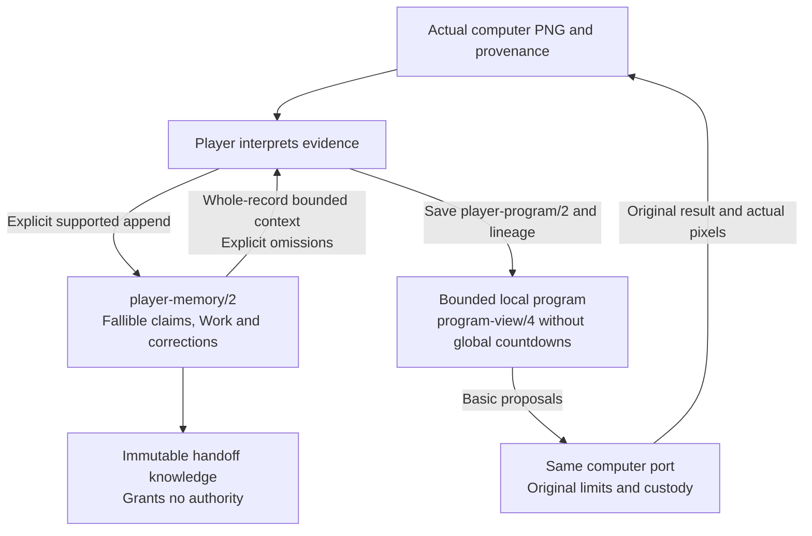

# Evidence, memory and learning

The [pure player package](../../harness/player/) owns optional fallible knowledge,
image views, local programs and context. It imports no process/provider/server
runtime. [Computer control](../contracts/computer-control.md#player-knowledge-and-executable-proposals)
owns exact formats; [architecture](../architecture.md) explains authority separation.

## Internal responsibilities

| Part | Owned data and consequence |
| --- | --- |
| [Memory](../../harness/player/memory.py) | Explicit `player-memory/2` SQLite store: typed claims/Work/decisions/procedures/corrections/advice, source bytes and support/supersession links. |
| [Contracts](../../harness/player/contracts.py) | Closed `player-record/1` / `player-program/2`, bounded fields and fallible applicability. |
| [Images](../../harness/player/images.py) | Pillow decoding of exact PNG to player-selected crop/nearest RGB view, disclosed geometry/sampling/omissions. |
| [Programs](../../harness/player/programs.py) | Immutable program IDs/digests/one-parent lineage; bounded JavaScript evaluation and coordinator proposals. |
| [Context](../../harness/player/context.py) | Whole-record bounded support/correction/program ancestry with explicit omissions. |
| [Composition](../../harness/application.py) | Lazily remembers explicitly referenced current images and preserves service/child operation IDs. |

## Current flow and feedback

The player observes pixels, makes an interpretation and may append a supported
record. Quantities, Work and completion remain player claims. Corrections identify
a superseded record while preserving parents, contradictions and history. Default
queries hide superseded records, not delete them. Candidate advice never auto-adopts.

Memory append/program save explicitly register selected source PNGs before the
transaction; ordinary Observe does not copy every image into long-term memory.
The bounded 256MiB BLOB store preserves digest-verified original pixels across
fresh native-child sessions. A retained reference proves availability, not reading.
Current stores are `player-memory/2` with SQLite `user_version=2`; old
stores/libraries are refused without conversion or import.

Programs receive `program-view/4`: actual source metadata, player-selected crop
and nearest-neighbour RGB image ≤96×96 and optional player interpretation. The
global experiment-resource object is absent. Stored `player-program/2` requires
`view_schema:"program-view/4"`. Full PNG is separately readable. No structured game
facts are supplied. `step(view,state)` returns act/yield/done and basic controls only;
evaluation has no direct effects or host I/O. The runner uses real captures and
same computer callbacks, up to 64 steps/20seconds under original limits.

Current. “How do optional knowledge and programs feed the player without gaining
authority?” Boxes are logical stores and ports; labelled arrows are explicit saves,
proposals and context reads. Exact formats are in the
[contract](../contracts/computer-control.md#player-knowledge-and-executable-proposals).
The player explicitly appends a supported claim or saves a program, which lazily
remembers the referenced images. Programs are saved in the same player-memory/2
store and act only through an explicit program run; context may return program
code. Programs only propose basic controls through the
same computer port under original limits. Bounded whole-record context, with
explicit omissions, returns to the player and becomes immutable handoff knowledge.

Context selects at most32 roots and returns whole records/code within64KiB.
Oversized/missing material is explicitly omitted with readable IDs, never truncated
into plausible executable content. Handoff persists this bounded snapshot plus
player summary; no snapshot grants authority.

## Failure, bounds and ownership

Cannot-remember/capacity/helper failure is reported without blocking basic input
when computer custody remains healthy. Digest mismatch refuses source consumption.
Unknown/partial physical delivery stops further input and is never replayed.
Service-result collection retains original authoring/program-run and child IDs.
Sibling program revisions coexist; software chooses no winner or applicability.
The store can span native sessions but cannot reconstitute a capability.

## Drill down and verification

Use the [tool schema](../../harness/player_tools.py) and [player guide](../player-guide.md)
for authoring/retrieval; exact constraints remain in the current contract/source.

## Assurance and evidence

[Memory](../../tests/test_player_memory.py), [program](../../tests/test_player_programs.py)
and [composition](../../tests/test_player_application.py) tests cover provenance,
bounds, context closure/omissions, actual image inputs, faults and original-child
collection. They do not establish learning efficacy. The [production report](../acceptance/2026-10-29-computer-control.md) records
actual conditional scouting, correction and fresh successor application, with
failed safety claims and no causal learning-benefit qualification.
No asynchronous learner service is part of the current route.
