# Native control and visible observation

The [computer package](../../harness/computer/) owns mechanical custody and basic
input. It has no game/player/tooling imports. [Exact contract](../contracts/computer-control.md)
and [architecture](../architecture.md) define the boundary; CDDA preparation stays
outside it. The current adapter targets macOS SDL; a second game is unqualified.

## Internal responsibilities

| Part | Owned state / failure responsibility |
| --- | --- |
| [Launch](../../harness/computer/launch.py) | Exact native process/group, exclusive one-shot marker, inherited shared-lock descriptor and socketpair; no PID adoption or global process scan. |
| [Native adapter](../../harness/computer/native/bridge.mm) | Actual default-renderer capture, basic SDL events, real-input precedence, mechanical geometry and nonblocking bounded packet work. |
| [Channel](../../harness/computer/channel.py) | Socket framing and bounded receipt/state slots; independent permanent stop path; no receive-thread file/DB writes. |
| [Runtime](../../harness/computer/runtime.py) | One serialized writer, actor capabilities, original IDs/deadlines/capacities, issued sources and exact result collection. |
| [Store](../../harness/computer/store.py) | Fresh `computer-session/1` SQLite operations/source provenance; cannot reconstruct runtime custody. |

The native adapter validates the exact inherited shared-lock descriptor/file
identity and retains its reference for the native lifetime. Descriptor closure,
not `LOCK_UN`, releases an owned reference. Native sets inherited descriptors
close-on-exec. The host/MCP receives no native descriptors; only the provider host receives its selected key, while MCP/native receive none.

Native callbacks perform bounded nonblocking socket work and never publish files
or SQLite. The custodian publishes image bytes/records outside the game thread.
One pending packet and a separate Pause receipt preserve original terminal results
under backpressure. This bounds bridge publication coupling; it does not cover
upstream save I/O, PNG CPU or arbitrary OS hangs.

## Pause, unknown effects and restart

Pause latches before executor/DB waits and sends through a separate bounded path;
if framing cannot complete, write-side shutdown signals EOF. Native neutralizes
only owned presses and retains the original receipt before the separate Pause
receipt. Report stop-requested separately from native-confirmed Pause.

Partial/unknown input permanently stops new input. Preserve original IDs and
collect late results; never replay/rearm. Capture equality/age and game phase do
not gate keys/text. Clicks require issued source geometry. Real native input
precedes synthetic events and fences automation without discarding human input.
Restart reads no old inbox and reconstructs no authority.

### Stop, collection and recovery views

These three diagrams are current. Boxes are logical states, not processes; labelled
arrows are the transitions or reads the
[contract](../contracts/computer-control.md#computer-operations-and-custody) allows.
The paragraph under each image is its text equivalent.

Current. “How is one submitted request collected, and when may the player submit a corrected replacement?”
Only a verified complete local refusal permits a new corrected choice; admitted or
uncertain work is collected under its original ID, and partial or unknown input
stops input permanently. A lost response is collected under the same ID. After
collection the player interprets the actual effect before its next choice, unless
input stopped. [Editable source](../diagrams/request-receipts.mmd).

Current. “What happens after Pause, takeover or uncertain input?” Automation stays
fenced, original receipts are collected without replay or renewed limits, and any
further play needs separate explicit admission of a fresh session. The operator may
instead recover through ordinary native controls; both paths end in exact owned
cleanup, with normal exit kept distinct from forced signals. [Editable source](../diagrams/recovery.mmd).

Current. “What may an operator do by hand after a permanent stop?” This expands the
operator branch of the recovery diagram above. Use the game's
ordinary controls; the harness supplies no recovery handler and certifies neither
the recovery nor a save. See [Pause procedure](../operations/pause-timeout.md#operator-recovery).
[Editable source](../diagrams/native-recovery.mmd).

## Portability and verification

Actual PNG and mechanical geometry are the whole observation port. Save/load,
identity, menus, activities and objective meaning belong to the player. The
[prepared application](../../harness/prepared_app.py) and
[preparation tool](../../tools/prepare_game.py) select ordinary CDDA options
before a run; the computer adapter does not override game settings.

## Assurance and evidence

[Protocol](../../tests/test_computer_protocol.py), [wire](../../tests/test_computer_wire.py),
[channel](../../tests/test_computer_channel.py) and [runtime](../../tests/test_computer_runtime.py)
assert ingress, original expiry/capacity, packet backpressure, stop and uncertainty.
[Compiled native](../../tests/computer_native_check.py) and
[inherited lock](../../tests/computer_lock_check.py) checks add actual SDL/descriptor
behavior. Portable doubles cannot replace these or actual CDDA qualification.

The [native procedure](../operations/native-acceptance.md) owns actual control,
useful play, save/new-child reload and normal exit evidence. The [production report](../acceptance/2026-10-29-computer-control.md)
retains scoped actual outcomes. Geometry/resize, Unicode/IME, actual-human takeover and
second-game qualification remain explicit limits.
