# Native control and visible observation

Parent: [system architecture](../architecture.md). This view answers: “What makes
an input eligible, and how can the user stop it?” The controller serializes
dispatch; the CDDA integration validates its receiver/custody at commit and the
engine decides outcomes. User Pause and native takeover remain independent of
the player's reasoning and the ordinary mission queue.

This logical view shows acquisition, dispatch and revocation within the host.
It is not a process-isolation diagram. [Editable source](../diagrams/run-ownership.mmd).

## Internal responsibilities

| Block | Owned state/interface | Implementation |
| --- | --- | --- |
| Controller | Exact process-local lease, serialized ordinary/control slots, pending delivery, Pause/takeover generations | [controller.py](../../harness/controller.py) |
| Owned process adapter | Fixed prepared wrapper and retained child custody; no arbitrary command/PID adoption interface | [native_process.py](../../harness/native_process.py), [prepared_app.py](../../harness/prepared_app.py) |
| Native CDDA bridge | File inbox/receipt boundary, current receiver/token validation, actual SDL frame and visible metadata | [cdda_harness.cpp](../../native/cdda_harness.cpp), [header](../../native/cdda_harness.h) |
| Recovery composition | Separate paused control requests and original uncertain-dispatch evidence | [mission_recovery.py](../../harness/mission_recovery.py); [detailed native recovery design](../design/native-control.md) |
| Shared movement policy | Pure conservative visible-cell rules used by controller walk and movement skill | [movement.py](../../harness/movement.py) |

Native metadata is restricted to player-visible information, excluding saves,
unseen maps and hidden threats. Physical ordinary input and semantic shortcuts
have different applicability checks; neither bypasses custody, receiver or original
deadlines. A capture's historical integrity and its suitability for a current
semantic action are distinct. [Protocol](../protocol.md#controller-run-ownership)
owns precise fences and [transport](../protocol.md#transport-and-state) its wire shape.

## Pause, unknown effects and restart

Pause revokes subsequent remote dispatch; it cannot undo input already committed
or guarantee interruption of an engine-owned activity. Native keys/buttons latch
takeover. Expected internal rotations cannot erase an intervening user Pause.
One controller process lock covers ordinary/control writers; native validates
again at commit. Status describes ownership but cannot serialize the object lease.

Unknown delivery retains its identity and charge. Collect/reconcile through
supported evidence instead of replaying. Recovery cannot bypass interruptibility,
own an unrelated question or Resume ordinary gameplay. Restart restores history
and uncertainty, never an execution lease/private phase. Process exit alone does
not prove a normal Save, identity or successful lifecycle.

## Portability and verification

The bridge, menu metadata, lifecycle proofs, timing/coordinate units and portions
of mission contracts are CDDA-specific. Shared player/memory/orchestration design
must not silently treat those as universal game concepts. See the parent
[portability boundary](../architecture.md#game-family-portability).

Review responsibility/custody and failure flows, then host/native producer-consumer
contracts and source. Import/protocol checks and focused controller/receiver tests
detect selected drift. A changed native boundary needs matching built source and
actual affected native qualification for a new support claim. Passing fixtures,
a native build, current source checks and actual gameplay are separate lanes.
The [runbook](../runbook.md) owns operating/recovery steps; [evaluation](../evaluation.md)
owns acceptance definitions. Wider mouse/geometry and generic recovery remain
limited to their demonstrated scope.
