# Player interface: judgment in, bounded evidence out

Parent: [system architecture](../architecture.md). This view answers: “What must
the player decide, and what should software handle?” One designated player plans,
interprets visible evidence, chooses intent/sources/limits and judges outcomes.
The lead owns engineering and verification; routine play and curation do not wait
for the lead. The adviser proposes data without input authority.
Gameplay model roles use the generic host, including a separately admitted
adviser/reflector. Engineering/review agents remain outside deciding gameplay.
The campaign driver manages original/successor activation; no extra advisory
role, orchestration or paid allowance is activated by this host requirement.

## Internal responsibilities

| Block | Responsibility and owned state | Implementation |
| --- | --- | --- |
| MCP adapter | Official SDK framing, tool exposure, JSON text and actual image parts; no game launch/executor | [player_mcp.py](../../harness/player_mcp.py) |
| Player tools | Current semantic schemas, bounded selected snapshot/source/procedure caches, mechanical request metadata | [player_tools.py](../../harness/player_tools.py) |
| Decision projection | Small current decision view; exact retained detail available on demand | [player_view.py](../../harness/player_view.py) |
| Imperative client | Immutable staged requests, HTTP ingress and original result collection | [mission_client.py](../../harness/mission_client.py) |
| Host driver | Mandatory generic-runner activation and at most the admitted fresh successor after real quiescent handoff | [campaign_player.py](../../tools/campaign_player.py) |
| Generic gameplay host, Pi core | Explicit model/context/tool loadout, complete MCP presentation and finite timestamped provider loop; offline conformance and scoped live compatibility | [host package](../../tools/player_host/package.json) |

The flow is selected snapshot + explicit player intent → request composition →
durable SDK stage → existing mission ingress → original collection → decision
view and image. Mechanical IDs, waits, canonical metadata and joins belong to
software. Native7's nullable literal `rendered_marker` stays separate from row
labels and focused `selected` ID through retained sources, MCP/Pi presentation
and `program-view/2`. An unknown marker is not unmarked or a task-success fact.
Software must not guess intent, choose supporting evidence, repair malformed
arguments, replay input or turn a detail read into a new observation.

Procedure parents can be revealed by explicit context or a canonical completed
accepted write result, including explicit original-result collection. Player tools
validate and retain that returned record in the same32-entry, qualified
mission/revision cache; the player still selects the exact parent. Pending or
uncertain writes and advice exposure reveal no parent. Cache copies survive no
restart and confer no current-head, applicability or input authority; the receiver
still checks lineage, environment and support. Eviction/restart needs an explicit
context read or original-result collection, without replay or automatic retrieval.

For a reconciled initial Load menu, the transition result explains the separate
same-root readmission required before menu dismissal and identity inspection.
The producer refuses a premature skill from that selected paused snapshot before
staging; it does not refresh evidence, Resume or establish current authority.
The [lifecycle contract](../contracts/lifecycle-create-load.md) owns the sequence.

Before first owned launch, a disconnected, empty source-free bootstrap Observe
returns the existing launch guidance without publishing a native capture. The
receiver distinguishes the controller's initial reconciliation diagnostic from
other faults; connected unowned observations and pending recovery retain their
paths. This prevents an absent renderer from stranding a pending capture while
leaving all live Launch guards intact. The
[admission contract](../contracts/mission-admission.md) owns the exact conditions.

For an activity child, the player chooses only the step and any explicit YES/NO
answer. Before staging, player tools collect the exact original request selected
by the published phase through the existing read-only result interface. The pure
composer inherits immutable activity semantics and binds the answer owner from
the selected checkpoint. Missing or inconsistent context refuses before a new
child is staged; this read neither refreshes authority nor extends limits.
For `step=poll`, the selected checkpoint must be `activity_poll`; a known menu or
other boundary refuses locally before staging. A returned menu/`awaiting_control`
requires a new player decision under the same published root and limits. This
as-of check does not replace live runtime validation or repair an unknown action.
Activity start still requires the player's operation, target, duration and
interrupt consent. The [protocol](../contracts/request-binding.md#skill-request-binding-errors)
owns the distinction between semantic duration and an ordinary root's ceiling.

## Context and failure boundaries

Default responses expose the next decision, relevant visible state, active scope,
remaining original capacity, uncertainty and obligations. Exact cached details and
source images are progressively available. Source metadata fits the permitted
handoff working set; eviction requires an explicit exact reread, not authority
restoration. A cache is neither durable history nor proof of model attention.

The current `player-view/5` projects known technical fields from historical-source
references and memory packet source references, plus the context configuration's
native binary hash. It preserves source IDs, visible state, uncertainty, authored
claims/procedures and images. This is typed projection, never recursive deletion
of similarly named authored fields. Raw SDK source/context responses and retained
evidence remain complete. `enactive_detail` returns exact sections of its selected
cached snapshot; it does not turn that snapshot into a different historical source.
Historical machine bindings remain available through `MissionClient.source` and
the original context response, rather than another model-facing audit endpoint.

The [editable view](../diagrams/request-receipts.mmd) answers when the player can
correct a request and when the original operation still needs collection.

A positively pure new preparation refusal can be `not_submitted`. Existing stages,
failed stage lookup and uncertainty from staging onward retain original collection
arguments. A transport or presentation error proves neither delivery nor
nondelivery. Restart cannot reconstruct missing settled identities or permission
to replay. The [binding contract](../contracts/request-binding.md#skill-request-binding-errors)
and [operator contract](../contracts/mission-admission.md#designated-campaign-operator) own exact rules.

For a selected active, idle prompt with no activity/lifecycle phase, a refused new
root points to explicit Observe. Observe may close a locally exhausted ordinary
macro; if the returned prompt remains open, supported prompt children retain that
original root. A program requires a new root after actual phase closure. The
composer neither performs that read nor promises closure. Whole
mission capacity is not local root capacity. Pause, pending operations and other
phases retain their distinct rules; the original root and all costs remain intact.

A narrowly certified receiver refusal is `submission=not_admitted`: the SDK has
validated an authenticated `mission-refusal/1` against its immutable staged
request. The player can select a new corrected decision; software assigns its new
identity. No nonexistent operation is collected, and the refused stage is retained
without replay. Generic refusals, malformed certificates and lost responses do
not establish this fact. Machine binding/digest fields stay out of default MCP
context; raw SDK evidence retains them. See the
[exact contract](../contracts/player-transport.md#certified-request-admission-refusal).

An unfinished/uncertain mutation response retains its assigned `original_collection` in the
MCP presentation even when the immediate snapshot is unavailable. It comes from
the original composed call, not a guessed mission or refreshed source. This is
collection-only guidance; it proves neither admission/delivery nor permission to
replay. Proven unsubmitted/nonadmitted responses do not gain that uncertainty path.

An advisory Claim's validated `busy, admitted=false` receipt proves zero admission;
its local fence can be released for another bounded attempt. Missing receipts,
uncertainty and admitted commands remain collection-only. This exception does not
retry gameplay or advisory submissions. Image deduplication records presentation
in the response-building path, after background work returns. Failed/cancelled
responses and intervening historical-source images cannot suppress an unseen image.

The actual host's loaded schema, image presentation and context sufficiency need
qualification; SDK tests alone do not establish those properties. Routine player
work starts with the compact [guide](../player-guide.md), frozen mission and
selected tool schema, without source archaeology or the engineering corpus.
Memory authoring keeps its type selector at `intent.entry_type`, alongside
`intent.entry`. The tool description and guide make that envelope explicit;
software neither moves misplaced fields nor adds another memory type's fields
to repair a draft. Pi can reject malformed arguments before MCP dispatch, so its
union-schema diagnostics are not evidence of a missing gameplay capability.

The pinned Pi1.4.0 host projects a positively identified SDK memory-validation
refusal into diagnostics for the explicitly selected `intent.entry_type` branch.
It uses the same SDK validator, keeps surrounding schema constraints and changes
neither arguments nor normal validation/dispatch. Parser errors, executed MCP
errors, unknown/ambiguous selectors and unpaired history keep their original
path. The original SDK result and exact projection join remain in the existing
host trace; canonical messages stay intact. Computed diagnostics are memoized
against canonical call/result objects before image copying and remain stable in
later request history. This is error presentation, not a source-read receipt,
semantic validation or automatic repair. Recheck the discriminator and remove
the helper when a Pi upgrade provides precise union diagnostics; the
[host contract](../../tools/player_host/README.md) owns its pinned details.

The existing `enactive_skill` description carries the evaluator-derived program
result schema once in the selected tool loadout. A defensive data copy from
`policy_program.program_result_schema` keeps presentation from mutating the
validator's contract. It makes the complete key/text/click return shapes explicit;
program clicks omit geometry while ordinary direct clicks retain theirs. The
guide distinguishes highlighting, invocation and later effect inspection. This
adds no tool, argument format, execution authority or semantic-success check.

The campaign driver always uses the generic Pi core host with the same MCP server
and handoff/custody guards. Within one inference request, the host can retry one
eligible HTTP429 before assistant output through Pi's abortable provider helper.
Every HTTP attempt consumes the same request allowance and has a distinct trace
identity; classification, backoff and both attempts share the original timeout and
host deadline. Explicit non-transient errors, cancellation and partial-stream
failures remain terminal. This provider-only recovery neither repeats a tool/input
nor revives a closed host or mission. The [host contract](../../tools/player_host/README.md)
owns exact eligibility, bounds and unknown-usage receipts.

A coherent completed handoff MCP receipt settles the original host before another
model request. Collected completion must match a pending/uncertain handoff
originated by this host; successor issuance reads remain ordinary reads. Later
calls in the same sequential batch are refused before
dispatch; the maintained Pi turn-completion hook also handles ordinary tools
preceding handoff. The receipt remains unchanged, final text is empty and all
fatal/cleanup guards still win. This is host settlement only: the driver retains
full canonical issuance and fresh actor/source/custody/Pause/budget validation
before any successor. Draft refusals and unfinished collection do not settle the
host. The [route contract](../../tools/player_host/README.md) owns exact receipt
coherence and settlement behavior.

The host appends one software-generated resource-status message after the
request-only projected history: actual HTTP attempts charged before this request,
and allowance remaining including it. Retries retain that context snapshot; the
next assistant turn includes their charges. Original history and the static
system/tool prefix stay intact. This is bookkeeping, not a human task, gameplay
evidence, a source-read declaration, input authority or a latency/quality metric.
It helps the player assess its frozen reserves without changing the cap or
qualifying actual ending behavior.

Both original and successor start fresh, with explicit
frozen context instead of file-reading tools. Removed Codex launch/resume/host
selector options are rejected. The host keeps original MCP text/images complete
in its private trace and carries all text and MCP error status into provider-visible
content. Its required frozen `max_context_images` bounds historical image parts
through Pi's maintained context hook. The newest images are retained; older pixels
are replaced by explicit provenance/hash markers which grant no read proof or
authority. The entire latest assistant tool-call result group stays intact, even
when its final result is text-only; a group exceeding the allowance stops before
another request. Original messages, tool pairing/IDs, source references and reasoning
are preserved. An exact source can be deliberately reread with existing tools;
software performs no automatic retrieval. See the [route contract](../../tools/player_host/README.md).
The host refuses SDK-coerced arguments before dispatch and stops on transport
uncertainty rather than reconnecting/replaying. The package has no ambient tool
discovery, automatic compaction or host-session restoration. Provider-request
JSON bodies are retained in the existing private host trace so actual forwarded
context, schemas, images and reasoning history can be inspected without another
store. Transport headers, API keys and arbitrary provider errors are excluded.
Abort and response-completion receipts retain bounded per-attempt stream counters
and last observed body/parser/field timestamps. These private metadata snapshots
separate received body data from parsed string fragments without retaining raw
generated values or renewing deadlines. Missing diagnostics and unobserved backend
activity remain unknown; see the route contract for units and scope.
The driver admits exactly one or two hosts through its selected `max_hosts`
bound; a one-host nonterminal result cannot collect a handoff or assign another
actor. This bounds participating hosts separately from each host's request cap
and the mission's original input/time/cleanup limits.
Request construction and process cleanup can be qualified offline; actual perception,
play and cadence remain separate. The [first live configuration pilot](../acceptance/2026-10-25-pi-configuration-pilot.md)
passed basic image/tool/history compatibility but failed useful play and normal
ending. It does not qualify gameplay adoption or comparative speed. Later
[program-breadth009](../acceptance/2026-10-25-program-breadth.md#009-program-assisted-useful-lighting-and-normal-ending)
combines learned conditional item selection, same-root ordinary completion of
useful lighting and normal Save/owned exit/Finish; whole-player cadence and
fully automatic final-menu handling remain unqualified.
The mandatory host requirement stands independently of that model decision;
historical Codex trajectories remain comparator evidence, not an execution option.
[Preparation and limits](../operations/player-host.md#bounded-player-host-activation)
and [measurement meaning](../evaluation.md#pi-host-events) own those details.

## Assurance and evidence

Review mechanical vs semantic responsibilities first, then ingress/staging failure
boundaries, then projection/cache code. These are representative risks, not a
complete test inventory. The staging and projection mechanisms below implement
[C-RUNTIME](../controls.md#c-runtime--live-authority-and-input-guards-runtime);
[C-PORTABLE](../controls.md#c-portable--portable-regression-lane-automatic) executes
their source regressions. Import contracts separately prohibit these adapters
from instantiating an executor.

| User consequence | Invariant and contract | Mechanism, representative assertion and limit |
| --- | --- | --- |
| A lost response or repeated call sends another action | Staged intent stays immutable; uncertainty requires original collection. [Original submission contract](../contracts/player-transport.md). | MissionClient staging: [client](../../tests/test_mission_client.py) `test_duplicate_only_collects_same_operation_and_changed_payload_refuses` asserts one submission followed by result collection and rejects changed payload. [Player tools](../../tests/test_player_tools.py) `test_unknown_delivery_is_preserved_without_retry_or_implicit_input` asserts one ambiguous submission, unchanged delivered inputs and retained uncertainty. These `assurance_ingress` fixtures do not prove real host delivery. |
| Compact context erases the player's evidence or changes retained detail | Project only known binding fields, preserve authored content and isolate copies. [Context boundary](#context-and-failure-boundaries). | Decision projection: [view tests](../../tests/test_player_view.py), selected by `assurance_context`, assert authored claim/procedure preservation and no cache mutation/aliasing. Synthetic records and a controlled client do not prove sufficient context or actual image presentation. |
| A mechanically valid response still leaves the player unable to continue | The actual host must load the schema, show relevant evidence and support a useful next decision. [Operator contract](../contracts/mission-admission.md#designated-campaign-operator). | [C-USABILITY](../controls.md#c-usability--operator-understanding-review-manual) requires observed use and reader judgment. The retained [useful-play assessment](../acceptance/2026-10-25-useful-play-readiness.md) demonstrates bounded continuation but records failed normal ending and rejected whole-player readiness. Tags and SDK passes cannot qualify this outcome. |
| Host defaults truncate evidence, hide an error or replay after uncertain transport | Current MCP text/image/error and original-collection contract; sequential mutations and no semantic argument repair. | [Pi conformance](../../tests/test_pi_player_host.py) exercises the pinned SDK's constructed next request, restricted tools, error marker, full content, coercion refusal, transport stop and owned-child closure with synthetic responses. It does not establish actual provider semantics, image comprehension or game outcomes. |

The [evaluation](../evaluation.md#latency-budgets-for-interactive-play) owns useful
latency definitions; short calls or token-cache rates do not qualify play cadence.

Current limitations and actions belong to [#164](https://github.com/CVX-Hull/enactive/issues/164)
and the linked campaign issues. A host report describes observed host events, not
current process liveness, fresh memory use, normal game cleanup or successful play.
