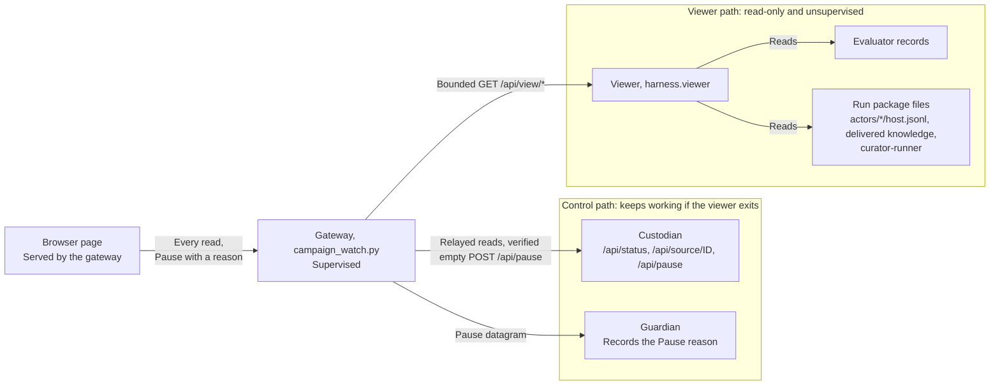

# Spectator, host operations and delivery

The spectator shows actual owned target images, mechanical resources/custody and
separately labelled player claims. It owns no actor capability. The operator's
Pause is an independent permanent stop. The spectator is two parts
([ADR008](../decisions/008-evaluation-and-spectator.md)): a minimal **control path**
that keeps Pause, status and the frame, and a **viewer** that shows interpreted
records and can fail without effect. [Architecture](../architecture.md) and
[current contract](../contracts/computer-control.md) own system/port guarantees.

This diagram answers “Why can the viewer fail without affecting Pause or the live
frame?” Boxes are processes or files and arrows are requests or reads. The two paths
share only the page and the gateway: no arrow runs from the viewer to the custodian, so
its exit leaves status, frames and Pause unchanged. The
[custodian routes](#control-path) and the
[viewer contract](../contracts/spectator-view.md#control-path-and-viewer) own the detail.

## Internal responsibilities

| Part | Owns |
| --- | --- |
| [Server](../../harness/server.py) | Selected `127.0.0.1` host/origin checks, bounded JSON, passive `/api/status` and `/api/source/ID` routes, independent Pause and the actor tool routes. It serves no page and no derived view. |
| [Gateway](../../tools/campaign_watch.py) | The page origin and static files, relayed status and source reads, Pause with a reason, and bounded forwarding of view reads. Its exit ends supervision, so it stays minimal. |
| [Page](../../web/) | Source presentation, labels, resource status, Pause feedback and the viewer's views. Served by the gateway. |
| Viewer (`harness/viewer`) | Read-only evaluator views, projections of the run package's host traces, delivered knowledge and curator runner files, and operator-selected curator records ([contract](../contracts/spectator-view.md#spectator-view-api-spectator-view4)). |
| [Supervisor](../../tools/campaign_supervision.py) | Starts and stops the custodian, gateway, keep-awake and viewer children; the guardian owns the custody deadline and the Pause receipt ([procedure](../operations/campaign-supervision.md)). |
| [Custodian](../../tools/campaign_run.py) | Frozen admission validation, exact native target, store/server lifetime and final cleanup/accounting receipt. |
| [Preparation](../../tools/prepare_game.py) | Project-local windowed options, normal mouse input, wrapper/userdir and shared exclusion before changes. |
| [Build](../../tools/build_computer.py) | Current mechanical SDL adapter/fixture plus source/output provenance; no gameplay claim. |

## Control path

**Custodian routes.** `GET /api/status` is passive `computer-status/2`;
`/api/source/ID` serves current session PNGs with retained identity/digest
verification. A failed spectator image read reports unavailable without calling
actor-side source-failure fencing, so it never affects actor capture or input integrity.
Browser reads do not select a player store or create observations.
`POST /api/pause` accepts `{}` and bypasses actor/executor/DB waits. Its
`computer-pause/1` response identifies the actual receiving session and original
stop facts. Authenticated actor tools use `/api/tool`; source reads use
`/api/player-source`. No CORS/public exposure, semantic recovery controls or
browser-issued actor handoff exists.

**Gateway.** It binds `127.0.0.1` on a free port, checks `Host` and `Origin`, and
serves only `index.html`, `web/app/*` and `web/vendor/*`, unchanged, with its
own security headers (`default-src 'self'`, `nosniff`, `no-store`). It relays only
`/api/status` and `/api/source/<session>-<n>` from the custodian, and accepts no
mutation except Pause.
- **Watching.** The page asks for no acknowledgement and nobody is required to watch:
  an unwatched run continues until a run limit or Pause stops it
  ([procedure](../operations/campaign-supervision.md)). The control strip takes the
  frame and status only from the two relayed routes, so a viewer outage cannot blank it.
- **Pause.** The page sends the operator's reason to the gateway under the
  [operator Pause contract](../contracts/computer-control.md#passive-spectator-reads-and-operator-pause).

**Failure.** Report stop-requested separately from native-confirmed Pause. A stale
image or retained launch receipt is historical evidence, not current liveness. Player
claims are fallible, separately labelled data. Delivered events, process absence and
host completion do not certify a save or objective. Unknown input remains stopped.
The finite custodian retains exact owned process/group handles and distinguishes
normal native exit before forced cleanup from exceptional termination. Failure to
verify absence stays unknown. No unrelated process scan/adoption is supported.

## Viewer

The viewer can fail independently of the run under the
[launch and lifetime rules](../contracts/spectator-view.md#control-path-and-viewer).

The viewer lists only its own live run as `live`. Another run whose store is still
`live`, because its final `evaluate-run` pass never ran, is listed as `unfinished`, so the
page follows the [current live run (#435)](https://github.com/CVX-Hull/enactive/issues/435).

The [Mission Control](../contracts/spectator-view.md#the-page-mission-control)
bar keeps run selection, essential run figures, control status and Pause in a
compact row. Four run tabs organize one selected run:

- **Watch** aligns the screen, four-lane continuity timeline and working-state agenda dock with the
  [story feed](../contracts/spectator-view.md#story-feed), including player intent,
  mechanical results, context cuts, coverage waits, deliveries and findings.
- **Memory** browses [exported knowledge](../contracts/spectator-view.md#delivered-knowledge),
  world-state groups, recorded deliveries, usage/claims and citations that can open a verified frame.
- **Curator** shows [runner progress, spend, sessions, grooming and run-filtered
  gate results and drafts](../contracts/spectator-view.md#run-curator-sessions).
- **Diagnostics** shows Pause conditions, spend, context, routing, findings and
  [custodian receipt facts](../contracts/spectator-view.md#recorded-custodian-receipt)
  alongside the evaluator's outcome.

**All Runs** holds Lineage, Compare, Explore, Changes, Failures and Archive.
The page supports deep links to tabs, runs, steps, versions and curator sessions through URL hashes.

**The control path's frame is never lost to the viewer.** The bar shows its own frame in
full by default. The viewer page may make it small, and may hide it only while Watch has
painted the same capture; a newer capture that Watch has not decoded, any outage, failed
page module, scrub, hold or other tab brings it back. Pause is coloured by a met condition
and otherwise unchanged by the viewer.

See [recorded browser entry](../operations/start-observe.md#recorded-browser-entry) and [playback and live relay](../operations/start-observe.md#playback-and-live-relay) for the command and controls.

The gateway forwards `GET /api/view/*` under the
[viewer forwarding limits and failure rules](../contracts/spectator-view.md#control-path-and-viewer).

**Recorded sources.** *Delivery by request* shows knowledge selection and
delivery for an actor and request, digest-verified snapshot entries, explicit
reads and public reports. Source links use recorded IDs and frame verification.
See the [recorded knowledge contract](../contracts/spectator-view.md#recorded-knowledge-and-public-reports).
The [archive API](../contracts/spectator-view.md#archive) serves player records,
forgetting episodes and the container inventory. A forgetting episode can open
Watch at a verified frame or report why the frame is unavailable.

Configured lineage-wide [drafts](../contracts/spectator-view.md#curator-drafts),
[session receipts](../contracts/spectator-view.md#recorded-curator-sessions) and
[gate results](../contracts/spectator-view.md#recorded-curator-results) are
available through the Curator Sources API. The selected run's Curator endpoint
filters drafts and verdicts using its own session IDs.

## Assurance and evidence

The [testing guide](../testing.md) routes the HTTP boundary, gateway/forwarding,
guardian and compiled-native tests. Proven by fixture: forwarding refuses HTML, script
and oversize bodies; a viewer killed mid-run leaves status, frames and Pause
working; Pause with a reason forwards `{}` and records the reason; viewer exit does not
end supervision. A reference test checks that the player driver and host never name the
evaluator or viewer.

Limits:
- The viewer port is chosen before launch and recorded, not bound by the supervisor,
  so another loopback service could take it; the media and size rules still bound what
  the page accepts, but the answer is not proven to come from the viewer.
- The Pause receiver check is the Mac-specific `lsof` socket binding. It qualifies
  neither another OS nor a hostile local process.
- The page shows retained evidence. Human attention, physical paint and useful game
  effects are separate, and nothing records whether anyone watched.
- Actual browser/native visual inspection is separate from parser, hash and HTTP
  checks. [Operations](../runbook.md) route launch, Pause and cleanup; the
  [production report](../acceptance/2026-10-29-computer-control.md) retains
  native/player qualification.
