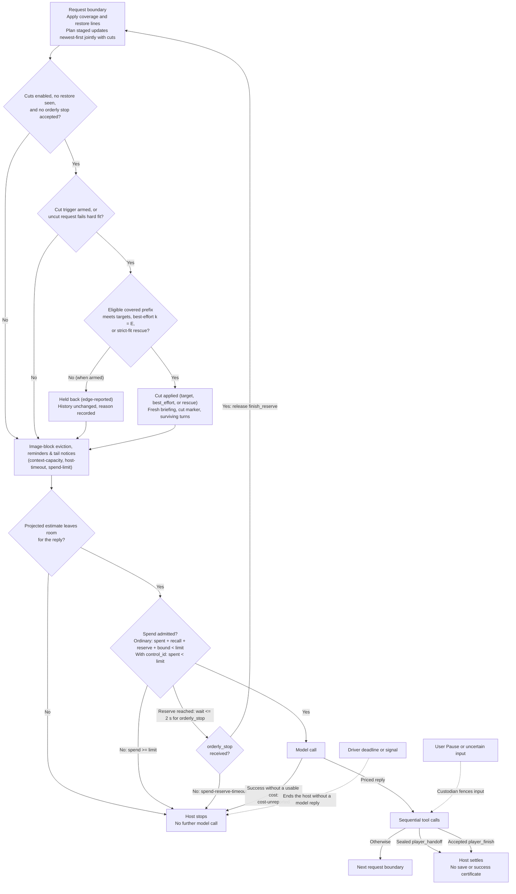

# Player host contract

`player-host/12` is the current boundary between the
[campaign driver](../../tools/campaign_player.py) and the program hosting a
deciding player. The host owns the model/tool loop and player context. The finite
test driver owns original limits, process-group closure and verified succession.
The player receives its user objective and actual tool interface; experiment
countdowns and final-actor policy stay outside its context.

The [adapter reference](../../tools/player_host/README.md) owns provider-specific
serialization. The [conformance suite](../../tests/test_player_host_contract.py)
drives listed adapters only through this contract. No component name makes all
its behavior either player logic or test scaffolding.

## Adapter selection

The [campaign package](../operations/campaign-run.md#frozen-data) freezes
`host:{"argv":[...]}` with 1 to 8 strings.
The first is an absolute existing executable/interpreter regular file; later
entries are canonical project-local regular files tracked by the clean source.
The driver supports only the explicit frozen invocation.

## Modes

`ARGV validate --config ROUTE --mcp-config MCP --model ID --effort EFFORT`
accepts only the current route/MCP configuration, exits zero without credentials
or network within ten seconds and writes nothing to stdout. The validator gives
it only `PATH` and `LANG`.

`ARGV run --config ROUTE --mcp-config MCP --context CONTEXT --prompt PATH --session SESSION --actor-id ACTOR --pending-control-id none|ID --delivered-knowledge KNOWLEDGE --finish-reserve-usd USD --model ID --effort EFFORT --timeout-seconds S -o FINAL [--knowledge-updates LIST]`
hosts one actor. Every flag but `--knowledge-updates` occurs exactly once; that
one occurs at most once, only in a run that
[delivers newer knowledge versions](#a-newer-version-during-play). Unknown, missing
or repeated flags refuse. Frozen regular files other than knowledge are at most 1 MiB each. Delivered text has no hard cap. Session/actor IDs are 32
lowercase hexadecimal characters. The driver reserves `FINAL`; successful direct
player reports write it, while handoff/failure leaves it unchanged.

The driver starts a new session with project cwd, stdout JSONL, bounded stderr
and only `PATH`, `LANG` and the selected credential variable. `S` is the original
host allowance. SIGINT/SIGTERM and hard deadlines stop independently of a model
reply. The driver's stdin pipe remains open for control until settlement. Exit
zero requires successful settlement, owned MCP closure and any final-file write.

## Route envelope

The closed route has `schema:"player-host/12"`, `model`, `api_key_env`,
`spend_limit_usd`, `unpriced_request_usd`, `max_context_images`,
`context_image_block`, `context_reserve_tokens`, `context_cut`, `request_timeout_seconds`,
`service_tier`, `endpoint_costs` and the closed `recall` object
(`model`, `every`, `unpriced_request_usd`, `endpoint_costs`).
The adapter owns its closed `model` fields. The driver reads only model
ID/name/cost/context/output fields, credential variable, the two
dollar amounts and tier.
The image block is a positive integer no larger than the image peak.
`context_reserve_tokens` is a safe integer at least `model.maxTokens` and less
than `model.contextWindow`. The required `context_cut` is null to disable cuts or
a closed object with the safe integers `low_mark`, `high_mark` and `min_free`.
The marks satisfy `1 <= low_mark < high_mark < model.contextWindow` for the
player model, and `min_free` is at least one turn. The host rejects unsupported
route versions.

Each role declares one model. For a route that supports ordered endpoint failover,
the adapter validates a list of one or two distinct endpoint tags. The routing
provider may try the second declared endpoint before the first token within the
same HTTP attempt. The same model serves both endpoints. Model fallback and
fallback outside the declared endpoint list are unsupported.

Each role sets `endpoint_costs` to null on a direct or single-endpoint route.
On a two-endpoint route, it is a closed object keyed by the two declared tags.
Each value has finite nonnegative `input`, `output`, `cacheRead` and `cacheWrite`
rates in dollars per million tokens. For each field, that role's `model.cost`
equals the higher of the two endpoint rates.

A dollar amount is plain decimal text such as `"0.4096"`: digits with an optional
fraction. A JSON number, an exponent, a sign or a non-finite word is refused. Two
rules set its length:

- **A declared amount** (the route's `spend_limit_usd` and `unpriced_request_usd`, and
  the package's limit and dollar reserve) has at most twelve whole and eighteen
  fractional digits. Both route amounts are above zero.
- **A counted amount** in a trace (`reported_cost_usd`, `counted_cost_usd`,
  `spent_usd`) has no cap on its digits, because the host writes the provider's own
  digits, which can be more than eighteen. The driver reads it at any length and sums
  without rounding. When it gives a successor what remains, it cuts that to eighteen
  fractional digits, never up.

The driver sets `spend_limit_usd` to the dollars the run has left ([Spend](#spend)).
A logical player request admits at most two host HTTP attempts. The initial
attempt and the one shared retry use the same declared endpoint order.
Once per actor, an HTTP 200 stream may reach its request deadline after
producing content, reasoning or tool arguments and before a provider finish reason. After aborting and accounting for that attempt, the adapter may
make one inference with a fresh request deadline from the identical serialized
context. Only a completed reply reaches the agent or its tools. The next attempt
must fit below the dollar limit with ending and concurrent recall reserves intact.
A prior computer stop, unconfirmed computer operation, pending handoff, accepted
ending control, cancellation or host timeout prevents recovery. The custodian
permanently fences native input on Pause, including during final-report grace. Actor,
session and custody deadlines stay fixed. Missing charges remain unknown. The
[adapter reference](../../tools/player_host/README.md) defines the eligible failures. For an eligible pre-output refusal, the original request deadline covers the
backoff and the retry. Actor time and custodian mechanical resources are separate.
An HTTP 403 is eligible for the shared retry only when its redacted diagnostic
class is `upstream-provider` and the response permits retry. The
`provider-403-failover` retry resends the same declared endpoint order so an
aggregator can route around a failing upstream endpoint. On a single-endpoint
route, it acts as one bounded retry. Credit or limit, moderation, authorization
and unknown 403 refusals stop after that attempt.
[Pre-output retry contract](https://github.com/CVX-Hull/enactive/issues/308) · [Live refusal evidence](../acceptance/2026-11-19-joanna-campground-memory-803.md) · [Backoff review and the unsaved-stop tradeoff](../acceptance/2026-11-19-request-deadline-during-provider-backoff-805.md).
These operator counts do not enter the assignment, repeated model messages or
actor tool results.

The current adapter reuses its maintained context estimate, reported usage and a text/image
heuristic floor to warn before capacity becomes critical. Every actor's tool table
includes `player_handoff`, so the warning offers the existing handoff and says to use
`player_finish` if the call reports that no successor is available. The final actor's
call is refused that way. Once an orderly stop is accepted, the warning names only the
`player_finish` ending under that control.
Known excessive context stops before another fetch. Before checking capacity the
host may [cut a curator-covered prefix](#coverage-gated-context-cut) from the
request. The token estimates are approximate.
The finite diagnostic must exercise its envelope, including missing usage and
oversized results, before admission.

### Spend

The host stops a run at a dollar limit, from the cost the provider reports for each
response ([R-OVERSPEND](../risks.md#operating-risks)).

- **What the route carries.** `spend_limit_usd` is the dollars this actor may still
  count. The route's `unpriced_request_usd` is a planning bound for an in-flight
  request. The package check computes it from the full context window at the largest
  configured input/cache rate plus the configured output limit at its output rate.
  On a two-endpoint route those rates cover either declared endpoint. The host
  uses the bound for the in-flight and ending allowances for each role.
- **What counts.** Telemetry records every started HTTP request, including a
  retry. It adds only a usable provider-reported cost to the dollar total. A
  refusal, timeout, cutoff or abort without a usable cost keeps an unknown charge
  and an explicit unpriced attempt. A successful response without such a cost
  keeps the integration stop below.
- **The reported cost** comes from the response's usage records. On a route that is not
  on the caller's own provider key, each record contributes the larger of `cost` and
  `cost_details.upstream_inference_cost`. On an own-key route (`is_byok: true`), each
  record must supply both amounts and contributes their sum. When a response carries
  several records, the largest counts. A malformed record, or a response without a
  usable amount, leaves the player's cost unknown, never estimated. The curator computes
  a usable reported amount with the same arithmetic, and both hosts test it against
  `tests/fixtures/provider-usage-cost.json`
  ([player route cost pilot (#555)](../acceptance/2026-11-12-provider-cost-pilot-555.md)).
- **Exact sums.** Amounts are summed as decimals, never as floating-point numbers.
- **Stop at the limit and reserve handshake.** Before each ordinary-work HTTP attempt
  (retries included, whenever no accepted `orderly_stop` control is projected into the
  request), the host stops with reason `spend-limit` when `spent >= spend_limit_usd`,
  and otherwise admits the attempt only while
  `spent + in_flight_recall_bound + finish_reserve + unpriced_bound < spend_limit_usd`
  (equality fails admission). If an in-flight recall reservation is the sole obstruction,
  the host awaits recall settlement and rechecks once. When ordinary admission still fails
  while `spent < spend_limit_usd`, the host emits one actor-bound `spend-reserve-reached`
  event and waits up to 2 s for `orderly_stop` on stdin (which the live driver issues
  immediately unless Pause, deadline, or another stop already fired). Clean expiry of the
  2 s wait with no `orderly_stop` settles with reason `spend-reserve-timeout` without
  masking Pause, deadline, `spend-limit` or control-EOF reasons. `finish_reserve` is
  released **only** for a request whose projected context carries the accepted
  `control_id` (superseding any unsent or backoff ordinary request when `orderly_stop`
  arrives). A request already sent finishes; the provider subtotal can pass the limit by
  the returned charges for final in-flight player and recall requests.
- **Stop on an unpriced player success.** After a player response that did not fail and whose
  `reported_cost_usd` is null, the host stops with reason `cost-unreported` and
  dispatches no tool call from it. This keys on the cost, not on `usage_available`:
  token counts without a cost stop the run, and a cost without token counts does not.
- **Spend notice.** The work budget is `spend_limit_usd` less the ending reserve,
  floored at zero. Its remaining amount subtracts counted spend and is also floored
  at zero. The host warns on halving steps (`100%`, `50%`, `25%`, `12.5%`) of the
  warning threshold (the greater of 15% of the work budget and $0.25, capped at the
  work budget), with no further spend notice below `12.5%`.
  The first notice reports the remaining amount and advises wrapping up with
  `player_finish`. When `player_handoff` is enabled and no orderly-stop control
  has been accepted, it advises finishing instead of starting a fresh actor.
  The driver's ending reserve and `spend-reserve-reached` handshake still trigger its
  own orderly-stop control ([External control](#external-control)).

The driver reconciles each `request-start` with its cost record and sums returned
charges. A trace is complete when every attempt has a cost record, including
explicit unknowns, and settlement agrees on the subtotal and both unpriced
counts. A lost terminal record or a mismatch marks the trace incomplete and
admits no successor. The observed subtotal still records only provider charges.

### Delivered knowledge and recall

Every `campaign-run/13` package carries `delivered-knowledge.json` (`delivered-knowledge/3`), including an empty file of that format when no knowledge exists. `private_files` is a closed manifest map of `knowledge-full.json` and `units.json` hashes; neither private file is given to the host or application. The application requires the delivered file; every caller supplies it, including an explicit empty file when there is no knowledge. The driver copies its exact bytes into the first actor's frozen inputs (`player-host-inputs/4`). It records the finish reserve there too.

`delivered-knowledge/3` has exactly `schema`, `version`, `commit`, `repository_id`,
`coverage`, `articles`, `facts` and `history`. `commit` is the 40-hexadecimal commit of
the published version's tag. `repository_id` is the commit of the repository's first
version `v0`, which every later version of that repository shares. The exporter writes
both; the empty file has `null` for `version`, `commit` and `repository_id`. A version is
`vN`. No raw `world` or `lineage` label appears anywhere in the delivered bytes
(including aliased session identifiers and coverage stamps). Its records have the closed
forms the exporter writes, and both readers (the host and the application) refuse any
other:

- `coverage` is null or exactly `schema` (`curator-coverage/2`), `session` (blinded
  session alias `s01`…), `actor` (null or non-empty text) and `last_step` (null or an
  integer).
- An article has `id` (the stable slug), `revision` (`<slug>@v<N>`), `title`, `lead`,
  `body` (non-empty list of `{text, facts}` claims), `tags`, `scope` (`game`, optional
  `world: null` for world-bound articles, and declared non-world axes),
  `branch_relation` (`null` for unbound records, else `same`, `inherited` or `unknown`,
  with `unknown` requiring `unverified_branch: true`), `lifecycle_state` (`active` or
  `contested`), `stale_citations`, `needs_review`, `condition_unverified`,
  `unverified_branch`, `links`, `backlinks`, `shadowed_by`, `contradicted_by` and
  `last_confirmed` (aliased position object).
- A fact has `id`, `claim_kind`, `evidence_basis`, `tags`, `text`, `scope` (`game`,
  optional `world: null` when world-bound, and declared non-world axes),
  `branch_relation`, `lifecycle_state`, `stale_citations`, `needs_review`,
  `condition_unverified`, `unverified_branch`, `links`, `backlinks`, `shadowed_by`,
  `contradicted_by`, `cited_by_articles`, `citation_source_ids` and `seen`, with
  optional `subject` and `when`.
- `history` holds `{replaced, ended, retracted}` for read-by-ID lookup and provenance
  inspection (`player-knowledge/3`).

`player-host-inputs/4` (`actors/NNN/frozen.json`) has `schema`, `actor_id`,
`session`, `finish_reserve_usd`, `files` (the SHA-256 of `actor.json`, `route.json`,
`mcp.json`, `context.txt`, `prompt.txt` and `delivered-knowledge.json`) and
`knowledge_updates`: `"knowledge-updates.jsonl"` in a run that delivers newer
versions, else `null`.

`private/knowledge-full.json` holds the full selected facts, articles and history before
withholding, plus a closed top-level `selection` object with exactly six keys: `world`
(the selected label or null), `lineage` (the selected lineage or null), `context` (the
package's declared context map), `delivered_sha256` (the SHA-256 of the delivered file),
`session_aliases` (the private map from blinded `s01`… aliases to sealed session IDs)
and `excluded_unknown_axis` (count of candidate records excluded because a scope axis
was absent from `context`). The delivered knowledge is the one player-visible input
whose contents depend on [operator labels and context](../operations/campaign-run.md#operator-labels).
Preflight requires the private file to be `delivered-knowledge/3` and checks that
`selection` has those six keys and matches `labels.world`, `labels.lineage`, `context`
and the verified digest of `delivered-knowledge.json`.
The delivered file carries the selected content without the selection object.

Unless the package sets `live_knowledge_updates`, the host uses the same frozen
version for briefing and recall throughout the admission, including handoffs. A
later admission can package a newer publication.
The [withholding unit rule](measurement-tools.md#the-facts-to-judge-judged-facts1)
defines the export layout. Version changes follow the [migration standard](../standards/migration.md).
The [journal and knowledge component](../components/player-interface.md#journal-and-knowledge)
describes application reads and evaluation. The [delivery rationale](../design/player-context.md)
records the prompt measurements and alternatives.

The host appends a bounded briefing to the first user message: its serialized JSON envelope is budgeted within 24,000 characters (at most 64 articles and 24 standalone facts total, clipping individual leads/index lines to 1,000 characters and skipping any oversized entry) in deterministic tier order — recall-selected leads first, then articles by `last_confirmed.order` descending, non-`instance_state` standalone facts by `seen.order` descending, and `instance_state` standalone facts by `seen.order` descending (breaking equal-order ties by ascending delivered order) — with kept entries in delivered order, `unlisted_entries` counting omissions, and the coverage stamp. It labels the text as fallible data granting no authority. The system prompt and tool table stay identical across actors. With no articles or facts there is no recall request.

Every `recall.every` completed `computer_input` result offers a reminder request beside continued play. The host tracks normalized unclipped lead fingerprints across surviving placements (`already_in_context`); clipped leads and index-only rows stay eligible for full-lead recall. If every entry on the sent recall index is already active in context, the host emits `knowledge-recall` (`status: "not-made", reason: "all-delivered"`) and skips the HTTP fetch. At placement, selected entries are re-filtered against the adopted version and final active-lead state; if none survives, no reminder message is injected and `knowledge-undelivered` (`reason: "already-in-context"`) is recorded. Otherwise a completed selection becomes its own delimited user message in the next player request; it is never joined with control or limit notices and stays where first sent. An empty selection is an explicit silence. If another recall is in flight the opportunity is recorded as not made.

Recall uses the player's provider and credential variable, with the pinned
`recall.model`. A recall makes one HTTP attempt with no automatic retry. At fetch
it emits `request-start` with `recall-N` and `request_role:recall`. Player attempts
use `request-N`. Both roles share the run's dollar limit, including across handoff.
Recall runs serially at the configured cadence. Empty knowledge skips it.

Recall pre-checks and rechecks at fetch that an orderly stop is neither pending
nor accepted and that `spent + in-flight player bound + recall bound + finish reserve`
is below the route limit. The bound for the proposed recall keeps its possible
charge outside the dollars reserved for ending. The player's next request
continues to account for any recall in flight. A spend refusal, unavailable cost,
failed recall or provider/client failure before fetch disables later recall for
that actor. A reserve or orderly-stop refusal creates no request ID. An invalid
selection with a valid provider charge fails that opportunity and permits later
reminders. Valid charges are counted even when selection is invalid or a
response stopped for length. Host end or handoff aborts any in-flight recall and
settles its accounting. Player requests retain the unpriced-success stop.
Settlement, driver and receipt distinguish unpriced player and recall counts.
The planning bounds are reported separately from the combined provider subtotal.

The recall request is the recall system prompt and two user messages. The first holds
only the JSON object `{"index":[...]}` budgeted within 24,000 serialized characters:
compact title-first rows (`{id, title, status?}` with titles clipped to 120 characters)
in deterministic tiers (articles by `last_confirmed.order` descending, then non-`instance_state`
standalone facts, then `instance_state` standalone facts, breaking ties by ascending
delivered order; `unlisted_entries` counts rows omitted on overflow), spending any
remaining budget on first-sentence `index` snippets in the same order. The second holds
a JSON object with `kind`, `already_in_context` (`[]` for `briefing`), and
`first_message` (`briefing`) or `recent_calls` (`reminder`), followed by the latest screen
for a reminder. Recalls of
one version, across actors and reminders, therefore share a byte-identical message-1
prefix that ends at a message boundary, which the provider can reuse from its cache. A route that requests
strict structured output requires the pinned upstream to support the selection schema. Its
real-model check covers that capability before use. The [adapter reference](../../tools/player_host/README.md#knowledge-delivery)
owns provider serialization. The joined, trimmed reply text must contain exactly
one JSON object with `articles` as its sole key and an array of strings as its value.
The object may be bare or inside one Markdown code fence, optionally tagged `json`,
with only whitespace outside the fence.

Recall accepts only IDs and titles on the delivered index (articles and standalone facts). An article named by both ID and title is selected once; a repeated selection entry is invalid. A standalone fact is accepted as a lead carrying its text; IDs/titles absent from the index are refused, including facts filed under articles.

The [host telemetry contract](player-host-telemetry.md#knowledge-delivery-and-recall-events) defines the delivery and recall events.

### A newer version during play

A package with `live_knowledge_updates: true` delivers versions the curator
publishes during the admission to the actor that is running. Nothing in this path
waits, and no failure in it stops play: an actor that receives no update plays on
with the version it holds. The [package rules](../operations/campaign-run.md#live-knowledge-updates)
say when a package may set the field.

| Step | Owner | Rule |
| --- | --- | --- |
| Export | [Curator runner](../components/curator.md#delivery-to-a-running-actor) | After a poll in which it confirmed a version, it writes that version as `delivered-knowledge/3` for the package's world, lineage and context to `RUN/curator-runner/delivered/vN.json`, whole (temporary name, sync, rename). It exports a confirmed publication only, never a restore, and only above the last version it exported. |
| Adoption | [Driver](../../tools/campaign_player.py) | A thread of its own looks at `RUN/curator-runner/delivered` every tenth of a second, so no read there delays the driver's deadline checks, settlement or handoff. It takes the highest `vN.json` above the version it holds that is `delivered-knowledge/3`, names version `vN` and has the `repository_id` of the version held (any repository after the empty file). For a running actor it copies the bytes to `actors/NNN/knowledge/vN.json`, writes the update list with one more line to a temporary file, synced, and renames it over `actors/NNN/knowledge-updates.jsonl`; only then does the application serve the version and the driver hold it. A version prepared for an actor that has since stopped is decided again. A version that does not verify or cannot be written is reported on the custodian's stderr and never tried again; the list, the application and the next actor stay on the version held. |
| Reads | Application | `player_knowledge_read` and `player_knowledge_query` answer from the adopted version as `player-knowledge/3` from then on (full records on read with exact-title-first casefolded fallback; compact hits on query). Each result names its `version`. |
| Delivery | Host | A refresh beside play, at start, every second and after each player response, reads the whole unread lines of `--knowledge-updates` and their files in an isolated helper (bounded per read so one stalled file never blocks later updates or CLI exit) and stages verified candidates above its own. Building a player request reads no file: it adopts the newest staged candidate that fits within context capacity, if any, so a stalled read never delays a request. |
| Successor | Driver | A successor's `delivered-knowledge.json` is the latest version adopted in the run, taken from memory, or the package's file when none was. Its update list starts empty. |

The append-only JSONL list carries two closed line schemas. A
`knowledge-update-entry/1` line has exactly `schema`, `version` (`vN`), `commit`,
`repository_id`, `file` (`knowledge/vN.json`, relative to the list), `sha256`
of that file and its `coverage` stamp.

The host verifies a knowledge entry before it adopts it: the line is a closed entry; the
version number is above the adopted one; `repository_id` is the adopted version's,
unless that is the empty file; the file's SHA-256 is the entry's; the file is
`delivered-knowledge/3` in its closed form; and its `version`, `commit`,
`repository_id` and `coverage` are the entry's. It tries unread entries newest first
and stages every candidate that verifies, deciding each on its own, so one malformed
or oversized entry never hides an older valid one. When the next request is built,
the host evaluates staged candidates newest first jointly with context-cut planning
(as specified below), adopting the newest candidate that fits within context capacity
and refusing the rest (`context-capacity` for oversized newer ones, `superseded` for
older ones).
An entry that fails, an older one and one passed over
for a newer are each recorded as refused with a reason when the next request is
built (or when the actor ends), and the adopted version stays.

An adopted version is the host's version for every later recall, reminder and
delivery of that actor. Pending knowledge updates are adopted before queued
reminders are placed: an in-flight recall's index and reply check still use the
version it was requested from, while placement rebuilds its reminder against the
adopted version using the selected entries that still exist (dropping it with
`knowledge-undelivered` reason `superseded` if none remain).

The host states the difference in one message of its own, delimited
`BEGIN FALLIBLE KNOWLEDGE UPDATE (vN)` and `END FALLIBLE KNOWLEDGE UPDATE (vN)`
around one JSON line, labelled as fallible data granting no authority. It covers
what a briefing can show, the articles and the facts no article files, with `status`
markers on any non-`active` or flagged entry (while plain `active` entries keep stable
serialization bytes):

- `added` and `updated` carry each entry's ID, title, lead (a fact's subject and text)
  and optional `status` markers. An article is updated when its title, lead, claims or
  status markers changed; a standalone fact is updated when its text, subject or status
  markers changed.
- `removed` carries the ID and title of an entry the version no longer has. A fact
  that an article now files is not removed.
- From an empty store the line carries `index`, budgeted under the same 24,000-character
  tiered cap as an actor-start briefing, in place of a difference.

The message makes no recall request and costs no request of its own. Like a
reminder, it is appended at the next request boundary as its own message.
At each request boundary, update adoption and context cutting are planned jointly
(side-effect-free, newest staged version first): a newer version is admitted only when
its final projected candidate request satisfies both strict hard fit and the existing
`context_reserve_tokens` update capacity-warning threshold, committing version, cut,
placements and telemetry atomically; otherwise it is refused with reason
`context-capacity` and the driver's next actor starts from that version.

### Coverage-gated context cut

A `coverage-update-entry/1` line has exactly `schema`, `session`, `actor_id`,
`operation_id`, `version` and `restored`. The session is 32 lowercase hexadecimal
characters. A publication sets `restored:false` and names a 32-character
lowercase hexadecimal actor and operation ID and a version `vN` with positive
safe integer `N`. A restore sets `restored:true` and sets the actor, operation
and version to null. The refresh stages these lines from the same list. The
request builder applies them between requests. The host ignores another session's
entry and publications for another actor.

The host uses the operation from the highest coverage version at or below its
adopted knowledge version. The latest line for that version supplies its operation.
An undelivered newer version leaves eligible older coverage available. A restore
permanently disables further cuts by the actor and leaves its last cut in effect.
An accepted orderly stop also prevents any further cuts and sends its control
instruction in the surviving request history.

The host arms cut pressure when the post-image-projection token estimate above the
current briefing exceeds `high_mark`, or when image block eviction would omit more images
from the active history than it omitted from the previous request (`image_peak`). Holds
are edge-reported once on entering each `(reason, coverage_frontier)` state while cut
pressure remains armed, and re-evaluated when coverage, eligibility or adopted version
changes. A turn is one assistant message and its contiguous tool results. The coverage
operation must be the last creating operation in its turn for the host to remove that
turn. Earlier complete turns are eligible, and the latest turn always survives. When cut
pressure is armed and eligible covered turns `E >= min_free`, the host evaluates every
prefix `k` from `min_free` through `E` and selects the smallest `k` satisfying `low_mark`
above the fresh briefing, at most `max_context_images - context_image_block` images, and
strict hard fit (`estimatedTokens + maxTokens < contextWindow`). If no `k` meets both
targets, it applies the owner-approved best-effort fallback at `k = E` provided `R_E`
satisfies strict hard fit and strictly reduces total estimated tokens
([decision](../decisions/owner-decisions.md#context-cut-best-effort-fallback-949));
otherwise it holds back with reason `insufficient-cover`. Independently of `high_mark`
and `min_free` (under the same three guards: cuts enabled, no restore, no accepted
orderly stop), whenever the uncommitted candidate request fails strict hard fit and
`E >= 1`, the host searches `k` from `1` through `E` on the original uncommitted
projection for the smallest strict-fit prefix that strictly reduces tokens before falling
back to a `context-capacity` stop. Image block eviction still applies after each decision.

The cut preserves the system prompt and tools. It replaces the first user
message with the frozen mission prompt and a fallible briefing from the adopted
version and no recall request, filling `leads` from tiered articles and `index`
from standalone facts. Its size does not grow with the store: its JSON
payload is at most 24,000 characters, using the same tiered order, tie-break comparator
(descending recency, breaking ties by ascending delivered order), 64-article / 24-fact
caps, 1,000-character snippet clipping, skip-if-oversized rule and `unlisted_entries`
count as an actor-start briefing. `player_knowledge_read` and `player_knowledge_query`
still reach every entry.
The following user message is delimited by `BEGIN CONTEXT CUT` and
`END CONTEXT CUT`. Its JSON line contains `grants_authority:false`, the cumulative
`removed_turns`, `covered_through_operation_id`, the coverage `knowledge_version`,
`recent_intents` (the last 5 distinct validated public `intent` strings from committed,
non-refused actor tool calls in removed turns, excluding `player_finish`, clipped to 160
characters with the most recent occurrence at the tail)
and distinct `source_ids` in their original order across the removed turns, with
contiguous same-prefix numeric runs losslessly compacted as `start..end` and a
shared prefix factored into `source_id_prefix` when all entries share one stem.
The marker directs the player to `player_source` for those frames. Both
messages stay fixed until the next cut. Knowledge notices at or after the cut
boundary stay with the surviving turns; `tail-notice` messages before the cut boundary
and all `context-capacity` notice lines and step tracking reset on a cut (while
`host-timeout` and `spend-limit` step trackers and any such notices at or after the
cut boundary stay intact), the token estimate disregards pre-cut provider usage, and
capacity/time/spend warnings are re-evaluated against the new request.
[Cut telemetry](player-host-telemetry.md#context-cut) records the decision.

This diagram answers “What happens inside the player host on each request, when is a
context cut applied or held back, and what stops the actor?” Boxes are steps of one
host process, diamonds are its decisions and solid arrows give their order. Dashed
arrows are stops that act from outside the loop at any point. A refused image group
and other host faults also stop the actor; the sections above and
[settlement](#settlement-and-handoff) own the exact rules.

### Request stability and tail notices

A provider's prompt cache helps only when each request extends the previous one
byte for byte. The host therefore keeps these rules, which the offline
request-serialization tests prove for consecutive requests, a retried request, a
handoff successor and a new admission's first actor, with no provider call:

- **Prefix.** A request's messages begin with all of the previous request's messages,
  its notices included, because the provider's cache reuses a request only when a later
  one extends it
  ([context stability and prompt-cache findings (#489)](../acceptance/2026-11-08-context-stability-489.md#follow-up-the-cause-found)).
  A coverage-gated cut starts a new message prefix. Image eviction can also
  rewrite history when a whole block of the oldest pixels first becomes
  omission markers; a cut for images is considered only at that request, so an
  applied cut replaces the eviction rather than following it. Both projections preserve the system prompt, tool table,
  limits and routing.
- **System prompt and tool table.** The system prompt is the frozen context plus the
  MCP server instructions, and holds no per-actor identity. Every actor of a package
  gets the same system prompt and the same tool table, so they are byte-identical
  across actors. The final actor keeps `player_handoff`. An actor's own session and
  actor IDs (audit data granting no authority) are in the first user message.
- **Session affinity.** The host gives its provider serializer one session identifier
  per mechanical session, a digest of the session ID that every actor of the session
  shares, recorded as `session_affinity_id` in `host-start`. For a route whose provider takes a
  session-affinity header (the adapter reference names it) the serializer sends it on
  every request, retries included; a request that would go out without it fails
  closed (`session-affinity-missing`) before any charge. It is not a credential. A
  serializer may also derive a provider prompt-cache key from it on routes that take
  one (the adapter reference names them).
- **Omission markers** carry the omitted frame's `source_id` (when its tool result
  has one) and name `player_source` as the way to read it again.
- **Notices** go at the end of the request in which they are first sent, and then stay
  in the retained history there unchanged. A retry resends the same body below the notice step,
  so it adds no notice. Each notice kind (`context-capacity`, `host-timeout`, `spend-limit`)
  is emitted only when remaining room crosses fixed halving steps (`100%`, `50%`, `25%`,
  `12.5%`) of its warning threshold, combining simultaneous crossings into one user
  message and emitting no further notice below `12.5%`. The first context, time and
  [spend](#spend) notices explain how to wrap up; later step crossings state the current
  remaining figures. The context threshold is `context_reserve_tokens` before the hard
  stop, and a cut resets the context step tracker and re-evaluates against the post-cut
  projection. The time threshold is one tenth of the work allowance, at least a minute
  and at most half. An accepted ending control carries its own ending instruction.
  Each `tail-notice` event records `request_id` and `kinds` only on actual placement.
  The model receives the notice text in its request.

## External control

Stdin carries newline-delimited closed `player-control/1` objects containing
`schema,id,session,actor_id,type`. Type is `orderly_stop`. IDs are 32 lowercase
hexadecimal characters. Each line is bounded to 4,096 UTF-8 bytes before a newline.
The pipe is separate from MCP's stdin. Identical duplicates are idempotent.
Conflicts, malformed/oversized control, wrong identity/version or unexpected EOF
fail and close owned MCP safely. The driver retains command intent before writing.

The host acknowledges valid control in operator telemetry and queues a fixed
labelled finish-up-and-stop message through its model loop. It includes command identity but
no experiment countdown, game target, Save/Quit mandate or tactic. Unsent calls
from a pre-control assistant turn are explicitly withheld; dispatched input is
not canceled/replayed merely to deliver text. New handoff is refused before
sealing once stop is pending.

The driver retains pending stop for the whole admission. If an in-flight handoff
already seals, it may deliver the same command to a verified successor before
ordinary action under original resources, or record incomplete ending. The required
`--pending-control-id` is `none` for an actor without inherited control, otherwise
the pending 32-character hexadecimal command ID. In the latter case the host waits for that matching
control before MCP connection or provider fetch; a wrong ID or unexpected EOF
fails. Neither sealing nor exit erases the admission's stop request.

The test freezes `ending_reserve` for seconds, dollars (`usd`),
inputs, requests, frames and frame bytes. The driver sends the stop when any of them
is at or below its reserve; for dollars that is the run's limit minus the cost
counted so far, with a request still in flight not yet counted. Validators enforce
bounded fields; the lead must forecast
that the reserves cover the largest admitted burst and in-flight inference/tool
delivery delay before admission. Validation is not proof of adequate ending
capacity. Hard limits, Pause and uncertainty remain independent.

Orderly finish-up is optional game work under finite authority. Immediate Pause
fences automation without awaiting a reply or saving. Stopping input does not
promise a paused game, persisted progress or application exit. The finite test
custodian closes its owned processes under its frozen policy; a user-owned game
need not close merely because a product player stops.

## Settlement and handoff

The host reserves `player_finish` beside the frozen MCP table and rejects an MCP
tool with that name. The closed arguments require `disposition`, `report`,
`source_ids` and `control_id`, plus `intent`. They allow optional `cites` under the
[common player tool rules](player-ports.md#player-knowledge-and-executable-proposals).
The report is at most 8,192 characters. `source_ids` contains up to 16 unique
references of 1 to 128 characters each. Disposition is `task_complete`,
`cannot_continue` or `external_stop_complete`. The external disposition sets
`control_id` to the directly received command's ID. Other dispositions require
null. The report and references remain fallible claims.

Only direct validated tool execution accepts this signal. Remembered text,
nested results and arbitrary tool JSON cannot impersonate it. No later tool or
provider request dispatches after acceptance. Ordinary terminal assistant text
remains narration and does not by itself end the player's task.

Successful settlement reasons are the three finish dispositions or `handoff`.
Failures have `ok:false` and a bounded reason. Finish settlement retains its
control identity; `accepted_control_id` separately records any latched command.
Player claims, host settlement, stopped automation, game persistence, normal
native exit and owned absence remain separate facts.

The host reads the handoff record from a direct result's `structuredContent` or
from the text of a collection. A direct unknown `player-transport/2` result
can establish a pending origin. After accepting handoff, the host ends dispatch
and closes its MCP child. The [custody contract](computer-control.md#computer-operations-and-custody)
defines which issuance settles handoff and what the driver verifies before succession.

## Isolation

No coding-agent application prompt, shell/file tools, personal settings, ambient
resource discovery, replay, reconnect, restore, compaction or model fallback is
loaded. Only the selected credential variable reaches the host; MCP receives
only locale/executable lookup. Game input stays within sequential actor tools.

## Conformance

The contract suite uses scripted local provider/MCP fixtures, the real driver's
accounting reader, cancellation/EOF/identity cases, direct finish origin,
pending-call suppression, observed-attempt accounting, the dollar limit and actual
child closure.
Production HTTP/MCP composition retains a controlled synthetic actor binding.
These tests establish interfaces, not model quality, actual saving, useful
cadence, unattended reliability or cross-game support. Real play remains a
separately frozen lane.
