# Native interruption and error-screen design

Investigation for [#6](https://github.com/CVX-Hull/cdda-player/issues/6), based on
CDDA 0.I-1 commit `7b2efa5cea38e4d4d97dd0e63b28b9148623da59` and harness base
`806c0ba`. This is a future implementation contract. Today's
[protocol](../protocol.md) still pauses new dispatch only. No new native behavior
was built or demonstrated in this investigation.

## What the source establishes

Links below pin upstream sources; the local inspected tree contains our existing
patch, so patched input/main/SDL line numbers can differ. The source pin and original
patched-file hashes are in [upstream.json](../../native/upstream.json).

| Path and inspected functions | Established fact and consequence |
| --- | --- |
| [`do_turn.cpp`](https://github.com/CleverRaven/Cataclysm-DDA/blob/7b2efa5cea38e4d4d97dd0e63b28b9148623da59/src/do_turn.cpp), `handle_key_blocking_activity`, `do_turn` | Activity polling reuses `DEFAULTMODE`. Its `pause` action tests keyboard interruptibility and calls the native cancellation query. Polling is rate-limited around 100 ms in one no-moves branch; synchronous activity handlers and sleep paths need not reach it promptly. This is not a universal real-time interrupt. |
| [`game.cpp`](https://github.com/CleverRaven/Cataclysm-DDA/blob/7b2efa5cea38e4d4d97dd0e63b28b9148623da59/src/game.cpp), `cancel_activity_query` | Handles destination cancellation and an activity-specific confirmation, then uses engine cancellation, aborts auto-move and resumes backlog. Confirmation can be declined; resumed backlog can mean activity continues. |
| [`player_activity.cpp`](https://github.com/CleverRaven/Cataclysm-DDA/blob/7b2efa5cea38e4d4d97dd0e63b28b9148623da59/src/player_activity.cpp), `is_interruptible_with_kb`, `canceled`; [`character.cpp`](https://github.com/CleverRaven/Cataclysm-DDA/blob/7b2efa5cea38e4d4d97dd0e63b28b9148623da59/src/character.cpp), `cancel_activity` | Interruptibility is policy plus instance flags. Cancellation invokes actor cleanup and backlog/hauling/sound changes. Calling `cancel_activity` indiscriminately would skip the ordinary input policy and is rejected. |
| [`output.cpp`](https://github.com/CleverRaven/Cataclysm-DDA/blob/7b2efa5cea38e4d4d97dd0e63b28b9148623da59/src/output.cpp), `query_yn`; [`keybindings.json`](https://github.com/CleverRaven/Cataclysm-DDA/blob/7b2efa5cea38e4d4d97dd0e63b28b9148623da59/data/raw/keybindings.json) | Confirmation uses `YESNO` with `YES`/`NO`. Bindings are resolved from the active engine context, not assumed from a fixed y/n layout. A generic YESNO prompt alone does not identify an interruption confirmation. |
| [`debug.cpp`](https://github.com/CleverRaven/Cataclysm-DDA/blob/7b2efa5cea38e4d4d97dd0e63b28b9148623da59/src/debug.cpp), `debug_error_prompt` | Redraws the actual error and calls raw `get_input_event`, outside its own `input_context`. Space continues; I suppresses future instances; C copies in tiles. Some errors are buffered before UI initialization. No general crash recovery follows from this path. |
| [patch_game.py](../../tools/patch_game.py), [bridge](../../native/cdda_harness.cpp) | Current scope is a boolean set/cleared around input waits. `poll` refuses unscoped calls and pending requests; a nested raw debug call might inherit an outer scope. The trace does not prove that such nesting occurs at runtime. Current metadata cannot distinguish ordinary play from activity polling. |

The historical [raw vehicle error](../acceptance/2026-10-17-mvp.md#real-game-acceptance-2026-10-17)
froze remote progress and needed native Space. It motivates this work but was not
reproduced here. Source trace is evidence of paths and possible hazards, not measured
latency, cancellation success or proof that every error screen uses the traced path.

## User-visible design

Keep **Pause** as immediate revocation of future remote gameplay. Add a separate
operator action, **Ask CDDA to stop its current activity**. This requests the game's
ordinary interruption dialogue at the next supported activity poll. It does not
promise instantaneous cancellation or target an activity that has already finished.
The operator sees CDDA's actual confirmation and explicitly answers it. Never
auto-confirm, directly clear an activity or suppress an engine error.

When a raw debug prompt is visible, display the original frame and **Continue past
this error once**. That operator action sends one Space to this exact prompt; it
does not select “ignore future errors”, copy to the clipboard or declare the problem
fixed. Preserve the error evidence. All recovery leaves gameplay paused and requires
fresh normal-play observation plus explicit resume before new gameplay.

Proposed operator flow: **what a recovery request can establish, and when control
can resume**. Boxes are steps, not processes; arrows name outcomes. The uncertain
path preserves native fallback rather than declaring success.

The activity and debug branches both return to observation. Neither an answer nor
a dismissal proves task completion. [Editable diagram](../diagrams/native-recovery.mmd).

## Boundary identity and scope

Introduce native wire version 2 in the implementation, changing producer and all
consumers together. Reject mixed versions; retain the v1 source/release in Git for
rollback. No silent downgrade or compatibility claim with a v1 running process.

Rotate the native session on every `playing(true)` world entry and on world exit,
not merely at process creation. Today the coordinate origin resets at entry while
the process session persists; same-process save/reload therefore invalidates task
coordinates even without a process restart. V2 gives each world lifetime its own
session and origin. Pending old-session actions remain uncertain in host records;
new-world observations must never acknowledge their gameplay success. Reject old
session commands on either channel and require fresh reconciliation after transition.

Add a discriminated `boundary` record to observations: kind `normal_play`,
`activity_poll`, `interrupt_confirmation`, `debug_prompt`, `menu` or `unsupported`;
opaque boundary instance ID; allowed recovery operations; operator-control generation;
and optional owning interrupt request ID. The activity poll advertises only the
native keyboard-interruption eligibility and visible confirmation affordance, not
hidden activity targets, remaining work, inventory, NPC state or absolute position.
Scene export is restricted to normal play. Boundaries without rendered evidence
cannot grant input authority. The gameplay design requires `normal_play` positively.

Replace boolean scope with a game-thread-owned RAII stack that restores prior input
scope on normal return and exceptions. Explicit scopes at the activity handler and
raw debug prompt override inherited gameplay context; a debug prompt must never
inherit ordinary movement authority. An unknown caller defaults to unsupported.
Context names alone do not promote a boundary to normal play. Mark the ordinary
avatar action-input path separately, and audit nested menus/animations during #7.

An interrupt confirmation is marked only while handling a harness-requested native
`pause` in the activity handler and the corresponding `cancel_activity_query` call.
Each rendered confirmation gets its own instance ID, including multiple destination/
activity questions. Other YESNO prompts are not recovery targets. IDs change on
entry/exit, native input, question replacement and new session, not every repaint.
The matching frame/revision is still required when answering or dismissing a prompt.

## Narrow recovery transport

One existing controller process remains the host writer. Add a separate, bounded
control inbox because a gameplay command may still be waiting for its result.
Use the existing atomic-JSON/rename pattern, not an additional service or OS-event
injector. `control.json → control-claimed.json → control-response.json` has a separate
ID namespace, seen-ID ledger and nonblocking host control lock. At most one recovery
request is unresolved. It cannot overwrite `request.json` or its pending disposition.

All recovery requests: protocol 2, unique ID, session, expected native operator-control
generation, host revocation token, kind, creation/expiry, maximum 4096 bytes. Use a two-second expiry; a
late request is rejected and never automatically resent. A manual repeat requires
new evidence and a new ID. Host restart pauses, retires unclaimed work and preserves
uncertain claimed work for reconciliation, on both channels. The process lock
outlives both writers. The local token/origin rules still apply at HTTP ingress.
The planner facade does not expose recovery actions; they are explicit operator
controls, not a cryptographic isolation boundary from arbitrary local code.

Publish a durable atomic host revocation token `(controller_boot_id, counter)` before
each Pause (even when already paused), takeover, new run lease, shutdown or restart
retirement. Capture the token after a recovery request's own initial Pause. Both v2
gameplay and recovery envelopes carry their admission token. The native final gate
reads it immediately before committing an input; a mismatch, missing or malformed
token rejects delivery, even if the file was already claimed. This closes the case
where a second Pause would otherwise leave a queued YES eligible at the same prompt.
No command silently refreshes its token. One host lock serializes token publication
and admission; native remains the sole event consumer. The final gate is the input
dispatch commit point: a Pause published after that point cannot undo the committed
input. Record that distinction, rather than claiming atomic cancellation across two
processes. Test Pause before claim, after claim/before gate, and after commit.

| Request | Eligibility and exact behavior | Honest result |
| --- | --- | --- |
| `request_interrupt` | Host first pauses and revokes the run. It targets the current session and control generation, not a stale activity type. At a supported activity poll, feed exactly the native registered `pause` action through that handler; preserve its interruptibility check and query. | `prompt_opened` with matching frame/instance, `not_applicable` if no eligible activity, `rejected` or `unknown`. Opening a prompt is not cancellation. |
| `answer_interrupt` | Requires originating request ID, current confirmation instance, frame/revision, and choice YES or NO. Resolve that choice's usable binding in the current native query. Permit only this answer while gameplay is paused. | `answer_delivered`, then observe the resulting boundary. Do not report cancellation from the answer alone. |
| `continue_debug_once` | Requires current debug instance and matching frame/revision; emits exactly Space in that raw prompt's keyboard mode. No other raw input is admitted. | `dismissal_delivered`, then fresh observation or unknown. Error handling may raise another prompt with another ID. |

`request_interrupt` is deliberately not tied to a constantly changing world-turn
revision: it merely asks the engine to present its current confirmation. Its expected
operator generation is invalidated by human input, another recovery request, resume,
session replacement or shutdown. The host captures the last observed native generation
and its own durable post-pause token when creating it. These are separate values: a
plain pause sentinel revokes host dispatch but does not advance the new native control
generation; native input, recovery acceptance and resume do. An intervening native
change rejects the request; a later host Pause is caught by the durable token even
when native generation is unchanged. Turn progression alone does not invalidate this request. The
operator makes the consequential YES choice only against the exact displayed prompt.
The game may finish or change activity before that question; no old YES is reusable.

Poll recovery only at explicitly eligible game-thread points, even if a gameplay
request is pending. No background thread touches game state. At each such point,
observe native input/pause first, arbitrate recovery, then ordinary gameplay. A
recovery request sets native pause and increments control generation/revision before
any event is delivered. Confirmation eligibility is scoped so nested unrelated
prompts cannot consume its response. Missing usable bindings return rejection.

Separate transport result from recovery status. A request can be claimed and its
input delivered without an observed terminal boundary; host timeout marks it unknown
and keeps dispatch frozen. Never clear the original gameplay pending ID to make
recovery appear successful. Its next boundary response retains its original ID and
the new boundary kind; `ready` remains “returned to input”, not “activity stopped”.
No blind gameplay/control retry follows a timeout, expiry or dropped response.

## Supported scope, limits and acceptance

First native cancellation acceptance uses a legitimate user-started WAIT activity
whose keyboard interruption reaches the traced handler. Reject unsupported cases;
do not use a direct cancellation fallback. Other activity types, sleep, synchronous
handlers, noninterruptible work and ambiguous nested queries are unverified until
separately tested. Returning to normal play proves the current activity no longer
owns input at that boundary; it does not prove rollback of spent time/resources or
that resumable backlog will never run later. Display these limits to the operator.

| Probe | Required observation and failure condition |
| --- | --- |
| Normal vs activity DEFAULTMODE | Distinct boundary kinds; ordinary movement is rejected at activity polls even when registered in DEFAULTMODE |
| WAIT interruption, YES and NO | Native question/frame, single explicit answer, engine-defined outcome; paused throughout, no automatic resume or repeated cancel |
| Activity finishes before claim | No unrelated input; not-applicable or the actual current confirmation, never a fabricated original-activity cancellation |
| Pause/takeover and stale input | Native input and durable host revocation invalidate queued/claimed recovery answers or debug dismissals; stale session, generation, prompt ID, revision and expired/duplicate IDs reject; already committed input remains an explicit limit |
| Original action or control result lost | Both pending identities remain observable; unknown state freezes; reconciliation never replays either action |
| Raw debug, including nested scope | Actual error frame, no inherited gameplay permission, one scoped Space only; I/C and arbitrary keys not remotely authorized |
| Restart, same-process reload and capture failure | Old origin/session and host-boot tokens cannot authorize inputs or task completion; no stale replay; absent frame prevents prompt authority; native control remains available if remote recovery fails |
| Unsupported or noninterruptible activity | Clear rejection/unknown with native fallback; no direct cancellation, elapsed-time or game-rule bypass |

Portable tests cover envelopes, identity races, state mapping and negative dispatch.
Patch anchoring/hash checks and a real native build cover integration with this pin.
#8 owns real windowed probes with source/build identity, before/after frames and traces.
A labelled test-only debug prompt probe may exercise the real prompt function, but
must not manufacture a passing gameplay outcome or conceal the historical error.
Test-injected diagnostics and naturally encountered errors are separate evidence.

Unresolved until implementation/native acceptance: precise hook coverage for nested
activity/query paths, frame capture timing at raw debug, effective stop latency and
backlog behavior of WAIT in the selected legitimate save. These are named acceptance
risks, not reasons to assert stronger guarantees. If a hook cannot establish unique
prompt ownership, keep that operation unsupported and escalate the design before
claiming #7/#8 complete. Keep the native window as the documented recovery path.
