# Historical proposal — outcome monitoring beyond movement

**Historical, never implemented.** This proposal was written for the
waypoint/skills harness that #289 retired; its `SkillDescriptor`, controller and
waypoint references describe no current runtime. It is kept as rationale for
#42–#44. Its open questions now belong to
[ADR-007](../decisions/007-player-subgoal-level.md)'s accepted, not yet delivered
levels: event abstraction
and escalation beyond mechanical wake rules are parked as #325 A4, and #43 maps
to the subgoal level. A replacement design is written when A4 or #42 is shaped.
The original text follows unchanged.

**Proposed design, not implemented capability.** This resolves #41 and supplies
future handoffs for #42–#44. The accepted [waypoint design](gameplay.md) remains
the scope of #16/#24. [Architecture](../architecture.md) and
[protocol](../protocol.md) describe current runtime guarantees. Existing predicate
strings in `SkillDescriptor` are descriptions, not a semantic verification engine.

## Reader question: how do we notice trouble and choose the right help?

Keep the controller's permission checks exact. Interpret task outcomes through
replaceable, read-only monitors that can admit uncertainty. A monitor can stop or
inform a decision, but cannot grant input authority. More capable reasoning is
one possible remedy; another observation, a narrower task, a revised plan or an
operator decision may be more useful. Calling a model again with the same missing
evidence is not a recovery policy.

Boxes are logical responsibilities, not required processes or model tiers. Arrows
name evidence or candidate flow; the authority gate alone admits an action.
The text and routing table below are the equivalent explanation, including stops.
[Editable source](../diagrams/outcome-monitoring.mmd) and
[research evidence](../research-outcome-monitoring.md) support review.

This design has three layers:

| Layer | Example | What the result establishes |
| --- | --- | --- |
| Deterministic control gate | Current session/token, eligible boundary, pause and budget checks | Whether this specific input may be committed; not game safety or task success |
| Reusable factual evaluators | Observed position delta, visible menu identity, explicitly observed quantity | A bounded fact from the advertised observation surface, with provenance |
| Semantic outcome monitor | Whether the visible interaction supports the intended acquisition | A fallible interpretation of task/history/evidence, never upgraded to an exact fact |

The initial implementation should compose existing facts and use one capable
model where interpretation is needed. A separate small monitor or router must
earn its place through #25/#44. Training, world-model prediction and predicate
learning remain conditional investigations in #27. Reuse existing JSON Schema,
immutable evidence, provider ports and evaluation records; do not introduce an
agent framework, workflow service or training stack just to represent this loop.

## Claims and expectations

A **claim** has `supported`, `contradicted` or `unknown` status. Supported means
supported by the named evaluator and evidence, not universally true. Every claim
also identifies `exact_visible_fact` or `model_interpretation`. The viewer and
planner must preserve that distinction. An observation absence is not proof that
an object, danger or effect does not exist.

The future `monitor/1` contract groups these records, with exact schemas, bounded
inputs and rejection of unsupported fields/versions. These names are design
identifiers only until #42 implements the coordinated consumer set.

| Record | Required content and checks |
| --- | --- |
| Expectation | ID/version, task/plan/stage scope, goal claim, expected progress, acceptable alternative effects, completion and stop conditions, evaluator IDs/versions, observation requirements, review deadline and risk class |
| Claim | Claim ID, status, factual/interpretive kind, bounded public explanation, immutable evidence references and observation times, session/coordinate scope, evaluator/model/configuration version, missing information and explicit counterevidence |
| Monitor request | Expectation plus bounded recent before/after observations, actions and transport dispositions, current task/plan/epoch identity, permitted evaluator registry and remaining review/resource budget |
| Monitor report | Original request identity and evidence, separate progress/failure/completion claims, anomaly or contradiction claims, missing-information requests, recommended route and evaluator diagnostics; no executable actions, credentials or filesystem paths |
| Calibration reference | Versioned dataset/split, task/observation domain, model/evaluator configuration, metric/threshold and uncertainty, sample count, assessment date and validity trigger; nullable with reason |
| Routing decision | Selected route, policy/version, evidence/report IDs, public reason, plan suffix affected, remaining budgets and whether operator action is required |

Model self-confidence may be retained as a labeled diagnostic, never as a
calibration reference. A calibration result applies only within its measured
domain and version. A task/observation/model change invalidates that applicability
until reviewed; do not keep a stale number merely because a field is required.

Expected outcomes are sets or ranges where appropriate. A skill can open a menu,
show a legitimate rejection or make partial progress; those differ from transport
failure and from completing the goal. A transport acknowledgment never satisfies
a semantic completion condition by itself. Predictive models, if later adopted,
can suggest possible effects, but their predictions are not observed evidence.

### A small declarative vocabulary

Start with evaluator calls over supported visible fields, bounded numeric/range
comparisons, evidence identity and `all`, `any`, `not`. Evaluator registry entries
declare input surface, scope, result kind, missing-data behavior, resource limits
and supported task families. The planner may propose a composition as validated
data, not new evaluator code, arbitrary expressions, native queries or guard edits.

For `all`, any contradicted member contradicts the group; otherwise all must be
supported, with unknown propagating. For `any`, any supported member supports the
group; otherwise all must be contradicted, with unknown propagating. `not` swaps
supported/contradicted only for an explicitly evaluated proposition; unknown stays
unknown. It cannot turn “not observed” into “absent.” Mixed compositions remain
interpretive if any contributing support depends on a model. A numerical result
parsed by a model remains interpretive unless a separately accepted factual
observer supplies it. Contradictory evidence is surfaced, never discarded to make
the composition pass.

Do not build an exhaustive game rule model. Add an evaluator only for an actual
repeated need and verify its observation contract. Unsupported conditions become
an observation request or an unverifiable task constraint. A model may suggest
future predicates for offline review; runtime code and accepted guard logic stay
unchanged. New menu/item observers need their own capability and native acceptance.

## Observation and execution boundaries

The supervisor passes immutable evidence to a monitor outside controller locks.
The monitor can read only its supplied packet. It cannot access the bridge,
saves, undiscovered map, native internals, network tools, or controller functions.
External messages and UI text are observations, not instructions to change its
role or authority. Model outputs are schema-validated untrusted data.

No gameplay dispatch occurs while the initial semantic review is pending.
Use one unresolved primitive and one admitted stage, as in the waypoint design.
After each primitive, perform exact control/evidence checks. Semantic reviews
occur at stage completion, an unexpected observation or a declared maximum
primitive/turn/wall-time interval. A skill descriptor must state which boundaries
need semantic review; an omitted review policy cannot mean unlimited execution.
Only reviewed skills with observable progress and explicit bounds may batch work.

Reports retain the original task, plan, stage, epoch and observation identity.
New frames do not retroactively freshen old intent. On return, the supervisor
checks for intervening pause, takeover, goal replacement, session change or relevant
state change. Obsolete results may remain historical interpretation but cannot
advance the task or authorize dispatch. Fresh observation can restore current
knowledge, not prove an earlier unknown effect. A new plan candidate must be
grounded in the current evidence and re-admitted under the current contract.

Timeouts, malformed output, unavailable providers and missing calibration do not
invent success. Preserve exact facts already established and mark the affected
semantic claims unknown. Missing calibration alone does not prohibit all semantic
use: a reviewed policy may permit bounded, low-consequence interpretation while
labeling its uncalibrated nature. It cannot satisfy a deterministic prerequisite
or a high-consequence completion claim that requires stronger evidence.

## Choosing a response

The first policy is explicit and versioned. It records why a route applies and
can be tested without a live model. Learned routing is a later optional component.
Apply authority and urgent-stop rules first. A supported failure or unknown
required claim blocks completion and continuation, even when progress is also
supported. Resolve conflicting claims before admitting more work. Completion
requires every declared completion claim and prerequisite to be supported at the
required evidence strength, with no unresolved blocking claim; it takes precedence
over progress. Lower rows select a remedy only after these rules hold.

| Evidence and authority | Immediate response | Resolution |
| --- | --- | --- |
| Pause, revoked authority, stale input, unresolved side effect | Freeze dispatch | Existing controller reconciliation and explicit operator control; no model override |
| Urgent threat, hard guard violation or unknown critical prerequisite | Stop the current skill | Inspect current evidence; select a permitted response only after re-admission |
| Supported completion, all required claims satisfied, no unresolved blocker | Finish this stage or task | Record evidence; advance only through admission of the next stage, with no extra action in the completed stage |
| Supported progress, no terminal or blocking claim, valid contract and budgets | Continue bounded work | Executor, subject to the next scheduled review |
| Known local variation with an accepted recovery capability | Stop current routine | Admit that bounded repair; preserve partial progress and avoid whole-skill replay |
| Needed information not in the packet | Suspend and request a specific permitted observation | Supervisor evaluates observation action/cost; inspect UI only through normal guarded inputs |
| Evidence is available but interpretation is beyond current competence | Suspend and send a focused evidence packet | More capable model or larger reasoning/context budget, when configured and affordable |
| Goal/resource assumption is contradicted | Suspend the stage | Strategist repairs the unsupported suffix; earlier verified accomplishments remain history |
| Strongest model already active, evidence still insufficient or repeated equivalent failure | Stop further identical attempts | Seek different evidence, change approach, ask a targeted operator question or abandon |

“Critical” is declared in the reviewed skill/task policy, not invented by a model
after observing failure. The initial implementation permits only low-consequence
visible interaction families selected in #44; safety-critical unsupported claims
(for example absence of traps or safe water) remain unknown and cannot authorize
a task that requires them. New risk classes require design review and evidence.

Additional observation is an action if it changes the UI or game state. It consumes
normal authority and budgets; looking is not assumed free or safe. Prefer a fresh
passive observation when sufficient. Ask the operator only for a specific missing
fact or decision they can actually supply; preserve native manual control when
remote recovery cannot establish a supported boundary.

Escalation is justified by the expected improvement in the particular decision
relative to its total cost and risk. A likelihood of failure alone does not tell
us which remedy helps. Initially use explicit triggers and bounded capable-model
review; estimate intervention value from held-out outcomes before fitting a
router. If a capable model is equally fast and cheap for the task, a smaller tier
has no presumed advantage. A second model's agreement is not independent evidence
unless its residual errors have been measured; actor and monitor can be wrong
together.

Coalesce equivalent nonurgent events only within the declared review interval.
Urgent stops, pause and invalidation bypass cooldown. Permit at most one identical
local repair per blocker without new resolving evidence; another equivalent
failure stops and requires a new decision. A changed explanation without new
information is not resolving evidence. Call/time/turn/primitive/spend budgets
survive replanning, model switching and explicit continuation. Reaching any limit
stops new work; it cannot undo an already-committed native action. No repeated
critic/planner loop receives a fresh budget merely by renaming the subgoal.

## Worked examples and observation gaps

| Family and expectation | Available or required evidence | Unexpected result and response |
| --- | --- | --- |
| Waypoint movement: reach the next adjacent position | Current implementation exposes visible local position, terrain and boundary. Exact displacement is factual; unseen threats are not excluded | Wrong/no displacement stops; missing frame is unknown; pause or lost action acknowledgment freezes rather than retrying |
| Acquire a visible item: possession/quantity increased | Future accepted inventory/item observer or explicitly interpretive inventory-screen review, plus before/after evidence; current protocol has no structured inventory guarantee | Pickup menu is progress, not possession. Full inventory or missing item triggers inspection or revised approach; unsupported quantity remains unknown |
| Bounded activity: request WAIT interruption and decide whether to continue the task | Current owned query, exact answer delivery and subsequent visible boundary; public ingress is #31 | YES delivery does not prove cancellation, backlog removal or recovered resources. Inspect the resulting boundary and preserve unknown history; never repeat an old answer |

These examples demonstrate the contract, not a promise that three runtime skills
exist. #44 selects feasible, materially different families and records missing
capabilities before Ready. A task needing unavailable facts must narrow its claim,
obtain an accepted observer or remain unsupported; the monitor cannot hallucinate
new exported fields.

## Evaluation and user review

Reuse #18's versioned traces and #24's baseline discipline. Before comparing
monitors, freeze supported domains, thresholds, budgets, versions, held-out family
splits and a policy for independent outcome labeling. Label genuinely unobservable
results unknown. Avoid trajectory leakage between calibration and evaluation.
Replay measures judgment on recorded evidence; it cannot measure the consequence
of a different action that was never taken. Record failures and budget-censored
runs alongside successes.

Evaluate progress recognition, failure detection and completion separately.
Measure false success, missed failure, detection delay, false stops,
abstention/coverage and calibration where applicable. Evaluate unnecessary and
missed escalation, recovery success, harmful outcomes, operator burden and total
cost/latency including monitors, routers, context transfer and failed calls.
Report task-family and tail results, sample uncertainty and configuration scope.
An agent that never acts cannot win by avoiding all observed failures.

The spectator answers: **what was expected, what was observed, what remains
unknown, and why did we continue, inspect, escalate or stop?** Show goal/stage,
current evidence freshness, factual versus interpretive claims, active model and
public reason. Expand to source frames, version, budget and plan difference on
request. Never display private reasoning or a calibrated-looking number unsupported
by measurements. Keep controller ownership and Pause prominent during deliberation.

## Maintenance, migration and implementation handoffs

The lead owns the contract; the evaluator owner records observation/model scope,
accepted tests and calibration evidence. Review on model/prompt/observer/skill
changes, false-success incidents or measured drift, and at #26's active research
checkpoint. Refresh papers only when their methods/results change a decision.
Do not treat a new model release or timestamp as revalidation. Record cost, false
alarms and user review burden as well as failures; retire a dominated monitor or
control when simpler evidence-backed behavior is preferable.

Disabling a monitor invalidates dependent expectations explicitly; it cannot
silently leave a task running without its completion check. Preserve historical
reports/versioned evidence but do not read old formats as current runtime input.
At #42 implementation, inventory consumers, fixtures, stored candidates and tools;
stop writers, preserve evidence, perform the explicit offline migration if needed
and deploy one coordinated contract. Unsupported versions fail closed; no parallel
compatibility path, guessed schema or authority reconstruction from history.

| Issue | Frozen responsibility and acceptance handoff |
| --- | --- |
| #42 | Passive expectation/evaluator/report schemas and composition; capable-model adapter through the proposed planner/provider port owned by the #22 implementation lead (not present today). Freeze that port before adapter integration, or explicitly assign its creation within a separately estimated prerequisite. Bounded records, explicit unknown and provenance, negative tests and spectator integration. Re-estimate after selecting actual observation capabilities; split shared schema from adapter work if M scope is exceeded |
| #43 | Explicit response policy and supervisor integration, preserved epochs/budgets and partial progress, strongest-model fallback, observation requests through normal authority, adversarial policy tests; no mandatory learned router |
| #44 | Independently labeled traces, held-out family/calibration separation, actual non-movement capability gaps, predeclared experiment and real windowed trials, honest results and model-tier follow-up |

The initial #42 implementation can use one capable model and declarative evaluator
composition; no offline training is required. Selecting an API/provider and spend
ceiling remains a separate explicit live-execution prerequisite. #41 acceptance
is reviewed design/research/visual clarity only. It cannot close #42–#44 or claim
general autonomous gameplay.
