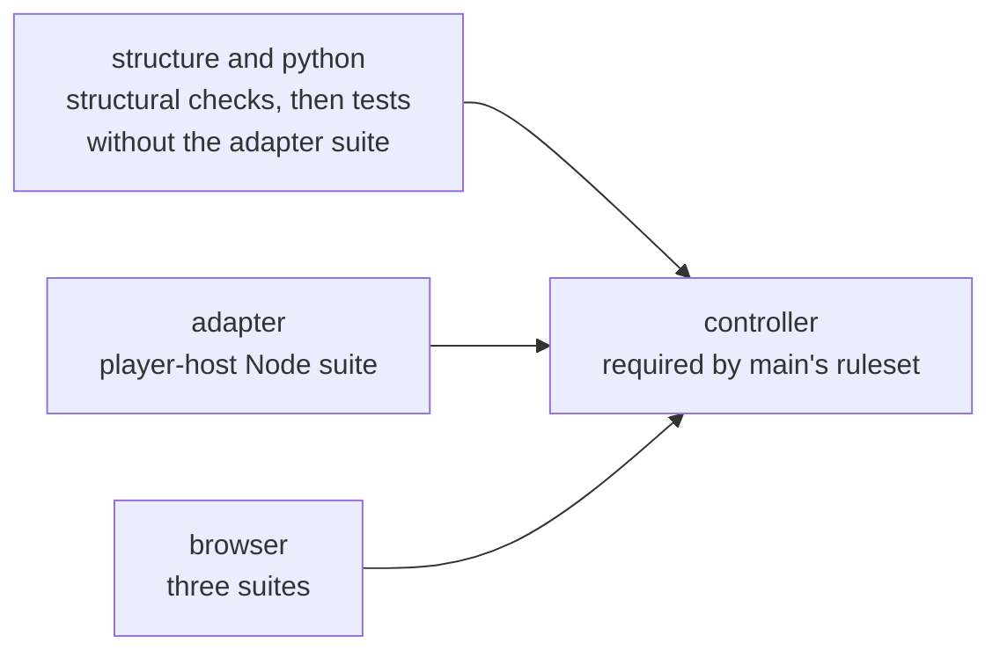

# Parallel jobs behind the required check

**Status: proposed, 12 November 2026.** Nothing here is built. The
[CI profiles page](../workflows/ci-profiles.md) describes the running system. The issue
that tracks the cost of the pull-request check,
[#557](https://github.com/CVX-Hull/enactive/issues/557), owns this proposal.

## Problem

A pull request that changes code waits about four minutes for its check. Recent
full-profile runs took 203, 220, 238, 243, 298 and 301 seconds. The check is C-PORTABLE
on the [controls page](../controls.md); its cost is paid on every change, so lowering it
without weakening it is worth doing
([R-CONTROL-BLOAT](../risks.md#development-risks)).

Where the time goes, from the hosted run of the pull request that split the adapter
tests into parallel files ([#561](https://github.com/CVX-Hull/enactive/pull/561)):

| Part | Time |
| --- | --- |
| Setup: checkout, Python and Node, dependency installs, Chrome | 51 to 56 s |
| Python test lane, including the player-host adapter suite at 126 s | 161 s |
| Browser lane, three scripts one after another (66, 43 and 60 s), beside the Python lane | 169 s |
| Whole run | 243 s |

The hosted runner has four virtual CPUs. The Python workers, the adapter's Node
processes and Chrome all share them, so each runs slower than it would alone. Splitting
the adapter suite into parallel files took it from 68 s to 14 s on a 16-CPU machine and
changed almost nothing on the hosted runner. The limit there is total CPU, not ordering.

## Proposal

Run three lanes as separate jobs, each on its own runner, and keep one required check.

The diagram answers "which jobs run, and which one does the ruleset require?" Boxes are
jobs; arrows mean "must finish before".

**Every lane always runs.** Each lane job checks out the commit, runs `tools/ci.py` to
choose the profile exactly as the single job does today, and runs
`tools/check.py --profile P --lane L`. When the profile does not need that lane, the
command prints that and exits successfully. There is no planning job and no job-level
condition, so no lane is ever skipped for a legitimate reason.

| Lane | What it runs | Profiles in which it does work |
| --- | --- | --- |
| `structure-and-python` | The structural checks every profile runs today, then the Python tests except `tests/test_player_host_adapter.py`; in the viewer profile, that profile's component tests | all (tests only in full and viewer) |
| `adapter` | `tests/test_player_host_adapter.py`, which runs the player-host Node suite | full |
| `browser` | The three browser suites | full, viewer |

**`controller` keeps its name**, so main's ruleset and its required-check setting do not
change. It needs all three lanes, always runs, and passes only if every lane's result is
`success`. Because no lane is ever legitimately skipped, that one rule is complete: a
failed, cancelled, timed-out or skipped lane fails the check.

The local command does not change. `tools/check.py` with no `--lane` runs everything as
it does now, so one command still gives a full local pass.

## Risks to the required check

This change touches how C-RELEASE's required check is produced. A wrong green there puts
an untested tree on main ([R-WRONG-MERGE](../risks.md#development-risks)).

**A skipped job counts as passing.** On GitHub, a skipped job satisfies a required
check, and a job is skipped when a job it needs fails. A `controller` that merely
"needs" the lanes would be skipped, and so pass, exactly when a lane fails. The guards:

- `controller` runs under `if: always()`. A weaker condition such as "not cancelled"
  would leave it skipped, and green, when someone cancels a run on the current head.
- Its only step fails unless every needed job reports `success`. It needs no checkout
  and no Python, so it cannot fail to start for a reason of its own.
- A test in `tests/test_ci.py` pins the workflow: `controller` needs every other job,
  carries exactly `if: always()`, and every job has a timeout.

**A lane can pass while quietly running fewer tests.** Two Python test files skip their
cases when a host's Node packages are not installed
(`tests/test_player_host_contract.py`, `tests/test_curator_host.py`). A lane that
installs "only what it needs" could drop them and still be green. The guards:

- The `structure-and-python` lane installs both host packages, as the single job does
  today, and the workflow test pins those install steps.
- A unit test asserts that the Python lane and the adapter lane together collect
  exactly what the full profile collects.
- The adopting pull request shows the lanes' passed and skipped totals adding up to
  today's totals (966 passed and 51 skipped on the run cited above).

**Proof on GitHub before it is relied on.** Throwaway pull requests, closed without
merging, with their run links in the adopting pull request:

- a failing Python test, a failing adapter test and a failing browser test each turn
  `controller` red;
- a run cancelled by hand on the current head turns `controller` red, not skipped;
- a second push to the same pull request leaves no stale green on the new head;
- a documents-only change and a viewer-only change turn `controller` green with the
  unneeded lanes reporting that they had nothing to do.

## What it should save

Each lane pays its own setup. The wall time becomes setup, plus the slowest lane, plus
`controller` starting.

| Lane | Setup | Work, alone on a hosted runner (estimate) |
| --- | --- | --- |
| `structure-and-python` | about 55 s (Python lockfile and all three Node installs) | 80 to 120 s |
| `adapter` | about 45 s (Python lockfile and one Node install) | 45 to 80 s |
| `browser` | about 20 s (Node, Chrome and the system Python only) | 70 to 120 s |

That points to **about two and a half to three minutes instead of four**. The local
figures behind it are 62 s for the Python tests without the adapter suite on four
workers, 38 s for the adapter suite at three files at a time, and 55 s for the browser
lane, all measured on 12 November 2026. The hosted runner has been 1.6 to 2.9 times
slower than local under load; how much of that is contention is what is unknown.

The saving is real but modest, and run times already vary by a minute and a half. So:

- **Measure before building the rest.** One throwaway pull request runs the three lanes
  as separate jobs with no other change, five times.
- **Build only if** the median of those five runs is at or under 2 minutes 45 seconds,
  and a documents-only check takes no longer than it does today (about one minute).
- Otherwise the proposal is dropped and this page records why.

Costs:

- **Runner minutes.** Three runners instead of one. The repository is public, so hosted
  minutes are free; the cost is queueing when several pull requests run at once.
- **Complexity.** The workflow grows from one job to four, and the pass rule becomes
  something that must itself be right. This is the main cost.
- **Logs.** A failure is read in its lane's job, not in one long log.
- **Waiting on the check.** The documented way to wait is one
  `gh pr checks --watch`, and auto-merge is queued "when only the required check is
  still running". `controller` does not exist as a check until the lanes finish, so
  both may behave differently. The probes above check this, and the three pages that
  describe the procedure change with the workflow
  ([development](../workflows/development.md),
  [operator permissions](../operator-permissions.md),
  [coding-agent hosts](../operations/coding-agents.md)).

## What does not change

- Main's ruleset, the required check's name and the merge rules.
- Profile selection: which changes qualify for the editorial and viewer profiles, and
  the rule that any doubt selects the full profile.
- What is tested. No test is removed, skipped by path or made conditional on labels.
- Supply-chain settings: actions pinned by commit, installs with required hashes and no
  install scripts, a read-only token. Dependency caching is left out, because a cached
  environment would bypass the hash check on restore; it can be decided separately.
- Native and gameplay evidence stay separate from this check.

One current rule does change and is rewritten with the workflow: the CI profiles page
says there are "no conditional required jobs" and a test asserts the workflow has the
single job `controller`. The new statement is that `controller` is the only required
job, every job always runs, and none carries a condition other than `controller`'s
`always()`.

## Alternatives considered

- **Leave it.** Four minutes is tolerable, and the complexity is real. This is the
  outcome if the measurement misses the bar.
- **Move only the browser lane to its own job.** The adapter suite and the Python
  workers would still share four CPUs; the estimate is about 195 s, too little gain.
- **A planning job that tells lanes whether to run.** It saves idle setup on
  documents-only changes, but it adds a serial step and makes skipped lanes legitimate,
  which is exactly the state the pass rule must then tell apart from a failure.
- **A larger hosted runner.** It removes the contention without changing the workflow,
  but larger runners are billed even for public repositories.
- **Run the browser scripts in parallel inside the one job.** Three Chrome processes
  on four busy CPUs would make timing-sensitive tests flaky.
- **Skip the adapter suite unless adapter files change.** The CI policy forbids
  path-conditional selection outside the explicit component allowlists, because inferred
  impact is how an untested change gets through.
- **Share one Python child across adapter tests.** It would cut the suite's CPU time,
  but each test currently proves that the host owns and closes its own child.

## Delivery

1. The measurement pull request, closed after five runs.
2. If the bar is met, one pull request: the workflow, `--lane` in `tools/check.py`, the
   lane partition test, the workflow pinning test, the CI profiles page, the C-PORTABLE
   and C-RELEASE rows, the testing guide and the three pages on waiting for the check.
   It carries the probe runs and the reconciled test totals, and it needs an independent
   review before merge, because it changes how the required check is produced.
3. The measured timings replace the estimates here; this page then becomes a historical
   record and the CI profiles page carries the current rules.
