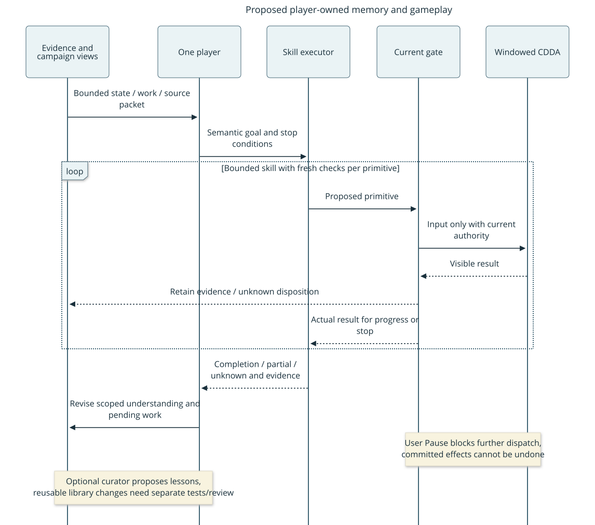

# Player-owned mission design

This is the accepted design deliverable for [#137](https://github.com/CVX-Hull/enactive/issues/137),
with implemented component checkpoints and remaining acceptance work below; it
is not a gameplay admission. The coordinated mission/7 ingress now replaces the
waypoint runtime. [Architecture](../architecture.md) and [protocol](../protocol.md)
own current behavior; lifecycle and independent mission acceptance remain pending.
The [assessment](../research-memory-architecture.md) supplies the research rationale;
the [trace pilot](../acceptance/2026-10-19-memory-trace-pilot.md) supplies bounded
first-run development cases. GitHub owns scope, allocation and live stages.

## What changes for the owner

One designated playing system receives a finite objective and handles its own
plans, memory, semantic skills, routine recovery and normal lifecycle. The user
and engineering lead can observe without supplying keys, tactical advice, memory
repairs or another assignment at every skill boundary. Ordinary-width graphical
play, source inspection and immediate Pause remain available.

The next delivery is one useful supply-and-shelter mission, followed by an explicit
readiness decision for a fresh seven-day assessment. The short mission is not the
seven-day result. A safe failed mission remains a failure, even if its incident
report or component tests are useful. No model superiority or memory benefit is
claimed from this functional delivery.

Reader question: **who remembers, who chooses, and who can send input?**
The existing proposed logical diagram applies to this design:

Boxes are responsibilities, not required model tiers/processes. Solid arrows are
requests and updates; dashed arrows are returned observations/results. Retained
memory informs choices but grants no dispatch authority. Text equivalent: the
player retrieves a bounded state/work packet, selects a skill, receives feedback
from guarded execution, then updates or corrects its understanding and replans.
[Editable diagram](../diagrams/player-owned-memory.mmd). The diagram remains
proposed until the corresponding protocol/runtime is delivered.

## Responsibilities and physical ownership

| Responsibility | Implementation boundary and limit |
| --- | --- |
| Mission policy and decisions | A designated general-purpose Codex player; no concrete paid provider or automatic model routing. It owns subgoal/skill choices, evidence interpretation and routine replanning. Its chat is replaceable. |
| Durable understanding | Passive campaign memory and canonical retained evidence; no controller/process imports or tool execution. Facts from native fields and fallible image/model interpretations are distinct. |
| Skill policy | Passive bounded navigation, visible-item/menu and activity policies return one proposed primitive or a progress/stop result. They do not acquire authority. |
| Execution/session | One `MissionRuntime` in the existing service assembles policies, counters, memory and controller receipts. It is the only general admitted runtime; no second campaign service beside the waypoint worker. |
| Native/lifecycle custody | The existing controller plus a fixed wrapper launch/normal-exit adapter. Native CDDA owns outcomes. No arbitrary command, PID, path, environment or save editor is accepted from the player. |
| Engineering and review | Lead designs/integrates/adjudicates/releases; independent reviewers read evidence. During deciding gameplay they supply no routine gameplay assistance. Optional curation is not an ordinary-action approval gate. |

A single model can fill several reasoning roles. Luna remains a candidate, not a
selected configuration. Use a capable single-player baseline for this delivery;
record exposed identity/effort, otherwise unknown. Stronger consultation is an
in-system reasoning operation, not authority or independent source truth.

## One current migration

Replace `/api/gameplay` and `gameplay-*` CLI ingress with `/api/mission` and
`mission-*`; migrate server, CLI, viewer, tests and project command-rule examples
together. Remove the old live waypoint worker/inbox ingress, not a fallback.
Waypoint-return remains a scenario built from current navigation skills; useful
passive contracts/planner/supervisor logic may remain only with current consumers
and tests. Remove unconsumed execution scaffolding rather than keep two players.

Advance gameplay records together to `gameplay/2` where their shared encoding is
used; unsupported `gameplay/1` input rejects. Introduce `mission/7` for the strict
mission request/state envelope and `campaign-memory/3` for the durable index.
Advance the evidence-store metadata to version3 and native observation to wire4
for the visible-menu field below. Update every active producer/reader/fixture,
source patch, build pin receipt and permission-rule example in the same integrated
candidate. Native3 and prior executable metadata cannot be current inputs.
Historical reports/raw artifacts remain historical evidence, not runtime readers.

Deploy only with all writers stopped, old slots terminal/reconciled, normal save
and owned process shutdown. No live old lease, inbox, queue or relative-coordinate
map migrates. An offline import of historical source references is explicit and
advisory; unsupported files are rejected without modification. No compatibility
alias, dual reader, version guessing or automatic old-state upgrade. Current docs,
setup/checks and operation preflight change with implementation, not merely because
this proposal is accepted.

## Minimal objects and interfaces

Use the existing strict finite-JSON/JSON-Schema machinery. Extra fields, duplicate
keys, nonfinite numbers and unsupported versions reject. Runtime ingress stays
bounded to64KiB; source images travel through existing authenticated frame routes,
not JSON. IDs are audit/binding fields, not OS isolation.

| Object | Required fields / meaning |
| --- | --- |
| Mission admission | `mission_id`, `objective`, `player_id`, `scenario`, `limits`, `cleanup_reserve`, `allowed_skills`, `allowed_lifecycle`, `update_policy`, `configuration`. Immutable prospective scope. Configuration identifies source/native/skill/lesson/model conditions and unavailable metrics. |
| Mission state | `mission_id`, `epoch`, `phase`, `player_id`, `objective`, `subgoal`, `active_skill`, `remaining`, `pause_cause`, `unresolved_effects`, `memory_version`, `last_evidence`, `interventions`. Advisory status is never a lease. |
| Skill request | `request_id`, `mission_id`, `epoch`, `kind`, `goal`, `sources`, `expected_session`, `expected_revision`, `expected_boundary_id`, `limits`, `work_id`, `phase_id`, `perception`. Request ID deduplicates admission; it never causes a timed-out side effect to replay. |
| Skill result | Same request/mission/epoch plus `state`, `reason`, `progress`, `before`, `after`, `primitive_receipts`, `next_observation`. States: running/completed/partial/blocked/failed/unknown/paused. Delivery and semantic completion are separate. |
| Evidence reference | Existing session/revision/frame/hash/boundary plus canonical retained source ID. Receipt time is not observation time; missing scene/time remains null. Menu/activity evidence is not a normal-play scene. |
| Claim | `id`, `kind`, `key`, `value`, `text`, `scope`, `observed_time`, `received_time`, `coverage`, `sources`, `supports`, `status`, `supersedes`. Native fact versus interpretation; current/last_seen/inferred/disputed/retired/unknown. |
| Work instance | `id`, `intent`, `scope`, `predecessor_work_id`, `stage`, `progress`, `available`, `committed`, `predicted_output`, `observed_output`, `unresolved_effects`, `sources`, `next_verification`, `status`. Association with an engine activity may be uncertain. |
| Decision/context packet | Explicit packet ID, query, memory version, selected claim/work/source IDs, applicable lesson IDs/counterexamples, omitted/truncated counts and original objective/remaining limits. No implicit claim that it contains everything. |

`scenario` identifies an ordinary creation/load UI condition; it cannot prescribe
hidden world contents. Scope contains mission, native session and coordinate epoch;
character/world names are fallible observed identity clues, not a universal key.
Native position stays relative. Explicit visible relocalization is needed before
a new session can use an old place; no origin-vector arithmetic across reloads.

Expose these operations through the one mission ingress and literal CLI:
`start`, `status`, `observe`, `context`, `remember`, `correct`, `skill`, `result`,
`reconcile`, `handoff`, `claim`, `lifecycle`, `stop`. Fixed kind-specific schemas;
no generic execute/callable/import endpoint. `status/context/result` are read-only.
`remember/correct` update advisory records only. `skill` returns an accepted ID
quickly; its bounded worker settles through `result/status`. Only one operation
can own native input; concurrent skill/lifecycle admissions reject. Retained
candidates/results are bounded and never resurrect an expired operation.

Request producers derive opaque expected fields from the same retained observation
as their chosen source, using the pure canonical producer for ordinary skill/lifecycle
intent. Select a named public phase scope and primary archive bundle explicitly;
the producer never selects fresher evidence or certifies authority. Specialized
memory/handoff/recovery records retain their current typed shapes.
[Narrow source-binding validation](../protocol.md#skill-request-binding-errors)
rejects an internally inconsistent request before mutation only after applicable
existing authority/ownership/budget fences. It preserves original deadlines and
permits a new fully guarded request; it does not infer new bindings or recover an
already stopped phase. Failed deciding002 remains evidence, never a resumed pass.

The existing user Observe/Pause interfaces remain. User direct input first revokes
mission authority; it cannot race an active mission. A mission records external
intervention and cannot conceal it by acquiring another epoch. The ordinary
controller CLI remains useful outside an admitted mission, not a legacy mission
execution path.

### Dispatch capability and boundary matrix

The design replaces the base revision's normal-play/action-only run capability;
the passive source checkpoint below records the implemented mission API. One
`MissionLease` object is created only inside the controller. It binds mission ID,
mission epoch, actor assignment, native session and pause generation. Only the
mission runtime receives it; JSON/player names never recreate the object.
`acquire_mission(...)` requires reconciled empty command/recovery slots, a fresh
successful supported boundary and explicit mission-phase eligibility.
`execute_mission(lease, logical_id, kind, payload, expected_session,
expected_revision, expected_boundary_id, deadline)` accepts exactly one registered
action or permitted printable/named key through the existing serialized transport.
It returns the existing exact logical/native receipt envelope, including publication
and unknown status. No broad private `_execute` bypass or unguarded macro path.

| Operation | Eligible boundary and capability rule |
| --- | --- |
| Acquire | Fresh unpaused normal play, or supported menu in the admitted creation/load/interaction/lifecycle phase. A menu lease is not permission to navigate normal terrain. No pending/frozen work. |
| Navigation step | Normal play only; same-session position and existing shared movement guard, registered direction, exact displacement afterward. |
| Item/menu action or key | Fresh supported menu or admitted ordinary entry action; exact session/revision/boundary and registered binding. UI selection additionally rechecks the requested visible row/label/count scope. Unknown prompts stop. |
| Observe/activity poll | No input capability required; serialized Observe may reconcile expired transport. Retention grants no input. Activity-poll metadata never admits ordinary keys. |
| Recovery | Release/revoke lease first; use existing exact recovery request/confirmation identities and native eligibility. Stay paused afterward. A new generation/observation and deliberate permitted continuation are required before another lease. |
| Resume | No old lease can Resume itself. Runtime may request deliberate Resume only for its admitted initial startup or documented lifecycle/recovery/handoff transition, with exact pause-generation/cause and no newer user Pause/takeover. Unknown cause defaults to user-controlled stop. |
| Native session change | Immediately revoke old lease/queued intents, retain pending request as unknown, enter lifecycle reconciliation. Only the explicitly outstanding launch/create/load/save-exit phase may adopt a new supported session after its completion evidence below. |
| User Pause/takeover, deadline, shutdown or fault | Revoke synchronously before bookkeeping; no automatic reacquisition or Resume. Polling/status remain available. |

The controller checks the same object/generation at queue admission, after its
fresh observation and immediately before native publication/commit. Native still
validates its durable token, request session/revision and matching presented
boundary freshness at input commit. The host additionally binds the expected
boundary ID; wire4 ordinary action/key/resume requests carry `boundary_id` and
`takeover_generation` from the informing observation and check both at dispatch, rather than infer
a caller's intended menu from action text. A command
cannot cross a changed menu, actor epoch, session or Pause by waiting in a queue.
Recovery and native activity effects already committed remain outside rollback.
Source/format adoption must migrate the existing owner checks and tests together;
retaining the normal-only gate and calling external keys alongside it is rejected.

### Request shapes

Every request has `schema=mission/7`, `kind` and a unique `request_id` except read-only
status/result/context. Mutating existing-mission operations additionally bind
`mission_id` and `epoch`; input decisions bind the informing session/revision and
boundary. Exact operation payloads are:

| Kind | Payload beyond binding |
| --- | --- |
| start | `admission`: the immutable mission admission object; rejects another nonterminal mission. No native input is implicit. |
| status / result | `mission_id`; result also `operation_id` of the retained operation. |
| observe / reconcile | No replacement intent. Reconcile references `unresolved_request_id` and a new observation; it cannot rewrite the old delivery disposition. |
| context | `mission_id`, `query`, `scope`, `max_bytes` (<=32768); returns selected IDs/version and omission counts. |
| remember / correct | Typed claim/work update; correction names retired derivation IDs, replacement interpretation/support and reason. Clients cannot insert native facts. |
| skill | The exact skill request; kinds navigate/menu/item/activity/inspect/edit/interact, each with typed goal fields and bounded stop conditions. No callable, shell or arbitrary path. |
| handoff / claim | Handoff names settled checkpoint/source IDs and intended successor role; claim consumes its originating request ID with exact epoch, boundary, native Pause origin and host/native generations after reconciliation. Runtime compares its designated actor and role; IDs are audit fields. |
| lifecycle | `operation` launch/create/save/exit/load/finish, supported observed identity/target when relevant, before-source IDs and explicit remaining limits. No player-supplied process path/PID. |
| stop | Pause reason only; normal finish uses lifecycle(operation=finish). Former finish flags reject. |

Only request IDs known as read-only may be retried as reads. An identical retained
mutating request returns its existing state/result and never repeats inputs;
a conflicting payload for the same ID rejects. Skill goals are concretized in
strict shared schemas before worker dispatch: navigate has scoped integer target;
menu has purpose, exact label and focused/activated/inspected outcome; item also
has quantity and its acquired/consumed/stored/dropped outcome. Activity has
ordinary operation, visible target/progress/time bound and interrupt policy;
inspect has a registered UI purpose. This is a closed enum, not a policy language.

## Evidence and memory storage

Reuse the existing controller journal/native frame identities. One mission-owned
canonical archive retains successful normal/menu/activity/recovery frames and
metadata before they are referenced; no second raw game log. Extend evidence
retention, not a parallel recorder. Separate “can retain this source” from “is
this source eligible for this primitive?” Movement still requires the current
normal scene and existing shared terrain/creature predicates.

Use Python's bundled SQLite for the campaign index: one writer, standard
transactions, fixed version in `PRAGMA user_version`, bounded tables for claims,
work and decision references, and exact queries. No ORM/vector DB/graph service,
custom history/VCS or automatic lesson learner. Original images/journal records
remain canonical observation evidence. SQLite owns the retained semantic assertions,
corrections and work updates; its current views are rebuildable projections of
those records. A lost assertion cannot be recreated as truth from an image hash.
Rebuilding a source index alone does not reconstruct lost interpretations. A transaction cannot atomically commit CDDA input plus an acknowledgment.
Never use database recovery as an outbox retry of unknown game effects.

Initial admission ceilings:4096 retained frames,1GiB total image bytes,32MiB per
image,2048 claims,256 work records,2048 decisions,8sources per claim,1024characters
per text field. Ordinary context response <=32KiB, <=32claims,16work entries and16source
references, with omissions explicit. Raw Work assertions retain eight sources;
coherent `WorkView` projections can retain128 premises. Bound successor context
uses a complete <=128KiB/128source/16Work envelope; query relevance and unrelated
Claims cannot displace required Work. Issuance preflights the same projection in
96KiB, reserving32KiB for wrapper/query/post-Pause metadata and one of128 distinct
source checks for that new source. Correctable fit refusal preserves original
authority before stopping input. Work writes remain frozen until readmission.
Missing evidence retains unknown dispositions and can still invalidate fit;
neither corruption nor fresh source authority is concealed by this preflight.
Reserve capacity for terminal receipts and
cleanup before dispatch. Hard ceilings are implementation bounds, not permission
to consume all space; mission preflight chooses finite lower budgets and a cleanup
reserve. If storage cannot preserve evidence, stop before further side effects.
No silent eviction of referenced sources; explicitly record unavailable/retired
sources and invalidate dependent advice. A rebuild is verified against retained
references; broken sources remain broken, not reconstructed facts.

### Durable mission ledger and crash ordering

One project-local SQLite file at `.runtime/missions/<mission_id>/mission.sqlite3`
owns both mission execution metadata and semantic memory; it is not a Git-like
history system. Fixed tables: immutable admission/configuration; mission phase,
epoch, pause cause and original deadlines; admitted semantic requests with canonical
payload hash/state/result; logical primitive/native UUID mappings and terminal or
unknown disposition; cumulative charges/reserves; handoffs; source references;
immutable claim/correction/work-update records and rebuildable current views;
decision/context references. Keep source images/journal evidence in the one archive.
Before returning a context packet, the runtime durably records its exact contents
and packet ID through the existing canonical journal. Decisions persist that ID
and their selected references; text rationale is not a substitute for correlation.
The passive memory module validates decisions against a bounded issued-packet
cache. Reopening requires a new context query rather than restoring that cache or
input authority. Missing journal evidence remains an explicit audit gap.
One process/file lock and one serialized writer; no concurrent restored mission.

Transactionally reserve input/capacity/cumulative cost and insert semantic request
and logical primitive **before** attempting transport publication. Record native
UUID/published metadata when available and settle with exact receipt/source IDs.
There is no cross-process database/native atomic commit: a crash between these
steps leaves the intent potentially sent, not safely retryable. Count it conservatively
and mark unknown on reopen. Settlement/storage failure synchronously pauses further
inputs and preserves existing controller evidence for reconciliation.

On service reopen verify schema/configuration and source references; retain original
admission/deadline, spent costs and every nonterminal mapping, mark interrupted
operations unknown, clear ephemeral capabilities/queued execution and remain paused.
Never restart workers or dispatch from persisted requests. Querying old results is
allowed; continuing requires explicit fresh reconciliation and readmission to the
remaining original scope, or a new separately recorded attempt. An unknown native
UUID may lack a terminal receipt even after its effect is separately observed.
Wall-clock rollback or unprovable remaining budget stops instead of renewing time.
Persisted counters are charged before dispatch, including attempts with unknown
outcome; report actual known delivery counts separately, without refund-by-guess.

Bound mission request/primitive records by admission's input ceilings plus bounded
read/control operations; reject growth beyond4096semantic requests,8192primitive
mappings,16handoffs or64MiB database. Claims/updates and context limits below remain
independent. Reopening tests inject failure before publication, after publication,
before settlement and during source retention/cost update. They must prove no
double input, no renewed budget/lease and retained unknowns, not pretend to transact
the game through SQLite. Deleted semantic records cannot be reconstructed as truth
from raw frames; explicit loss remains loss.

Pause cause is set by controller/runtime events, never a client-provided reason
claim: user/takeover/unknown, internal_bootstrap, internal_lifecycle, internal_handoff, internal_recovery or finishing.
A newer user/takeover generation always supersedes an internal cause. Deliberate
continuation compares the exact recorded cause and generation before Resume and
again before reacquisition; unknown origin defaults to no automatic continuation.

Native facts enter automatically with their actual coverage. Player observations
from screenshots enter as interpretations with source references; language-model
assertions never become native facts. `correct` appends a correction, retires the
specified derivation and flags dependent interpretations/plans. Preserve surviving
independent support; duplicate citations or reviewer repetition do not increase
support. Each bounded support group is conjunctive; alternative groups are
explicitly separate. Retiring one premise invalidates that derivation, not an
independent surviving group. Reject cyclic claim dependencies; this is a small
provenance check, not a general theorem prover. Historical truth and present
applicability are separate. An inventory
page proves only its inspected coverage, not all containers or future stock.

The current-view reducer uses typed `key={subject, property, unit, coverage_id}`
within scope, not prose similarity. Initial properties are visible needs, displayed
supply counts, observed place and work progress; unsupported identity/unit alignment
stays separate. Duplicate labels do not identify the same item/container. A value
contains a typed quantity/state or explicit unknown; free-text advice is not an
inventory observation. Client `status=current` is only a request, never permission
to override this reducer.

Order observations by supported native session/revision and observed game time
when available, never arrival/receipt order. Comparisons across sessions require
explicit supported identity/time alignment; otherwise retain separate last-seen
claims. A delayed older observation cannot supersede a newer frontier. Conflicting
values at the same supported order, unknown/incomparable order or incompatible
coverage produce disputed/unknown rather than a guessed last writer. A later
partial page never clears uninspected containers. Native absence requires the
corresponding explicit visible coverage; unsupported negative interpretations
remain interpretations.

Persist the supersession/correction frontier even if its source later becomes
missing/retired. Losing the newest support makes the current value unknown; it
cannot revive an older superseded stock count. Independent valid support at the
same frontier may survive. Only a new supported observation/correction can establish
another current value. Any potentially state-changing input or unknown effect
invalidates affected freshness (conservatively all dynamic supply/needs/work keys
when effects are not known); historical observations remain last-seen. Retrieval
reports its as-of source and requires fresh reobservation for a current execution
precondition. Rebuilding projections must reproduce these frontiers, conflicts and
loss dispositions, not re-run an LLM to invent missing facts.

Retrieve at subgoal/skill choice, material change, surprise and context replacement,
not per key. Rank exact scope/status/eligibility before text relevance; use simple
term matching/exact keys first, no embeddings or trained composer. Permit an empty
useful result and a concrete reobservation request. Record which packet IDs actually
informed a choice. Mutable campaign facts and scoped provisional tactics may
change under the admitted update policy; executable skills/guards/reusable lessons
stay frozen. New general lessons remain candidates outside the executable library.

## Semantic skills and outcome feedback

Navigation takes a scoped destination or bounded sequence of observed places,
not a long blind key list. The retained visible-neighbor graph supplies candidate
routes, current observation authorizes each next step, and the executor verifies
displacement before continuing. Maximum32primitives per request, bounded node set
and deterministic shortest-path search on admitted cardinal cells. Unknown cells
are unavailable; changed obstacles/threats, menus, no progress, world changes,
Pause or missing evidence produce a partial/blocked/unknown result for the player.
Reached-target verification is separate from permission for another move.

Reuse review: pinned `handle_action.cpp` selects auto-move directions before ordinary
`get_player_input()` when a destination exists; directional autotravel creates a
native route and destination. The current bridge offers activity interruption but
no observed-route/step restriction for this flow. Therefore this iteration does
not start native autotravel or read `map::route` on unseen cells. Use the smallest
bounded graph search over already observed cells, sharing `harness/movement.py`
guards. This is a specific authority/visibility gap, not a general pathfinding
library. Revisit native navigation when a proven current-gate integration exists.

Visible item/menu skill takes exact displayed label, intended quantity, menu purpose
and outcome goal. Reuse native registered actions, filters, invlets/count controls;
no direct insertion/removal from inventory. It may navigate a bounded number of
rows or type a bounded filter while observing every transition, without another
model decision for every key. Ambiguous/disabled/missing targets, changed menus,
partial quantities or warnings return an exception. Selection is not acquisition,
consumption or completed storage; completion needs a subsequent visible result.

Wire4 adds nullable `ui`: purpose/title, selected visible row, visible rows with
screen-order ID/text/enabled/displayed hotkey, visible filter/count text and a
coverage tag. Hook only rendered `uilist`/inventory selector rows, never enumerate
hidden inventory, off-page/filter-excluded entries, recipe internals or latent
needs. IDs are scoped to the exact rendered boundary/frame and cannot select a
hidden item. Capture/render and metadata must describe the same presentation;
if a hook cannot attest that, `ui=null` and the operation requests interpretation
or stops, rather than filling fields from engine internals. A semantic selection
may use player-supplied fallible screenshot interpretation, but cannot silently
assert exact native label/quantity coverage from it.

Native activity skill uses ordinary wait/rest/craft UI and activity polling. It
tracks requested versus elapsed game time, visible progress, committed inputs,
unfinished output, interruptions and next verification. It does not force sleep,
disable questions/alarms, modify mechanics or treat a forecast as stock. Bound
polling by original wall/input/game-time budgets and permitted repairs. User Pause
revokes further harness dispatch; it cannot reverse already committed actions or
promise to freeze an autonomous native activity. Expose that limitation and use the
existing eligible interrupt/confirmation path when policy permits.

One shared outcome contract composes deterministic invariants with fallible semantic
judgment. Missing evidence -> specific observation; stale prerequisites -> reobserve;
partial/refused activity -> bounded supported repair or revised plan; contradiction
-> correct the derivation and revise dependent plans; repeated no progress ->
strategy change/stop; unknown delivery -> reconcile without replay; software fault
or unsupported required capability -> engineering incident and stopped attempt.
Focused internal reasoning is allowed when reasoning can help, including with the
strongest model already active. No per-key critic or identical repeated review loop.

## Lifecycle, restart and player-context replacement

Mission phase: admitted -> active -> (paused/reconciling/handoff/finishing) ->
completed/failed/stopped. Every transition retains original admission and cumulative
costs. Hard limits reserve cleanup time/inputs/space. Normal completion requires
observed mission objectives and verified normal lifecycle; a timeout/process absence
alone is neither a save acknowledgment nor proof of success.

Registered lifecycle is only launch, ordinary creation, normal save/menu exit, normal process exit,
restart/load and finish, through the fixed prepared project wrapper and ordinary
engine UI. Use an owned `subprocess.Popen` handle, never an arbitrary player PID.
Launch rejects another owned/live game. Normal exit waits for its owned child;
no force-kill/signal or global application changes. If normal exit/save cannot be
verified within the reserve, stop with evidence and a cleanup incident. Startup
at the main menu and loading are supported mission phases, not normal-play facts.
The player chooses ordinary menu options; runtime owns process handles and records
them. Native session changes invalidate execution authority/maps until explicit
fresh observation and supported identity/relocalization.

The [source adapter](../../harness/native_process.py) launches the fixed prepared
wrapper directly when called: its final
`exec` makes the owned process become CDDA. Preparation and validation share one
root-bound script template, so a bundle copied from another checkout cannot use
that checkout's binary/userdir unnoticed. A zero wrapper exit still needs prior
fresh native readiness and normal save/menu/exit evidence. The `open -W` waiter in
the engineering probe provides no native exit-code guarantee. Earlier direct
wrapper launch had weaker desktop-app binding; actual window/spectator/bridge
readiness is required, while desktop-tool binding is not a gameplay dependency.

Initial admission may exist before a native child or scene. `launch` owns the
fixed wrapper handle and records an internal-bootstrap operation, then awaits a
fresh paused main-menu frame. Only that exact launch/create/load operation can
request the first deliberate Resume; a general mission start never unpauses an
unowned existing game. Ordinary new-character creation has its own lifecycle phase
and verifies the displayed setup/identity and first in-game observation. The
`playing(true)` session change is expected for that phase, but still revokes the
old menu lease and requires explicit fresh reconciliation/acquisition.

Wire4 additionally publishes authority metadata `pause_origin` and monotonic
`takeover_generation` (actual human input only, scoped to native process identity).
Host user Pause is tracked by the controller's separate pause generation. Bind
both values before each lifecycle input; startup/session-change origin alone is
not enough if a newer human/host event occurred. Native `human_input()` increments
the takeover counter even if a later world change overwrites the latest pause
origin. Reconcile only the exact owned launch/session-transition with no newer
host Pause or takeover; compare generations immediately before Resume/acquisition
and again at commit. New-process counters are not compared numerically to old ones:
require the owned child/new native identity and initial current observation. Any
unexplained origin/generation or intervening user input stays paused. Test human
and host Pause during launch, creation, load and recovery, including an event
followed by a world change. None may be mistaken for bootstrap permission.

Lifecycle requests have their own durable operation ID and phases, separate from
ordinary primitive delivery. Result fields are `operation_id`, `phase`,
`before_session`, `after_session`, `before_turn`, `after_turn`, `sources`,
`native_receipts`, `owned_child_exit`, `identity_status`, `disposition` and
`unresolved_requests`. Missing times remain null; no scene is invented for a menu.

| Lifecycle phase | Required evidence and allowable conclusion |
| --- | --- |
| launch | Fixed wrapper's owned child handle plus fresh supported native main-menu frame; launch return/process alive alone is not readiness. |
| create | Observed ordinary scenario/attributes/world and character menus followed by fresh in-game identity; no prearranged hidden world. Adopt only this expected creation transition, preserving any input ACK uncertainty. |
| save -> menu | Ordinary save UI/confirmation and fresh main-menu presentation; retain input ACK if available. A session change may erase the old ACK, which stays unknown even when the lifecycle transition is verified. |
| exit | Previously verified saved/menu state plus the owned child's normal exit result within reserve. A missing process without this preceding evidence is unresolved cleanup, not successful save/exit. |
| restart -> load | New owned child/main-menu frame, ordinary observed world/character selection, then fresh in-game frame. Verify displayed identity against retained source and exact pre-save turn when available; ambiguity stops acceptance. |
| relocalize | New coordinate epoch; recover places only from supported visible landmarks/identity. Same character/turn does not prove old relative vectors still apply. |
| finish | Objective evidence, normal saved/menu transition and normal owned-child exit, no live writer/queue/lease. Publish outcome separately from any unknown primitive ACK. |

`playing()` currently changes native session and clears old pending acknowledgment;
the controller correctly revokes/freezes on that change. Lifecycle reconciliation
must use the exact outstanding phase and newly observed frames/owned handle, then
record “effect verified, delivery unknown” where appropriate. It cannot relabel an
unknown ACK, blindly resend Enter, or adopt an unrelated world just because a menu
transition occurred. New-session adoption requires explicit reconciliation and
fresh capability acquisition, with user Pause/takeover precedence intact. A saved
menu plus exact reload identity/turn validates continuity without hidden save reads;
if that visible comparison is unavailable, continuity remains unproven.

On player replacement, the playing system first pauses/releases its current lease,
settles every tool handle and native slot, persists objective/state/work/source IDs
and counters, and emits a one-use handoff reference tied to the mission epoch.
A clean-context successor receives only that reference, the admitted instruction
and read-only retrieval tools, loads the bounded packet and independently reads
needed sources. It claims the new epoch and deliberately resumes only an eligible
internally requested handoff. User Pause/takeover never auto-resumes. Unknown
pending effects prevent input claim until explicit reconciliation, not a new actor.
A normal native restart similarly grants no inherited lease.

For the Codex implementation the designated playing-system coordinator may request
one clean-context successor under this frozen procedure; the engineering lead does
not reconstruct its memory, choose its tactics or provide a segment plan. Record
all orchestration and any outside assistance. Actor names/shared inherited tools
are procedural roles, not security isolation; only the in-process controller object
is dispatch authority. A claimed `player_id` alone does not authenticate a person.

## First integrated native acceptance

Use a new ordinary Evacuee/Survivor character in a new project-local world; preserve
Ned/Belgium and its evidence. Default attributes/random location; no debug spawn,
map selection for guaranteed supplies or save edits. The mission may fail honestly
if needed supplies/coverage are unavailable. Creation is ordinary player UI work.

Prospective target profile, confirmed/frozen after portable/native preflight:
within12elapsed game hours, acquire and visibly retain at least500mL clean water
and one food portion, actually consume a food/drink when needed, reach an observed
shelter/rest place and assess one ordinary wait/rest interval of at least30game
minutes, with no observed critical unmet need at finish. Include a meaningful
navigation goal of at least four credited steps and a direction change, one actual
partial/changed condition with player-owned replanning, ordinary save/process
restart/exact reload and actual clean player-context replacement. A selected alarm
or attempted rest is not measured sleep. No universal safe-shelter guarantee.

Initial preparation ceiling:1500ordinary inputs,2hours wall time,12game hours,
one deciding attempt; reserve100inputs,15wall minutes,256frame slots and128MiB for ending work.
These are proposed ceilings to verify against observed preflight throughput and
final engine boundary, not live authority or a promise of enough resources.
Record lower skill/phase limits and attempt identity before any deciding input.
Adjust only prospectively under the user's existing finite-budget delegation,
retaining old costs/limits and a credible final cleanup forecast. Wall/input limits bound further harness admission, not already-running native
activity; game-time ceilings are checked at observed boundaries. An overshoot or
unobservable required deadline is recorded as failure, not rewound or claimed
as an exact freeze. A stopped deciding
attempt cannot be silently resumed or relabeled; a repaired candidate needs a
new assessment. Native fault probes stay separate.

Use the actual designated player's preapproved structured tools for a harmless
live snapshot when the actor/setup changes; reuse unchanged verified permission
setup. New entry points require narrow project matching/loading verification,
not a global allow setting, repeated preflight gauntlet or approval per action.
Record which facts are unexposed. Deliberate Pause/control tests are declared separately; prohibited
engineering gameplay rescue invalidates independence even if safety cleanup succeeds.

Show objective/skill/progress, current versus last-seen/inferred memory, pending
work/unknowns and remaining limits in the existing spectator, with source details
available at ordinary width. Count semantic requests, primitives, tool/model calls,
retrieval/recovery/curation, interventions and measured phase time separately.
Unavailable external tokens, model-inference time, quota and spending stay unknown.

## Implementation briefs, review and maintenance

Lead first migrates shared contracts/evidence/native observation and current docs;
source/API changes must not be deployed piecemeal to a running game. Then memory
and navigation workers consume fixed interfaces in separate worktrees, with
exclusive test files. After integration, interaction/activity/outcome ownership is
serialized where it shares modules; a viewer worker can operate against the fixed
status payload. Lead owns controller/runtime/server/CLI/lifecycle and all builds,
shared dependency/cache resources and native scheduling. At most two implementation
workers; no worker runs a native campaign. Each dispatch pins base revision, actual
owned paths, exact tests, return evidence and the two-failed-repairs stop rule.

Split #139 into visible-menu observation, selected item interaction, bounded native
activity; #142 into shared contracts/capability/ledger foundation, single mission
runtime and registered lifecycle/context handoff; #144 into candidate/preflight readiness and independent deciding mission.
These are real component/review boundaries, not a PR or budget renewal per action.
The [development-first workflow](../project-management.md#development-first-delivery)
allows frozen finite development play after fast/focused checks; full review/CI
qualifies the coherent result afterward. It does not require another complete run
solely because review followed play. Original outcome, independence, source-freeze,
resources and honest evidence still determine acceptance; held-out claims retain
their separate prospective conditions.
Keep parent aggregates Backlog/L until children exist and interfaces are reviewed.
Component candidates may stay Validation while shared acceptance runs; only #137
and bounded #71 closure are initial design/source gates. No full memory benchmark,
model-tier experiment or optional curator is required to ship the functional path.

Checks: strict-schema/old-version rejection; stale/cross-session/scope and source-loss;
semantic correction with surviving independent support; delayed older stock,
same-order conflicts, unknown observation order, newest-source loss without
resurrection and exact projection rebuild; pending-work/unknown-ACK
reconstruction; budget/cleanup/Pause races; item reorder/quantity/refusal/partial
results; activity/no-progress interruption; normal lifecycle and takeover. Fresh
native build/real windowed graphical evidence is required for wire4, visible-menu
coverage, changed dispatch and lifecycle, separate from portable tests. Independent
review challenges native field visibility, changed tests, primitive authority,
interpretation labels and no-assistance evidence. Exact candidate and merged-main
protected CI plus inspected current docs precede Done.

At #137 exit re-estimate the whole integrated critical path including review,
rework, native runtime and cleanup. At #144 closeout produce #145's bounded fresh
seven-day brief or owned actual blockers, using measured throughput/resource gaps.
Keep #136/#145 open until seven-day independence is actually accepted. #75 owns
maintenance findings/control burden; #26 retains October24,2026/earlier research
triggers. Revisit this design on an implementation contradiction, repeated false
memory, missing observation or changed engine/model. Keep one concise current
contract after adoption; preserve this design as rationale instead of a duplicate
operating policy. No new scheduler, general learning stack or automatic lesson
promotion is included.

Design review on2026-10-19 independently checked execution authority/lifecycle and
memory representation. Revisions resolved the normal-only lease gap, durable
mission crash/deduplication state, lifecycle effect-versus-ACK completion, paused
startup/creation adoption and delayed-state/source-loss reduction. Final focused
reviews found no remaining blockers in those scopes. This accepts a design basis;
it does not establish implemented schemas, native fields, gameplay or efficacy.

### Passive source foundation checkpoint

The current source foundation defines strict `mission/7`/`campaign-memory/3` records in
[mission_contracts.py](../../harness/gameplay/mission_contracts.py) and single-writer
accounting in [mission_ledger.py](../../harness/gameplay/mission_ledger.py).
The ledger and records send no input; MissionRuntime composes the registered
lifecycle and quiescent handoff adapter through the existing controller. The coordinated
source contract is wire4; native compilation is separate from installation and
graphical acceptance. SQLite receipt reservations precede dispatch intent, crash reopening
retains uncertainty/cost and clears authority, and rejected expiry checks retain
the observed wall-clock watermark. Source-level regression and independent review
are separate from the future integrated native/graphical acceptance.

Ledger format9 reuses immutable typed handoff/claim request results for up to16
one-use handoffs, rather than adding a second mutable consumption store. It rejects
formats1/2/3/4/5/6/7/8. Issuance requires active, settled work and atomically pauses at a new epoch;
claim changes the recorded actor while remaining paused. Runtime must verify actual
quiescence, fresh native binding and deliberate readmission; the ledger sends no
Pause/Resume. Human Pause or reopen invalidates an old issuance without erasing it,
renewing costs or permanently blocking a later legitimately admitted handoff.

`SourceBinding` records mission/epoch/actor, controller boot, host/native generations
and store generation for a source. `SourceRevalidation` permits one deliberate
refresh within that same scope, using native state or exact encoded PNG equality.
Runtime must check those records against its live opaque capability; parsing them
restores no authority. Immutable request sources, fresh proposal `source_before`
and required actual `preflight_source` remain separate. A prepared intent can
include the typed refresh relation only when it connects the original request to
that proposal source; subsequent verified steps keep their own before/preflight
references. Never encode the relationship only in rationale text.

The source controller supports exact live capability rotation between registered
operations and a trusted final-preflight callback before publication. The canonical
archive retains that final frame without promoting navigation's current source.
Every ordinary native envelope now carries the generated frame identity and a
strict exact-presentation flag; true compares encoded presented PNG bytes at commit.
These source mechanisms still require native qualification and runtime integration.
They do not make a fallible screenshot interpretation native-attested UI metadata.

The passive [navigation skill](../../harness/gameplay/navigation.py) projects only
observed cardinal cells, retains route support and validates each settled step.
Before its first proposal, one explicit typed source revalidation can connect an
original planning view to a fresh equivalent checkpoint. The original budget
anchor survives; any intervening promoted capture invalidates that attribution.
Only the first refreshed intent carries the relation; the final outcome retains it.
The passive [campaign memory](../../harness/gameplay/campaign_memory.py) reduces
typed claims and work before retrieval. Old quantities never become current from
receipt order; missing newest sources remain unknown. Work availability requires
fresh scoped evidence, while retained output/progress remains historical. Neither
module is a player, dispatcher or proof of continuity, autonomy or learning benefit.

### Integrated runtime and admission gate

The reviewed [mission runtime](../../harness/mission_runtime.py) now composes the
existing controller, ledger, archive, memory and navigation behind one bounded
writer. It is the sole live server runtime, using strict POST /api/mission and the
mission-request CLI. The old waypoint runtime/API/CLI are removed; passive study
components create no second executor. Cached status does no storage work, original costs survive reopening,
and exact final preflight precedes durable intent and input publication.
Contradictory publication receipts remain unknown, even if movement occurred.

Start and Observe never launch or Resume. Neither paused menus nor unowned normal
play establish world/character or the game-time anchor. Stop requests user Pause
and revokes current consent; it cannot authorize automatic cleanup or Resume.
Registered normal lifecycle and the narrow internally paused Resume-only abort
path own eligible cleanup. Registered launch and untouched-menu exit have bounded
[native qualification](../acceptance/2026-10-20-owned-launch.md), with the first
failure and unknown ACKs retained. Character creation/save/load and provisional
identity inspection now compose through the real controller/ledger in synthetic UI
tests, including normal exit/new child/reload and exact saved-turn continuity.
The [current protocol](../protocol.md#integrated-mission-lifecycle) specifies typed
transition/adoption/checkpoint proofs, diagnostic unknown reconciliation, canonical
all-session validation and non-restoration of authority.
[Native006](../acceptance/2026-10-20-native-character-lifecycle.md) qualified only
ordinary creation/identity, counted dropping, inventory inspection, one-minute
wait/poll and first normal save/exit. Its navigation, acquisition, exact reload,
final normal shutdown and independent mission remain open; source repairs require
new native qualification. Quiescent bound-memory handoff
and charged readmission have synthetic coverage. Normal finish has source coverage
after verified owned exit, with separate player-reported objective evidence and no
native input. Actual mission acceptance remains open;
there is no accepted independent mission or fresh player-context demonstration.

The [native-row menu policy](../../harness/gameplay/interaction.py) can propose a
bounded sequence of actual `UILIST.UP`/`UILIST.DOWN` actions to an exact visible
enabled label, followed by one CONFIRM. Focus checks follow the advanced native
boundary and one attributed archive promotion. Confirmation returns partial with
verification required; contradictory after-state retains unknown delivery and
its pending ID. Only native uilist rows are supported by this policy. Inventory
highlight versus multiselect remains a gap. The separate semantic policy handles
fallible image controls and text editing; component tests do not qualify native focus.

Ledger format9 accounts Resume as a distinct primitive with null value under an
admitted lifecycle/readmission or exact activity-resume request. Activity interruption
and answers use this same primitive table, exact parent checks and cumulative limits. Its required preflight source, reserved receipt,
original limits and crash uncertainty use the existing accounting path. The
controller supplies the same correlated six-field envelope for mission Resume,
requires an actual paused frame and keeps the unchanged Pause sentinel through
preflight. A newer touch/rewrite/removal or host Pause stops publication. The registered lifecycle component uses these checks; native character lifecycle
acceptance remains separate.

The [windowed wire4 probe](../acceptance/2026-10-20-native-presentation.md) qualifies
tested menu presentation/preflight paths. It loaded no character and proves no
memory or navigation benefit. Its normal process exit retained an unknown final
ACK. The existing native boundary hook can acknowledge at a rendered activity poll;
the first-run rest timeout does not establish that the bridge waited for wake.

### Semantic control and scoped-work contract migration

The [first campaign](../acceptance/2026-10-19-seven-day-survival.md) recorded2109
whole-campaign inputs, including171 lifecycle inputs. Its interrupted craft and
ground-versus-carried water corrections motivate explicit Work and effect evidence;
its lifecycle overhead motivates composed controls. Those totals are development
evidence, not model latency or an efficiency baseline for a different scenario.

Current source uses mission/7, campaign-memory/3 and ledger9. Stop has only a Pause
reason; NormalFinish is separate. Bound successor context and readmission,
typed item/activity/inspection records and explicit units remain. Mission/7 retains
the uniform typed effect proof and explicit handoff/recovery readmission modes.
All current callers, results and fixtures migrate; mission/2, mission/3, mission/4,
mission/5 and mission/6 requests/admissions reject without
mutation or a compatibility reader. Historical admissions remain evidence; there
is no automatic import. Native4/gameplay2/archive3 stay unchanged. These contracts
do not accept independent gameplay; the [protocol](../protocol.md#quiescent-player-replacement)
owns implemented handoff details and remaining native/context acceptance.

Skills carry required nullable work_id, phase_id and perception. Lifecycle carries
required nullable work_id/phase_id and up to4 identity_claim_ids, with a separate
ceiling of256 primitives/1800wall seconds; ordinary skills remain32/900. Work
scope, intent and predecessor are immutable. A new scoped Work can name an already
recorded predecessor in the same mission. This is fallible intent lineage, without
copying availability, progress, output or coordinates. It is not physical activity
identity or evidence that stock survived a reload. Existing-parent ordering makes
links acyclic; SQLite validates the invariant on append and reopen. Git still owns
source history; no second graph/history service is added.

Menu goals distinguish focused, activated and inspected, with no menu quantity or
old selected alias. Native-row focus can finish without CONFIRM. Activation still
returns partial for player verification. The source-bound perception union uses
existing JSON Schema discrimination: menu rows/control/selection, whole focused
editor value, or a visible direction/confirmation question. Direction questions
need no fictional rows. Every view is explicitly player_interpretation and names
an informing source; it cannot override contradictory native rows. An edit goal
is at most24 literal supported ASCII characters, optionally a separate commit;
a known-empty visible field is valid. Interact selects one ordinary registered
game verb from the closed schema and requires actual effect verification. Neither
field accepts a script, callable, shell command or arbitrary action sequence.
The exact closed shapes live in the linked source contract rather than a second
hand-maintained schema.

The reviewed passive [control source](../../harness/gameplay/semantic_controls.py) supports image-menu focus,
direction/confirmation, edit, typed item selection and registered normal roots. Image focus permits at
most8 unverified arrows with actual observations and unchanged scope/actions after
each; it never auto-confirms or earns native verified-focus credit. Text entry
uses the existing ASCII/ImGui transport, observes each transition and stops on
byte-identical literal no-progress. A fresh whole-value interpretation is required
before separate TEXT.CONFIRM. Registered control/category mappings are fixed by
pinned native source; unsupported controls stop. Native-row MenuSkill rejects
player interpretations rather than silently treating them as native evidence.
World-generation forms use their registered form controls, without a tab-focus
mapping. NEXT_TAB on the final character-description screen begins completion;
ordinary focus blocks it. The registered lifecycle adapter requests world FINALIZE and character finish
as explicit stage commits, separate from focus.
The passive policy additionally stops an arrow batch when available native rows
contradict its next expected enabled focus. Unknown results retain their pending
ID and canonical actual-after reference even when the PNG is missing or corrupt;
that diagnostic reference cannot authorize another input. This remains synthetic
component verification, with native editor behavior pending. The current mission
HTTP ingress is connected; owned lifecycle acceptance is not.

Ledger9 validates a direct earlier lifecycle or navigate/item/activity/interact/inspect root,
derives child deadlines from its original deadline, and counts direct-root and child
inputs together through SQLite's indexed request/primitive join. It checks links,
original ceilings and counts again on reopen. A partial root receipt remains
immutable. This accounting is data and restores no live phase authority.
The sole live runtime integrates returned interaction/item/activity/inspection
prompts and direct controls, immutable root/Work association
and exact stage/source/actor/epoch checks before publication. One root may return
partial and release the writer while awaiting player interpretation; it leaves no
queued input. A child never creates another root or renews the original deadline.
Persisted receipts grant no private phase authority on reopen. The source controller
now distinguishes host operator-Pause generation from internal authority revocation;
trusted Resume requires the captured operator counter and controller boot in addition
to the general generation. Internal stops still revoke and set the Pause sentinel.
The lifecycle adapter must capture those values before an expected transition;
user Pause always prevents automatic adoption/Resume. Registered lifecycle phases
are separate. Registered activity interruption/answer/resumption now has synthetic
source coverage, with exact ACK/frame separation, fresh observation and separately
charged Resume under original consent. Native qualification and common semantic
outcome/recovery remain required. Ordinary prompts cannot adopt lifecycle phases.
An ordinary interact root may open a private phase only from its exact correlated
supported returned prompt. Its menu/edit/inspect children share the original
32-input/900-second maximum. Unknown delivery cannot open it; actual return to normal
play closes it without claiming the desired semantic effect. Another interact is
a new deliberate normal-play root, not a nested continuation. This supports an
ordinary open→direction question using the same accounting and controls.

The shared dispatch retains an actual after-source at normal/menu/activity-poll
boundaries, with displacement only between two same-session normal scenes. Image
interpretations require exact-PNG preflight; native rows use native-state equality.
After policy uncertainty, the primitive's actual delivery receipt stays intact,
while controller authority and the private prompt are revoked. Unknown takes
precedence over a simultaneous budget overshoot; both diagnostics are retained.
Root and child game ceilings use separate observed normal anchors; menu time is
unknown, never zero. Root deadlines/inputs are shared through the existing ledger.

A settled owned menu may be refreshed by Observe only through an explicit retained
exact-PNG SourceRevalidation, under unchanged actor/epoch/controller/operator/native
ownership and no unresolved input. The relation is verified and recorded before
the new input binding is published. No root deadline, anchor or child refresh
allowance is renewed. Poll observations remain input-ineligible; actual normal
return may close the prompt and record budget overshoot without semantic success.
Malformed views, unrelated roots and wrong-phase children cannot send input.
User Pause clears the private phase; unknown delivery cannot create or restore one.
The closed semantic PhaseReceipt names its interaction/item/activity/inspection
operation, stage, actor/
epoch/controller/Pause/takeover/source audit identifiers and continuity=null. New
receipts must match both the request's recorded actor and current actor; historical
ones are validated against the handoff chain on reopen. Nested JSON strings,
future roots and invented lifecycle continuity reject. No persisted receipt
restores live prompt authority. Tests are synthetic, not independent gameplay.

Before the first normal anchor, only verified root-owned launch/create menu stages
may input with null game cost. Creation records that anchor once. Save/reload cost
continuity connects adjacent retained normal-play sessions through verified source
pairs and exact turns, ignoring intermediate menu sessions. It never reanchors the
mission budget or imports old relative coordinates. Unknown transition ACK remains
unknown; a current-epoch continuation must verify its exact effect and original
limits before a separately recorded trusted adoption, never blind retry.

Identity Claims have property=identity, unit=name and exact visible name in
value.state, with quantity=null and kind=interpretation. World uses subject=world/
coverage_id=visible-world-menu; character uses subject=character/
coverage_id=visible-character-screen; the old HUD coverage rejects. The world
Claim keeps its actual menu-session scope; the character Claim keeps its normal
session scope. The lifecycle proof must explicitly connect them rather than copy a
world source into a different session. Lifecycle must check actual phase source/support,
current undisputed scope and admission names, not annotation text or any existing
claim ID. These remain fallible identity evidence. One-current ingress and cached observer
views are connected. Native item/activity outcomes, actual handoff/readmission, native
character lifecycle and the actual fresh-player mission remain acceptance gates.

### Cached observer and continuity reducer

The observer consumes the single cached mission status and last explicitly requested
memory packet. It labels that packet historical; later observations/corrections do
not silently rewrite it. It displays source IDs, claims, Work, omissions/dispositions,
original budget/reserve and unavailable costs as unknown. A nonterminal or malformed
mission disables raw input/Resume/recovery. Typed Observe uses mission ID and epoch;
Pause remains independent. Rendering issues no gameplay/memory operation.

Explicit dismissal is a rowless fallible view of the actual question, paired only
with Cancel/dismissed. It selects the exact registered action: TEXT.QUIT in
STRING_INPUT, UILIST.QUIT in UILIST, WORLDGEN_CONFIRM.QUIT in WORLDGEN_CONFIRM_DIALOG,
and QUIT in other supported contexts. No other action is tried when registration
is absent. One input returns partial for verification; it cannot alias NO or answer
a later prompt. General setup-abort lifecycle remains unsupported beyond its narrow
existing branch, even when one cancel action can open a separate confirmation.

The timeline reducer validates archive chronology and exact adjacent normal-session
endpoint links, rejects disputed/lost sources and sums session durations. The historical lifecycle reader now derives links only from validated transitions,
identity adoption and exact saved endpoints across all retained normal sessions;
missing proof makes cost unknown. Each adopted session gets a new coordinate epoch. Equal turns alone never prove same-character identity or restore authority.

Selected item/count/inspection and one-observation activity polls now compose in
source under the same writer. Quantity-editor ownership follows the exact returned
MARK_WITH_COUNT transition, not its shared filter-popup identifier. Polls preserve
original authority/limits and require semantic verification after native return.
The [protocol](../protocol.md#selected-item-inspection-and-activity-composition)
owns current details and the remaining activity-control/runtime gaps. No source
checkpoint accepts independent gameplay or causal memory/efficiency benefit.

### Selected delivery recovery integration

The current single writer retains original unknown-dispatch custody, independently
records its canonical native request and dispatch binding, and collects exact
delivery evidence once before diagnostic Observe. Framed terminal bytes consume
the original archive reservation before that observation. Explicit reconciliation
requires captured typed proof and a current fresh paused diagnostic source; the
immutable unknown ACK and charge remain. Separate normal-play readmission charges
one Resume. A navigation suffix keeps the original goal/Work/root, first game-time
anchor and cumulative limits, fencing competing roots and handoff. User Pause
revokes it; missing proof, unknown Resume and unsupported prompt ownership stay
stopped. Reopening validates history without restoring private consent. The
[protocol](../protocol.md#controller-run-ownership) owns the exact current contract.
Native recovery and independent mission acceptance remain open.
