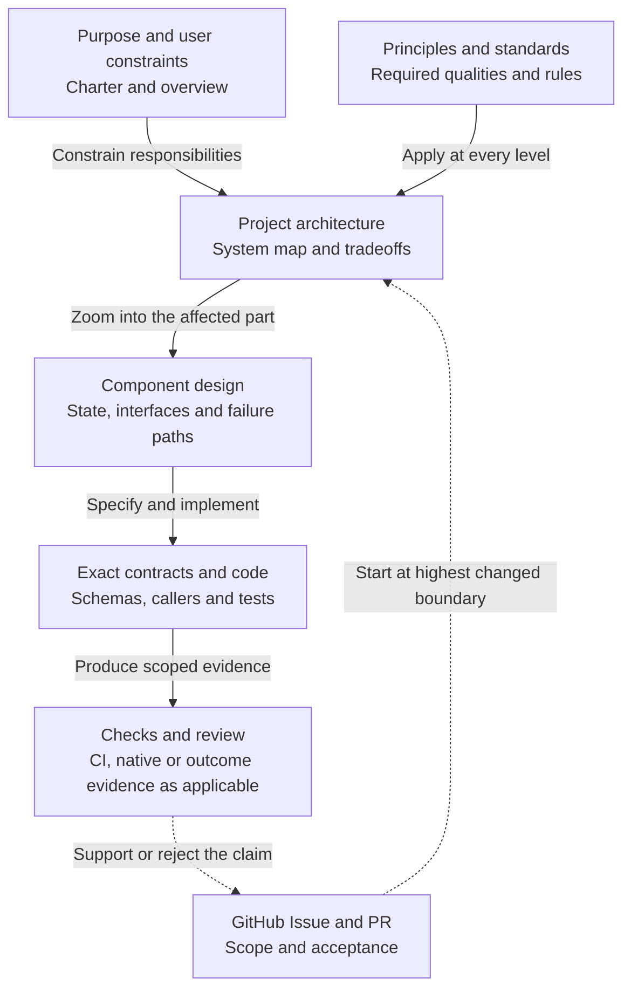

# Documentation: understand, decide, implement, verify

Start with the [overview](overview.md), then the responsibility you need to
challenge. [S-DOCS](standards/documentation.md#s-docs-useful-maintained-documentation)
owns documentation requirements. The lead maintains navigation with component
maintainers. Deciding players use the [compact guide](player-guide.md), frozen
assignment and actual tool schema; routine play does not require engineering history.

This current logical diagram answers “Where should review begin?” Arrows show
constraint or drill-down; boxes are document roles, not separate processes or
approval stages.

## Read at the level of your question

| Question | Start | Follow when needed |
| --- | --- | --- |
| Purpose and constraints | [Charter](charter.md) | [Engineering standards](engineering.md) |
| Product capability and limits | [Overview](overview.md) | [Architecture](architecture.md) |
| Ownership, state and failures | A component linked from architecture | [Contract index](protocol.md): [computer control](contracts/computer-control.md), [player host](contracts/player-host.md), [evaluation](contracts/evaluation.md); code and assertions |
| Operate a finite run | [Setup](setup.md), [runbook](runbook.md) | [Campaign procedure](operations/campaign-run.md) |
| Change scope and acceptance | GitHub Issue/PR | Affected parent/component, contract and [review policy](workflows/review.md) |
| Evidence and remaining work | [Work](work.md) / public Project | Run method in [development runs](development-runs.md); dated records in the [acceptance index](acceptance/index.md) and [change index](changes/index.md) |
| Checks and their limits | [Testing](testing.md) | Shared [CI selection](../tools/ci.py) and actual assertions |
| What can go wrong and what is done about it | [Risk register](risks.md) | [Controls](controls.md), then the [control rule](standards/authority.md#control-review) for adding or removing one |
| What the owner decided | [Owner decision log](decisions/owner-decisions.md) | The record or issue its row links |
| What may be done without asking | [Operator permissions](operator-permissions.md) | [Owner decision log](decisions/owner-decisions.md) |
| Where a kind of fact belongs | [One authoritative home](#one-authoritative-home-per-kind-of-fact) | [S-DOCS](standards/documentation.md#current-pages-records-and-decisions), [authority and review surfaces](workflows/authority.md) |
| What a term means | [Glossary](glossary.md) | The owning page each entry links |
| What to call something | [Names](standards/documentation.md#names) | [Name mapping](acceptance/2026-11-12-control-review-and-names.md#names) for labels in historical records |

Architecture starts outside a responsibility, then explains owned state,
interfaces, important flows, failures and limits. Decompose only where a concrete
reader task or boundary benefits; no universal file-size quota applies.

## Repository boundaries

| Location | Responsibility |
| --- | --- |
| `harness/computer/` | Mechanical packets, socket, writer, store, target custody and SDL adapter; no game/player semantics. |
| `harness/player/` | Pure fallible knowledge, image views, bounded programs and context; no process/provider/native authority. |
| `harness/application.py` and transport adapters | Compose current ports/tools without granting observer authority. |
| `harness/evaluation/` | Interpretive run evaluation ([contract](contracts/evaluation.md)): game-neutral `core/` and the `cdda/` binding. It is never imported by player, computer or server code. |
| `harness/viewer/` | The read-only viewer process the spectator page reads through the gateway; outside supervision. |
| `data/evaluation/` | Git-tracked human evaluation data: failure taxonomy, labels, change records, the closed archive index and reader validation. |
| `tools/` | Maintained setup/check/build/campaign entry points and the current player host adapter. |
| `native/` | Upstream provenance and preparation inputs, not a semantic control backend. |
| `web/` | The spectator page (served by the supervised gateway) and independent user Pause. |
| `tests/` | Scoped behavioral assertions/doubles and compiled fixtures; actual outcomes are separate evidence. |
| `docs/components/`, `contracts/`, `standards/`, `workflows/`, `operations/` | Explanation, exact rules, mandatory qualities, decisions and supported tasks. |
| `docs/design/` | Design notes: `proposed` while their owner decisions are open, `active` while one is the working description of something being built, and `historical` once that is built or the decisions went another way. An adopted design's current rules move into components and contracts. |
| `docs/research*.md` | External evidence and its limits, with a dated research cutoff; [research](research.md) indexes the current pages, and pages whose question is closed are `historical`. |
| `docs/decisions/owner-decisions.md` | The one list of the owner's decisions, including the permissions and limits in force. |
| `docs/acceptance/`, `changes/`, `decisions/` (ADRs) | Dated evidence/rationale under explicit status, not live commands or permission. `changes/` holds the change briefs written before ADRs and issues took that role; it receives no new briefs. |
| Ignored `.runtime/` | Frozen inputs, owned stores/saves and raw evidence; no private maintained source framework. |

### From code to its documents

Before changing an area, read its row: the page that explains it, the page that states
its exact rules, and the tests that hold them. A delegated agent with a bounded brief
needs these and the [glossary](glossary.md), not the whole start-here set.

| Code | Explanation | Exact rules | Tests |
| --- | --- | --- | --- |
| `harness/computer/`, the native bridge | [Native control](components/native-control.md) | [Computer control](contracts/computer-control.md) | `tests/test_computer_*.py`, the compiled `tests/computer_*_check.py` |
| `harness/player/`, `harness/player_tools.py`, `player_view.py`, `player_mcp.py`, `player_client.py` | [Player interface](components/player-interface.md), [memory and learning](components/memory-learning.md) | [Computer control](contracts/computer-control.md), [player guide](player-guide.md) | `tests/test_player_memory.py`, `test_player_programs.py`, `test_player_view.py`, `test_player_context.py`, `test_player_isolation.py`, `test_policy_program.py` |
| `harness/application.py`, `harness/server.py` | [Execution](components/mission-execution.md) | [Computer control](contracts/computer-control.md) | `tests/test_player_application.py`, `tests/test_server.py` |
| `tools/player_host/`, `tools/campaign_*.py`, `tools/configure_player_tools.py` | [Player host procedure](operations/player-host.md), [campaign procedure](operations/campaign-run.md), [supervision](operations/campaign-supervision.md) | [Player host](contracts/player-host.md) | `tests/test_player_host_*.py`, `tests/test_campaign_*.py`, `tools/player_host/test/` |
| `harness/curator/`, `tools/curator_host/` | [Curator](components/curator.md), [curator session design](design/curator-session.md) | [Curator hosts](operations/curator-hosts.md) | `tests/test_curator_*.py`, `tools/curator_host/test/` |
| `harness/evaluation/`, `harness/trace/`, `tools/evaluate.py`, `host_analysis.py`, `control_analysis.py`, `run_ledger.py`, `probe_baseline.py`, `memory_reads.py`, `memory_screen_checks.py`, `memory_measure.py` | [Development runs](development-runs.md); no component page | [Evaluation](contracts/evaluation.md) | `tests/test_evaluation_*.py`, `test_host_analysis.py`, `test_memory_measure*.py`, `test_run_ledger.py`, `test_probes.py`, `test_trace_*.py` |
| `harness/viewer/`, `web/` | [Observer operations](components/observer-operations.md) | [Evaluation](contracts/evaluation.md) for the view API, [computer control](contracts/computer-control.md#passive-spectator-reads-and-operator-pause) for Pause | `tests/test_viewer_*.py`, the browser suites `tests/test_*.cjs` |
| `tools/check.py`, `ci.py`, `documents.py`, `evidence.py`, `.github/` | [Testing](testing.md), [CI profiles](workflows/ci-profiles.md), [evidence retention](operations/evidence-cleanup.md) | [Controls](controls.md), [S-DOCS](standards/documentation.md) | `tests/test_ci.py`, `test_documents*.py`, `test_document_*.py`, `test_record_indexes.py`, `test_evidence.py` |
| `tools/setup.py`, `prepare_game.py`, `patch_game.py`, `build_computer.py`, `harness/prepared_app.py`, `native/` | [Setup](setup.md), [environment](environment.md) | [Native acceptance](operations/native-acceptance.md) | `tests/test_setup.py` |
| `harness/jsonio.py` | A shared helper with no page of its own | The contract of whichever caller is changed | `tests/test_jsonio.py` |

### Follow a concrete reader task

| Task | Current route and consequence |
| --- | --- |
| Send basic control | [Player guide](player-guide.md) → [tool schemas](../harness/player_tools.py) → [computer operations](contracts/computer-control.md#computer-operations-and-custody). No game-phase/identity admission. |
| Collect uncertain input | [Tool procedure](operations/mission-requests.md) → exact original `computer_result` / `player_result`. Input remains stopped; no replay. |
| Replace an actor | [Host procedure](operations/player-host.md) → [custody contract](contracts/computer-control.md#computer-operations-and-custody). Canonical context and actual quiescence precede successor capability. |
| End automation | [Host control](contracts/player-host.md#external-control) → [campaign reserves/closeout](operations/campaign-run.md). Optional finish-up is distinct from independent permanent Pause; game saving is an ordinary player choice. |
| Save/load/exit | [Player guide](player-guide.md#current-registered-cdda-lifecycle) → actual visible ordinary controls. The player judges game state; the harness certifies no save. |
| Observe play | [Start/observe](operations/start-observe.md) → [observer component](components/observer-operations.md) → [passive reads and Pause contract](contracts/computer-control.md#passive-spectator-reads-and-operator-pause). The viewer's recorded views and the current control target remain distinct. |
| Select validation | [Testing](testing.md) → [development policy](workflows/development.md) and [CI profiles](workflows/ci-profiles.md). Native/gameplay evidence stays separate. |

## One authoritative home per kind of fact

Charter owns purpose; engineering/standards own mandatory rules;
architecture/components own current responsibilities and assurance limits;
[computer-control](contracts/computer-control.md) owns exact current ports;
schemas/source own their declared executable interface; operations own tasks.
GitHub Issues and the linked Project own live priorities, status, owners, blockers
and exceptions, with [work](work.md) as their navigation page; proposals and designs own
unadopted scope; ADRs own dated rationale; acceptance reports own original observations;
research owns external evidence and its limits; setup and the runbook own procedures.
The charter owns the [scope of use](charter.md#scope-of-use-and-what-is-guaranteed);
the [risk register](risks.md) owns the risks defended against in that scope and the
ones excluded; the [controls page](controls.md) owns which risks each control serves,
how, at what cost and with what gap. Neither is a second contract or work tracker. The
[authority contract](workflows/authority.md) owns which summaries may restate what. The
[evaluation contract](contracts/evaluation.md) owns the spectator view API.

Five kinds of fact are often put in the wrong place:

| Fact | Home | Not |
| --- | --- | --- |
| What is true now and how to do it | A current page, in the present tense | A dated account of how it came to be |
| What the owner decided | One row in the [owner decision log](decisions/owner-decisions.md) | Only a sentence in a current page, a banner on a design, or a record of its own |
| What a run, measurement or study showed | A dated record under `docs/acceptance/` | A current page |
| What a change did, why, and what was checked | Its pull request and commit message | A dated record |
| Where a piece of work stands | Its issue and the Project | An ADR, a design note or a current page |

[S-DOCS](standards/documentation.md#current-pages-records-and-decisions) states the
rules that follow from this table.

### Before writing or changing a document

1. **Is it true now?** State it in the present tense on the current page that owns it.
   Do not narrate how it came to be.
2. **Did the owner decide it?** Add a row to the
   [owner decision log](decisions/owner-decisions.md), in the change that acts on the
   decision or in a change of its own when nothing else changes, and link the log from
   the page that states the resulting rule. The same change marks a design note or a
   research page the decision settles `historical` (a design note that is now the
   working description of something being built becomes `active` instead), and moves a
   research page to the historical table of the [research index](research.md).
3. **Is it evidence from a run, a measurement, a study or a review?** Write one dated
   record, `docs/acceptance/YYYY-MM-DD-what-it-is.md`, with front matter `owner`,
   `status: historical`, `kind`, `date` and `scope`, opening with "At a glance", then
   run `.venv/bin/python -m tools.documents --write` to regenerate the index. A change
   whose only evidence is its diff gets no record: say it in the pull request.
4. **Is it where work stands?** Replace the issue's description; do not add a section
   to it. Set Status and Priority in the Project.
5. **Is it a design for a decision?** Write a `proposed` note under `docs/design/`,
   opening with "At a glance". An architectural decision that will stand for a long
   time is an ADR under `docs/decisions/` instead.
6. **Does it use a project term?** Use the [glossary](glossary.md)'s word, or add the
   term there.
7. **Does it give a number?** Name the command or reader that produces it.

`.venv/bin/python tools/check.py --fast` checks links and anchors and runs
`tools.documents`, which checks front matter, record kinds, the opening section and
the generated indexes. Review applies the rest of this checklist
([review](workflows/review.md)).

## Lifecycle and maintenance

Use `active`, `proposed`, `historical` or `superseded` stewardship metadata according
to artifact authority. Superseded guidance names a repository-relative replacement.
A timestamp or parser pass does not establish truth. Keep original failures intact.

Historical records and superseded pages are evidence, not runnable instructions,
another supported backend or authority to import old data; they keep their original
tested scope. This covers acceptance reports, change briefs, superseded ADRs and old
executable artifacts. Their content is never edited; when a link target moves or is
removed, only the link is repointed, to the new home or to a commit permalink of the
old file. A replaced current page is deleted rather than kept as a superseded copy:
Git keeps it. Historical records carry no `review_trigger`. Current pages describe the
current system and are not changelogs: what changed, when and what it replaced belongs
in Git and pull requests, what was observed belongs in dated records, and what the
owner decided belongs in the owner decision log, not in an active page.

Update parent/component/contract/callers/storage/operations together when behavior
changes. Incorporate adopted design into current pages, transfer remaining work
to GitHub and retain briefs as rationale. Preserve useful bookmarks while routing
them to the current rule. No extra backlog, registry or source-history database is
needed. C-USABILITY follows a real reader task; C-REVIEW compares claims with source.
Valid paths and anchors support these judgments but cannot replace them.
