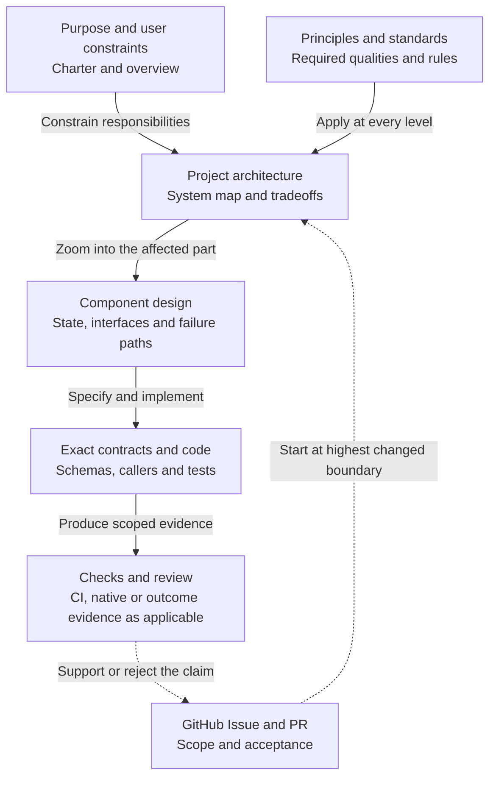

# Documentation: understand, decide, implement, verify

Start with the [overview](overview.md), then the responsibility you need to
challenge. [S-DOCS](standards/documentation.md#s-docs-useful-maintained-documentation)
owns documentation requirements. The lead maintains navigation with component
maintainers. Deciding players use the [compact guide](player-guide.md), frozen
assignment and actual tool schema; routine play does not require engineering history.

This current logical diagram answers “Where should review begin?” Arrows show
constraint or drill-down; boxes are document roles, not separate processes or
approval stages.

## Read at the level of your question

| Question | Start | Follow when needed |
| --- | --- | --- |
| Purpose and constraints | [Charter](charter.md) | [Engineering standards](engineering.md) |
| Product capability and limits | [Overview](overview.md) | [Architecture](architecture.md) |
| Ownership, state and failures | A component linked from architecture | [Contract index](protocol.md): [computer control](contracts/computer-control.md), [player host](contracts/player-host.md), [evaluation](contracts/evaluation.md); code and assertions |
| Operate a finite run | [Setup](setup.md), [runbook](runbook.md) | [Campaign procedure](operations/campaign-run.md) |
| Change scope and acceptance | GitHub Issue/PR | Affected parent/component, contract and [review policy](workflows/review.md) |
| Evidence and remaining work | [Work](work.md) / public Project | Run method in [development runs](development-runs.md); dated records in the [acceptance index](acceptance/index.md) and [change index](changes/index.md) |
| Checks and their limits | [Testing](testing.md) | Shared [CI selection](../tools/ci.py) and actual assertions |

Architecture starts outside a responsibility, then explains owned state,
interfaces, important flows, failures and limits. Decompose only where a concrete
reader task or boundary benefits; no universal file-size quota applies.

## Repository boundaries

| Location | Responsibility |
| --- | --- |
| `harness/computer/` | Mechanical packets, socket, writer, store, target custody and SDL adapter; no game/player semantics. |
| `harness/player/` | Pure fallible knowledge, image views, bounded programs and context; no process/provider/native authority. |
| `harness/application.py` and transport adapters | Compose current ports/tools without granting observer authority. |
| `harness/evaluation/` | Interpretive run evaluation ([contract](contracts/evaluation.md)): game-neutral `core/` and the `cdda/` binding. It is never imported by player, computer or server code. |
| `harness/viewer/` | The read-only viewer process the spectator page reads through the gateway; outside supervision. |
| `data/evaluation/` | Git-tracked human evaluation data: failure taxonomy, labels, change records, archive labels and reader validation. |
| `tools/` | Maintained setup/check/build/campaign entry points and the current player host adapter. |
| `native/` | Upstream provenance and preparation inputs, not a semantic control backend. |
| `web/` | The spectator page (served by the supervised gateway) and independent user Pause. |
| `tests/` | Scoped behavioral assertions/doubles and compiled fixtures; actual outcomes are separate evidence. |
| `docs/components/`, `contracts/`, `standards/`, `workflows/`, `operations/` | Explanation, exact rules, mandatory qualities, decisions and supported tasks. |
| `docs/design/` | Designs for proposed or in-progress work (status `proposed` or `active`), and finished designs kept as dated evidence (`historical`). An adopted design's current rules move into components and contracts. |
| `docs/research*.md` | External evidence and its limits, with a dated research cutoff; [research](research.md) indexes the current pages, and pages whose question is closed are `historical`. |
| `docs/acceptance/`, `changes/`, `decisions/` | Dated evidence/rationale under explicit status, not live commands or permission. `changes/` holds the change briefs written before ADRs and issues took that role; it receives no new briefs. |
| Ignored `.runtime/` | Frozen inputs, owned stores/saves and raw evidence; no private maintained source framework. |

### Follow a concrete reader task

| Task | Current route and consequence |
| --- | --- |
| Send basic control | [Player guide](player-guide.md) → [tool schemas](../harness/player_tools.py) → [computer operations](contracts/computer-control.md#computer-operations-and-custody). No game-phase/identity admission. |
| Collect uncertain input | [Tool procedure](operations/mission-requests.md) → exact original `computer_result` / `player_result`. Input remains stopped; no replay. |
| Replace an actor | [Host procedure](operations/player-host.md) → [custody contract](contracts/computer-control.md#computer-operations-and-custody). Canonical context and actual quiescence precede successor capability. |
| End automation | [Host control](contracts/player-host.md#external-control) → [campaign reserves/closeout](operations/campaign-run.md). Optional finish-up is distinct from independent permanent Pause; game saving is an ordinary player choice. |
| Save/load/exit | [Player guide](player-guide.md#current-registered-cdda-lifecycle) → actual visible ordinary controls. The player judges game state; the harness certifies no save. |
| Observe play | [Start/observe](operations/start-observe.md) → [observer component](components/observer-operations.md) → [passive reads and Pause contract](contracts/computer-control.md#passive-spectator-reads-and-operator-pause). The viewer's recorded views and the current control target remain distinct. |
| Select validation | [Testing](testing.md) → [development policy](workflows/development.md) and [CI profiles](workflows/ci-profiles.md). Native/gameplay evidence stays separate. |

## One authoritative home per kind of fact

Charter owns purpose; engineering/standards own mandatory rules;
architecture/components own current responsibilities and assurance limits;
[computer-control](contracts/computer-control.md) owns exact current ports;
schemas/source own their declared executable interface; operations own tasks.
GitHub Issues and the linked Project own live priorities, status, owners, blockers
and exceptions, with [work](work.md) as their navigation page; proposals and designs own
unadopted scope; ADRs own dated rationale; acceptance reports own original observations;
research owns external evidence and its limits; setup and the runbook own procedures.
The [controls page](controls.md)
owns what each control stops and where it is enforced, not a second contract or work
tracker. The
[authority contract](workflows/authority.md) owns which summaries may restate what.

The [evaluation contract](contracts/evaluation.md) owns the spectator view API.

## Lifecycle and maintenance

Use `active`, `proposed`, `historical` or `superseded` stewardship metadata according
to artifact authority. Superseded guidance names a repository-relative replacement.
A timestamp or parser pass does not establish truth. Keep original failures intact.

Historical records and superseded pages are evidence, not runnable instructions,
another supported backend or authority to import old data; they keep their original
tested scope. This covers acceptance reports, change briefs, superseded ADRs and old
executable artifacts. Their content is never edited; when a link target moves or is
removed, only the link is repointed, to the new home or to a commit permalink of the
old file. A replaced current page is deleted rather than kept as a superseded copy:
Git keeps it. Historical records carry no `review_trigger`. Current pages describe the
current system and are not changelogs: what changed, when and what it replaced belongs
in Git, PRs and dated records, not in an active page.

Update parent/component/contract/callers/storage/operations together when behavior
changes. Incorporate adopted design into current pages, transfer remaining work
to GitHub and retain briefs as rationale. Preserve useful bookmarks while routing
them to the current rule. No extra backlog, registry or source-history database is
needed. C-USABILITY follows a real reader task; C-REVIEW compares claims with source;
C-MAINTENANCE checks drift at existing triggers. Valid paths/anchors/render receipts
support these judgments but cannot replace them.
